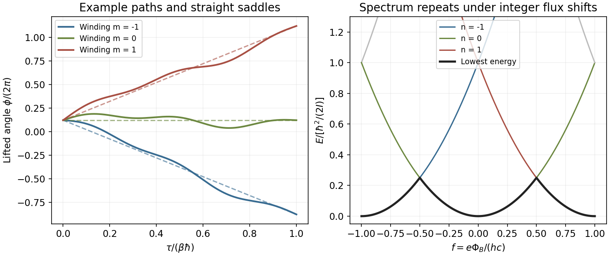

<h1 id="3/c/solution">Solution</h1>

↑ **Parent:** [C](../c.md)

The Euclidean saddle in winding sector $m$ is a constant-speed lifted path, $\phi_{\rm cl}(\tau)=\phi_0+2\pi m\tau/\mathcal T$. Write $\phi=\phi_{\rm cl}+\eta$ with Dirichlet fluctuation endpoints $\eta(0)=\eta(\mathcal T)=0$. The cross term in the kinetic action is proportional to $\int\partial_\tau\eta\,d\tau=0$, and the flux term of $\eta$ vanishes for the same reason. Therefore

$$
\frac{S_E}{\hbar}=\frac{2\pi^2I}{\hbar^2\beta}m^2-i2\pi fm+\frac I{2\hbar}\int_0^{\mathcal T}(\partial_\tau\eta)^2d\tau.
$$

Define the fluctuation prefactor by

$$
Z_0=\int_{\eta(0)=\eta(\mathcal T)=0}\mathcal D\eta\,\exp\left[-\frac I{2\hbar}\int_0^{\mathcal T}(\partial_\tau\eta)^2d\tau\right].
$$

It is the free-line diagonal Euclidean propagator for the angular coordinate with inertia $I$, or equivalently the Gaussian bridge amplitude about a given classical lifted path. It is independent of $m,\phi_0$ and flux. It is **not** the complete zero-flux ring [partition function](../../../../../canonical-partition-function.md), which still includes every winding and the initial-angle integral. Translational independence supplies the factor $\int_0^{2\pi}d\phi_0=2\pi$, leaving

$$
\boxed{Z=2\pi Z_0\sum_{m\in\mathbb Z}\exp\left[-\frac{2\pi^2I}{\hbar^2\beta}m^2+i2\pi fm\right].}
$$

The [momentum-winding duality of a quantum rotor](../../../../../momentum-winding-duality-of-a-quantum-rotor.md) uses a Gaussian expansion that is exact here because the kinetic action is quadratic and the flux coupling is a total derivative. It is not merely a leading semiclassical approximation.

**[Figure 2](#3/c/image-lifted-winding-sectors-on-a-flux-threaded-ring-and-the-periodic-flux-dependence-of-quantum-energy-levels). Lifted winding sectors on a flux-threaded ring and the periodic flux dependence of quantum energy levels**.

## ↑ Ancestors (14)

1. [C](../c.md)
2. [3](../../3.md)
3. [Paper 1](../../../paper-1-split.md)
4. [2016](../../../split.md)
5. [Past exam of the quantum Condensed Matter Field Theory course of the University of Cambridge](../../../../split.md)
6. [Quantum Condensed Matter Field Theory course of the University of Cambridge](../../../../../quantum-condensed-matter-field-theory-course-of-the-university-of-cambridge.md)
7. [Physics course of the year 4 of the natural sciences course of the University of Cambridge](../../../../../physics-course-of-the-year-4-of-the-natural-sciences-course-of-the-university-of-cambridge.md)
8. [Year 4 of the natural sciences course of the University of Cambridge](../../../../../year-4-of-the-natural-sciences-course-of-the-university-of-cambridge.md)
9. [Year of the natural sciences course of the University of Cambridge](../../../../../year-of-the-natural-sciences-course-of-the-university-of-cambridge.md)
10. [Natural sciences course of the University of Cambridge](../../../../../natural-sciences-course-of-the-university-of-cambridge.md)
11. [Course of the University of Cambridge](../../../../../course-of-the-university-of-cambridge.md)
12. [University of Cambridge](../../../../../university-of-cambridge-split.md)
13. [List of universities](../../../../../list-of-universities.md)
14. [Codex Wiki](../../../../../split.md)
