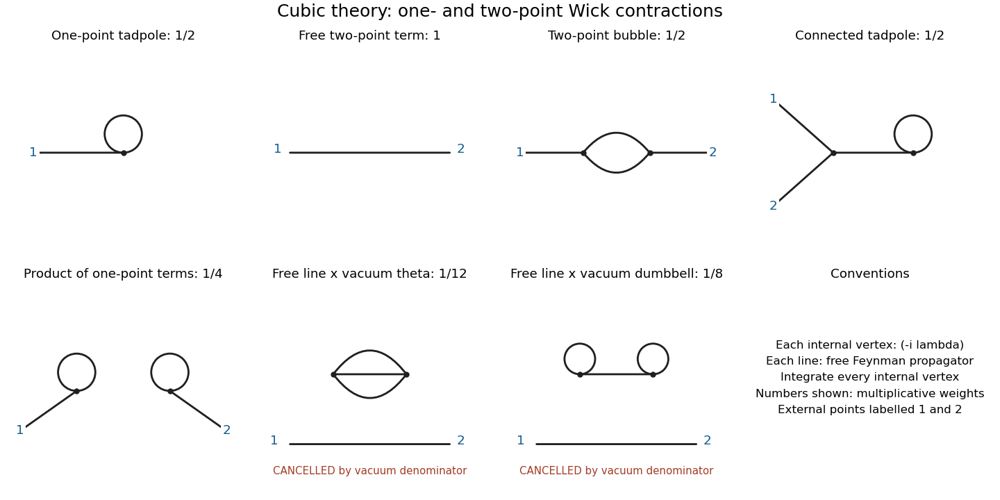
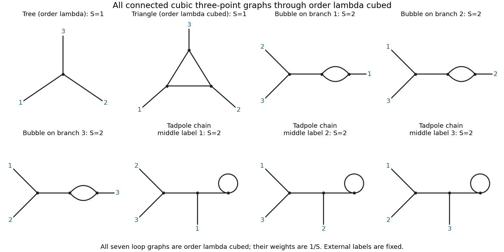
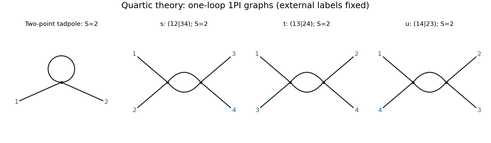

# 2016

↑ **Parent:** [Past exam of the quantum field theory course of the University of Oxford](../past-exam-of-the-quantum-field-theory-course-of-the-university-of-oxford.md)

Source paper: [https://www.whatdotheyknow.com/request/oxford_physics_past_papers_2/response/2340696/attach/4/Physics%20Papers%202015.pdf?cookie_passthrough=1](https://www.whatdotheyknow.com/request/oxford_physics_past_papers_2/response/2340696/attach/4/Physics%20Papers%202015.pdf?cookie_passthrough=1)

Solutions use [natural units](../mathematical-physics.md#natural-units) $\hbar=c=1$ and [Minkowski metric](../special-relativity.md#minkowski-metric) $\eta=\operatorname{diag}(1,-1,-1,-1)$. The [d'Alembert operator](../wave-equation.md#d-alembert-operator) is $\Box=\partial_\mu\partial^\mu$. All four questions are covered, including the optional fourth question.

**Table of contents**

- [1](#1)
  - [a](#1/a)
    - [Solution](#1/a/solution)
  - [b](#1/b)
    - [Solution](#1/b/solution)
  - [c](#1/c)
    - [Solution](#1/c/solution)
  - [d](#1/d)
    - [Solution](#1/d/solution)
- [2](#2)
  - [a](#2/a)
    - [Solution](#2/a/solution)
  - [b](#2/b)
    - [Solution](#2/b/solution)
  - [c](#2/c)
    - [Solution](#2/c/solution)
  - [d](#2/d)
    - [Solution](#2/d/solution)
  - [e](#2/e)
    - [Solution](#2/e/solution)
- [3](#3)
  - [a](#3/a)
    - [Solution](#3/a/solution)
  - [b](#3/b)
    - [Solution](#3/b/solution)
  - [c](#3/c)
    - [Solution](#3/c/solution)
  - [d](#3/d)
    - [Solution](#3/d/solution)
- [4](#4)
  - [a](#4/a)
    - [Solution](#4/a/solution)
  - [b](#4/b)
    - [Solution](#4/b/solution)
  - [c](#4/c)
    - [Solution](#4/c/solution)
  - [d](#4/d)
    - [Solution](#4/d/solution)

## 1

↑ **Parent:** [2016](2016.md)

<h3 id="1/a">a</h3>

↑ **Parent:** [1](#1)

<h4 id="1/a/solution">Solution</h4>

↑ **Parent:** [A](#1/a)

For the [real scalar field](../scalar-field-theory.md#real-scalar-field), the two derivatives entering the [Euler-Lagrange field equation](../classical-field-theory.md#euler-lagrange-field-equation) are

$$
\frac{\partial\mathcal L}{\partial(\partial_\mu\phi)}=\partial^\mu\phi,
\qquad
\frac{\partial\mathcal L}{\partial\phi}=-m^2\phi-\frac{\lambda}{6}\phi^3.
$$

Consequently the [equation of motion](../classical-mechanics.md#equation-of-motion) is

$$
\boxed{(\Box+m^2)\phi+\frac{\lambda}{6}\phi^3=0.}
$$

The [quartic interaction](../scalar-field-theory.md#quartic-interaction) therefore adds a local cubic term to the free [Klein-Gordon equation](../wave-equation.md#klein-gordon-equation). Below, write $F=(\Box+m^2)\phi+\lambda\phi^3/6$; thus $F=0$ means that the [field](../algebra.md#field) is [on shell](../classical-field-theory.md#on-shell).

<h3 id="1/b">b</h3>

↑ **Parent:** [1](#1)

<h4 id="1/b/solution">Solution</h4>

↑ **Parent:** [B](#1/b)

Take a constant infinitesimal [translation](../geometry-and-topology.md#translation-geometry) with fixed-coordinate [field variation](../classical-field-theory.md#field-variation) $\delta\phi=\epsilon^\nu\partial_\nu\phi$. The associated change in the [Lagrangian density](../classical-field-theory.md#lagrangian-density) is $\delta\mathcal L=\epsilon^\nu\partial_\nu\mathcal L=\partial_\mu(\epsilon^\nu\delta^\mu{}_{\nu}\mathcal L)$. Substituting this total derivative into the [Noether current](../classical-field-theory.md#noether-current) gives $J^\mu=\epsilon^\nu T^\mu{}_{\nu}$, where

$$
\boxed{T^\mu{}_{\nu}=\partial^\mu\phi\,\partial_\nu\phi-\delta^\mu{}_{\nu}\left[\frac12\partial_\rho\phi\,\partial^\rho\phi-\frac12m^2\phi^2-\frac{\lambda}{24}\phi^4\right].}
$$

This is the [canonical stress-energy tensor](../classical-field-theory.md#canonical-stress-energy-tensor). The chosen sign of the [translation](../geometry-and-topology.md#translation-geometry) parameter produces precisely this sign of the [Noether current](../classical-field-theory.md#noether-current); reversing the parameter reverses the current without changing its conservation law.

To check [current conservation](../classical-field-theory.md#conserved-current) directly, differentiate the [tensor](../multilinear-algebra.md#tensor). The terms containing $\partial_\nu\partial_\rho\phi$ cancel against the derivative of the [kinetic term](../classical-field-theory.md#kinetic-term), leaving

$$
\partial_\mu T^\mu{}_{\nu}=
\left(\Box\phi+m^2\phi+\frac{\lambda}{6}\phi^3\right)\partial_\nu\phi
=F\partial_\nu\phi.
$$

Thus $\partial_\mu T^\mu{}_{\nu}=0$ [on shell](../classical-field-theory.md#on-shell). Raising the second [Lorentz index](../special-relativity.md#lorentz-index) gives $T^{\mu\nu}=T^{\nu\mu}$: this [scalar field](../classical-field-theory.md#scalar-field) already has a symmetric [canonical stress-energy tensor](../classical-field-theory.md#canonical-stress-energy-tensor).

<h3 id="1/c">c</h3>

↑ **Parent:** [1](#1)

<h4 id="1/c/solution">Solution</h4>

↑ **Parent:** [C](#1/c)

First take the [trace](../linear-algebra.md#matrix-trace) in four [spacetime](../special-relativity.md#spacetime) dimensions:

$$
T^\mu{}_{\mu}=-(\partial\phi)^2+2m^2\phi^2+\frac{\lambda}{6}\phi^4,
\qquad
\Omega^\mu{}_{\mu}=T^\mu{}_{\mu}-3C\Box\phi^2.
$$

The [product rule](../calculus.md#product-rule) gives $\Box\phi^2=2(\partial\phi)^2+2\phi\Box\phi$. For the massless [equation of motion](../classical-mechanics.md#equation-of-motion), $\phi\Box\phi=-\lambda\phi^4/6$, so

$$
\left.\Omega^\mu{}_{\mu}\right|_{F=0,m=0}
=-(1+6C)(\partial\phi)^2+\lambda\left(\frac16+C\right)\phi^4.
$$

Both coefficients vanish for

$$
\boxed{C=-\frac16.}
$$

The minus sign follows from the order $\partial^\mu\partial^\nu-\eta^{\mu\nu}\Box$ used in the question's [stress-energy tensor improvement](../stress-energy-tensor.md#stress-energy-tensor-improvement). Commuting [partial derivatives](../multivariable-calculus.md#partial-derivative) shows that this improvement has identically zero [divergence](../multivariable-calculus.md#divergence), so it preserves the conservation law.

The precise [trace](../linear-algebra.md#matrix-trace) identity, without using the [equation of motion](../classical-mechanics.md#equation-of-motion), is

$$
\boxed{\Omega^\mu{}_{\mu}=m^2\phi^2+\phi F.}
$$

Hence the massless [tensor](../multilinear-algebra.md#tensor) is traceless **on shell**. It is not traceless for arbitrary [off shell](../classical-field-theory.md#off-shell) configurations: a nonzero constant $\phi=A$ with $\lambda\ne0$ has $\Omega^\mu{}_{\mu}=\lambda A^4/6$. This is a classical result; it does not assert absence of a quantum [trace anomaly](../relativistic-quantum-field.md#trace-anomaly).

<h3 id="1/d">d</h3>

↑ **Parent:** [1](#1)

<h4 id="1/d/solution">Solution</h4>

↑ **Parent:** [D](#1/d)

Under the finite [dilation](../vector-space.md#uniform-dilation), the [volume element](../integral.md#volume-element) transforms as $d^4x'=e^{4\alpha}d^4x$, whereas $\partial'_\mu\phi'(x')=e^{-2\alpha}\partial_\mu\phi(x)$. Thus the [kinetic term](../classical-field-theory.md#kinetic-term) and [quartic interaction](../scalar-field-theory.md#quartic-interaction) both acquire the factor $e^{-4\alpha}$. Their factors cancel the [Jacobian determinant](../multivariable-calculus.md#jacobian-determinant), proving

$$
\boxed{S[\phi']=S[\phi]\quad(m=0).}
$$

A [mass term](../classical-field-theory.md#mass-term) would instead acquire a net factor $e^{2\alpha}$ in the [action](../lagrangian-mechanics.md#action) and break this [scale invariance](../mathematics.md#scale-invariance).

For the [Noether current](../classical-field-theory.md#noether-current), use the variation at the same coordinate, rather than comparing values at different coordinates:

$$
\delta_0\phi(x)=\phi'(x)-\phi(x)
=-\alpha\bigl(\phi+x^\nu\partial_\nu\phi\bigr).
$$

At $m=0$, the corresponding [Lagrangian density](../classical-field-theory.md#lagrangian-density) variation is $\delta_0\mathcal L=-\alpha(4+x\cdot\partial)\mathcal L=-\alpha\partial_\mu(x^\mu\mathcal L)$. Thus $J_0^\mu=-x^\mu\mathcal L$, and the stated [Noether current](../classical-field-theory.md#noether-current) convention gives

$$
\boxed{j^\mu=-x_\nu T^{\mu\nu}-\phi\partial^\mu\phi.}
$$

The frequently used [dilatation current](../classical-field-theory.md#dilatation-current) $D^\mu=x_\nu T^{\mu\nu}+\phi\partial^\mu\phi$ is $-j^\mu$; this is solely an overall parameter convention. In the convention $D^\mu=x_\nu T^{\mu\nu}-V^\mu$, the [virial current](../classical-field-theory.md#virial-current) is $V^\mu=-\phi\partial^\mu\phi$.

Using [solution](#1/b/solution) and the [trace](../linear-algebra.md#matrix-trace) computed in [solution](#1/c/solution) gives the useful identity

$$
\partial_\mu D^\mu
=T^\mu{}_{\mu}+x^\nu F\partial_\nu\phi+(\partial\phi)^2+\phi\Box\phi
=m^2\phi^2+\bigl(\phi+x^\nu\partial_\nu\phi\bigr)F.
$$

It follows that $\boxed{\partial_\mu j^\mu=0}$ in the massless theory [on shell](../classical-field-theory.md#on-shell). Equivalently, $x_\nu\Omega^{\mu\nu}$ is a [conserved current](../classical-field-theory.md#conserved-current), since its [divergence](../multivariable-calculus.md#divergence) is the [trace](../linear-algebra.md#matrix-trace) of the improved [stress-energy tensor](../stress-energy-tensor.md) [on shell](../classical-field-theory.md#on-shell). These are classical [scale invariance](../mathematics.md#scale-invariance) statements; the nonzero [beta function](../complex-analysis.md#beta-function) in [solution](#4/d/solution) explains why the interacting quantum theory need not retain them.

## 2

↑ **Parent:** [2016](2016.md)

<h3 id="2/a">a</h3>

↑ **Parent:** [2](#2)

<h4 id="2/a/solution">Solution</h4>

↑ **Parent:** [A](#2/a)

Write $\int_{\mathbf p}=\int d^3p/(2\pi)^3$ and $E_{\mathbf p}=\sqrt{\mathbf p^2+m^2}$. Insert the [mode expansion of a free field](../quantum-field-theory.md#mode-expansion-of-a-free-field) for each quantity into the [commutator](../lie-algebra.md#commutator). Only the mixed [creation operator](../quantum-harmonic-oscillator.md#creation-operator) and [annihilation operator](../quantum-harmonic-oscillator.md#annihilation-operator) terms survive. The [Dirac delta function](../distribution-theory.md#dirac-delta-function) in their [canonical commutation relation](../quantum-mechanics.md#canonical-commutation-relation) sets the two [momenta](../momentum.md) equal, so the square-root factors multiply to $1/2$:

$$
[\phi(\mathbf x),\pi(\mathbf y)]
=\frac i2\int_{\mathbf p}\left[e^{i\mathbf p\cdot(\mathbf x-\mathbf y)}+e^{-i\mathbf p\cdot(\mathbf x-\mathbf y)}\right]
=\boxed{i\delta^3(\mathbf x-\mathbf y)}.
$$

In the second equality, each [Fourier transform](../fourier-transform.md) is the same [Dirac delta function](../distribution-theory.md#dirac-delta-function), since the integration domain is invariant under $\mathbf p\mapsto-\mathbf p$. This is the equal-time [canonical commutation relation](../quantum-mechanics.md#canonical-commutation-relation). The analogous calculation gives $[\phi(\mathbf x),\phi(\mathbf y)]=[\pi(\mathbf x),\pi(\mathbf y)]=0$, because their two mixed terms have opposite signs.

<h3 id="2/b">b</h3>

↑ **Parent:** [2](#2)

<h4 id="2/b/solution">Solution</h4>

↑ **Parent:** [B](#2/b)

The unit-normalized [Fock vacuum](../quantum-field-theory.md#fock-vacuum) is characterized by

$$
a_{\mathbf p}|0\rangle=0\quad\hbox{for every }\mathbf p,
\qquad \langle0|0\rangle=1.
$$

Choose the [relativistic normalization of a one-particle state](../quantum-field-theory.md#relativistic-normalization-of-a-one-particle-state) from the outset:

$$
|\mathbf p\rangle=\sqrt{2E_{\mathbf p}}\,a^\dagger_{\mathbf p}|0\rangle,
\qquad
|\mathbf p_1,\ldots,\mathbf p_n\rangle
=\prod_{r=1}^n\bigl(\sqrt{2E_{\mathbf p_r}}\,a^\dagger_{\mathbf p_r}\bigr)|0\rangle.
$$

Since any two [creation operators](../quantum-harmonic-oscillator.md#creation-operator) commute, any [permutation](../combinatorics.md#permutation) of their order gives exactly the same [state vector](../dynamical-systems.md#state-vector). Thus these [multiparticle quantum states](../tensor-product-of-quantum-systems.md#multiparticle-quantum-state) are symmetric under exchange and describe [bosons](../tensor-product-of-quantum-systems.md#boson), without a minus sign or any additional exchange phase.

The [Hilbert space](../hilbert-space.md) is the [bosonic Fock space](../quantum-field-theory.md#bosonic-fock-space), the direct sum of the symmetric $n$-particle [Hilbert spaces](../hilbert-space.md), including the zero-particle sector. Sharp-[momentum](../momentum.md) kets are distributionally normalized; square-integrable [wave packets](../dispersion-relation.md#wave-packet) provide ordinary [Hilbert space](../hilbert-space.md) vectors. For repeated occupation of a discrete mode, a unit-normalized [number state](../quantum-harmonic-oscillator.md#number-state) uses $(a^\dagger)^n|0\rangle/\sqrt{n!}$. That factorial does not belong in the above labelled continuum-ket convention.

<h3 id="2/c">c</h3>

↑ **Parent:** [2](#2)

<h4 id="2/c/solution">Solution</h4>

↑ **Parent:** [C](#2/c)

The [normal ordering](../perturbative-quantum-field-theory.md#normal-ordering) of both [linear maps](../vector-space.md#linear-map) puts every [annihilation operator](../quantum-harmonic-oscillator.md#annihilation-operator) to the right, so

$$
H|0\rangle=0,\qquad\mathbf P|0\rangle=\mathbf0.
$$

In particular the stated [Hamiltonian](../hamiltonian-mechanics.md#hamiltonian) has already subtracted the free [vacuum energy](../perturbative-quantum-field-theory.md#vacuum-energy). For a [one-particle state](../quantum-field-theory.md#one-particle-state), evaluate the [commutators](../lie-algebra.md#commutator) using $[AB,C]=A[B,C]+[A,C]B$:

$$
[H,a^\dagger_{\mathbf k}]
=\int_{\mathbf p} E_{\mathbf p}a^\dagger_{\mathbf p}(2\pi)^3\delta^3(\mathbf p-\mathbf k)
=E_{\mathbf k}a^\dagger_{\mathbf k},
\qquad
[\mathbf P,a^\dagger_{\mathbf k}]=\mathbf k\,a^\dagger_{\mathbf k}.
$$

Acting on the [Fock vacuum](../quantum-field-theory.md#fock-vacuum) therefore gives

$$
\boxed{H|\mathbf k\rangle=E_{\mathbf k}|\mathbf k\rangle,
\qquad\mathbf P|\mathbf k\rangle=\mathbf k|\mathbf k\rangle.}
$$

The extra factor $\sqrt{2E_{\mathbf k}}$ in the chosen [relativistic normalization of a one-particle state](../quantum-field-theory.md#relativistic-normalization-of-a-one-particle-state) is a scalar multiplier and does not change either [eigenvalue](../linear-operator-theory.md#eigenvalue). Applying the same argument to a [multiparticle quantum state](../tensor-product-of-quantum-systems.md#multiparticle-quantum-state) gives additive total [energy](../energy.md) and [momentum](../momentum.md).

<h3 id="2/d">d</h3>

↑ **Parent:** [2](#2)

<h4 id="2/d/solution">Solution</h4>

↑ **Parent:** [D](#2/d)

The [Fock vacuum](../quantum-field-theory.md#fock-vacuum) condition and the [creation operator](../quantum-harmonic-oscillator.md#creation-operator) [commutator](../lie-algebra.md#commutator) give

$$
\langle\mathbf p|\mathbf q\rangle
=\sqrt{2E_{\mathbf p}\,2E_{\mathbf q}}\,
\langle0|a_{\mathbf p}a^\dagger_{\mathbf q}|0\rangle
=\boxed{2E_{\mathbf p}(2\pi)^3\delta^3(\mathbf p-\mathbf q)}.
$$

Equality of the square-root product and $2E_{\mathbf p}$ holds on the support of the [Dirac delta function](../distribution-theory.md#dirac-delta-function).

The positive-energy [mass shell](../special-relativity.md#mass-shell) has the [Lorentz invariant](../special-relativity.md#lorentz-invariance) measure

$$
d^4p\,\theta(p^0)\delta(p^2-m^2)=\frac{d^3p}{2E_{\mathbf p}}.
$$

Here both $p^2$ and the four-dimensional [volume element](../integral.md#volume-element) are invariant, and positive [energy](../energy.md) is preserved by a proper orthochronous [Lorentz transformation](../special-relativity.md#lorentz-transformation). Consequently the three-dimensional [Jacobian determinant](../multivariable-calculus.md#jacobian-determinant) is $J=E_{\boldsymbol\Lambda p}/E_{\mathbf p}$. Transforming the [Dirac delta function](../distribution-theory.md#dirac-delta-function) yields

$$
\delta^3(\boldsymbol\Lambda p-\boldsymbol\Lambda q)
=\frac{E_{\mathbf p}}{E_{\boldsymbol\Lambda p}}\delta^3(\mathbf p-\mathbf q),
$$

so its factor exactly cancels that of $2E_{\boldsymbol\Lambda p}$. Thus the displayed [inner product](../inner-product.md) is invariant under simultaneous transformation of both [momenta](../momentum.md). This is also why the one-particle completeness measure is $d^3p/((2\pi)^3 2E_{\mathbf p})$.[Section 2.4.1, relativistic normalization and the positive-energy mass-shell measure](../physics-bibliography.md#quantum-field-theory-by-david-tong)

<h3 id="2/e">e</h3>

↑ **Parent:** [2](#2)

<h4 id="2/e/solution">Solution</h4>

↑ **Parent:** [E](#2/e)

The [Heisenberg picture](../quantum-system.md#heisenberg-picture) evolution of the [annihilation operator](../quantum-harmonic-oscillator.md#annihilation-operator) follows from $[H,a_{\mathbf p}]=-E_{\mathbf p}a_{\mathbf p}$. With $p^0=E_{\mathbf p}$, this gives the [mode expansion of a free field](../quantum-field-theory.md#mode-expansion-of-a-free-field)

$$
\phi(x)=\int_{\mathbf p}\frac1{\sqrt{2E_{\mathbf p}}}
\left(a_{\mathbf p}e^{-ip\cdot x}+a^\dagger_{\mathbf p}e^{ip\cdot x}\right).
$$

Define $\Delta^+(z)=\int_{\mathbf p}e^{-ip\cdot z}/(2E_{\mathbf p})$. The [time-ordered product](../perturbative-quantum-field-theory.md#time-ordered-product) then gives the [Feynman propagator](../quantum-field-theory.md#feynman-propagator)

$$
\Delta_F(z)=\theta(z^0)\Delta^+(z)+\theta(-z^0)\Delta^+(-z)
=\int\frac{d^4p}{(2\pi)^4}\frac{i\,e^{-ip\cdot z}}{p^2-m^2+i0}.
$$

The last expression follows by closing the $p^0$ [contour integral](../complex-analysis.md#contour-integral) below for $z^0>0$ and above for $z^0<0$; the [scalar Feynman propagator pole prescription](../quantum-field-theory.md#scalar-feynman-propagator-pole-prescription) supplies the required positive- and negative-frequency terms.

For $z^0\ne0$ every term obeys the homogeneous [Klein-Gordon equation](../wave-equation.md#klein-gordon-equation). At $z^0=0$, the equal-time [commutator](../lie-algebra.md#commutator) of the [fields](../algebra.md#field) vanishes, so the [propagator](../quantum-field-theory.md#propagator) is continuous and there is no derivative of a [Dirac delta function](../distribution-theory.md#dirac-delta-function). Its first time derivative has the jump

$$
\left[\partial_{z^0}\Delta_F\right]_{0^-}^{0^+}
=\int_{\mathbf p}(-i)e^{i\mathbf p\cdot\mathbf z}
=-i\delta^3(\mathbf z).
$$

The second time derivative therefore supplies precisely the source:

$$
\boxed{(\Box_x+m^2)\Delta_F(x-y)=-i\delta^4(x-y).}
$$

Thus the defined [Feynman propagator](../quantum-field-theory.md#feynman-propagator) is a [Green's function](../green-s-function.md) with source normalization $-i$; $i\Delta_F$ has source normalization $+1$. Keeping this factor avoids confusing the [vacuum expectation value](../quantum-field-theory.md#vacuum-expectation-value) convention with conventions which define the [propagator](../quantum-field-theory.md#propagator) after dividing by $i$.[Sections 2.7.1–2.7.2, time ordering, pole prescription and the inhomogeneous Klein-Gordon equation](../physics-bibliography.md#quantum-field-theory-by-david-tong)

## 3

↑ **Parent:** [2016](2016.md)

<h3 id="3/a">a</h3>

↑ **Parent:** [3](#3)

<h4 id="3/a/solution">Solution</h4>

↑ **Parent:** [A](#3/a)

Let brackets denote [mass dimension](../perturbative-quantum-field-theory.md#mass-dimension). In [natural units](../mathematical-physics.md#natural-units), $[x]=-1$ and $[\partial_\mu]=1$, so a dimensionless [action](../lagrangian-mechanics.md#action) requires $[\mathcal L]=D$. The [kinetic term](../classical-field-theory.md#kinetic-term) fixes

$$
2+2[\phi]=D,
\qquad
\boxed{[\phi]=\frac{D-2}{2}.}
$$

The [cubic scalar field theory](../scalar-field-theory.md#phi-cubed-theory) interaction then requires $[\lambda]+3[\phi]=D$, giving

$$
\boxed{[\lambda]=\frac{6-D}{2},\qquad D_c=6,\qquad[\phi]_{D_c}=2.}
$$

The [coupling constant](../statistical-model.md#coupling-constant-physics) is dimensionless at this [critical dimension of a monomial scalar interaction](../perturbative-quantum-field-theory.md#critical-dimension-of-a-monomial-scalar-interaction). For $D<6$ it has positive [mass dimension](../perturbative-quantum-field-theory.md#mass-dimension), while for $D>6$ it has negative [mass dimension](../perturbative-quantum-field-theory.md#mass-dimension), the usual [power counting](../perturbative-quantum-field-theory.md#power-counting-in-quantum-field-theory) distinction between super-renormalizable and non-renormalizable cubic interactions.

<h3 id="3/b">b</h3>

↑ **Parent:** [3](#3)

<h4 id="3/b/solution">Solution</h4>

↑ **Parent:** [B](#3/b)

Write $S=S_0+S_I$, where $S_0$ contains the quadratic [kinetic term](../classical-field-theory.md#kinetic-term) and [mass term](../classical-field-theory.md#mass-term), and $S_I=-\lambda\int d^Dx\,\phi(x)^3/3!$. Then

$$
e^{iS}=e^{iS_0}\sum_{r=0}^\infty\frac{(-i\lambda)^r}{r!(3!)^r}
\int\prod_{a=1}^r d^Dx_a\,\prod_{a=1}^r\phi(x_a)^3.
$$

Let $Z_0=\int D\phi\,e^{iS_0}$ and let $\langle\cdot\rangle_0$ denote the unit-normalized free [Gaussian](../probability-distribution.md#normal-distribution) [vacuum expectation value](../quantum-field-theory.md#vacuum-expectation-value). The unnormalized numerator $\mathcal N_N$ is consequently

$$
\frac{\mathcal N_N}{Z_0}
=\sum_{r=0}^\infty\frac{(-i\lambda)^r}{r!(3!)^r}
\int\prod_{a=1}^r d^Dx_a\,
\left\langle T\phi(y_1)\cdots\phi(y_N)\prod_{a=1}^r\phi(x_a)^3\right\rangle_0.
$$

The Minkowski [path integral](../quantum-field-theory.md#path-integral) is understood with the usual [scalar Feynman propagator pole prescription](../quantum-field-theory.md#scalar-feynman-propagator-pole-prescription), as a formal [perturbation series](../perturbative-quantum-field-theory.md#perturbation-series). A real cubic [potential energy](../energy.md#potential-energy) is unbounded below; no nonperturbative stable [vacuum](../physics.md#vacuum) is being assumed here.

Set $\Delta(x-z)=\langle T\phi(x)\phi(z)\rangle_0$, $K_i(x)=\Delta(y_i-x)$, and $t=\Delta(0)$, with a common [regularization](../statistical-learning.md#regularization) understood for coincident points. The zero-order one-point term has one [field](../algebra.md#field) and vanishes. At first order, [Wick's theorem](../perturbative-quantum-field-theory.md#wick-s-theorem) gives three choices for the [contraction](../analysis.md#contraction-mapping) with the external [field](../algebra.md#field), leaving a [tadpole diagram](../perturbative-quantum-field-theory.md#tadpole-diagram):

$$
\langle T\phi(y_1)\phi(x)^3\rangle_0=3K_1(x)t.
$$

The second-order term contains seven [fields](../algebra.md#field), so it vanishes by the [vanishing odd correlators of a free Gaussian field](../perturbative-quantum-field-theory.md#vanishing-odd-correlators-of-a-free-gaussian-field). Hence

$$
\boxed{\mathcal N_1=Z_0\left[\frac{-i\lambda}{2}\int d^Dx\,K_1(x)t+O(\lambda^3)\right].}
$$

The coefficient is $3/3!=1/2$, or [symmetry factor](../perturbative-quantum-field-theory.md#feynman-diagram-symmetry-factor) $S=2$ when each diagram is weighted by $1/S$. No [spacetime](../special-relativity.md#spacetime) integral has been evaluated. The one-point [tadpole diagram](../perturbative-quantum-field-theory.md#tadpole-diagram) is shown in the first panel of the following figure; its other panels organize [solution](#3/c/solution).

**[Figure 1](#3/b/image-cubic-one-and-two-point-wick-contractions-vacuum-factors-cancel-but-the-product-of-two-one-point-tadpoles-remains-in-the-full-two-point-correlator). Cubic one- and two-point Wick contractions; vacuum factors cancel, but the product of two one-point tadpoles remains in the full two-point correlator**.

<h3 id="3/c">c</h3>

↑ **Parent:** [3](#3)

<h4 id="3/c/solution">Solution</h4>

↑ **Parent:** [C](#3/c)

Use the notation $\Delta_{12}=\Delta(y_1-y_2)$, $\Delta_{xz}=\Delta(x-z)$ and $\int_{xz}=\int d^Dx\,d^Dz$. The order-$\lambda$ term vanishes because it has five [fields](../algebra.md#field). At order $\lambda^2$, enumerate the eight-field [Wick contractions](../perturbative-quantum-field-theory.md#wick-contraction), whose expansion denominator is $2!(3!)^2=72$.

If the two external [fields](../algebra.md#field) contract with each other, the remaining [vacuum diagrams](../perturbative-quantum-field-theory.md#vacuum-feynman-diagram) are a pair of cubic [vertices](../graph.md#vertex-graph-theory) joined by three lines, with six [Wick contractions](../perturbative-quantum-field-theory.md#wick-contraction), and a pair joined by one line with a [tadpole diagram](../perturbative-quantum-field-theory.md#tadpole-diagram) at each end, with nine [Wick contractions](../perturbative-quantum-field-theory.md#wick-contraction). Define their combined integrated weight by

$$
V_2=\int_{xz}\left[\frac1{12}\Delta_{xz}^3+\frac18t^2\Delta_{xz}\right].
$$

Thus $Z/Z_0=1+(-i\lambda)^2V_2+O(\lambda^4)$. The numerator is

$$
\begin{aligned}
\frac{\mathcal N_2}{Z_0}
={}&\Delta_{12}\left[1+(-i\lambda)^2V_2\right]\quad+\\
&(-i\lambda)^2\int_{xz}\left[
\frac12K_1(x)K_2(z)\Delta_{xz}^2
+\frac12K_1(x)K_2(x)\Delta_{xz}t
+\frac14K_1(x)K_2(z)t^2\right]+O(\lambda^4).
\end{aligned}
$$

The three latter terms have respectively 36, 36 and 18 [Wick contractions](../perturbative-quantum-field-theory.md#wick-contraction). Together with the six and nine [Wick contractions](../perturbative-quantum-field-theory.md#wick-contraction), they exhaust all $7!!=105$ pairings.

Dividing by $Z/Z_0$ cancels the two [vacuum diagrams](../perturbative-quantum-field-theory.md#vacuum-feynman-diagram), giving

$$
\boxed{\begin{aligned}
\langle T\phi(y_1)\phi(y_2)\rangle={}&\Delta_{12}+(-i\lambda)^2\int_{xz}\Bigl[
\tfrac12K_1(x)K_2(z)\Delta_{xz}^2\\
&+\tfrac12K_1(x)K_2(x)\Delta_{xz}t
+\tfrac14K_1(x)K_2(z)t^2\Bigr]+O(\lambda^4).
\end{aligned}}
$$

The first correction is the two-line [bubble diagram](../perturbative-quantum-field-theory.md#bubble-diagram), with [symmetry factor](../perturbative-quantum-field-theory.md#feynman-diagram-symmetry-factor) $S=2$. The second is the connected [tadpole contribution to a cubic-theory two-point function](../perturbative-quantum-field-theory.md#tadpole-contribution-to-a-cubic-theory-two-point-function): both external lines meet one [vertex](../graph.md#vertex-graph-theory), joined by a single line to a second [vertex](../graph.md#vertex-graph-theory) bearing a [tadpole diagram](../perturbative-quantum-field-theory.md#tadpole-diagram); its [symmetry factor](../perturbative-quantum-field-theory.md#feynman-diagram-symmetry-factor) is also $S=2$. Interchanging the two integrated [vertices](../graph.md#vertex-graph-theory) is already included in the 36 contractions and gives no extra factor.

The final term is the [disconnected Feynman diagram](../perturbative-quantum-field-theory.md#disconnected-feynman-diagram) consisting of two separate one-point [tadpole diagrams](../perturbative-quantum-field-theory.md#tadpole-diagram), with coefficient $1/4$. It survives [cancellation of vacuum bubbles](../perturbative-quantum-field-theory.md#cancellation-of-vacuum-bubbles), since each component touches an external point. Indeed it is precisely the leading $\langle\phi(y_1)\rangle\langle\phi(y_2)\rangle$. It would disappear from the connected [two-point correlation function](../critical-phenomenon.md#two-point-correlation-function), but the question defines the full [correlation function](../critical-phenomenon.md#correlation-function). No [normal ordering](../perturbative-quantum-field-theory.md#normal-ordering) or [tadpole subtraction](../perturbative-quantum-field-theory.md#tadpole-subtraction) of the interaction was specified. All terms are depicted in [solution](#3/b/solution), and all [spacetime](../special-relativity.md#spacetime) integrals remain unevaluated.

<h3 id="3/d">d</h3>

↑ **Parent:** [3](#3)

<h4 id="3/d/solution">Solution</h4>

↑ **Parent:** [D](#3/d)

For a connected cubic [Feynman diagram](../perturbative-quantum-field-theory.md#feynman-diagram) with $V$ internal [vertices](../graph.md#vertex-graph-theory), $I$ internal lines and three external lines, $3V=2I+3$. Hence $V$ is odd and the [loop order](../perturbative-quantum-field-theory.md#loop-order) is $L=I-V+1=(V-1)/2$. Through order $\lambda^3$, there is one [tree-level Feynman diagram](../perturbative-quantum-field-theory.md#tree-level-feynman-diagram) at $V=1$ and seven labelled [one-loop Feynman diagrams](../perturbative-quantum-field-theory.md#one-loop-feynman-diagram) at $V=3$:

- One triangle, with one external line at each [vertex](../graph.md#vertex-graph-theory). Fixing the three external labels leaves no internal automorphism, so its [symmetry factor](../perturbative-quantum-field-theory.md#feynman-diagram-symmetry-factor) is $S=1$.
- Three [bubble diagrams](../perturbative-quantum-field-theory.md#bubble-diagram) on external branches of the tree, one for each choice of the distinguished external label $i$. The other two external lines meet the remaining tree [vertex](../graph.md#vertex-graph-theory). Exchanging the two parallel lines gives [symmetry factor](../perturbative-quantum-field-theory.md#feynman-diagram-symmetry-factor) $S=2$ for each labelled graph.
- Three [tadpole diagrams](../perturbative-quantum-field-theory.md#tadpole-diagram) at the end of a chain. The middle [vertex](../graph.md#vertex-graph-theory) carries the distinguished external label $i$, the other two external lines meet one end [vertex](../graph.md#vertex-graph-theory), and the other end bears the loop. Reversing the two half-edges of the loop gives [symmetry factor](../perturbative-quantum-field-theory.md#feynman-diagram-symmetry-factor) $S=2$ for each labelled graph.

**[Figure 2](#3/d/image-all-connected-cubic-three-point-diagrams-through-third-order-one-tree-and-seven-labelled-one-loop-graphs-a-diagram-of-symmetry-factor-s-has-coefficient-1-s). All connected cubic three-point diagrams through third order: one tree and seven labelled one-loop graphs; a diagram of symmetry factor S has coefficient 1/S**.

For an explicit check, use the [propagator](../quantum-field-theory.md#propagator) notation of [solution](#3/b/solution) and define, with $\{i,j,k\}=\{1,2,3\}$,

$$
\begin{aligned}
\mathcal T&=\int d^Dx\,d^Dz\,d^Dw\,
K_1(x)K_2(z)K_3(w)\Delta_{xz}\Delta_{zw}\Delta_{wx},\\
\mathcal B_i&=\int d^Dx\,d^Dz\,d^Dw\,
K_i(z)K_j(w)K_k(w)\Delta_{xz}^2\Delta_{xw},\\
\mathcal A_i&=\int d^Dx\,d^Dz\,d^Dw\,
K_i(z)K_j(w)K_k(w)\Delta_{xz}\Delta_{zw}\,t.
\end{aligned}
$$

There is no ordering of $j,k$ in this notation. The complete connected [correlation function](../critical-phenomenon.md#correlation-function) through this order is

$$
\boxed{G_{3,c}=(-i\lambda)\int d^Dx\,K_1(x)K_2(x)K_3(x)
+(-i\lambda)^3\left[\mathcal T+\frac12\sum_{i=1}^3(\mathcal B_i+\mathcal A_i)\right]+O(\lambda^5).}
$$

For completeness of the classification, a one-loop connected internal graph either has a three-edge cycle, a pair of parallel edges and a bridge, or a self-loop and two bridges. The cubic degree condition forces exactly the external attachments just listed. Direct [Wick contraction](../perturbative-quantum-field-theory.md#wick-contraction) counting gives 1296 pairings for the triangle and 648 for each of the six other labelled graphs, divided by $3!(3!)^3=1296$.

**Connected does not mean one-particle irreducible.** After [amputation of external propagators](../perturbative-quantum-field-theory.md#amputation-of-external-propagators), only the triangle is [one-particle irreducible](../perturbative-quantum-field-theory.md#one-particle-irreducible-feynman-diagram) at this order; the six other loop graphs belong to the requested connected answer. The [tadpole diagrams](../perturbative-quantum-field-theory.md#tadpole-diagram) cannot be discarded without an additional subtraction prescription.

## 4

↑ **Parent:** [2016](2016.md)

<h3 id="4/a">a</h3>

↑ **Parent:** [4](#4)

<h4 id="4/a/solution">Solution</h4>

↑ **Parent:** [A](#4/a)

For incoming [four-momenta](../special-relativity.md#four-momentum), the momentum-space [Feynman rules](../perturbative-quantum-field-theory.md#feynman-rules) in the chosen [Minkowski metric](../special-relativity.md#minkowski-metric) convention are:

- Each internal line contributes the [scalar propagator](../scalar-field-theory.md#scalar-propagator) $i/(p^2-m^2+i0)$.
- Each quartic [interaction vertex](../perturbative-quantum-field-theory.md#interaction-vertex) contributes $-i\lambda_0$ and $(2\pi)^D\delta^D(\sum p)$ for [momentum conservation](../momentum.md#momentum-conservation).
- Each independent [loop momentum](../perturbative-quantum-field-theory.md#loop-momentum) is integrated with $d^Dk/(2\pi)^D$; after eliminating redundant [Dirac delta functions](../distribution-theory.md#dirac-delta-function), one overall conservation factor remains.
- Each graph is divided by its [symmetry factor](../perturbative-quantum-field-theory.md#feynman-diagram-symmetry-factor) $S$, with external labels held fixed.

There is one connected one-loop [one-particle irreducible](../perturbative-quantum-field-theory.md#one-particle-irreducible-feynman-diagram) two-point graph: a single quartic [vertex](../graph.md#vertex-graph-theory) with two external lines and one [tadpole diagram](../perturbative-quantum-field-theory.md#tadpole-diagram). Its [symmetry factor](../perturbative-quantum-field-theory.md#feynman-diagram-symmetry-factor) is $S=2$ from interchange of the two loop half-edges.

There are three connected one-loop [one-particle irreducible](../perturbative-quantum-field-theory.md#one-particle-irreducible-feynman-diagram) four-point graphs: two quartic [vertices](../graph.md#vertex-graph-theory) joined by two parallel internal lines, with external partitions $(12|34)$, $(13|24)$ and $(14|23)$. These are the $s$, $t$ and $u$ [scattering channels](../quantum-scattering.md#scattering-channel); each [bubble diagram](../perturbative-quantum-field-theory.md#bubble-diagram) has [symmetry factor](../perturbative-quantum-field-theory.md#feynman-diagram-symmetry-factor) $S=2$. External-branch insertions are excluded by the [one-particle irreducible](../perturbative-quantum-field-theory.md#one-particle-irreducible-feynman-diagram) requirement.

**[Figure 3](#4/a/image-one-loop-one-particle-irreducible-quartic-scalar-graphs-the-two-point-tadpole-and-the-three-labelled-four-point-bubble-channels-each-with-symmetry-factor-s-2). One-loop one-particle-irreducible quartic scalar graphs: the two-point tadpole and the three labelled four-point bubble channels, each with symmetry factor S=2**.

<h3 id="4/b">b</h3>

↑ **Parent:** [4](#4)

<h4 id="4/b/solution">Solution</h4>

↑ **Parent:** [B](#4/b)

The positive denominators in this part are **Euclidean**. Starting with the [Minkowski spacetime](../special-relativity.md#minkowski-spacetime) [Feynman rules](../perturbative-quantum-field-theory.md#feynman-rules), first perform a [Wick rotation](../perturbative-quantum-field-theory.md#wick-rotation); a bare [Minkowski metric](../special-relativity.md#minkowski-metric) integral without a pole prescription would not equal the displayed positive expression. Work initially with $m^2>0$ and $\Re n>D/2$, where the [Euclidean massive loop integral](../perturbative-quantum-field-theory.md#euclidean-massive-loop-integral) converges.

Use [Schwinger parameterization](../perturbative-quantum-field-theory.md#schwinger-parameterization) followed by the [Gaussian integral](../integral.md#gaussian-integral):

$$
\frac1{(k^2+m^2)^n}=\frac1{\Gamma(n)}\int_0^\infty ds\,s^{n-1}e^{-s(k^2+m^2)},
\qquad
\int\frac{d^Dk}{(2\pi)^D}e^{-sk^2}=\frac1{(4\pi s)^{D/2}}.
$$

The remaining [Gamma function](../complex-analysis.md#gamma-function) integral gives

$$
\begin{aligned}
I_{D,n}(m^2)
&=\frac1{(4\pi)^{D/2}\Gamma(n)}\int_0^\infty ds\,s^{n-D/2-1}e^{-sm^2}\\
&=\boxed{\frac{\Gamma(n-D/2)}{(4\pi)^{D/2}(n-1)!}(m^2)^{D/2-n}}.
\end{aligned}
$$

The factorial form is for positive integral $n$. [Dimensional regularization](../perturbative-quantum-field-theory.md#dimensional-regularization) defines the result elsewhere by [analytic continuation](../holomorphic-function.md#analytic-continuation).

For the [scalar bubble integral](../perturbative-quantum-field-theory.md#scalar-bubble-integral), combine the two denominators with a [Feynman parameter](../perturbative-quantum-field-theory.md#feynman-parameter) $x$ and shift the integration variable to $\ell=k-(1-x)p_E$. Then

$$
B_D(p_E)=\int_0^1dx\,I_{D,2}(M_x^2),
\qquad M_x^2=m^2+x(1-x)p_E^2.
$$

For $D=4-\epsilon$ this is

$$
B_D(p_E)=\frac{\Gamma(\epsilon/2)}{(4\pi)^{2-\epsilon/2}}\int_0^1dx\,(M_x^2)^{-\epsilon/2}.
$$

The [Gamma function](../complex-analysis.md#gamma-function) recurrence gives $\Gamma(\epsilon/2)=2/\epsilon+O(1)$, and the parameter integral is $1+O(\epsilon)$. Consequently

$$
\boxed{B_D(p_E)=\frac1{8\pi^2\epsilon}+O(1).}
$$

This [ultraviolet divergence](../perturbative-quantum-field-theory.md#ultraviolet-divergence) is independent of the external [momentum](../momentum.md). The assumption $m^2>0$ avoids an [infrared divergence](../quantum-field-theory.md#infrared-divergence). In particular the completely massless zero-momentum integral is a [scaleless integral](../perturbative-quantum-field-theory.md#scaleless-integral) and vanishes in [dimensional regularization](../perturbative-quantum-field-theory.md#dimensional-regularization); its ultraviolet and infrared poles must be separated before assigning it the displayed ultraviolet residue.

<h3 id="4/c">c</h3>

↑ **Parent:** [4](#4)

<h4 id="4/c/solution">Solution</h4>

↑ **Parent:** [C](#4/c)

It is convenient to evaluate the [one-particle irreducible](../perturbative-quantum-field-theory.md#one-particle-irreducible-feynman-diagram) vertices using the [Euclidean action](../perturbative-quantum-field-theory.md#euclidean-action) and then translate the [counterterms](../perturbative-quantum-field-theory.md#counterterm) back to the [Minkowski spacetime](../special-relativity.md#minkowski-spacetime) [Lagrangian density](../classical-field-theory.md#lagrangian-density). For the [tadpole integral](../perturbative-quantum-field-theory.md#tadpole-integral), [analytic continuation](../holomorphic-function.md#analytic-continuation) of [solution](#4/b/solution) gives

$$
I_{D,1}=\frac{\Gamma(-1+\epsilon/2)}{(4\pi)^{2-\epsilon/2}}(m^2)^{1-\epsilon/2}
=-\frac{m^2}{8\pi^2\epsilon}+O(1).
$$

Indeed $\Gamma(-1+\epsilon/2)=\Gamma(\epsilon/2)/(\epsilon/2-1)=-2/\epsilon+O(1)$. The negative pole is a property of [analytic continuation](../holomorphic-function.md#analytic-continuation), not the value of a convergent positive integral.

The [Euclidean space](../normed-vector-space.md#euclidean-norm) inverse two-point [vertex](../graph.md#vertex-graph-theory) has the one-loop correction

$$
\Gamma_E^{(2)}(p_E)=p_E^2+m^2+\frac{\lambda_0}{2}I_{D,1}+O(\lambda_0^2),
\qquad
\left.\Gamma_E^{(2)}\right|_{\rm pole}=-\frac{\lambda_0m^2}{16\pi^2\epsilon}.
$$

The factor $1/2$ is the [symmetry factor](../perturbative-quantum-field-theory.md#feynman-diagram-symmetry-factor) weight of the [tadpole diagram](../perturbative-quantum-field-theory.md#tadpole-diagram). A mass [counterterm](../perturbative-quantum-field-theory.md#counterterm) $\delta m^2=\lambda_0m^2/(16\pi^2\epsilon)$ cancels this pole. There is no momentum-dependent pole at this order, and hence no one-loop [wave-function renormalization](../perturbative-quantum-field-theory.md#wave-function-renormalization).

For the four-point [vertex](../graph.md#vertex-graph-theory), the three [bubble diagrams](../perturbative-quantum-field-theory.md#bubble-diagram) give

$$
\Gamma_E^{(4)}=\lambda_0-\frac{\lambda_0^2}{2}(B_s+B_t+B_u)+O(\lambda_0^3),
\qquad
\left.\Gamma_E^{(4)}\right|_{\rm pole}=-\frac{3\lambda_0^2}{16\pi^2\epsilon}.
$$

One can check the relative minus sign independently from the one-loop [effective action](../perturbative-quantum-field-theory.md#effective-action): its $\tfrac12\operatorname{Tr}\log(1+G\lambda_0\phi^2/2)$ term has a positive term linear in $\lambda_0\phi^2$ and a negative term quadratic in it. Thus $\delta\lambda=3\lambda_0^2/(16\pi^2\epsilon)$ cancels the quartic pole.

In the [Euclidean action](../perturbative-quantum-field-theory.md#euclidean-action), these two [counterterms](../perturbative-quantum-field-theory.md#counterterm) are $+\delta m^2\phi^2/2+\delta\lambda\phi^4/4!$. Returning to the [Minkowski spacetime](../special-relativity.md#minkowski-spacetime) [Lagrangian density](../classical-field-theory.md#lagrangian-density) gives

$$
\boxed{\mathcal L_{\rm ct}=-\frac12\frac{\lambda_0m^2}{16\pi^2\epsilon}\phi^2
-\frac1{4!}\frac{3\lambda_0^2}{16\pi^2\epsilon}\phi^4.}
$$

For a direct sign check with [Feynman rules](../perturbative-quantum-field-theory.md#feynman-rules), the two amputated loop pole insertions are $+i\lambda_0m^2/(16\pi^2\epsilon)$ and $+i3\lambda_0^2/(16\pi^2\epsilon)$, while the [counterterm](../perturbative-quantum-field-theory.md#counterterm) insertions are $-i\delta m^2$ and $-i\delta\lambda$.

As usual, the displayed pole residues suppress [renormalization scale](../perturbative-quantum-field-theory.md#renormalization-scale) powers: $[\lambda_0]=\epsilon$ away from four dimensions. The next part restores these powers explicitly with a dimensionless [renormalized coupling](../perturbative-quantum-field-theory.md#renormalized-coupling). Replacing the tree coupling by its renormalized counterpart inside a one-loop residue changes only higher-loop terms.

<h3 id="4/d">d</h3>

↑ **Parent:** [4](#4)

<h4 id="4/d/solution">Solution</h4>

↑ **Parent:** [D](#4/d)

Because the quartic [coupling constant](../statistical-model.md#coupling-constant-physics) has [mass dimension](../perturbative-quantum-field-theory.md#mass-dimension) $\epsilon=4-D$, introduce a [renormalization scale](../perturbative-quantum-field-theory.md#renormalization-scale) $\mu$ and define the dimensionless [renormalized coupling](../perturbative-quantum-field-theory.md#renormalized-coupling) $g$ by [minimal subtraction scheme](../perturbative-quantum-field-theory.md#minimal-subtraction-scheme):

$$
\boxed{\lambda_0=\mu^\epsilon\left[g+\frac{3g^2}{16\pi^2\epsilon}+O(g^3)\right].}
$$

Here $\lambda_0$ is the fixed bare [coupling constant](../statistical-model.md#coupling-constant-physics). Equivalently the tree-level quartic term is $-\mu^\epsilon g\phi^4/4!$, and its one-loop [counterterm](../perturbative-quantum-field-theory.md#counterterm) is $-\mu^\epsilon3g^2\phi^4/(16\pi^2\epsilon\,4!)$. This states explicitly the scale convention implicit in [solution](#4/c/solution).

Put $a=3/(16\pi^2)$. Differentiating the bare relation at fixed $\lambda_0$ gives

$$
0=\epsilon\left(g+\frac{ag^2}{\epsilon}\right)
+\widehat\beta(g)\left(1+\frac{2ag}{\epsilon}\right)+O(g^3).
$$

Write $\widehat\beta=-\epsilon g+b g^2+O(g^3)$. The coefficient of $g^2$ in the last identity is $a+b-2a$, so $b=a$. Therefore

$$
\boxed{\widehat\beta(g)=-\epsilon g+\frac{3g^2}{16\pi^2}+O(g^3).}
$$

The first term is the [engineering term in a dimensionally continued beta function](../perturbative-quantum-field-theory.md#engineering-term-in-a-dimensionally-continued-beta-function). In four dimensions it disappears, leaving the positive [one-loop quartic scalar beta function](../scalar-field-theory.md#one-loop-quartic-scalar-beta-function) $3g^2/(16\pi^2)$. Thus the [renormalized coupling](../perturbative-quantum-field-theory.md#renormalized-coupling) increases with increasing [renormalization scale](../perturbative-quantum-field-theory.md#renormalization-scale) near weak positive coupling. This quantum running is the obstruction to extending the classical [scale invariance](../mathematics.md#scale-invariance) in [solution](#1/d/solution) to the interacting quantum theory.

## ↑ Ancestors (9)

1. [Past exam of the quantum field theory course of the University of Oxford](../past-exam-of-the-quantum-field-theory-course-of-the-university-of-oxford.md)
2. [Quantum field theory course of the University of Oxford](../university-of-oxford.md#quantum-field-theory-course-of-the-university-of-oxford)
3. [Year 4 of the mathematical and theoretical physics course of the University of Oxford](../university-of-oxford.md#year-4-of-the-mathematical-and-theoretical-physics-course-of-the-university-of-oxford)
4. [Mathematical and theoretical physics course of the University of Oxford](../university-of-oxford.md#mathematical-and-theoretical-physics-course-of-the-university-of-oxford)
5. [Undergraduate course of the University of Oxford](../university-of-oxford.md#undergraduate-course-of-the-university-of-oxford)
6. [Course of the University of Oxford](../university-of-oxford.md#course-of-the-university-of-oxford)
7. [University of Oxford](../university-of-oxford.md)
8. [List of universities](../README.md#list-of-universities)
9. [Codex Wiki](../README.md)
