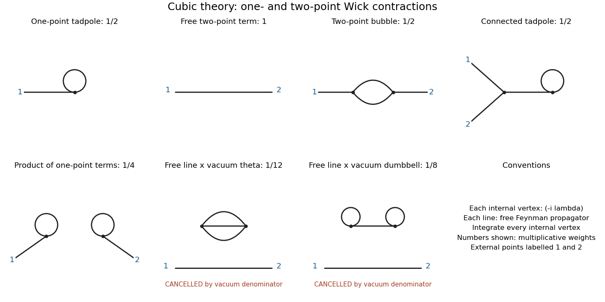

<h1 id="3/b/solution">Solution</h1>

↑ **Parent:** [B](../b.md)

Write $S=S_0+S_I$, where $S_0$ contains the quadratic [kinetic term](../../../../kinetic-term.md) and [mass term](../../../../mass-term.md), and $S_I=-\lambda\int d^Dx\,\phi(x)^3/3!$. Then

$$
e^{iS}=e^{iS_0}\sum_{r=0}^\infty\frac{(-i\lambda)^r}{r!(3!)^r}
\int\prod_{a=1}^r d^Dx_a\,\prod_{a=1}^r\phi(x_a)^3.
$$

Let $Z_0=\int D\phi\,e^{iS_0}$ and let $\langle\cdot\rangle_0$ denote the unit-normalized free [Gaussian](../../../../normal-distribution.md) [vacuum expectation value](../../../../vacuum-expectation-value.md). The unnormalized numerator $\mathcal N_N$ is consequently

$$
\frac{\mathcal N_N}{Z_0}
=\sum_{r=0}^\infty\frac{(-i\lambda)^r}{r!(3!)^r}
\int\prod_{a=1}^r d^Dx_a\,
\left\langle T\phi(y_1)\cdots\phi(y_N)\prod_{a=1}^r\phi(x_a)^3\right\rangle_0.
$$

The Minkowski [path integral](../../../../path-integral.md) is understood with the usual [scalar Feynman propagator pole prescription](../../../../scalar-feynman-propagator-pole-prescription.md), as a formal [perturbation series](../../../../perturbation-series.md). A real cubic [potential energy](../../../../potential-energy.md) is unbounded below; no nonperturbative stable [vacuum](../../../../vacuum.md) is being assumed here.

Set $\Delta(x-z)=\langle T\phi(x)\phi(z)\rangle_0$, $K_i(x)=\Delta(y_i-x)$, and $t=\Delta(0)$, with a common [regularization](../../../../regularization.md) understood for coincident points. The zero-order one-point term has one [field](../../../../field.md) and vanishes. At first order, [Wick's theorem](../../../../wick-s-theorem.md) gives three choices for the [contraction](../../../../contraction-mapping.md) with the external [field](../../../../field.md), leaving a [tadpole diagram](../../../../tadpole-diagram.md):

$$
\langle T\phi(y_1)\phi(x)^3\rangle_0=3K_1(x)t.
$$

The second-order term contains seven [fields](../../../../field.md), so it vanishes by the [vanishing odd correlators of a free Gaussian field](../../../../vanishing-odd-correlators-of-a-free-gaussian-field.md). Hence

$$
\boxed{\mathcal N_1=Z_0\left[\frac{-i\lambda}{2}\int d^Dx\,K_1(x)t+O(\lambda^3)\right].}
$$

The coefficient is $3/3!=1/2$, or [symmetry factor](../../../../feynman-diagram-symmetry-factor.md) $S=2$ when each diagram is weighted by $1/S$. No [spacetime](../../../../spacetime.md) integral has been evaluated. The one-point [tadpole diagram](../../../../tadpole-diagram.md) is shown in the first panel of the following figure; its other panels organize [solution](../c/solution.md).

**[Figure 1](#3/b/image-cubic-one-and-two-point-wick-contractions-vacuum-factors-cancel-but-the-product-of-two-one-point-tadpoles-remains-in-the-full-two-point-correlator). Cubic one- and two-point Wick contractions; vacuum factors cancel, but the product of two one-point tadpoles remains in the full two-point correlator**.

## ↑ Ancestors (12)

1. [B](../b.md)
2. [3](../../3.md)
3. [2016](../../../2016-split.md)
4. [Past exam of the quantum field theory course of the University of Oxford](../../../split.md)
5. [Quantum field theory course of the University of Oxford](../../../../quantum-field-theory-course-of-the-university-of-oxford.md)
6. [Year 4 of the mathematical and theoretical physics course of the University of Oxford](../../../../year-4-of-the-mathematical-and-theoretical-physics-course-of-the-university-of-oxford.md)
7. [Mathematical and theoretical physics course of the University of Oxford](../../../../mathematical-and-theoretical-physics-course-of-the-university-of-oxford.md)
8. [Undergraduate course of the University of Oxford](../../../../undergraduate-course-of-the-university-of-oxford.md)
9. [Course of the University of Oxford](../../../../course-of-the-university-of-oxford.md)
10. [University of Oxford](../../../../university-of-oxford-split.md)
11. [List of universities](../../../../list-of-universities.md)
12. [Codex Wiki](../../../../split.md)

## ← Incoming links (2)

- [Solution](../c/solution.md)
- [Solution](../d/solution.md)
