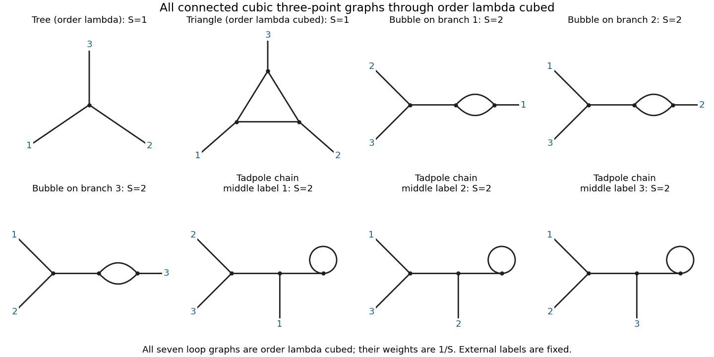

<h1 id="3/d/solution">Solution</h1>

↑ **Parent:** [D](../d.md)

For a connected cubic [Feynman diagram](../../../../feynman-diagram.md) with $V$ internal [vertices](../../../../vertex-graph-theory.md), $I$ internal lines and three external lines, $3V=2I+3$. Hence $V$ is odd and the [loop order](../../../../loop-order.md) is $L=I-V+1=(V-1)/2$. Through order $\lambda^3$, there is one [tree-level Feynman diagram](../../../../tree-level-feynman-diagram.md) at $V=1$ and seven labelled [one-loop Feynman diagrams](../../../../one-loop-feynman-diagram.md) at $V=3$:

- One triangle, with one external line at each [vertex](../../../../vertex-graph-theory.md). Fixing the three external labels leaves no internal automorphism, so its [symmetry factor](../../../../feynman-diagram-symmetry-factor.md) is $S=1$.
- Three [bubble diagrams](../../../../bubble-diagram.md) on external branches of the tree, one for each choice of the distinguished external label $i$. The other two external lines meet the remaining tree [vertex](../../../../vertex-graph-theory.md). Exchanging the two parallel lines gives [symmetry factor](../../../../feynman-diagram-symmetry-factor.md) $S=2$ for each labelled graph.
- Three [tadpole diagrams](../../../../tadpole-diagram.md) at the end of a chain. The middle [vertex](../../../../vertex-graph-theory.md) carries the distinguished external label $i$, the other two external lines meet one end [vertex](../../../../vertex-graph-theory.md), and the other end bears the loop. Reversing the two half-edges of the loop gives [symmetry factor](../../../../feynman-diagram-symmetry-factor.md) $S=2$ for each labelled graph.

**[Figure 2](#3/d/image-all-connected-cubic-three-point-diagrams-through-third-order-one-tree-and-seven-labelled-one-loop-graphs-a-diagram-of-symmetry-factor-s-has-coefficient-1-s). All connected cubic three-point diagrams through third order: one tree and seven labelled one-loop graphs; a diagram of symmetry factor S has coefficient 1/S**.

For an explicit check, use the [propagator](../../../../propagator.md) notation of [solution](../b/solution.md) and define, with $\{i,j,k\}=\{1,2,3\}$,

$$
\begin{aligned}
\mathcal T&=\int d^Dx\,d^Dz\,d^Dw\,
K_1(x)K_2(z)K_3(w)\Delta_{xz}\Delta_{zw}\Delta_{wx},\\
\mathcal B_i&=\int d^Dx\,d^Dz\,d^Dw\,
K_i(z)K_j(w)K_k(w)\Delta_{xz}^2\Delta_{xw},\\
\mathcal A_i&=\int d^Dx\,d^Dz\,d^Dw\,
K_i(z)K_j(w)K_k(w)\Delta_{xz}\Delta_{zw}\,t.
\end{aligned}
$$

There is no ordering of $j,k$ in this notation. The complete connected [correlation function](../../../../correlation-function.md) through this order is

$$
\boxed{G_{3,c}=(-i\lambda)\int d^Dx\,K_1(x)K_2(x)K_3(x)
+(-i\lambda)^3\left[\mathcal T+\frac12\sum_{i=1}^3(\mathcal B_i+\mathcal A_i)\right]+O(\lambda^5).}
$$

For completeness of the classification, a one-loop connected internal graph either has a three-edge cycle, a pair of parallel edges and a bridge, or a self-loop and two bridges. The cubic degree condition forces exactly the external attachments just listed. Direct [Wick contraction](../../../../wick-contraction.md) counting gives 1296 pairings for the triangle and 648 for each of the six other labelled graphs, divided by $3!(3!)^3=1296$.

**Connected does not mean one-particle irreducible.** After [amputation of external propagators](../../../../amputation-of-external-propagators.md), only the triangle is [one-particle irreducible](../../../../one-particle-irreducible-feynman-diagram.md) at this order; the six other loop graphs belong to the requested connected answer. The [tadpole diagrams](../../../../tadpole-diagram.md) cannot be discarded without an additional subtraction prescription.

## ↑ Ancestors (12)

1. [D](../d.md)
2. [3](../../3.md)
3. [2016](../../../2016-split.md)
4. [Past exam of the quantum field theory course of the University of Oxford](../../../split.md)
5. [Quantum field theory course of the University of Oxford](../../../../quantum-field-theory-course-of-the-university-of-oxford.md)
6. [Year 4 of the mathematical and theoretical physics course of the University of Oxford](../../../../year-4-of-the-mathematical-and-theoretical-physics-course-of-the-university-of-oxford.md)
7. [Mathematical and theoretical physics course of the University of Oxford](../../../../mathematical-and-theoretical-physics-course-of-the-university-of-oxford.md)
8. [Undergraduate course of the University of Oxford](../../../../undergraduate-course-of-the-university-of-oxford.md)
9. [Course of the University of Oxford](../../../../course-of-the-university-of-oxford.md)
10. [University of Oxford](../../../../university-of-oxford-split.md)
11. [List of universities](../../../../list-of-universities.md)
12. [Codex Wiki](../../../../split.md)
