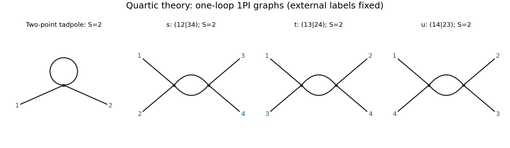

<h1 id="4/a/solution">Solution</h1>

↑ **Parent:** [A](../a.md)

For incoming [four-momenta](../../../../four-momentum.md), the momentum-space [Feynman rules](../../../../feynman-rules.md) in the chosen [Minkowski metric](../../../../minkowski-metric.md) convention are:

- Each internal line contributes the [scalar propagator](../../../../scalar-propagator.md) $i/(p^2-m^2+i0)$.
- Each quartic [interaction vertex](../../../../interaction-vertex.md) contributes $-i\lambda_0$ and $(2\pi)^D\delta^D(\sum p)$ for [momentum conservation](../../../../momentum-conservation.md).
- Each independent [loop momentum](../../../../loop-momentum.md) is integrated with $d^Dk/(2\pi)^D$; after eliminating redundant [Dirac delta functions](../../../../dirac-delta-function.md), one overall conservation factor remains.
- Each graph is divided by its [symmetry factor](../../../../feynman-diagram-symmetry-factor.md) $S$, with external labels held fixed.

There is one connected one-loop [one-particle irreducible](../../../../one-particle-irreducible-feynman-diagram.md) two-point graph: a single quartic [vertex](../../../../vertex-graph-theory.md) with two external lines and one [tadpole diagram](../../../../tadpole-diagram.md). Its [symmetry factor](../../../../feynman-diagram-symmetry-factor.md) is $S=2$ from interchange of the two loop half-edges.

There are three connected one-loop [one-particle irreducible](../../../../one-particle-irreducible-feynman-diagram.md) four-point graphs: two quartic [vertices](../../../../vertex-graph-theory.md) joined by two parallel internal lines, with external partitions $(12|34)$, $(13|24)$ and $(14|23)$. These are the $s$, $t$ and $u$ [scattering channels](../../../../scattering-channel.md); each [bubble diagram](../../../../bubble-diagram.md) has [symmetry factor](../../../../feynman-diagram-symmetry-factor.md) $S=2$. External-branch insertions are excluded by the [one-particle irreducible](../../../../one-particle-irreducible-feynman-diagram.md) requirement.

**[Figure 3](#4/a/image-one-loop-one-particle-irreducible-quartic-scalar-graphs-the-two-point-tadpole-and-the-three-labelled-four-point-bubble-channels-each-with-symmetry-factor-s-2). One-loop one-particle-irreducible quartic scalar graphs: the two-point tadpole and the three labelled four-point bubble channels, each with symmetry factor S=2**.

## ↑ Ancestors (12)

1. [A](../a.md)
2. [4](../../4.md)
3. [2016](../../../2016-split.md)
4. [Past exam of the quantum field theory course of the University of Oxford](../../../split.md)
5. [Quantum field theory course of the University of Oxford](../../../../quantum-field-theory-course-of-the-university-of-oxford.md)
6. [Year 4 of the mathematical and theoretical physics course of the University of Oxford](../../../../year-4-of-the-mathematical-and-theoretical-physics-course-of-the-university-of-oxford.md)
7. [Mathematical and theoretical physics course of the University of Oxford](../../../../mathematical-and-theoretical-physics-course-of-the-university-of-oxford.md)
8. [Undergraduate course of the University of Oxford](../../../../undergraduate-course-of-the-university-of-oxford.md)
9. [Course of the University of Oxford](../../../../course-of-the-university-of-oxford.md)
10. [University of Oxford](../../../../university-of-oxford-split.md)
11. [List of universities](../../../../list-of-universities.md)
12. [Codex Wiki](../../../../split.md)
