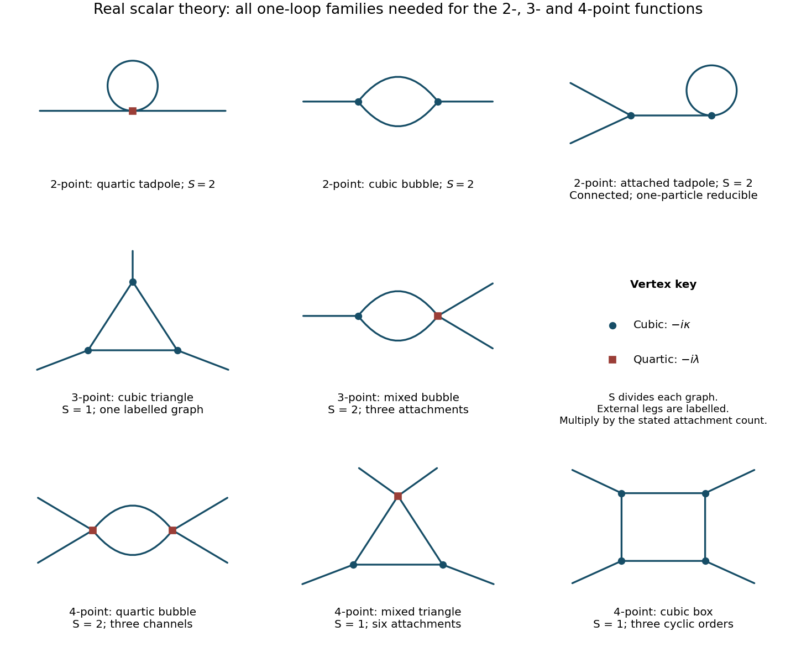
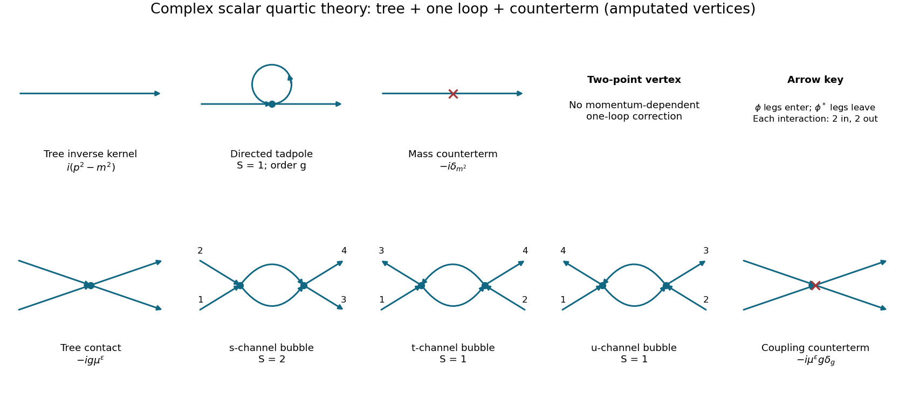

# 2017

↑ **Parent:** [Past exam of the quantum field theory course of the University of Oxford](../past-exam-of-the-quantum-field-theory-course-of-the-university-of-oxford.md)

Source paper: [https://www.whatdotheyknow.com/request/oxford_physics_past_papers_2/response/2340696/attach/5/Physics%20Papers%202016.pdf?cookie_passthrough=1.](https://www.whatdotheyknow.com/request/oxford_physics_past_papers_2/response/2340696/attach/5/Physics%20Papers%202016.pdf?cookie_passthrough=1.) The cover identifies Hilary Term 2017, 11 January; the bundle's 2016 filename does not determine the examination year. We use [natural units](../mathematical-physics.md#natural-units) $\hbar=c=1$, the mostly-minus [Minkowski metric](../special-relativity.md#minkowski-metric), and [Feynman propagators](../quantum-field-theory.md#feynman-propagator) with the $+i0$ prescription.

**Table of contents**

- [1](#1)
  - [a](#1/a)
    - [Solution](#1/a/solution)
  - [b](#1/b)
    - [Solution](#1/b/solution)
  - [c](#1/c)
    - [Solution](#1/c/solution)
  - [d](#1/d)
    - [Solution](#1/d/solution)
- [2](#2)
  - [a](#2/a)
    - [Solution](#2/a/solution)
  - [b](#2/b)
    - [Solution](#2/b/solution)
  - [c](#2/c)
    - [Solution](#2/c/solution)
  - [d](#2/d)
    - [Solution](#2/d/solution)
- [3](#3)
  - [a](#3/a)
    - [Solution](#3/a/solution)
  - [b](#3/b)
    - [Solution](#3/b/solution)
  - [c](#3/c)
    - [Solution](#3/c/solution)
  - [d](#3/d)
    - [Solution](#3/d/solution)
  - [e](#3/e)
    - [Solution](#3/e/solution)
  - [f](#3/f)
    - [Solution](#3/f/solution)
- [4](#4)
  - [a](#4/a)
    - [Solution](#4/a/solution)
  - [b](#4/b)
    - [Solution](#4/b/solution)
  - [c](#4/c)
    - [Solution](#4/c/solution)
  - [d](#4/d)
    - [Solution](#4/d/solution)
  - [e](#4/e)
    - [Solution](#4/e/solution)

## 1

↑ **Parent:** [2017](2017.md)

<h3 id="1/a">a</h3>

↑ **Parent:** [1](#1)

<h4 id="1/a/solution">Solution</h4>

↑ **Parent:** [A](#1/a)

Treat $\phi$ and $\phi^*$ as independent variables in the [Euler-Lagrange equations](../analysis.md#euler-lagrange-equation). Write $s=\phi^*\phi$, and assume the [scalar potential](../classical-field-theory.md#scalar-potential) $f(s)$ is real and differentiable. Variation with respect to $\phi^*$ gives

$$
\frac{\partial\mathcal L}{\partial\phi^*}=-f'(s)\phi,\qquad
\frac{\partial\mathcal L}{\partial(\partial_\mu\phi^*)}=\partial^\mu\phi.
$$

Consequently the equations for the [complex scalar field](../scalar-field-theory.md#complex-scalar-field) and its [complex conjugate](../complex-analysis.md#complex-conjugate) are

$$
\boxed{\Box\phi+f'(\phi^*\phi)\phi=0,\qquad
\Box\phi^*+f'(\phi^*\phi)\phi^*=0.}
$$

No polynomial assumption is needed: only the first derivative of the [scalar potential](../classical-field-theory.md#scalar-potential) enters. For $f(s)=m^2s$, both reduce to the free [Klein-Gordon equation](../wave-equation.md#klein-gordon-equation).

<h3 id="1/b">b</h3>

↑ **Parent:** [1](#1)

<h4 id="1/b/solution">Solution</h4>

↑ **Parent:** [B](#1/b)

For a constant real parameter, $\partial_\mu(e^{i\alpha}\phi)=e^{i\alpha}\partial_\mu\phi$. The phases therefore cancel separately in the [kinetic term](../classical-field-theory.md#kinetic-term) and in $\phi^*\phi$, leaving any $f(\phi^*\phi)$ unchanged. This is the [global phase symmetry of a complex scalar field](../scalar-field-theory.md#global-phase-symmetry-of-a-complex-scalar-field), with [circle group](../lie-theory.md#circle-group) $U(1)$.

Use infinitesimal variations per unit parameter, $\delta\phi=i\phi$, $\delta\phi^*=-i\phi^*$. The [Lagrangian density](../classical-field-theory.md#lagrangian-density) is exactly invariant, so no total-derivative correction is needed in [Noether's theorem](../calculus-of-variations.md#noether-conserved-quantity-for-a-mechanical-point-symmetry). The [Noether current](../classical-field-theory.md#noether-current) is

$$
\boxed{J^\mu=i(\partial^\mu\phi^*)\phi-i\phi^*\partial^\mu\phi.}
$$

It depends only on derivatives of the [Lagrangian density](../classical-field-theory.md#lagrangian-density) with respect to [field](../algebra.md#field) derivatives, so the derivative-free [scalar potential](../classical-field-theory.md#scalar-potential) cannot alter its form. Direct differentiation cancels the mixed first-derivative terms:

$$
\partial_\mu J^\mu=i(\Box\phi^*)\phi-i\phi^*\Box\phi
=-if'(s)\phi^*\phi+if'(s)\phi^*\phi=0.
$$

Thus it is conserved on solutions of the [Euler-Lagrange equations](../analysis.md#euler-lagrange-equation). Its spatial integral is a conserved [Noether charge](../classical-field-theory.md#noether-charge) when the [flux](../mathematical-physics.md#flux) through the boundary vanishes. Its overall sign is fixed here by $\delta\phi=+i\phi$; reversing the orientation of the phase transformation reverses the current.

<h3 id="1/c">c</h3>

↑ **Parent:** [1](#1)

<h4 id="1/c/solution">Solution</h4>

↑ **Parent:** [C](#1/c)

Let $\int_{\mathbf p}=\int d^3p/(2\pi)^3$. The [conjugate momentum](../hamiltonian-mechanics.md#canonical-momentum) [fields](../algebra.md#field) are $\pi_\phi=\dot\phi^\dagger$ and $\pi_{\phi^\dagger}=\dot\phi$. Inserting the given [mode expansion of a free field](../quantum-field-theory.md#mode-expansion-of-a-free-field) into $i\int d^3x(\dot\phi^\dagger\phi-\phi^\dagger\dot\phi)$ produces spatial [Dirac delta](../distribution-theory.md#dirac-delta-function) factors. The $b^\dagger c^\dagger$ and $cb$ terms vanish after integration: they contain $\omega_{\mathbf p}-\omega_{\mathbf q}$ on $\delta^3(\mathbf p+\mathbf q)$, and $\omega_{-\mathbf p}=\omega_{\mathbf p}$. The number-conserving terms instead add their two frequency factors, cancelling the mode normalization. The un-subtracted ordered expression is

$$
Q_{\mathrm{raw}}=\int_{\mathbf p}\left(c_{\mathbf p}c_{\mathbf p}^\dagger-b_{\mathbf p}^\dagger b_{\mathbf p}\right)
=\int_{\mathbf p}\left(c_{\mathbf p}^\dagger c_{\mathbf p}-b_{\mathbf p}^\dagger b_{\mathbf p}\right)
+\int_{\mathbf p}(2\pi)^3\delta^3(0).
$$

The last term is an infinite [vacuum](../physics.md#vacuum) constant, not a finite physical [vacuum](../physics.md#vacuum) charge. Choosing the [Fock vacuum](../quantum-field-theory.md#fock-vacuum) to have zero [Noether charge](../classical-field-theory.md#noether-charge), equivalently using [normal ordering](../perturbative-quantum-field-theory.md#normal-ordering), gives

$$
\boxed{Q=\int_{\mathbf p}\left(c_{\mathbf p}^\dagger c_{\mathbf p}-b_{\mathbf p}^\dagger b_{\mathbf p}\right)=N_c-N_b.}
$$

A state containing $n_c$ quanta created by $c^\dagger$ and $n_b$ by $b^\dagger$ has [Noether charge](../classical-field-theory.md#noether-charge) $n_c-n_b$. Thus the two families describe opposite unit [Noether charges](../classical-field-theory.md#noether-charge); with this source's current the $c^\dagger$ quantum has positive [Noether charge](../classical-field-theory.md#noether-charge) and the $b^\dagger$ quantum negative [Noether charge](../classical-field-theory.md#noether-charge). This is an internal [Noether charge](../classical-field-theory.md#noether-charge); identifying it with [electric charge](../electric-charge.md) requires a specified electromagnetic [coupling](../probability-and-statistics.md#coupling). The [vacuum subtraction of a complex scalar charge](../scalar-field-theory.md#vacuum-subtraction-of-a-complex-scalar-charge) leaves all [commutators](../lie-algebra.md#commutator) unchanged.[Section 2.5, complex scalar fields and their opposite-charge oscillator families; the phase convention fixes the overall sign](../physics-bibliography.md#quantum-field-theory-by-david-tong)

**Scope of the expansion:** a fixed-frequency expansion with time-independent oscillator coefficients is the free-field or asymptotic-field form. For arbitrary interacting $f$, it can be used as canonical oscillator coordinates at a chosen time, rather than as the exact interacting time dependence. For example, $f(s)=m^2s+\lambda s^2$ gives $(\Box+m^2)\phi+2\lambda\phi^*\phi\phi=0$, which a generic free plane-wave superposition does not satisfy. The [Noether charge](../classical-field-theory.md#noether-charge) and its generator [action](../lagrangian-mechanics.md#action) remain valid in the interacting theory; the [symmetry](../physics.md#symmetry-physics) does not depend on using a free [Hamiltonian](../hamiltonian-mechanics.md#hamiltonian).

<h3 id="1/d">d</h3>

↑ **Parent:** [1](#1)

<h4 id="1/d/solution">Solution</h4>

↑ **Parent:** [D](#1/d)

The two oscillator families commute with each other. Their [canonical commutation relations](../quantum-mechanics.md#canonical-commutation-relation) give

$$
[Q,b_{\mathbf p}]=+b_{\mathbf p},\qquad
[Q,c_{\mathbf p}^\dagger]=+c_{\mathbf p}^\dagger,
\qquad
[Q,b_{\mathbf p}^\dagger]=-b_{\mathbf p}^\dagger,\qquad
[Q,c_{\mathbf p}]=-c_{\mathbf p}.
$$

Both terms in the [mode expansion of a free field](../quantum-field-theory.md#mode-expansion-of-a-free-field) therefore acquire the same factor, giving

$$
\boxed{[Q,\phi(x)]=\phi(x),\qquad [Q,\phi^\dagger(x)]=-\phi^\dagger(x).}
$$

The [Noether charge](../classical-field-theory.md#noether-charge) is the generator of the internal [symmetry](../physics.md#symmetry-physics). In the active-operator convention $U(\alpha)=e^{i\alpha Q}$, repeated [commutators](../lie-algebra.md#commutator) give

$$
\boxed{U(\alpha)\phi(x)U(\alpha)^{-1}=e^{i\alpha}\phi(x).}
$$

The sign agrees with part b. A negative sign for $[Q,\phi]$ would correspond to the opposite current convention, not to the current used here. Subtracting a multiple of the identity from $Q$ to fix the [vacuum](../physics.md#vacuum) [Noether charge](../classical-field-theory.md#noether-charge) has no effect on this generator relation.

## 2

↑ **Parent:** [2017](2017.md)

<h3 id="2/a">a</h3>

↑ **Parent:** [2](#2)

<h4 id="2/a/solution">Solution</h4>

↑ **Parent:** [A](#2/a)

In $d$ [spacetime](../special-relativity.md#spacetime) dimensions, $[d^dx]=-d$ and a dimensionless [action](../lagrangian-mechanics.md#action) requires $[\mathcal L]=d$. Since $[\partial_\mu]=1$, the canonical [kinetic term](../classical-field-theory.md#kinetic-term) fixes $2+2[\phi]=d$. The cubic and quartic terms then give

$$
\boxed{[\phi]=\frac{d-2}{2},\qquad[\kappa]=\frac{6-d}{2},\qquad[\lambda]=4-d.}
$$

These brackets denote [mass dimensions](../perturbative-quantum-field-theory.md#mass-dimension). The cubic [coupling](../probability-and-statistics.md#coupling) is dimensionless at $d=6$, whereas the quartic [coupling](../probability-and-statistics.md#coupling) is dimensionless at $d=4$. Hence there is **no single dimension** in which both nonzero [couplings](../probability-and-statistics.md#coupling) are dimensionless. For example, at $d=4$ the cubic [coupling](../probability-and-statistics.md#coupling) still has [mass dimension](../perturbative-quantum-field-theory.md#mass-dimension) one.[Section 3.1, dimensional analysis of scalar interactions](../physics-bibliography.md#quantum-field-theory-by-david-tong)

<h3 id="2/b">b</h3>

↑ **Parent:** [2](#2)

<h4 id="2/b/solution">Solution</h4>

↑ **Parent:** [B](#2/b)

Let $D_{xy}=\langle0|T\phi(x)\phi(y)|0\rangle_0$ be the free [Feynman propagator](../quantum-field-theory.md#feynman-propagator), and abbreviate $v_3=-i\kappa$, $v_4=-i\lambda$. Expand the normalized [Dyson series](../perturbative-quantum-field-theory.md#dyson-series), so [vacuum](../physics.md#vacuum) bubbles cancel between numerator and denominator, and retain the [connected correlation function](../critical-phenomenon.md#connected-correlation-function). [Wick's theorem](../perturbative-quantum-field-theory.md#wick-s-theorem) yields

$$
\begin{aligned}
G_c(x,y)={}&D_{xy}
+\frac{v_4}{2}\int d^dz\,D_{xz}D_{zz}D_{zy}\\
&+\frac{v_3^2}{2}\int d^dz\,d^dw\,D_{xz}D_{zw}^2D_{wy}\\
&+\frac{v_3^2}{2}\int d^dz\,d^dw\,D_{xz}D_{zy}D_{zw}D_{ww}
+O(\text{two loops}).
\end{aligned}
$$

These are respectively the free line, the quartic [tadpole diagram](../perturbative-quantum-field-theory.md#tadpole-diagram), the two-cubic-vertex [bubble diagram](../perturbative-quantum-field-theory.md#bubble-diagram), and an [tadpole contribution to a cubic-theory two-point function](../perturbative-quantum-field-theory.md#tadpole-contribution-to-a-cubic-theory-two-point-function), attached by a bridge to the vertex carrying both external legs. The last graph is connected but is a [one-particle-reducible Feynman diagram](../perturbative-quantum-field-theory.md#one-particle-reducible-feynman-diagram); removing its bridge disconnects it. It must be included when all connected graphs are requested. It disappears if an additional vanishing-one-point-function [renormalization condition](../perturbative-quantum-field-theory.md#renormalization-condition) and its corresponding [tadpole subtraction](../perturbative-quantum-field-theory.md#tadpole-subtraction) are imposed; that convention was not specified here.

The factors can be counted directly. The quartic term has $4\cdot3=12$ attachments for the two labelled external legs, divided by $4!=24$. At second order in the cubic interaction the expansion denominator is $2!(3!)^2=72$. There are 36 [Wick contractions](../perturbative-quantum-field-theory.md#wick-contraction) for the bubble, and 36 for the attached-tadpole graph, giving $1/2$ for each. Thus each loop topology shown has [symmetry factor](../perturbative-quantum-field-theory.md#feynman-diagram-symmetry-factor) $S=2$. Disconnected products of one-point functions and [vacuum](../physics.md#vacuum) bubbles are not part of $G_c$.[Sections 3.3–3.4, Wick contractions and diagrammatic perturbation theory](../physics-bibliography.md#quantum-field-theory-by-david-tong)

The [one-loop cubic-quartic scalar vertex classification](../perturbative-quantum-field-theory.md#one-loop-cubic-quartic-scalar-vertex-classification) follows without truncating arbitrarily in powers of the [couplings](../probability-and-statistics.md#coupling). A connected graph with $E$ external legs, $V_3$ cubic vertices, $V_4$ quartic vertices and loop number $L$ satisfies

$$
V_3+2V_4=E+2L-2.
$$

For $E=2,L=1$, the only possibilities are $(V_3,V_4)=(2,0)$ or $(0,1)$, exactly those just listed.

**[Figure 1](#2/b/image-one-loop-feynman-diagrams-in-the-real-cubic-plus-quartic-scalar-field-theory-with-symmetry-factors-and-channel-multiplicities). One-loop Feynman diagrams in the real cubic-plus-quartic scalar field theory, with symmetry factors and channel multiplicities**.

<h3 id="2/c">c</h3>

↑ **Parent:** [2](#2)

<h4 id="2/c/solution">Solution</h4>

↑ **Parent:** [C](#2/c)

For the amputated [one-particle-irreducible vertex](../perturbative-quantum-field-theory.md#one-particle-irreducible-vertex), every internal bridge is forbidden. Define the [Feynman integrals](../perturbative-quantum-field-theory.md#feynman-integral)

$$
D(k)=\frac{i}{k^2-m^2+i0},\qquad \int_k=\int\frac{d^dk}{(2\pi)^d},
$$

$$
I_2(P)=\int_kD(k)D(k+P),\qquad
I_3(P,Q,R)=\int_kD(k)D(k+P)D(k-R),\quad P+Q+R=0.
$$

For $E=3,L=1$, the counting identity in part b gives $V_3+2V_4=3$. The only [one-particle-irreducible Feynman diagrams](../perturbative-quantum-field-theory.md#one-particle-irreducible-feynman-diagram) are a triangle of three cubic vertices and a two-propagator bubble joining one cubic and one quartic vertex. Write $\mathcal V_3$ for the amputated Feynman vertex, including its overall factor of $i$. With all external [momenta](../momentum.md) incoming,

$$
\boxed{\mathcal V_{3,\,1\text{-loop}}(p_1,p_2,p_3)
=v_3^3 I_3(p_1,p_2,p_3)
+\frac{v_3v_4}{2}\sum_{i=1}^3 I_2(p_i).}
$$

The triangle has $S=1$ for labelled external legs. The mixed bubble has $S=2$ because its two internal lines may be interchanged. There are three distinct terms, according to which external leg is attached to the cubic vertex; the other two attach to the quartic vertex. No tadpole attached by a bridge is [one-particle irreducible](../perturbative-quantum-field-theory.md#one-particle-irreducible-feynman-diagram).

The requested position-space three-point [correlation function](../critical-phenomenon.md#correlation-function) is obtained by restoring the external [propagators](../quantum-field-theory.md#propagator) and a [Fourier transform](../fourier-transform.md):

$$
G^{(3)}_{\mathrm{1PI},\,1\text{-loop}}(x,y,z)
=\int_{p_1}\int_{p_2}\int_{p_3}(2\pi)^d\delta^d(p_1+p_2+p_3)
 e^{-i(p_1x+p_2y+p_3z)}D(p_1)D(p_2)D(p_3)
\mathcal V_{3,\,1\text{-loop}}.
$$

The tree-level contribution would replace the last factor by $v_3$. This explicitly distinguishes the amputated vertex from the [correlation function](../critical-phenomenon.md#correlation-function) while giving all loop integrations in [momentum](../momentum.md) space.

<h3 id="2/d">d</h3>

↑ **Parent:** [2](#2)

<h4 id="2/d/solution">Solution</h4>

↑ **Parent:** [D](#2/d)

Let $\mathcal V_4=i\Gamma^{(4)}$ denote the amputated Feynman vertex, with tree term $v_4=-i\lambda$. A one-loop [one-particle-irreducible Feynman diagram](../perturbative-quantum-field-theory.md#one-particle-irreducible-feynman-diagram) has $V_3+2V_4=4$, allowing three families: two quartic vertices, two cubic vertices and one quartic vertex, or four cubic vertices. Define

$$
I_4(P,Q,R,S)=\int_kD(k)D(k+P)D(k+P+Q)D(k-S),\quad P+Q+R+S=0.
$$

Using $I_2,I_3$ from part c and writing $P_{ij}=p_i+p_j$, the complete one-loop result is

$$
\boxed{\begin{aligned}
\mathcal V_{4,\,1\text{-loop}}={}&\frac{v_4^2}{2}
\left[I_2(P_{12})+I_2(P_{13})+I_2(P_{14})\right]\\
&+v_3^2v_4\sum_{1\leq i<j\leq4}I_3(P_{ij},p_k,p_l)\\
&+v_3^4\left[I_4(p_1,p_2,p_3,p_4)+I_4(p_1,p_2,p_4,p_3)+I_4(p_1,p_3,p_2,p_4)\right].
\end{aligned}}
$$

In each term of the middle sum, $k,l$ are the two complementary indices. Their order does not change the integral after a loop-[momentum](../momentum.md) redefinition.

The first line contains three bubble channels, one for each partition of the four labelled external legs into two pairs. Each has $S=2$ from interchanging its two identical internal lines. In the second line, the quartic vertex carries a chosen pair of external legs, giving $\binom42=6$ mixed triangles. Each has $S=1$. In the last line, cyclic orderings of four labelled external legs are identified under rotation and reversal, leaving $(4-1)!/2=3$ boxes, again with $S=1$ each. The figure in part b shows one representative of each family and its multiplicity. External-leg corrections and tadpoles connected by bridges are excluded because $\Gamma^{(4)}$ is a [one-particle-irreducible vertex](../perturbative-quantum-field-theory.md#one-particle-irreducible-vertex). All integrals are left unevaluated, as appropriate here.

## 3

↑ **Parent:** [2017](2017.md)

<h3 id="3/a">a</h3>

↑ **Parent:** [3](#3)

<h4 id="3/a/solution">Solution</h4>

↑ **Parent:** [A](#3/a)

A free contraction must connect one $\phi$ and one $\phi^*$ [field](../algebra.md#field). In [momentum](../momentum.md) space,

$$
\boxed{\langle T\phi(p)\phi^*(-p)\rangle_0=\frac{i}{p^2-m_0^2+i0},\qquad
\langle T\phi\phi\rangle_0=\langle T\phi^*\phi^*\rangle_0=0.}
$$

Represent the nonzero [propagator](../quantum-field-theory.md#propagator) by a directed line so the two conjugate ends remain distinguishable; an undirected line alone would incorrectly allow same-charge contractions. Choose one consistent arrow convention, for example pointing from the starred end to the unstarred end.

The interaction contains two identical $\phi$ [fields](../algebra.md#field) and two identical $\phi^*$ [fields](../algebra.md#field). Their $2!2!$ assignments cancel the coefficient $1/4$, giving

$$
\boxed{v_{\phi\phi\phi^*\phi^*}=-i\lambda_0.}
$$

The vertex has two incoming and two outgoing arrows. Include $(2\pi)^d\delta^d(\sum p_i)$ at every vertex, integrate $d^dk/(2\pi)^d$ for each independent loop, and divide by the oriented graph's [symmetry factor](../perturbative-quantum-field-theory.md#feynman-diagram-symmetry-factor). There is no fermion-loop sign.

<h3 id="3/b">b</h3>

↑ **Parent:** [3](#3)

<h4 id="3/b/solution">Solution</h4>

↑ **Parent:** [B](#3/b)

The two real [fields](../algebra.md#field) have canonical normalization because

$$
\phi^*\phi=\frac{\phi_1^2+\phi_2^2}{2},\qquad
\partial_\mu\phi^*\partial^\mu\phi=\frac12\sum_{a=1}^2\partial_\mu\phi_a\partial^\mu\phi_a.
$$

Therefore

$$
\boxed{\mathcal L=\frac12\sum_{a=1}^2\left[(\partial\phi_a)^2-m_0^2\phi_a^2\right]
-\frac{\lambda_0}{16}\left(\phi_1^4+2\phi_1^2\phi_2^2+\phi_2^4\right).}
$$

The interaction is invariant under $O(2)$ rotations and reflections of $(\phi_1,\phi_2)$. The continuous rotations are the original complex-field $U(1)$ [symmetry](../physics.md#symmetry-physics). The factor $1/16$ follows from both the original $1/4$ and the square of the $1/2$ in $\phi^*\phi$.

<h3 id="3/c">c</h3>

↑ **Parent:** [3](#3)

<h4 id="3/c/solution">Solution</h4>

↑ **Parent:** [C](#3/c)

The [propagator](../quantum-field-theory.md#propagator) carries a real-species label rather than a charge-flow arrow:

$$
\boxed{D_{ab}(p)=\frac{i\delta_{ab}}{p^2-m_0^2+i0}.}
$$

Differentiating the interaction with respect to its four external real [fields](../algebra.md#field) gives the compact [tensor](../multilinear-algebra.md#tensor) rule

$$
\boxed{v_{abcd}=-\frac{i\lambda_0}{2}
(\delta_{ab}\delta_{cd}+\delta_{ac}\delta_{bd}+\delta_{ad}\delta_{bc}).}
$$

Thus four $\phi_1$ legs or four $\phi_2$ legs give $-3i\lambda_0/2$, while two of each give $-i\lambda_0/2$. Vertices with an odd number of either species vanish. For example, $4!(\lambda_0/16)=3\lambda_0/2$, whereas $2!2!(2\lambda_0/16)=\lambda_0/2$. These factors already account for assignments at one vertex; graph [symmetry factors](../perturbative-quantum-field-theory.md#feynman-diagram-symmetry-factor) must still be included separately. [Momentum](../momentum.md) conservation and loop measures are the same as in part a.

<h3 id="3/d">d</h3>

↑ **Parent:** [3](#3)

<h4 id="3/d/solution">Solution</h4>

↑ **Parent:** [D](#3/d)

Use renormalized [propagators](../quantum-field-theory.md#propagator) of [mass](../classical-mechanics.md#mass) $m$ and tree vertex $-ig\mu^\epsilon$. The interaction [counterterms](../perturbative-quantum-field-theory.md#counterterm) have Feynman factors $-i\delta_{m^2}$ for a two-leg [mass](../classical-mechanics.md#mass) insertion and $-i\mu^\epsilon g\delta_g$ for a four-leg insertion. At one loop the two-point [one-particle-irreducible vertex](../perturbative-quantum-field-theory.md#one-particle-irreducible-vertex) is

$$
i\Gamma^{(2)}(p)=i(p^2-m^2)-i\delta_{m^2}
+(-ig\mu^\epsilon)\int_k\frac{i}{k^2-m^2+i0}+O(g^2).
$$

The directed tadpole has $S=1$: interchanging its two ends would reverse the [field](../algebra.md#field) labels, so the real-scalar tadpole's factor $1/2$ does not apply. It is independent of external [momentum](../momentum.md), so no wave-function [counterterm](../perturbative-quantum-field-theory.md#counterterm) is required at this order.

For the four-point vertex, label the two unstarred incoming [fields](../algebra.md#field) by $1,2$ and the starred ones by $3,4$, with all [momenta](../momentum.md) incoming. The tree contact, the three oriented bubbles and the contact [counterterm](../perturbative-quantum-field-theory.md#counterterm) give

$$
\begin{aligned}
i\Gamma^{(4)}={}&-ig\mu^\epsilon-i\mu^\epsilon g\delta_g\\
&+(-ig\mu^\epsilon)^2\left[\frac12 I_2(p_1+p_2)+I_2(p_1+p_3)+I_2(p_1+p_4)\right]+O(g^3).
\end{aligned}
$$

The first bubble has two equivalent arrows along the same direction between its vertices, giving $S=2$. In the other two channels the arrows oppose one another, and interchanging the lines does not preserve their oriented attachments, giving $S=1$. This is the [oriented complex-scalar quartic graph factors](../perturbative-quantum-field-theory.md#oriented-complex-scalar-quartic-graph-factors) rule.

The [mass](../classical-mechanics.md#mass) tadpole is order $gm^2$, while the four-point loop is order $g^2$. In the multiplicative [coupling](../probability-and-statistics.md#coupling) convention of the source,

$$
\boxed{\delta_{m^2}=O(gm^2/\epsilon),\qquad \delta_g=O(g/\epsilon),\qquad g\delta_g=O(g^2/\epsilon).}
$$

The distinction between $\delta_g$ and the whole additive four-leg coefficient $g\delta_g$ matters for the requested order counting.

**[Figure 2](#3/d/image-tree-loop-and-counterterm-contributions-to-the-two-point-and-four-point-vertices-of-a-complex-scalar-field). Tree, loop and counterterm contributions to the two-point and four-point vertices of a complex scalar field**.

<h3 id="3/e">e</h3>

↑ **Parent:** [3](#3)

<h4 id="3/e/solution">Solution</h4>

↑ **Parent:** [E](#3/e)

**Source correction:** equation 11 on the original page has $\Gamma(\alpha-1/2)$. The dimensionally regulated integral instead contains $\Gamma(\alpha-d/2)$. This is not an interchangeable convention: for $\alpha=2$ and $d=4-\epsilon$, the correct factor $\Gamma(\epsilon/2)$ has a logarithmic [ultraviolet pole](../perturbative-quantum-field-theory.md#ultraviolet-pole), whereas the printed $\Gamma(3/2)$ is finite.

To obtain the correct expression, shift the [loop momentum](../perturbative-quantum-field-theory.md#loop-momentum) and perform a [Wick rotation](../perturbative-quantum-field-theory.md#wick-rotation). For positive Euclidean $\mathcal M^2$, introduce a [Schwinger parameterization](../perturbative-quantum-field-theory.md#schwinger-parameterization):

$$
\begin{aligned}
\int\frac{d^dq_E}{(2\pi)^d}\frac1{(q_E^2+\mathcal M^2)^\alpha}
&=\frac1{\Gamma(\alpha)}\int_0^\infty ds\,s^{\alpha-1}e^{-s\mathcal M^2}
\int\frac{d^dq_E}{(2\pi)^d}e^{-sq_E^2}\\
&=\frac{\Gamma(\alpha-d/2)}{(4\pi)^{d/2}\Gamma(\alpha)}(\mathcal M^2)^{d/2-\alpha}.
\end{aligned}
$$

The derivation first holds in the convergent range and defines the result elsewhere by [analytic continuation](../holomorphic-function.md#analytic-continuation). For integer $\alpha$, rotating back gives

$$
\boxed{\int\frac{d^dq}{(2\pi)^d}\frac1{(q^2+2q\cdot p-m^2+i0)^\alpha}
=\frac{i(-1)^\alpha}{(4\pi)^{d/2}}\frac{\Gamma(\alpha-d/2)}{\Gamma(\alpha)}
(p^2+m^2)^{d/2-\alpha},}
$$

with the branch inherited from $i0$. This is the Lorentzian continuation of the [Euclidean massive loop integral](../perturbative-quantum-field-theory.md#euclidean-massive-loop-integral).

Set $p=0$, $\alpha=1$, $d=4-\epsilon$. Since $\Gamma(-1+\epsilon/2)=-2/\epsilon+O(1)$,

$$
\int_k\frac1{k^2-m^2+i0}=\frac{im^2}{8\pi^2\epsilon}+O(1).
$$

Consequently the directed tadpole in part d gives

$$
\left.i\Gamma^{(2)}_{\mathrm{loop}}\right|_{\mathrm{div}}
=(-ig\mu^\epsilon)\left.i\int_k\frac1{k^2-m^2+i0}\right|_{\mathrm{div}}
=\frac{igm^2}{8\pi^2\epsilon}.
$$

The [counterterm](../perturbative-quantum-field-theory.md#counterterm) is $-i\delta_{m^2}$, so cancelling only the pole in the [minimal subtraction scheme](../perturbative-quantum-field-theory.md#minimal-subtraction-scheme) requires

$$
\boxed{\delta_{m^2}=\frac{gm^2}{8\pi^2\epsilon}.}
$$

This is the [quartic complex-scalar mass renormalization](../scalar-field-theory.md#quartic-complex-scalar-mass-renormalization) result. The scale factors and logarithms contribute finite terms at this order and do not change the displayed pole coefficient. A real-field check gives a tadpole coefficient $\tfrac12(3g/2+g/2)=g$, in agreement with the oriented complex-field computation.

<h3 id="3/f">f</h3>

↑ **Parent:** [3](#3)

<h4 id="3/f/solution">Solution</h4>

↑ **Parent:** [F](#3/f)

To first order, invert $m_0^2=m^2[1+g/(8\pi^2\epsilon)]$ and use $g=\lambda_0\mu^{-\epsilon}+O(\lambda_0^2)$:

$$
\boxed{m^2=m_0^2\left[1-\frac{\lambda_0\mu^{-\epsilon}}{8\pi^2\epsilon}\right]+O(\lambda_0^2).}
$$

The remainder is a perturbative statement at fixed regulator. When differentiating, hold the [bare mass](../perturbative-quantum-field-theory.md#bare-mass) $m_0^2$ fixed as well as $\lambda_0$; otherwise the [mass](../classical-mechanics.md#mass) running would not be defined by a fixed bare theory. Since $\mu\,\partial_\mu\mu^{-\epsilon}=-\epsilon\mu^{-\epsilon}$,

$$
\mu\frac{d\log m^2}{d\mu}\bigg|_{\mathrm{bare}}
=\frac{\lambda_0\mu^{-\epsilon}}{8\pi^2}+O(g^2)
=\frac{g}{8\pi^2}+O(g^2).
$$

Thus, with the source's extra factor of one half,

$$
\boxed{\gamma_m(g)=\frac{g}{16\pi^2}+O(g^2).}
$$

The factor $-\epsilon$ from the running dimensionless [bare coupling](../perturbative-quantum-field-theory.md#bare-coupling) cancels the [counterterm](../perturbative-quantum-field-theory.md#counterterm) pole. Differentiating as though $g$ were independent of $\mu$ would miss this finite result. Some conventions call $\mu\,d\log m^2/d\mu$ itself the [mass](../classical-mechanics.md#mass) [anomalous dimension](../critical-phenomenon.md#anomalous-dimension); that convention is twice the one defined here.

## 4

↑ **Parent:** [2017](2017.md)

<h3 id="4/a">a</h3>

↑ **Parent:** [4](#4)

<h4 id="4/a/solution">Solution</h4>

↑ **Parent:** [A](#4/a)

At fixed external [momenta](../momentum.md), fixed regulator and fixed bare [coupling](../probability-and-statistics.md#coupling), define the total scale derivative

$$
\mathcal D=\mu\frac{\partial}{\partial\mu}+\beta(g)\frac{\partial}{\partial g}.
$$

The bare vertex has no independent dependence on the arbitrary [renormalization scale](../perturbative-quantum-field-theory.md#renormalization-scale). Differentiating $\Gamma^{(n)}=Z_\phi^{n/2}\Gamma_0^{(n)}$ therefore gives

$$
\mathcal D\Gamma^{(n)}=\frac n2\left(\mu\frac{d\log Z_\phi}{d\mu}\right)_{\mathrm{bare}}\Gamma^{(n)}.
$$

Defining the two scale-response functions as in the source yields

$$
\boxed{\left[\mu\partial_\mu+\beta(g)\partial_g-\frac n2\gamma(g)\right]\Gamma^{(n)}=0.}
$$

This is the [Callan-Symanzik equation](../perturbative-quantum-field-theory.md#callan-symanzik-equation). Its minus sign and factor $n/2$ follow from the specified $Z_\phi^{n/2}$ multiplying the bare vertex. In particular, the source's $\gamma=\mu\,d\log Z_\phi/d\mu$ is twice the [field](../algebra.md#field) [anomalous dimension](../critical-phenomenon.md#anomalous-dimension) defined using $\log Z_\phi^{1/2}$. A convention change must be made consistently in both definitions and equation.

<h3 id="4/b">b</h3>

↑ **Parent:** [4](#4)

<h4 id="4/b/solution">Solution</h4>

↑ **Parent:** [B](#4/b)

The dimensionless bare parameter is $g_0=\lambda_0\mu^{-\epsilon}$, so direct differentiation at fixed $\lambda_0$ gives

$$
\boxed{\beta_0(g_0)=\mu\frac{dg_0}{d\mu}\bigg|_{\lambda_0}=-\epsilon g_0.}
$$

The dimensionful bare vertex itself is scale independent. Reexpressing it as $\widehat\Gamma^{(n)}(p,g_0,\mu)=\Gamma_0^{(n)}(p,g_0\mu^\epsilon)$ introduces only the combination $g_0\mu^\epsilon$. Hence

$$
\left(\mu\partial_\mu-\epsilon g_0\partial_{g_0}\right)\widehat\Gamma^{(n)}=0.
$$

There is no multiplicative [field](../algebra.md#field) rescaling in this bare parametrization, so

$$
\boxed{\gamma_0(g_0)=0.}
$$

This does not assert that the interacting renormalized [field](../algebra.md#field) has zero [anomalous dimension](../critical-phenomenon.md#anomalous-dimension). It says that the unrescaled bare [field](../algebra.md#field) has no additional normalization factor under this change of the arbitrary scale.

<h3 id="4/c">c</h3>

↑ **Parent:** [4](#4)

<h4 id="4/c/solution">Solution</h4>

↑ **Parent:** [C](#4/c)

Write $\mathcal D_0=\mu\partial_\mu+\beta_0(g_0)\partial_{g_0}$. Allow a general bare coefficient $\gamma_0$ temporarily, so the starting equation is $(\mathcal D_0-n\gamma_0/2)\widehat\Gamma^{(n)}=0$. Substitute $\widehat\Gamma^{(n)}=Z_\phi(g_0)^{-n/2}\Gamma^{(n)}(p,g(g_0),\mu)$ and apply the product and chain rules:

$$
0=Z_\phi^{-n/2}\left[
\mu\partial_\mu+\beta_0\frac{dg}{dg_0}\partial_g
-\frac n2\left(\gamma_0+\beta_0\frac{d\log Z_\phi}{dg_0}\right)\right]\Gamma^{(n)}.
$$

Multiplying by $Z_\phi^{n/2}$ identifies

$$
\boxed{\beta(g(g_0))=\beta_0(g_0)\frac{dg}{dg_0},\qquad
\gamma(g(g_0))=\gamma_0(g_0)+\frac{\beta_0(g_0)}{Z_\phi(g_0)}\frac{dZ_\phi}{dg_0}.}
$$

Thus the [renormalization-group beta function](../perturbative-quantum-field-theory.md#beta-function-physics) transforms by the [chain rule](../calculus.md#chain-rule) under a [coupling](../probability-and-statistics.md#coupling) reparametrization, while the [field](../algebra.md#field) coefficient also records the scale dependence of the finite or divergent [field](../algebra.md#field) normalization. For the actual bare parametrization here, substitute $\beta_0=-\epsilon g_0$ and $\gamma_0=0$.

<h3 id="4/d">d</h3>

↑ **Parent:** [4](#4)

<h4 id="4/d/solution">Solution</h4>

↑ **Parent:** [D](#4/d)

At fixed regulator abbreviate

$$
A(\epsilon)=\frac{a_1}{\epsilon}+a_2+a_3\epsilon+\cdots,\qquad
C(\epsilon)=\frac{z_1}{\epsilon}+z_2+z_3\epsilon+\cdots.
$$

The [coupling](../probability-and-statistics.md#coupling) expansion is $g=g_0+Ag_0^2+O(g_0^3)$, whose inverse is $g_0=g-Ag^2+O(g^3)$. Using part c before removing the regulator,

$$
\begin{aligned}
\beta(g)&=-\epsilon g_0(1+2Ag_0)+O(g_0^3)\\
&=-\epsilon g-\epsilon A g^2+O(g^3),\\
\gamma(g)&=-\epsilon g_0\frac{C}{1+Cg_0}+O(g_0^2)
=-\epsilon Cg+O(g^2).
\end{aligned}
$$

Therefore the regulator-free coefficients at the orders determined by the supplied expansions are

$$
\boxed{\beta(g)=-a_1g^2+O(g^3),\qquad\gamma(g)=-z_1g+O(g^2).}
$$

The canonical term $-\epsilon g$ vanishes, and the factors of $\epsilon$ cancel the simple poles. The finite coefficients $a_2,z_2$ and higher positive powers of $\epsilon$ do not enter these leading regulator-free terms. Inverting the [coupling](../probability-and-statistics.md#coupling) is essential: substituting $g_0=g$ too early would incorrectly give $-2a_1g^2$.

The calculation establishes finiteness only at the displayed perturbative orders. Higher-order pole cancellations require the higher-order coefficients, as the next part makes explicit.

<h3 id="4/e">e</h3>

↑ **Parent:** [4](#4)

<h4 id="4/e/solution">Solution</h4>

↑ **Parent:** [E](#4/e)

Retain the specified leading poles and write $A=a_1/\epsilon$, $B=b_1/\epsilon^2$. Solving $g=g_0+Ag_0^2+Bg_0^3$ recursively gives

$$
g_0=g-Ag^2+(2A^2-B)g^3+O(g^4).
$$

The scale derivative must again be reexpressed in the [renormalized coupling](../perturbative-quantum-field-theory.md#renormalized-coupling):

$$
\begin{aligned}
\beta(g)&=-\epsilon g_0\left(1+2Ag_0+3Bg_0^2\right)\\
&=-\epsilon g-\epsilon A g^2+2\epsilon(A^2-B)g^3+O(g^4)\\
&=\boxed{-\epsilon g-a_1g^2+\frac{2(a_1^2-b_1)}{\epsilon}g^3+O(g^4).}
\end{aligned}
$$

The [leading-pole consistency under coupling reparametrization](../perturbative-quantum-field-theory.md#leading-pole-consistency-under-coupling-reparametrization) shows that a finite [renormalization-group beta function](../perturbative-quantum-field-theory.md#beta-function-physics) requires the two-loop double-pole consistency condition

$$
\boxed{b_1=a_1^2.}
$$

The leading two-loop pole is fixed by the one-loop simple pole; it is not an independent parameter. This is an instance of the [simple-pole formulas for minimal-subtraction renormalization group functions](../perturbative-quantum-field-theory.md#simple-pole-formulas-for-minimal-subtraction-renormalization-group-functions) and their higher-pole consistency relations.

The source's leading-pole truncation does **not** fix the finite two-loop coefficient of the [beta function](../complex-analysis.md#beta-function). For example, adding the omitted term $c_1g_0^3/\epsilon$ leaves the double-pole condition unchanged but contributes $-2c_1g^3$ to the finite [beta function](../complex-analysis.md#beta-function). Thus cancelling the displayed $1/\epsilon$ term is not a claim that the physical two-loop running vanishes.

## ↑ Ancestors (9)

1. [Past exam of the quantum field theory course of the University of Oxford](../past-exam-of-the-quantum-field-theory-course-of-the-university-of-oxford.md)
2. [Quantum field theory course of the University of Oxford](../university-of-oxford.md#quantum-field-theory-course-of-the-university-of-oxford)
3. [Year 4 of the mathematical and theoretical physics course of the University of Oxford](../university-of-oxford.md#year-4-of-the-mathematical-and-theoretical-physics-course-of-the-university-of-oxford)
4. [Mathematical and theoretical physics course of the University of Oxford](../university-of-oxford.md#mathematical-and-theoretical-physics-course-of-the-university-of-oxford)
5. [Undergraduate course of the University of Oxford](../university-of-oxford.md#undergraduate-course-of-the-university-of-oxford)
6. [Course of the University of Oxford](../university-of-oxford.md#course-of-the-university-of-oxford)
7. [University of Oxford](../university-of-oxford.md)
8. [List of universities](../README.md#list-of-universities)
9. [Codex Wiki](../README.md)
