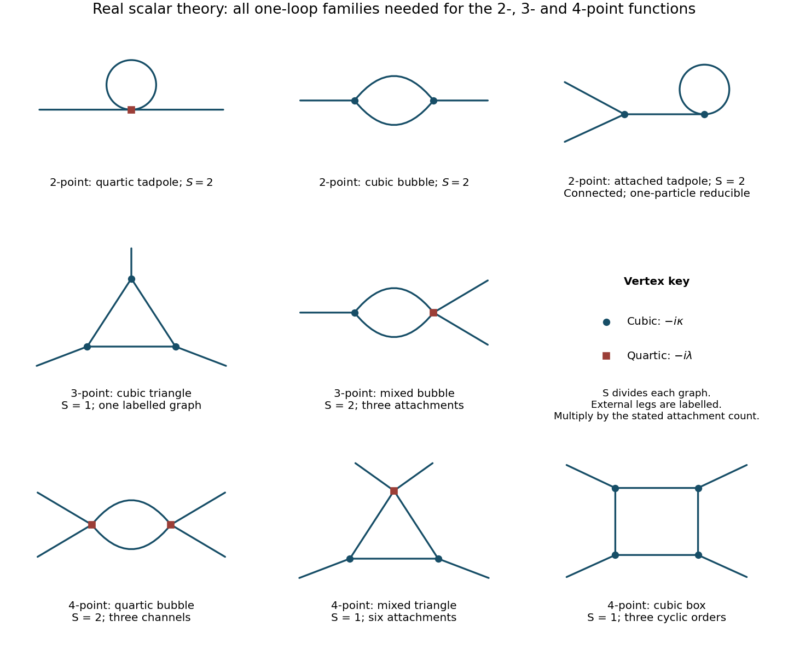

<h1 id="2/b/solution">Solution</h1>

↑ **Parent:** [B](../b.md)

Let $D_{xy}=\langle0|T\phi(x)\phi(y)|0\rangle_0$ be the free [Feynman propagator](../../../../feynman-propagator.md), and abbreviate $v_3=-i\kappa$, $v_4=-i\lambda$. Expand the normalized [Dyson series](../../../../dyson-series.md), so [vacuum](../../../../vacuum.md) bubbles cancel between numerator and denominator, and retain the [connected correlation function](../../../../connected-correlation-function.md). [Wick's theorem](../../../../wick-s-theorem.md) yields

$$
\begin{aligned}
G_c(x,y)={}&D_{xy}
+\frac{v_4}{2}\int d^dz\,D_{xz}D_{zz}D_{zy}\\
&+\frac{v_3^2}{2}\int d^dz\,d^dw\,D_{xz}D_{zw}^2D_{wy}\\
&+\frac{v_3^2}{2}\int d^dz\,d^dw\,D_{xz}D_{zy}D_{zw}D_{ww}
+O(\text{two loops}).
\end{aligned}
$$

These are respectively the free line, the quartic [tadpole diagram](../../../../tadpole-diagram.md), the two-cubic-vertex [bubble diagram](../../../../bubble-diagram.md), and an [tadpole contribution to a cubic-theory two-point function](../../../../tadpole-contribution-to-a-cubic-theory-two-point-function.md), attached by a bridge to the vertex carrying both external legs. The last graph is connected but is a [one-particle-reducible Feynman diagram](../../../../one-particle-reducible-feynman-diagram.md); removing its bridge disconnects it. It must be included when all connected graphs are requested. It disappears if an additional vanishing-one-point-function [renormalization condition](../../../../renormalization-condition.md) and its corresponding [tadpole subtraction](../../../../tadpole-subtraction.md) are imposed; that convention was not specified here.

The factors can be counted directly. The quartic term has $4\cdot3=12$ attachments for the two labelled external legs, divided by $4!=24$. At second order in the cubic interaction the expansion denominator is $2!(3!)^2=72$. There are 36 [Wick contractions](../../../../wick-contraction.md) for the bubble, and 36 for the attached-tadpole graph, giving $1/2$ for each. Thus each loop topology shown has [symmetry factor](../../../../feynman-diagram-symmetry-factor.md) $S=2$. Disconnected products of one-point functions and [vacuum](../../../../vacuum.md) bubbles are not part of $G_c$.[Sections 3.3–3.4, Wick contractions and diagrammatic perturbation theory](../../../../quantum-field-theory-by-david-tong.md)

The [one-loop cubic-quartic scalar vertex classification](../../../../one-loop-cubic-quartic-scalar-vertex-classification.md) follows without truncating arbitrarily in powers of the [couplings](../../../../coupling.md). A connected graph with $E$ external legs, $V_3$ cubic vertices, $V_4$ quartic vertices and loop number $L$ satisfies

$$
V_3+2V_4=E+2L-2.
$$

For $E=2,L=1$, the only possibilities are $(V_3,V_4)=(2,0)$ or $(0,1)$, exactly those just listed.

**[Figure 1](#2/b/image-one-loop-feynman-diagrams-in-the-real-cubic-plus-quartic-scalar-field-theory-with-symmetry-factors-and-channel-multiplicities). One-loop Feynman diagrams in the real cubic-plus-quartic scalar field theory, with symmetry factors and channel multiplicities**.

## ↑ Ancestors (12)

1. [B](../b.md)
2. [2](../../2.md)
3. [2017](../../../2017-split.md)
4. [Past exam of the quantum field theory course of the University of Oxford](../../../split.md)
5. [Quantum field theory course of the University of Oxford](../../../../quantum-field-theory-course-of-the-university-of-oxford.md)
6. [Year 4 of the mathematical and theoretical physics course of the University of Oxford](../../../../year-4-of-the-mathematical-and-theoretical-physics-course-of-the-university-of-oxford.md)
7. [Mathematical and theoretical physics course of the University of Oxford](../../../../mathematical-and-theoretical-physics-course-of-the-university-of-oxford.md)
8. [Undergraduate course of the University of Oxford](../../../../undergraduate-course-of-the-university-of-oxford.md)
9. [Course of the University of Oxford](../../../../course-of-the-university-of-oxford.md)
10. [University of Oxford](../../../../university-of-oxford-split.md)
11. [List of universities](../../../../list-of-universities.md)
12. [Codex Wiki](../../../../split.md)
