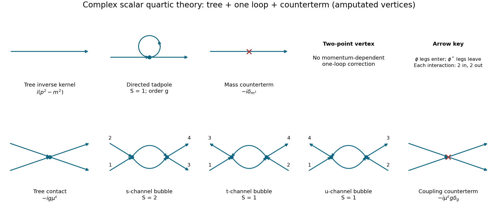

<h1 id="3/d/solution">Solution</h1>

↑ **Parent:** [D](../d.md)

Use renormalized [propagators](../../../../propagator.md) of [mass](../../../../mass.md) $m$ and tree vertex $-ig\mu^\epsilon$. The interaction [counterterms](../../../../counterterm.md) have Feynman factors $-i\delta_{m^2}$ for a two-leg [mass](../../../../mass.md) insertion and $-i\mu^\epsilon g\delta_g$ for a four-leg insertion. At one loop the two-point [one-particle-irreducible vertex](../../../../one-particle-irreducible-vertex.md) is

$$
i\Gamma^{(2)}(p)=i(p^2-m^2)-i\delta_{m^2}
+(-ig\mu^\epsilon)\int_k\frac{i}{k^2-m^2+i0}+O(g^2).
$$

The directed tadpole has $S=1$: interchanging its two ends would reverse the [field](../../../../field.md) labels, so the real-scalar tadpole's factor $1/2$ does not apply. It is independent of external [momentum](../../../../momentum-split.md), so no wave-function [counterterm](../../../../counterterm.md) is required at this order.

For the four-point vertex, label the two unstarred incoming [fields](../../../../field.md) by $1,2$ and the starred ones by $3,4$, with all [momenta](../../../../momentum-split.md) incoming. The tree contact, the three oriented bubbles and the contact [counterterm](../../../../counterterm.md) give

$$
\begin{aligned}
i\Gamma^{(4)}={}&-ig\mu^\epsilon-i\mu^\epsilon g\delta_g\\
&+(-ig\mu^\epsilon)^2\left[\frac12 I_2(p_1+p_2)+I_2(p_1+p_3)+I_2(p_1+p_4)\right]+O(g^3).
\end{aligned}
$$

The first bubble has two equivalent arrows along the same direction between its vertices, giving $S=2$. In the other two channels the arrows oppose one another, and interchanging the lines does not preserve their oriented attachments, giving $S=1$. This is the [oriented complex-scalar quartic graph factors](../../../../oriented-complex-scalar-quartic-graph-factors.md) rule.

The [mass](../../../../mass.md) tadpole is order $gm^2$, while the four-point loop is order $g^2$. In the multiplicative [coupling](../../../../coupling.md) convention of the source,

$$
\boxed{\delta_{m^2}=O(gm^2/\epsilon),\qquad \delta_g=O(g/\epsilon),\qquad g\delta_g=O(g^2/\epsilon).}
$$

The distinction between $\delta_g$ and the whole additive four-leg coefficient $g\delta_g$ matters for the requested order counting.

**[Figure 2](#3/d/image-tree-loop-and-counterterm-contributions-to-the-two-point-and-four-point-vertices-of-a-complex-scalar-field). Tree, loop and counterterm contributions to the two-point and four-point vertices of a complex scalar field**.

## ↑ Ancestors (12)

1. [D](../d.md)
2. [3](../../3.md)
3. [2017](../../../2017-split.md)
4. [Past exam of the quantum field theory course of the University of Oxford](../../../split.md)
5. [Quantum field theory course of the University of Oxford](../../../../quantum-field-theory-course-of-the-university-of-oxford.md)
6. [Year 4 of the mathematical and theoretical physics course of the University of Oxford](../../../../year-4-of-the-mathematical-and-theoretical-physics-course-of-the-university-of-oxford.md)
7. [Mathematical and theoretical physics course of the University of Oxford](../../../../mathematical-and-theoretical-physics-course-of-the-university-of-oxford.md)
8. [Undergraduate course of the University of Oxford](../../../../undergraduate-course-of-the-university-of-oxford.md)
9. [Course of the University of Oxford](../../../../course-of-the-university-of-oxford.md)
10. [University of Oxford](../../../../university-of-oxford-split.md)
11. [List of universities](../../../../list-of-universities.md)
12. [Codex Wiki](../../../../split.md)
