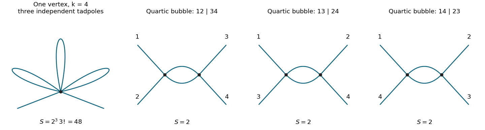
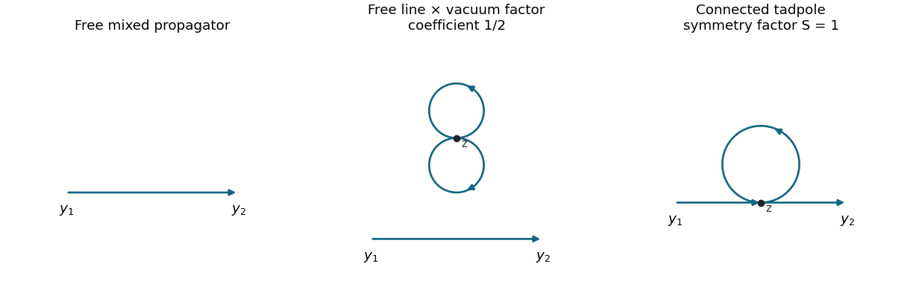
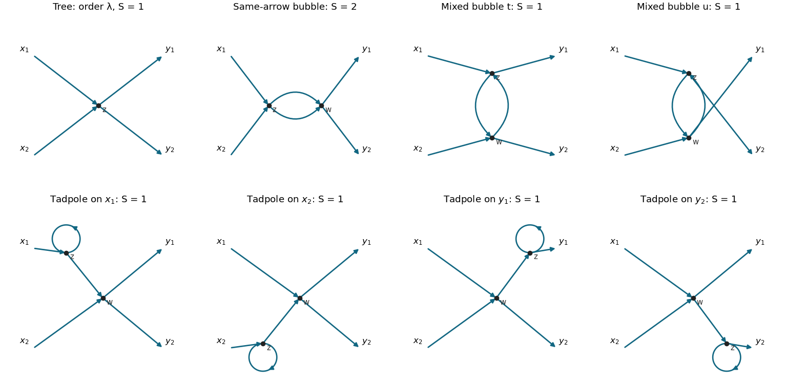

# 2018

↑ **Parent:** [Past exam of the quantum field theory course of the University of Oxford](../past-exam-of-the-quantum-field-theory-course-of-the-university-of-oxford.md)

Source paper: [https://www.whatdotheyknow.com/request/oxford_physics_past_papers_2/response/2340696/attach/6/Physics%20Papers%202017.pdf?cookie_passthrough=1](https://www.whatdotheyknow.com/request/oxford_physics_past_papers_2/response/2340696/attach/6/Physics%20Papers%202017.pdf?cookie_passthrough=1)

The scanned cover establishes Hilary Term 2018, despite the containing bundle's 2017 filename. Use $\hbar=c=1$, the [Minkowski metric](../special-relativity.md#minkowski-metric) signature $(+,-,\ldots,-)$ outside question 2, which uses [Euclidean space](../normed-vector-space.md#euclidean-norm), and $p\cdot x=E_{\mathbf p}t-\mathbf p\cdot\mathbf x$. The phase and normalization conflicts in question 4 are identified in [a](#4/a); its [path integral](../quantum-field-theory.md#path-integral) is evaluated with the normalization of its displayed [action](../lagrangian-mechanics.md#action).

**Table of contents**

- [1](#1)
  - [a](#1/a)
    - [Solution](#1/a/solution)
  - [b](#1/b)
    - [Solution](#1/b/solution)
  - [c](#1/c)
    - [Solution](#1/c/solution)
- [2](#2)
  - [a](#2/a)
    - [Solution](#2/a/solution)
  - [b](#2/b)
    - [Solution](#2/b/solution)
  - [c](#2/c)
    - [Solution](#2/c/solution)
  - [d](#2/d)
    - [Solution](#2/d/solution)
  - [e](#2/e)
    - [Solution](#2/e/solution)
- [3](#3)
  - [a](#3/a)
    - [Solution](#3/a/solution)
  - [b](#3/b)
    - [Solution](#3/b/solution)
  - [c](#3/c)
    - [Solution](#3/c/solution)
  - [d](#3/d)
    - [Solution](#3/d/solution)
- [4](#4)
  - [a](#4/a)
    - [Solution](#4/a/solution)
  - [b](#4/b)
    - [Solution](#4/b/solution)
  - [c](#4/c)
    - [Solution](#4/c/solution)

## 1

↑ **Parent:** [2018](2018.md)

<h3 id="1/a">a</h3>

↑ **Parent:** [1](#1)

<h4 id="1/a/solution">Solution</h4>

↑ **Parent:** [A](#1/a)

Divide the infinitesimal [variation](../calculus-of-variations.md#variation) by its constant parameter $\alpha$, so the transformation generator is $(\delta\phi_1,\delta\phi_2)=(\phi_2,-\phi_1)$. The variation of the [kinetic term](../classical-field-theory.md#kinetic-term) is

$$
\partial_\mu\phi_1\partial^\mu\phi_2-\partial_\mu\phi_2\partial^\mu\phi_1=0,
$$

and that of $\phi_1^2+\phi_2^2$ is $2\phi_1\phi_2-2\phi_2\phi_1=0$. Thus the [Lagrangian density](../classical-field-theory.md#lagrangian-density) is invariant pointwise, without a nonzero boundary current. The finite transformation is a rotation of the two [real scalar fields](../scalar-field-theory.md#real-scalar-field), giving an [SO(2)](../linear-algebra.md#special-orthogonal-group-in-two-dimensions) [global symmetry in field theory](../classical-field-theory.md#global-symmetry-in-field-theory).

[Noether's theorem](../calculus-of-variations.md#noether-conserved-quantity-for-a-mechanical-point-symmetry) supplies the parameter-independent [Noether current](../classical-field-theory.md#noether-current)

$$
\boxed{j^\mu=\phi_2\partial^\mu\phi_1-\phi_1\partial^\mu\phi_2.}
$$

Its [divergence](../multivariable-calculus.md#divergence) is $\partial_\mu j^\mu=\phi_2\Box\phi_1-\phi_1\Box\phi_2$, since the first-derivative terms cancel. Both fields obey the same [Klein-Gordon equation](../wave-equation.md#klein-gordon-equation), so this vanishes on solutions. With spatial boundary conditions giving zero flux at infinity, the [Noether charge](../classical-field-theory.md#noether-charge) is

$$
\boxed{Q=\int d^3x\,(\phi_2\dot\phi_1-\phi_1\dot\phi_2),\qquad \dot Q=0.}
$$

A finite box with periodic [boundary conditions](../differential-equation.md#boundary-condition) works as well. The spatial integral is conserved because the local [continuity equation](../mathematical-physics.md#continuity-equation) converts its time derivative into a boundary flux; neither vanishing local current nor constant individual fields is required. Equivalently, $\Phi=(\phi_1+i\phi_2)/\sqrt2$ transforms as $\Phi\mapsto e^{-i\alpha}\Phi$, exhibiting the equivalent [global U(1) symmetry](../scalar-field-theory.md#global-u-1-symmetry) and fixing the sign of the generator.

<h3 id="1/b">b</h3>

↑ **Parent:** [1](#1)

<h4 id="1/b/solution">Solution</h4>

↑ **Parent:** [B](#1/b)

The [canonical momenta](../hamiltonian-mechanics.md#canonical-momentum) are $\pi_k=\dot\phi_k$, so

$$
Q=\int d^3x\,(\phi_2\pi_1-\phi_1\pi_2).
$$

Different species commute at equal times, so these products have no ordering ambiguity and $Q$ is [Hermitian](../hilbert-space.md#hermitian-operator). Write $\int_{\mathbf p}=\int d^3p/(2\pi)^3$. Substituting the [mode expansion of a free field](../quantum-field-theory.md#mode-expansion-of-a-free-field) and using the spatial [Fourier transform](../fourier-transform.md) identity gives

$$
\int d^3x\,\phi_2\pi_1
=-\frac i2\int_{\mathbf p}
(a_{2,\mathbf p}+a_{2,-\mathbf p}^\dagger)
(a_{1,-\mathbf p}-a_{1,\mathbf p}^\dagger).
$$

Subtract the expression with species interchanged. The two-annihilator terms cancel after $\mathbf p\mapsto-\mathbf p$, as do the two-creator terms. Commuting different species in the remaining terms yields

$$
\boxed{Q=-i\int_{\mathbf p}
(a_{2,\mathbf p}^\dagger a_{1,\mathbf p}-a_{1,\mathbf p}^\dagger a_{2,\mathbf p}).}
$$

There is no infinite [vacuum](../physics.md#vacuum) contribution to the [Noether charge](../classical-field-theory.md#noether-charge) to subtract: the contractions that would generate a species-diagonal constant are absent.

The bosonic [canonical commutation relations](../quantum-mechanics.md#canonical-commutation-relation) give

$$
[Q,a_{1,\mathbf p}^\dagger]=-ia_{2,\mathbf p}^\dagger,
\qquad [Q,a_{2,\mathbf p}^\dagger]=ia_{1,\mathbf p}^\dagger.
$$

Define the [creation operators](../quantum-harmonic-oscillator.md#creation-operator)

$$
c_{+,\mathbf p}^\dagger=\frac{a_{1,\mathbf p}^\dagger-ia_{2,\mathbf p}^\dagger}{\sqrt2},
\qquad
c_{-,\mathbf p}^\dagger=\frac{a_{1,\mathbf p}^\dagger+ia_{2,\mathbf p}^\dagger}{\sqrt2}.
$$

Their [commutators](../lie-algebra.md#commutator) with $Q$ are $[Q,c_\pm^\dagger]=\pm c_\pm^\dagger$. Since $Q|0\rangle=0$, the [one-particle states](../quantum-field-theory.md#one-particle-state) have

$$
\boxed{Q\,c_{\pm,\mathbf p}^\dagger|0\rangle
=\pm c_{\pm,\mathbf p}^\dagger|0\rangle.}
$$

The fixed-[momentum](../momentum.md) states are delta-function normalized; a square-integrable [wave packet](../dispersion-relation.md#wave-packet) of either species is a normalizable state with the same [Noether charge](../classical-field-theory.md#noether-charge) [eigenvalue](../linear-operator-theory.md#eigenvalue). In this basis $Q=\int_{\mathbf p}(c_+^\dagger c_+-c_-^\dagger c_-)$, so it measures a difference of occupation numbers. The equal-time identity $i[Q,\phi_1]=\phi_2$, $i[Q,\phi_2]=-\phi_1$ independently checks the sign against [a](#1/a).

<h3 id="1/c">c</h3>

↑ **Parent:** [1](#1)

<h4 id="1/c/solution">Solution</h4>

↑ **Parent:** [C](#1/c)

Take the free [squared mass](../classical-field-theory.md#squared-mass) $m^2\geq0$, as for the ordinary massive free theory. The quartic part of the [scalar potential](../classical-field-theory.md#scalar-potential) can be written

$$
V_4=\lambda(\phi_1^2-\phi_2^2)^2+2(\lambda+\kappa)\phi_1^2\phi_2^2.
$$

It is nonnegative for every real field value exactly when

$$
\boxed{\lambda\geq0,\qquad \lambda+\kappa\geq0.}
$$

Necessity follows from the axis $\phi_2=0$ and the diagonal $\phi_1=\phi_2$: a negative coefficient on either ray makes $V$ tend to minus infinity under rescaling. The displayed sum proves sufficiency, since $m^2(\phi_1^2+\phi_2^2)/2$ is also nonnegative. This is a [copositive matrix](../linear-algebra.md#copositive-matrix) condition on the quadratic form in the nonnegative variables $(\phi_1^2,\phi_2^2)$, rather than positive definiteness on all independent signed variables.

The strict inequalities $\lambda>0$, $\kappa>-\lambda$ make the quartic part grow in every nonzero direction. They are not necessary for a stable [vacuum](../physics.md#vacuum) when $m^2>0$. For example, $\lambda=\kappa=0$ gives two stable free massive fields; $\lambda>0$, $\kappa=-\lambda$ has a flat quartic diagonal but a confining quadratic term. If $m^2=0$, boundary cases have flat vacuum directions and need not have a unique isolated minimum. If one instead allows negative [squared mass](../classical-field-theory.md#squared-mass), a flat quartic ray makes the full potential unbounded below; the stability conditions must then be strengthened. This distinguishes boundedness from strict quartic coercivity.

Under the generator of [a](#1/a), the variation is

$$
\delta V_4=4(\lambda-\kappa)\phi_1\phi_2(\phi_1^2-\phi_2^2).
$$

It vanishes identically if and only if $\kappa=\lambda$. In that case $V_4=\lambda(\phi_1^2+\phi_2^2)^2$ preserves the entire [global U(1) symmetry](../scalar-field-theory.md#global-u-1-symmetry). More explicitly, the interacting [Euler-Lagrange equations](../analysis.md#euler-lagrange-equation) give

$$
\partial_\mu j^\mu=-\delta V_4
=4(\kappa-\lambda)\phi_1\phi_2(\phi_1^2-\phi_2^2).
$$

Hence

$$
\boxed{Q\text{ is a conserved operator of the interacting theory exactly when }\kappa=\lambda.}
$$

A special solution lying on an axis does not establish an operator conservation law. Among the stable couplings, the symmetry-preserving line is $\kappa=\lambda\geq0$.

## 2

↑ **Parent:** [2018](2018.md)

<h3 id="2/a">a</h3>

↑ **Parent:** [2](#2)

<h4 id="2/a/solution">Solution</h4>

↑ **Parent:** [A](#2/a)

Use [mass dimensions](../perturbative-quantum-field-theory.md#mass-dimension) with $[x]=-1$, $[\partial_\mu]=1$ and dimensionless [action](../lagrangian-mechanics.md#action). The [Lagrangian density](../classical-field-theory.md#lagrangian-density) in [Euclidean space](../normed-vector-space.md#euclidean-norm) has dimension $D$, and the [kinetic term](../classical-field-theory.md#kinetic-term) fixes $2+2[\phi_0]=D$. Thus

$$
[\phi_0]=\frac{D-2}{2},\qquad
\boxed{[\lambda_{2k}]=D-k(D-2)=2k-(k-1)D\equiv d_k.}
$$

A dimensionless [coupling constant](../statistical-model.md#coupling-constant-physics) is therefore

$$
\boxed{g_{2k}(\mu)=\mu^{-d_k}\lambda_{2k},\qquad
\lambda_{2k}=\mu^{d_k}g_{2k}.}
$$

Here $\mu$ is a positive [regularization](../statistical-learning.md#regularization) scale with [mass dimension](../perturbative-quantum-field-theory.md#mass-dimension) one. The interaction is marginal at its [upper critical dimension](../critical-phenomenon.md#upper-critical-dimension) $D_c=2k/(k-1)$, relevant below it and irrelevant above it by this engineering-dimension test. In particular, $d_2=4-D$, while $d_k=4-2k+2(k-1)\epsilon$ near $D=4-2\epsilon$. At this stage $g_{2k}$ is the dimensionless version of the displayed bare coupling; after introducing [counterterms](../perturbative-quantum-field-theory.md#counterterm) one may use the same scale factor for the [renormalized coupling](../perturbative-quantum-field-theory.md#renormalized-coupling).

<h3 id="2/b">b</h3>

↑ **Parent:** [2](#2)

<h4 id="2/b/solution">Solution</h4>

↑ **Parent:** [B](#2/b)

Expand the normalized [Euclidean path integral](../quantum-field-theory.md#euclidean-path-integral) with weight $e^{-S_E}$ and apply [Wick's theorem](../perturbative-quantum-field-theory.md#wick-s-theorem). Use labelled external [momenta](../momentum.md) and a fixed [Fourier transform](../fourier-transform.md) convention throughout. A line carrying [momentum](../momentum.md) $q$ contributes $(q^2+m_0^2)^{-1}$. Each $2k$-valent [interaction vertex](../perturbative-quantum-field-theory.md#interaction-vertex) contributes $-\lambda_{2k}=-\mu^{d_k}g_{2k}$: its $(2k)!$ possible contractions cancel the factorial in the [Lagrangian density](../classical-field-theory.md#lagrangian-density). A vertex also carries $(2\pi)^D\delta^{(D)}(\sum q)$ with all incident [momenta](../momentum.md) incoming. Integrate each independent [loop momentum](../perturbative-quantum-field-theory.md#loop-momentum) with $d^Dq/(2\pi)^D$ and divide by the [Feynman-diagram symmetry factor](../perturbative-quantum-field-theory.md#feynman-diagram-symmetry-factor) for fixed external labels. There are no Minkowski factors of $i$.

For the full $N$-point [Green's function](../green-s-function.md), include every graph in which all vertices belong to components attached to external insertions. In particular, disconnected components carrying external insertions must be included, and the zeroth-order result is the sum of free pairings. Pure [vacuum bubbles](../perturbative-quantum-field-theory.md#vacuum-feynman-diagram) cancel against the denominator. The connected [Green's function](../green-s-function.md) restricts to connected graphs, while a [one-particle-irreducible vertex](../perturbative-quantum-field-theory.md#one-particle-irreducible-vertex) imposes the stronger restriction that removing one internal line cannot disconnect the graph. These are different objects. Odd $N$ vanishes in the symmetric [vacuum](../physics.md#vacuum) because every interaction has even valence. At fixed perturbative order, multiply by the appropriate power of the coupling and sum all allowed graph topologies and external attachments.

If the overall momentum-conservation delta function is removed by convention, report the remaining function as its coefficient. The ordinary unamputated [Green's function](../green-s-function.md) includes external [scalar propagators](../scalar-field-theory.md#scalar-propagator); dividing them out defines an amputated function. The definition in [c](#2/c) performs this amputation but does not, by itself, impose the usual one-particle-irreducibility condition.

<h3 id="2/c">c</h3>

↑ **Parent:** [2](#2)

<h4 id="2/c/solution">Solution</h4>

↑ **Parent:** [C](#2/c)

The [single-vertex scalar two-point graph](../perturbative-quantum-field-theory.md#single-vertex-scalar-two-point-graph) at first order in $g_{2k}$ has one $2k$-valent [interaction vertex](../perturbative-quantum-field-theory.md#interaction-vertex). Attach the two external lines to it and pair its remaining $2k-2$ legs into $k-1$ [tadpole diagrams](../perturbative-quantum-field-theory.md#tadpole-diagram). The graph is connected, has $L=k-1$ independent [loop momenta](../perturbative-quantum-field-theory.md#loop-momentum), and is momentum independent after amputation apart from the overall [Dirac delta function](../distribution-theory.md#dirac-delta-function). In particular, first order in the coupling need not mean one loop.

The number of contractions with fixed external labels is

$$
(2k)(2k-1)\frac{(2k-2)!}{2^{k-1}(k-1)!}.
$$

Dividing by the interaction factorial $(2k)!$ gives the inverse [Feynman-diagram symmetry factor](../perturbative-quantum-field-theory.md#feynman-diagram-symmetry-factor) $1/[2^{k-1}(k-1)!]$. Use $m>0$ for the mass in the lowest-order propagator and define the [tadpole integral](../perturbative-quantum-field-theory.md#tadpole-integral)

$$
T_D(m)=\int\frac{d^Dq}{(2\pi)^D}\frac1{q^2+m^2}.
$$

The linear-order correction to the amputated function is consequently

$$
\boxed{\Gamma^{(2)}_{\mathrm{lin}}(p_1,p_2)
=-(2\pi)^D\delta^{(D)}(p_1+p_2)
\frac{\mu^{d_k}g_{2k}}{2^{k-1}(k-1)!}\,T_D(m)^{k-1}.}
$$

This is the correction to the paper's amputated connected correlator, not a definition of an inverse-propagator self-energy with an unspecified sign. At this order using $m_0$ instead of $m$ gives the same lowest-order integral.

For completeness, [Schwinger parameterization](../perturbative-quantum-field-theory.md#schwinger-parameterization) and a [Gaussian integral](../integral.md#gaussian-integral) give

$$
\begin{aligned}
T_D(m)&=\frac1{(4\pi)^{D/2}}\int_0^\infty d\alpha\,\alpha^{-D/2}e^{-\alpha m^2}\\
&=\frac{(m^2)^{D/2-1}}{(4\pi)^{D/2}}\Gamma(1-D/2).
\end{aligned}
$$

This first converges for $0<D<2$ and then defines its [dimensional regularization](../perturbative-quantum-field-theory.md#dimensional-regularization) continuation. At $D=4-2\epsilon$, the [Gamma function](../complex-analysis.md#gamma-function) expansion yields

$$
\mu^{2\epsilon}T_D(m)
=-\frac{m^2}{16\pi^2}\left[\frac1\epsilon+1-\gamma_E+\log\frac{4\pi\mu^2}{m^2}+O(\epsilon)\right].
$$

Thus its highest [ultraviolet pole](../perturbative-quantum-field-theory.md#ultraviolet-pole) is

$$
\boxed{\Gamma^{(2)}_{\mathrm{lin}}
=(2\pi)^D\delta^{(D)}(p_1+p_2)
\frac{(-1)^k g_{2k}\mu^{4-2k}(m^2)^{k-1}}
{2^{k-1}(k-1)!(16\pi^2)^{k-1}\epsilon^{k-1}}
+O(\epsilon^{-(k-2)}).}
$$

For $k=2$ the remainder means finite terms. For $k>2$ the unrenormalized graph has a higher-order pole from its independent [ultraviolet subdivergences](../perturbative-quantum-field-theory.md#ultraviolet-subdivergence), rather than only a simple pole. A massless [tadpole integral](../perturbative-quantum-field-theory.md#tadpole-integral) is scaleless and vanishes in [dimensional regularization](../perturbative-quantum-field-theory.md#dimensional-regularization); that does not justify discarding the massive [ultraviolet divergence](../perturbative-quantum-field-theory.md#ultraviolet-divergence) by setting $m=0$ before separating ultraviolet and infrared effects.

**[Figure 1](#2/c/image-a-single-higher-valence-vertex-with-three-tadpole-loops-and-the-three-one-loop-quartic-bubble-channels). A single higher-valence vertex with three tadpole loops, and the three one-loop quartic bubble channels**. The first panel illustrates k=4; in general there are k minus one loops. The three remaining panels have identical topology and different labelled external attachments.

<h3 id="2/d">d</h3>

↑ **Parent:** [2](#2)

<h4 id="2/d/solution">Solution</h4>

↑ **Parent:** [D](#2/d)

The change of field and parameters separates the [Lagrangian density](../classical-field-theory.md#lagrangian-density) in [Euclidean space](../normed-vector-space.md#euclidean-norm) into

$$
\begin{aligned}
\mathcal L_{\mathrm{ren}}&=\frac12(\partial\phi)^2+\frac12m^2\phi^2
+\frac{\widetilde\lambda_{2k}}{(2k)!}\phi^{2k},\\
\mathcal L_{\mathrm{ct}}&=\frac12\delta Z(\partial\phi)^2+\frac12\delta m^2\phi^2
+\frac{\delta\lambda_{2k}}{(2k)!}\phi^{2k}.
\end{aligned}
$$

The two-leg [counterterm](../perturbative-quantum-field-theory.md#counterterm) [interaction vertex](../perturbative-quantum-field-theory.md#interaction-vertex) is $-(\delta Zp^2+\delta m^2)$, with the overall [momentum conservation](../momentum.md#momentum-conservation) delta function understood. With $D_0(p)=1/(p^2+m^2)$, the explicit first-order contribution to the [propagator](../quantum-field-theory.md#propagator) is

$$
\boxed{\delta D_{\mathrm{ct}}(p)
=-\frac{\delta Zp^2+\delta m^2}{(p^2+m^2)^2}.}
$$

The minus sign follows either from expanding $e^{-S_{\mathrm{ct}}}$ or from expanding $(p^2+m^2+\delta Zp^2+\delta m^2)^{-1}$.

For $k=2$, the loop correction is $-\widetilde\lambda_4T_D(m)D_0(p)^2/2$. Its [ultraviolet pole](../perturbative-quantum-field-theory.md#ultraviolet-pole) from [c](#2/c) is

$$
\delta D_{\mathrm{loop}}\big|_{\mathrm{pole}}
=\frac{g_4m^2}{32\pi^2\epsilon}\,D_0(p)^2,
\qquad \widetilde\lambda_4=\mu^{2\epsilon}g_4.
$$

There is no external $p^2$ dependence in the amputated [tadpole diagram](../perturbative-quantum-field-theory.md#tadpole-diagram), so no one-loop [wave-function renormalization](../perturbative-quantum-field-theory.md#wave-function-renormalization) is required. The [minimal subtraction scheme](../perturbative-quantum-field-theory.md#minimal-subtraction-scheme) therefore gives

$$
\boxed{\delta Z^{(1)}=0,\qquad
\delta m^{2(1)}=\frac{g_4m^2}{32\pi^2\epsilon}.}
$$

Only the pole is subtracted: including $1-\gamma_E+\log4\pi$ would impose a different finite subtraction prescription. The defined $\delta m^2$ is the coefficient in $Zm_0^2=m^2+\delta m^2$, not automatically the difference $m_0^2-m^2$ beyond this order.

<h3 id="2/e">e</h3>

↑ **Parent:** [2](#2)

<h4 id="2/e/solution">Solution</h4>

↑ **Parent:** [E](#2/e)

Use the [wave-function renormalization](../perturbative-quantum-field-theory.md#wave-function-renormalization) coefficient and [anomalous dimension](../critical-phenomenon.md#anomalous-dimension) definition stipulated in this part, keeping their signs and normalization. Put $A=1/[6(32\pi^2)^2]$. To the required order,

$$
\log Z=A\frac{g_4^2}{\epsilon}+O(g_4^3).
$$

At fixed bare $\lambda_4$, the leading change of the dimensionless coupling is $\mu\,dg_4/d\mu=-2\epsilon g_4+O(g_4^2)$, because $\lambda_4$ has [mass dimension](../perturbative-quantum-field-theory.md#mass-dimension) $2\epsilon$. Therefore the chain rule, applied before setting $\epsilon=0$, gives

$$
\begin{aligned}
\gamma(g_4)&=-\beta_\epsilon(g_4)\frac{\partial\log Z}{\partial g_4}\\
&=-(-2\epsilon g_4)\frac{2Ag_4}{\epsilon}+O(g_4^3)
=4Ag_4^2+O(g_4^3).
\end{aligned}
$$

Thus

$$
\boxed{\gamma(g_4)=\frac{g_4^2}{6(16\pi^2)^2}+O(g_4^3).}
$$

The vanishing engineering contribution $-2\epsilon g_4$ multiplies a pole and leaves a finite answer. Dropping it at the start would incorrectly give zero. The numerical answer is conditional on the supplied two-loop coefficient. A convention defining the field anomalous dimension as $\gamma_\phi=\tfrac12\mu\,d\log Z/d\mu$ instead gives $\gamma_\phi=-\gamma/2$ for the same $Z$; substituting that convention silently would answer a different question.

## 3

↑ **Parent:** [2018](2018.md)

<h3 id="3/a">a</h3>

↑ **Parent:** [3](#3)

<h4 id="3/a/solution">Solution</h4>

↑ **Parent:** [A](#3/a)

A [phi-fourth theory](../scalar-field-theory.md#quartic-interaction) interaction has [mass dimension](../perturbative-quantum-field-theory.md#mass-dimension) $4-D$, so its bare coefficient must contain a [renormalization scale](../perturbative-quantum-field-theory.md#renormalization-scale) factor $\mu^{4-D}=(\mu^2)^{2-D/2}$ when expressed through a dimensionless [renormalized coupling](../perturbative-quantum-field-theory.md#renormalized-coupling). The tree-level four-leg [interaction vertex](../perturbative-quantum-field-theory.md#interaction-vertex) is linear in that coupling. At the next order, two quartic vertices form the three one-loop [bubble diagram](../perturbative-quantum-field-theory.md#bubble-diagram) graphs shown in [c](#2/c), with external pairings $12|34$, $13|24$ and $14|23$.

For each pairing there are two identical internal lines and [Feynman-diagram symmetry factor](../perturbative-quantum-field-theory.md#feynman-diagram-symmetry-factor) 2. The loop integral has the large-[momentum](../momentum.md) behaviour

$$
\int\frac{d^Dq}{(2\pi)^D}\frac1{q^2(q+P)^2}
\sim\int^\infty dq\,q^{D-5}.
$$

It is logarithmically divergent in four dimensions. [Dimensional regularization](../perturbative-quantum-field-theory.md#dimensional-regularization) represents that local divergence by a simple pole proportional to $1/(D-4)$. Its residue is independent of external [momenta](../momentum.md), so a local quartic [counterterm](../perturbative-quantum-field-theory.md#counterterm) cancels it. The three graphs sum to one constant coefficient; this argument establishes its structure without requiring its value.

The relation consequently has the form

$$
\boxed{\lambda_0=\mu^{4-D}\left[g+\frac{Cg^2}{D-4}+O(g^3)\right].}
$$

The sign of $C$ incorporates the chosen pole denominator and vertex convention. In particular, a negative $C$ here corresponds to a positive coefficient of $1/(4-D)$ in the bare coupling. Finite pieces depend on the [renormalization scheme](../perturbative-quantum-field-theory.md#renormalization-scheme); a pure-pole relation is natural in [minimal subtraction scheme](../perturbative-quantum-field-theory.md#minimal-subtraction-scheme). One-loop two-point [tadpole diagrams](../perturbative-quantum-field-theory.md#tadpole-diagram) contribute [mass](../classical-mechanics.md#mass) [renormalization](../perturbative-quantum-field-theory.md#renormalization), but not the momentum-dependent [field renormalization](../perturbative-quantum-field-theory.md#wave-function-renormalization) that could change this coupling relation at order $g^2$. The four-point object relevant here is the amputated [one-particle-irreducible vertex](../perturbative-quantum-field-theory.md#one-particle-irreducible-vertex); external-leg [self-energy](../perturbative-quantum-field-theory.md#self-energy) insertions are dealt with separately.

<h3 id="3/b">b</h3>

↑ **Parent:** [3](#3)

<h4 id="3/b/solution">Solution</h4>

↑ **Parent:** [B](#3/b)

Let $\delta=4-D$ and $F(g)=g-Cg^2/\delta+O(g^3)$. Since changing the arbitrary [renormalization scale](../perturbative-quantum-field-theory.md#renormalization-scale) must leave the bare theory fixed,

$$
0=\mu\frac{d}{d\mu}\big[\mu^\delta F(g)\big]
=\mu^\delta\big[\delta F(g)+\beta(g)F'(g)\big].
$$

Write $\beta(g)=-\delta g+bg^2+O(g^3)$. Substitution gives, through order $g^2$,

$$
0=\delta g-Cg^2+(-\delta g+bg^2)
\left(1-\frac{2Cg}{\delta}\right)
=(b+C)g^2+O(g^3).
$$

Therefore $b=-C$, and the specified residue gives the [renormalization-group beta function](../perturbative-quantum-field-theory.md#beta-function-physics)

$$
\boxed{\beta(g)=-(4-D)g+\frac3{16\pi^2}g^2+O(g^3).}
$$

The derivative is at fixed bare parameters. It does not say the physical theory changes when $\mu$ changes; the [running coupling](../perturbative-quantum-field-theory.md#running-coupling) compensates the scale used to describe it. The coefficient also depends on defining the derivative with respect to $\log\mu$, rather than $\log\mu^2$; using the latter would divide both terms by two.

<h3 id="3/c">c</h3>

↑ **Parent:** [3](#3)

<h4 id="3/c/solution">Solution</h4>

↑ **Parent:** [C](#3/c)

In four dimensions set $b=3/(16\pi^2)$ and retain the one-loop [beta function](../complex-analysis.md#beta-function) $dg/d\log\mu=bg^2$. On an interval where $g\ne0$, differentiate its inverse:

$$
\frac{d(1/g)}{d\log\mu}=-b.
$$

Integrating between $\mu_s$ and $\mu$ yields

$$
\frac1{g(\mu)}=\frac1{g_s}-b\log\frac\mu{\mu_s},\qquad
\boxed{g(\mu)=\frac{g_s}{1-\dfrac{3g_s}{16\pi^2}\log(\mu/\mu_s)}.}
$$

The $g_s=0$ solution is identically zero and is also the continuous limit of this expression. Expanding the denominator gives $g(\mu)=g_s+bg_s^2\log(\mu/\mu_s)+\cdots$, directly checking the perturbative sign.

For positive $g_s$, the [running coupling](../perturbative-quantum-field-theory.md#running-coupling) decreases towards the infrared and increases towards the ultraviolet. The one-loop expression has a [Landau pole](../perturbative-quantum-field-theory.md#landau-pole) at

$$
\mu_L=\mu_s\exp\left(\frac{16\pi^2}{3g_s}\right).
$$

This is the scale where the truncated solution diverges, not a controlled perturbative prediction of a physical singularity at arbitrarily strong coupling. The formula is quantitatively reliable while the running coupling remains small enough that omitted higher-loop terms are negligible. It resums the leading logarithms of that approximate [renormalization group](../critical-phenomenon.md#renormalization-group) equation; it is not the exact all-orders solution of the theory.

<h3 id="3/d">d</h3>

↑ **Parent:** [3](#3)

<h4 id="3/d/solution">Solution</h4>

↑ **Parent:** [D](#3/d)

For a [fixed point](../function.md#fixed-point) $g^*$ with $\beta(g^*)=0$, put $g=g^*+h$. To first order in the displacement,

$$
\frac{dh}{d\log\mu}=\beta'(g^*)h,\qquad
h(\mu)=h(\mu_s)\left(\frac\mu{\mu_s}\right)^{\beta'(g^*)}.
$$

Hence $\beta'(g^*)<0$ means ultraviolet attraction, since $h\to0$ as $\mu\to\infty$; $\beta'(g^*)>0$ means infrared attraction, since $h\to0$ as $\mu\to0$. If the derivative vanishes, the linear test is inconclusive and higher terms determine the direction of flow.

For $\delta=4-D>0$ and $b=3/(16\pi^2)$, the retained [beta function](../complex-analysis.md#beta-function) is $-\delta g+bg^2$. Its two zeros and slopes are

$$
\begin{array}{c|c}
 g&\beta'(g)\\\hline
 0&-\delta\\
 \delta/b&+\delta
\end{array}.
$$

Thus the positive interacting [Wilson-Fisher fixed point](../critical-phenomenon.md#wilson-fisher-fixed-point) is

$$
\boxed{g^*=(4-D)\frac{16\pi^2}{3},\qquad \beta'(g^*)=4-D>0,}
$$

and is infrared attractive in the coupling direction. Couplings between zero and $g^*$ increase towards $g^*$ when the scale decreases; those just above $g^*$ decrease towards it. The Gaussian [fixed point](../function.md#fixed-point) $g=0$ is ultraviolet attractive for $D<4$.

The conclusion is local and perturbative. For $4-D\ll1$, $bg^*=4-D$ is small, making the expansion controlled; extrapolation far below four dimensions requires more information. It is also a statement about the displayed coupling flow, not stability against every possible deformation of the full theory. In particular, the [mass term](../classical-field-theory.md#mass-term) is a relevant perturbation of the critical theory and must be tuned to reach the massless critical surface. Calling this fixed point infrared stable must not erase that additional relevant direction.

## 4

↑ **Parent:** [2018](2018.md)

<h3 id="4/a">a</h3>

↑ **Parent:** [4](#4)

<h4 id="4/a/solution">Solution</h4>

↑ **Parent:** [A](#4/a)

**The displayed oscillator expansion and the displayed [action](../lagrangian-mechanics.md#action) require two separate corrections to describe one conventional positive-energy theory.** First compute what the oscillator algebra literally implies. Assume the two oscillator species commute with each other and annihilate the [vacuum](../physics.md#vacuum). Same-charge contractions vanish, so

$$
\boxed{\langle T\phi(x)\phi(y)\rangle_0
=\langle T\phi^*(x)\phi^*(y)\rangle_0=0.}
$$

For the two mixed contractions the printed phases give the same kernel, with $z=x-y$:

$$
\begin{aligned}
C_{\mathrm{lit}}(z)
&=\theta(z^0)\int\frac{d^3p}{(2\pi)^3\,2E_{\mathbf p}}e^{+ip\cdot z}
+\theta(-z^0)\int\frac{d^3p}{(2\pi)^3\,2E_{\mathbf p}}e^{-ip\cdot z}\\
&=\int\frac{d^4p}{(2\pi)^4}\frac{-i\,e^{-ip\cdot z}}{p^2-m^2-i0}.
\end{aligned}
$$

Thus $\langle T\phi(x)\phi^*(y)\rangle_0=\langle T\phi^*(x)\phi(y)\rangle_0=C_{\mathrm{lit}}(z)$. In $D$ dimensions replace $d^3p$ and $d^4p$ by $d^{D-1}p$ and $d^Dp$; the source's explicit three-dimensional spatial measure is the $D=4$ specialization. The covariant integral is manifestly [Lorentz invariant](../special-relativity.md#lorentz-invariance). With

$$
D_F(z)=\int\frac{d^Dp}{(2\pi)^D}\frac{i\,e^{-ip\cdot z}}{p^2-m^2+i0},
$$

we have $C_{\mathrm{lit}}(z)=D_F(z)^*$. This [reversed-frequency scalar contraction](../quantum-field-theory.md#reversed-frequency-scalar-contraction) has the opposite pole prescription to the usual positive-energy [Feynman propagator](../quantum-field-theory.md#feynman-propagator). For a single zero-[momentum](../momentum.md) mode at positive time separation, the printed contraction is $e^{+imt}/(2m)$, while $D_F$ is $e^{-imt}/(2m)$: this is a concrete phase counterexample, rather than an immaterial change of integration variable.

There is also a [normalization of a complex scalar propagator](../scalar-field-theory.md#normalization-of-a-complex-scalar-propagator) conflict independent of those phases. The displayed [Lagrangian density](../classical-field-theory.md#lagrangian-density) gives the [canonical momentum](../hamiltonian-mechanics.md#canonical-momentum) $\pi_\phi=\dot\phi^*/2$. Substituting the printed modes yields

$$
[\phi(t,\mathbf x),\pi_\phi(t,\mathbf y)]
=-\frac i2\delta^{(3)}(\mathbf x-\mathbf y),
$$

instead of the canonical $+i\delta^{(3)}$. Reversing the mode phases repairs the sign but leaves $+i\delta^{(3)}/2$, so it does not repair the normalization. The [complex scalar field](../scalar-field-theory.md#complex-scalar-field) convention with unit mixed propagator normally has no $1/2$ in its quadratic action.[§2.5, equations (2.67)–(2.73): complex-field kinetic normalization and canonical commutators](../physics-bibliography.md#quantum-field-theory-by-david-tong)

To retain the actual action in the paper, use $\phi=\phi_1+i\phi_2$ with canonically normalized real components, or equivalently replace its mode expansion by

$$
\phi(x)=\int\frac{d^{D-1}p}{(2\pi)^{D-1}\sqrt{E_{\mathbf p}}}
\left(a_{\mathbf p}e^{-ip\cdot x}+b_{\mathbf p}^\dagger e^{ip\cdot x}\right).
$$

The corresponding [path integral](../quantum-field-theory.md#path-integral) with the usual [Feynman i-epsilon prescription](../quantum-field-theory.md#feynman-i-epsilon-prescription) has

$$
\boxed{C(x,y)\equiv\langle T\phi(x)\phi^*(y)\rangle_0
=\langle T\phi^*(x)\phi(y)\rangle_0=2D_F(x-y),}
$$

with the two same-charge propagators still zero. This action-consistent kernel is used in [b](#4/b) and [c](#4/c). Keeping conventional unit modes instead would require removing the quadratic factors $1/2$ from the action as well as reversing the phases. Those are distinct theories unless the field and its coupling are rescaled together.

<h3 id="4/b">b</h3>

↑ **Parent:** [4](#4)

<h4 id="4/b/solution">Solution</h4>

↑ **Parent:** [B](#4/b)

Let $C(u,v)=2D_F(u-v)$ be the action-consistent free [propagator](../quantum-field-theory.md#propagator) established in [a](#4/a). Write $S=S_0+S_I$ and put

$$
V(z)=\phi(z)^2\phi^*(z)^2,\qquad
S_I=-\frac\lambda4\int d^Dz\,V(z).
$$

The perturbative expansion is

$$
e^{iS}=e^{iS_0}\sum_{n=0}^\infty\frac{(-i\lambda/4)^n}{n!}
\int\prod_{r=1}^n d^Dz_r\,\prod_{r=1}^nV(z_r).
$$

Divide numerator and denominator by the same free [vacuum functional](../perturbative-quantum-field-theory.md#vacuum-functional) $Z_0$. For $\mathcal O=\Phi(y_1)\cdots\Phi(y_N)$, they become

$$
\begin{aligned}
\mathcal N[\mathcal O]&=\sum_{n\geq0}\frac{(-i\lambda/4)^n}{n!}
\int\prod_r d^Dz_r\,\left\langle T\mathcal O\prod_r V(z_r)\right\rangle_0,\\
\mathcal D&=\sum_{n\geq0}\frac{(-i\lambda/4)^n}{n!}
\int\prod_r d^Dz_r\,\left\langle T\prod_r V(z_r)\right\rangle_0.
\end{aligned}
$$

For $\mathcal O=\phi(y_1)\phi^*(y_2)$, abbreviate $C_{12}=C(y_1,y_2)$ and $C_{zz}=C(z,z)$. Since only opposite-charge fields contract, [Wick's theorem](../perturbative-quantum-field-theory.md#wick-s-theorem) gives

$$
\langle V(z)\rangle_0=2C_{zz}^2,
$$

and

$$
\langle T\phi(y_1)\phi^*(y_2)V(z)\rangle_0
=2C_{12}C_{zz}^2+4C(y_1,z)C_{zz}C(z,y_2).
$$

The first multiplicity is $2!$ internal pairings. In the connected term, there are two choices for the vertex's $\phi^*$ contracted to the external $\phi$ and two for its $\phi$ contracted to the external $\phi^*$; the remaining pair forms a [tadpole diagram](../perturbative-quantum-field-theory.md#tadpole-diagram). Therefore

$$
\begin{aligned}
\mathcal N&=C_{12}
-\frac{i\lambda}{2}C_{12}\int d^Dz\,C_{zz}^2
-i\lambda\int d^Dz\,C(y_1,z)C_{zz}C(z,y_2)+O(\lambda^2),\\
\mathcal D&=1-\frac{i\lambda}{2}\int d^Dz\,C_{zz}^2+O(\lambda^2).
\end{aligned}
$$

Expanding the inverse denominator cancels the free-line times [vacuum bubble](../perturbative-quantum-field-theory.md#vacuum-feynman-diagram) term, leaving

$$
\boxed{\langle T\phi(y_1)\phi^*(y_2)\rangle
=C_{12}-i\lambda\int d^Dz\,C(y_1,z)C(z,z)C(z,y_2)+O(\lambda^2).}
$$

The local quartic [interaction vertex](../perturbative-quantum-field-theory.md#interaction-vertex) has factor $-i\lambda$, since $2!2!$ cancels its denominator 4. The oriented [tadpole diagram](../perturbative-quantum-field-theory.md#tadpole-diagram) has [Feynman-diagram symmetry factor](../perturbative-quantum-field-theory.md#feynman-diagram-symmetry-factor) 1; the isolated two-loop vacuum vertex has factor $1/2$ in its coefficient. Coincident kernels and the integrals require a common [regularization](../statistical-learning.md#regularization); none is being assigned a finite numerical value here.

**[Figure 2](#4/b/image-free-propagation-its-disconnected-vacuum-factor-and-the-connected-oriented-tadpole-correction). Free propagation, its disconnected vacuum factor, and the connected oriented tadpole correction**. An arrow from u to v represents C(u,v). The disconnected vacuum factor cancels against the denominator of the normalized correlation function.

More generally, [vacuum bubbles](../perturbative-quantum-field-theory.md#vacuum-feynman-diagram) exponentiate and factor from every numerator. Here [global U(1) symmetry](../scalar-field-theory.md#global-u-1-symmetry) also makes all one-point functions zero. Thus a surviving graph with the two external insertions in separate connected components would have a component with one unbalanced charge and vanish. This proves that only connected graphs contribute to this particular two-point function to all perturbative orders. Vacuum normalization alone would not remove disconnected components containing external legs in a general four-point function. If one formally chooses a different free kernel, the displayed Wick multiplicities are unchanged; replacing $C$ by $C_{\mathrm{lit}}$ gives a formal oscillator series, not the Gaussian integral of the action as printed.

<h3 id="4/c">c</h3>

↑ **Parent:** [4](#4)

<h4 id="4/c/solution">Solution</h4>

↑ **Parent:** [C](#4/c)

Work in the symmetric [vacuum](../physics.md#vacuum) and continue with the action-consistent kernel $C(u,v)=2D_F(u-v)$. Under [global U(1) symmetry](../scalar-field-theory.md#global-u-1-symmetry), a correlator with $r$ fields $\phi$ and $4-r$ fields $\phi^*$ picks up a phase $e^{i\alpha(2r-4)}$. Invariance for every $\alpha$ requires $r=2$. Consequently ten of the sixteen ordered field-type choices vanish, and the six placements with two fields of each type can be nonzero. This is the [charge selection rule for complex scalar correlators](../scalar-field-theory.md#charge-selection-rule-for-complex-scalar-correlators), not an assertion about a symmetry-breaking vacuum with a nonzero one-point function.

Choose external fields $\phi(x_1)\phi(x_2)\phi^*(y_1)\phi^*(y_2)$. Its zeroth-order full correlator is $C(x_1,y_1)C(x_2,y_2)+C(x_1,y_2)C(x_2,y_1)$ and is disconnected; its connected part starts at order $\lambda$. Define

$$
P(z)=C(x_1,z)C(x_2,z)C(z,y_1)C(z,y_2),
\qquad \int_{z,w}=\int d^Dz\,d^Dw.
$$

The tree term has [Feynman-diagram symmetry factor](../perturbative-quantum-field-theory.md#feynman-diagram-symmetry-factor) 1 and is $-i\lambda\int d^Dz\,P(z)$.

At second order, a connected graph has two quartic vertices, two internal lines and one loop. The three bubble integrals are

$$
\begin{aligned}
B_s={}&\int_{z,w}C(x_1,z)C(x_2,z)C(z,w)^2C(w,y_1)C(w,y_2),\\
B_t={}&\int_{z,w}C(x_1,z)C(z,y_1)C(z,w)C(w,z)C(x_2,w)C(w,y_2),\\
B_u={}&\int_{z,w}C(x_1,z)C(z,y_2)C(z,w)C(w,z)C(x_2,w)C(w,y_1).
\end{aligned}
$$

The [oriented complex-scalar quartic graph factors](../perturbative-quantum-field-theory.md#oriented-complex-scalar-quartic-graph-factors) distinguish the channels. In $B_s$ the two internal lines have the same orientation and can be interchanged, giving symmetry factor $S_s=2$. In each mixed channel the two orientations are opposite; interchanging them is not an oriented graph automorphism, so $S_t=S_u=1$. Equality of the numerical scalar kernels $C(z,w)=C(w,z)$ does not erase the field-slot distinction used in counting contractions.

There are also four connected external-leg [tadpole diagrams](../perturbative-quantum-field-theory.md#tadpole-diagram). They must be included because a connected correlation function is neither amputated nor restricted to [one-particle-irreducible Feynman diagrams](../perturbative-quantum-field-theory.md#one-particle-irreducible-feynman-diagram). Representative integrals, with the other two obtained by the indicated external permutations, are

$$
\begin{aligned}
T_{x_1}={}&\int_{z,w}C(x_1,z)C(z,z)C(z,w)C(x_2,w)C(w,y_1)C(w,y_2),\\
T_{x_2}={}&T_{x_1}\big|_{x_1\leftrightarrow x_2},\\
T_{y_1}={}&\int_{z,w}C(x_1,w)C(x_2,w)C(w,y_2)C(w,z)C(z,z)C(z,y_1),\\
T_{y_2}={}&T_{y_1}\big|_{y_1\leftrightarrow y_2}.
\end{aligned}
$$

Each oriented external-leg graph has symmetry factor 1: a directed self-loop has no independent reversal symmetry. Altogether,

$$
\boxed{\begin{aligned}
G_c^{(4)}={}&-i\lambda\int d^Dz\,P(z)\\
&+(-i\lambda)^2\left[\frac12B_s+B_t+B_u
+T_{x_1}+T_{x_2}+T_{y_1}+T_{y_2}\right]+O(\lambda^3).
\end{aligned}}
$$

These expressions retain every external [propagator](../quantum-field-theory.md#propagator). The physical normalization is explicit: each $C$ is $2D_F$, not $D_F$. Equivalently set $\chi=\phi/\sqrt2$; its quadratic action has unit mixed propagator and its interaction is $-\lambda|\chi|^4$, giving vertex $-4i\lambda$. Multiplying a four-$\chi$ correlator by four converts it to the four-$\phi$ correlator, confirming the powers of two.

**[Figure 3](#4/c/image-all-connected-four-point-graphs-through-second-order-one-tree-three-bubbles-and-four-external-leg-tadpoles). All connected four-point graphs through second order: one tree, three bubbles and four external-leg tadpoles**. Arrows follow C(u,v) from its first argument to its second. The same-orientation bubble has symmetry factor two; the other seven displayed graphs have symmetry factor one.

Completeness can also be seen without a picture. With two vertices and four external legs, $I=(8-4)/2=2$. Connectivity allows either two intervertex lines with a two-and-two external split, or one bridge and one self-loop with a one-and-three split. The charge assignments give exactly the three bubble attachments and four leg choices above. Direct labelled [Wick contraction](../perturbative-quantum-field-theory.md#wick-contraction) counting gives respectively $16,32,32,32,32,32,32$ contractions. Dividing by the expansion denominator $2!\,4^2=32$ reproduces $1/2,1,1,1,1,1,1$. Vacuum factors cancel, and there are no additional connected topologies at this order.

## ↑ Ancestors (9)

1. [Past exam of the quantum field theory course of the University of Oxford](../past-exam-of-the-quantum-field-theory-course-of-the-university-of-oxford.md)
2. [Quantum field theory course of the University of Oxford](../university-of-oxford.md#quantum-field-theory-course-of-the-university-of-oxford)
3. [Year 4 of the mathematical and theoretical physics course of the University of Oxford](../university-of-oxford.md#year-4-of-the-mathematical-and-theoretical-physics-course-of-the-university-of-oxford)
4. [Mathematical and theoretical physics course of the University of Oxford](../university-of-oxford.md#mathematical-and-theoretical-physics-course-of-the-university-of-oxford)
5. [Undergraduate course of the University of Oxford](../university-of-oxford.md#undergraduate-course-of-the-university-of-oxford)
6. [Course of the University of Oxford](../university-of-oxford.md#course-of-the-university-of-oxford)
7. [University of Oxford](../university-of-oxford.md)
8. [List of universities](../README.md#list-of-universities)
9. [Codex Wiki](../README.md)
