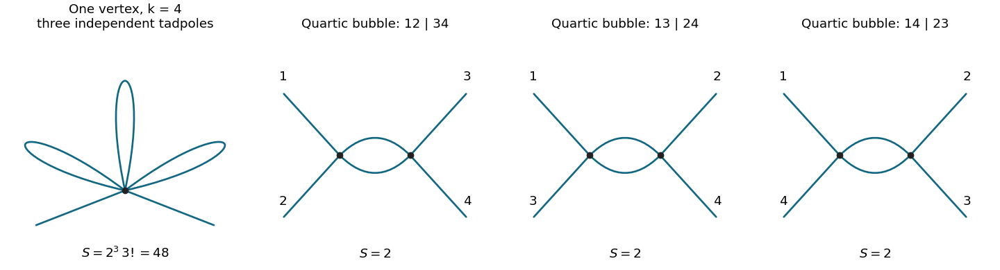

<h1 id="2/c/solution">Solution</h1>

↑ **Parent:** [C](../c.md)

The [single-vertex scalar two-point graph](../../../../single-vertex-scalar-two-point-graph.md) at first order in $g_{2k}$ has one $2k$-valent [interaction vertex](../../../../interaction-vertex.md). Attach the two external lines to it and pair its remaining $2k-2$ legs into $k-1$ [tadpole diagrams](../../../../tadpole-diagram.md). The graph is connected, has $L=k-1$ independent [loop momenta](../../../../loop-momentum.md), and is momentum independent after amputation apart from the overall [Dirac delta function](../../../../dirac-delta-function.md). In particular, first order in the coupling need not mean one loop.

The number of contractions with fixed external labels is

$$
(2k)(2k-1)\frac{(2k-2)!}{2^{k-1}(k-1)!}.
$$

Dividing by the interaction factorial $(2k)!$ gives the inverse [Feynman-diagram symmetry factor](../../../../feynman-diagram-symmetry-factor.md) $1/[2^{k-1}(k-1)!]$. Use $m>0$ for the mass in the lowest-order propagator and define the [tadpole integral](../../../../tadpole-integral.md)

$$
T_D(m)=\int\frac{d^Dq}{(2\pi)^D}\frac1{q^2+m^2}.
$$

The linear-order correction to the amputated function is consequently

$$
\boxed{\Gamma^{(2)}_{\mathrm{lin}}(p_1,p_2)
=-(2\pi)^D\delta^{(D)}(p_1+p_2)
\frac{\mu^{d_k}g_{2k}}{2^{k-1}(k-1)!}\,T_D(m)^{k-1}.}
$$

This is the correction to the paper's amputated connected correlator, not a definition of an inverse-propagator self-energy with an unspecified sign. At this order using $m_0$ instead of $m$ gives the same lowest-order integral.

For completeness, [Schwinger parameterization](../../../../schwinger-parameterization.md) and a [Gaussian integral](../../../../gaussian-integral.md) give

$$
\begin{aligned}
T_D(m)&=\frac1{(4\pi)^{D/2}}\int_0^\infty d\alpha\,\alpha^{-D/2}e^{-\alpha m^2}\\
&=\frac{(m^2)^{D/2-1}}{(4\pi)^{D/2}}\Gamma(1-D/2).
\end{aligned}
$$

This first converges for $0<D<2$ and then defines its [dimensional regularization](../../../../dimensional-regularization.md) continuation. At $D=4-2\epsilon$, the [Gamma function](../../../../gamma-function.md) expansion yields

$$
\mu^{2\epsilon}T_D(m)
=-\frac{m^2}{16\pi^2}\left[\frac1\epsilon+1-\gamma_E+\log\frac{4\pi\mu^2}{m^2}+O(\epsilon)\right].
$$

Thus its highest [ultraviolet pole](../../../../ultraviolet-pole.md) is

$$
\boxed{\Gamma^{(2)}_{\mathrm{lin}}
=(2\pi)^D\delta^{(D)}(p_1+p_2)
\frac{(-1)^k g_{2k}\mu^{4-2k}(m^2)^{k-1}}
{2^{k-1}(k-1)!(16\pi^2)^{k-1}\epsilon^{k-1}}
+O(\epsilon^{-(k-2)}).}
$$

For $k=2$ the remainder means finite terms. For $k>2$ the unrenormalized graph has a higher-order pole from its independent [ultraviolet subdivergences](../../../../ultraviolet-subdivergence.md), rather than only a simple pole. A massless [tadpole integral](../../../../tadpole-integral.md) is scaleless and vanishes in [dimensional regularization](../../../../dimensional-regularization.md); that does not justify discarding the massive [ultraviolet divergence](../../../../ultraviolet-divergence.md) by setting $m=0$ before separating ultraviolet and infrared effects.

**[Figure 1](#2/c/image-a-single-higher-valence-vertex-with-three-tadpole-loops-and-the-three-one-loop-quartic-bubble-channels). A single higher-valence vertex with three tadpole loops, and the three one-loop quartic bubble channels**. The first panel illustrates k=4; in general there are k minus one loops. The three remaining panels have identical topology and different labelled external attachments.

## ↑ Ancestors (12)

1. [C](../c.md)
2. [2](../../2.md)
3. [2018](../../../2018-split.md)
4. [Past exam of the quantum field theory course of the University of Oxford](../../../split.md)
5. [Quantum field theory course of the University of Oxford](../../../../quantum-field-theory-course-of-the-university-of-oxford.md)
6. [Year 4 of the mathematical and theoretical physics course of the University of Oxford](../../../../year-4-of-the-mathematical-and-theoretical-physics-course-of-the-university-of-oxford.md)
7. [Mathematical and theoretical physics course of the University of Oxford](../../../../mathematical-and-theoretical-physics-course-of-the-university-of-oxford.md)
8. [Undergraduate course of the University of Oxford](../../../../undergraduate-course-of-the-university-of-oxford.md)
9. [Course of the University of Oxford](../../../../course-of-the-university-of-oxford.md)
10. [University of Oxford](../../../../university-of-oxford-split.md)
11. [List of universities](../../../../list-of-universities.md)
12. [Codex Wiki](../../../../split.md)
