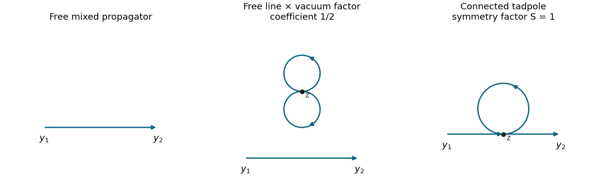

<h1 id="4/b/solution">Solution</h1>

↑ **Parent:** [B](../b.md)

Let $C(u,v)=2D_F(u-v)$ be the action-consistent free [propagator](../../../../propagator.md) established in [a](../a.md). Write $S=S_0+S_I$ and put

$$
V(z)=\phi(z)^2\phi^*(z)^2,\qquad
S_I=-\frac\lambda4\int d^Dz\,V(z).
$$

The perturbative expansion is

$$
e^{iS}=e^{iS_0}\sum_{n=0}^\infty\frac{(-i\lambda/4)^n}{n!}
\int\prod_{r=1}^n d^Dz_r\,\prod_{r=1}^nV(z_r).
$$

Divide numerator and denominator by the same free [vacuum functional](../../../../vacuum-functional.md) $Z_0$. For $\mathcal O=\Phi(y_1)\cdots\Phi(y_N)$, they become

$$
\begin{aligned}
\mathcal N[\mathcal O]&=\sum_{n\geq0}\frac{(-i\lambda/4)^n}{n!}
\int\prod_r d^Dz_r\,\left\langle T\mathcal O\prod_r V(z_r)\right\rangle_0,\\
\mathcal D&=\sum_{n\geq0}\frac{(-i\lambda/4)^n}{n!}
\int\prod_r d^Dz_r\,\left\langle T\prod_r V(z_r)\right\rangle_0.
\end{aligned}
$$

For $\mathcal O=\phi(y_1)\phi^*(y_2)$, abbreviate $C_{12}=C(y_1,y_2)$ and $C_{zz}=C(z,z)$. Since only opposite-charge fields contract, [Wick's theorem](../../../../wick-s-theorem.md) gives

$$
\langle V(z)\rangle_0=2C_{zz}^2,
$$

and

$$
\langle T\phi(y_1)\phi^*(y_2)V(z)\rangle_0
=2C_{12}C_{zz}^2+4C(y_1,z)C_{zz}C(z,y_2).
$$

The first multiplicity is $2!$ internal pairings. In the connected term, there are two choices for the vertex's $\phi^*$ contracted to the external $\phi$ and two for its $\phi$ contracted to the external $\phi^*$; the remaining pair forms a [tadpole diagram](../../../../tadpole-diagram.md). Therefore

$$
\begin{aligned}
\mathcal N&=C_{12}
-\frac{i\lambda}{2}C_{12}\int d^Dz\,C_{zz}^2
-i\lambda\int d^Dz\,C(y_1,z)C_{zz}C(z,y_2)+O(\lambda^2),\\
\mathcal D&=1-\frac{i\lambda}{2}\int d^Dz\,C_{zz}^2+O(\lambda^2).
\end{aligned}
$$

Expanding the inverse denominator cancels the free-line times [vacuum bubble](../../../../vacuum-feynman-diagram.md) term, leaving

$$
\boxed{\langle T\phi(y_1)\phi^*(y_2)\rangle
=C_{12}-i\lambda\int d^Dz\,C(y_1,z)C(z,z)C(z,y_2)+O(\lambda^2).}
$$

The local quartic [interaction vertex](../../../../interaction-vertex.md) has factor $-i\lambda$, since $2!2!$ cancels its denominator 4. The oriented [tadpole diagram](../../../../tadpole-diagram.md) has [Feynman-diagram symmetry factor](../../../../feynman-diagram-symmetry-factor.md) 1; the isolated two-loop vacuum vertex has factor $1/2$ in its coefficient. Coincident kernels and the integrals require a common [regularization](../../../../regularization.md); none is being assigned a finite numerical value here.

**[Figure 2](#4/b/image-free-propagation-its-disconnected-vacuum-factor-and-the-connected-oriented-tadpole-correction). Free propagation, its disconnected vacuum factor, and the connected oriented tadpole correction**. An arrow from u to v represents C(u,v). The disconnected vacuum factor cancels against the denominator of the normalized correlation function.

More generally, [vacuum bubbles](../../../../vacuum-feynman-diagram.md) exponentiate and factor from every numerator. Here [global U(1) symmetry](../../../../global-u-1-symmetry.md) also makes all one-point functions zero. Thus a surviving graph with the two external insertions in separate connected components would have a component with one unbalanced charge and vanish. This proves that only connected graphs contribute to this particular two-point function to all perturbative orders. Vacuum normalization alone would not remove disconnected components containing external legs in a general four-point function. If one formally chooses a different free kernel, the displayed Wick multiplicities are unchanged; replacing $C$ by $C_{\mathrm{lit}}$ gives a formal oscillator series, not the Gaussian integral of the action as printed.

## ↑ Ancestors (12)

1. [B](../b.md)
2. [4](../../4.md)
3. [2018](../../../2018-split.md)
4. [Past exam of the quantum field theory course of the University of Oxford](../../../split.md)
5. [Quantum field theory course of the University of Oxford](../../../../quantum-field-theory-course-of-the-university-of-oxford.md)
6. [Year 4 of the mathematical and theoretical physics course of the University of Oxford](../../../../year-4-of-the-mathematical-and-theoretical-physics-course-of-the-university-of-oxford.md)
7. [Mathematical and theoretical physics course of the University of Oxford](../../../../mathematical-and-theoretical-physics-course-of-the-university-of-oxford.md)
8. [Undergraduate course of the University of Oxford](../../../../undergraduate-course-of-the-university-of-oxford.md)
9. [Course of the University of Oxford](../../../../course-of-the-university-of-oxford.md)
10. [University of Oxford](../../../../university-of-oxford-split.md)
11. [List of universities](../../../../list-of-universities.md)
12. [Codex Wiki](../../../../split.md)
