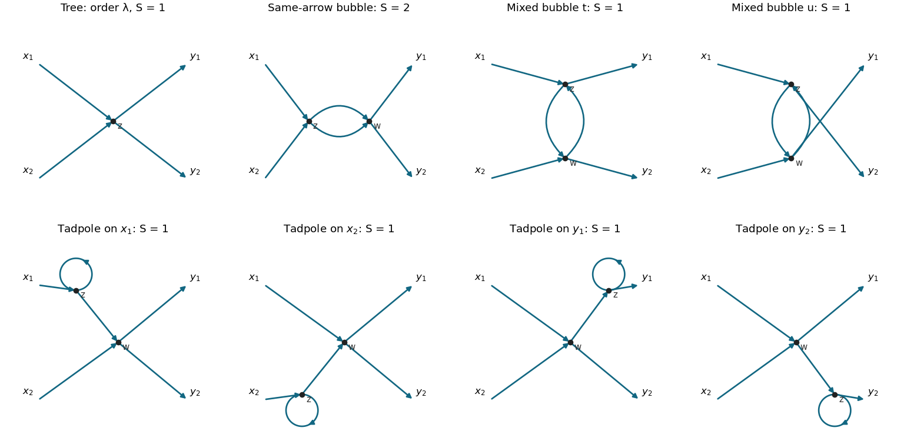

<h1 id="4/c/solution">Solution</h1>

↑ **Parent:** [C](../c.md)

Work in the symmetric [vacuum](../../../../vacuum.md) and continue with the action-consistent kernel $C(u,v)=2D_F(u-v)$. Under [global U(1) symmetry](../../../../global-u-1-symmetry.md), a correlator with $r$ fields $\phi$ and $4-r$ fields $\phi^*$ picks up a phase $e^{i\alpha(2r-4)}$. Invariance for every $\alpha$ requires $r=2$. Consequently ten of the sixteen ordered field-type choices vanish, and the six placements with two fields of each type can be nonzero. This is the [charge selection rule for complex scalar correlators](../../../../charge-selection-rule-for-complex-scalar-correlators.md), not an assertion about a symmetry-breaking vacuum with a nonzero one-point function.

Choose external fields $\phi(x_1)\phi(x_2)\phi^*(y_1)\phi^*(y_2)$. Its zeroth-order full correlator is $C(x_1,y_1)C(x_2,y_2)+C(x_1,y_2)C(x_2,y_1)$ and is disconnected; its connected part starts at order $\lambda$. Define

$$
P(z)=C(x_1,z)C(x_2,z)C(z,y_1)C(z,y_2),
\qquad \int_{z,w}=\int d^Dz\,d^Dw.
$$

The tree term has [Feynman-diagram symmetry factor](../../../../feynman-diagram-symmetry-factor.md) 1 and is $-i\lambda\int d^Dz\,P(z)$.

At second order, a connected graph has two quartic vertices, two internal lines and one loop. The three bubble integrals are

$$
\begin{aligned}
B_s={}&\int_{z,w}C(x_1,z)C(x_2,z)C(z,w)^2C(w,y_1)C(w,y_2),\\
B_t={}&\int_{z,w}C(x_1,z)C(z,y_1)C(z,w)C(w,z)C(x_2,w)C(w,y_2),\\
B_u={}&\int_{z,w}C(x_1,z)C(z,y_2)C(z,w)C(w,z)C(x_2,w)C(w,y_1).
\end{aligned}
$$

The [oriented complex-scalar quartic graph factors](../../../../oriented-complex-scalar-quartic-graph-factors.md) distinguish the channels. In $B_s$ the two internal lines have the same orientation and can be interchanged, giving symmetry factor $S_s=2$. In each mixed channel the two orientations are opposite; interchanging them is not an oriented graph automorphism, so $S_t=S_u=1$. Equality of the numerical scalar kernels $C(z,w)=C(w,z)$ does not erase the field-slot distinction used in counting contractions.

There are also four connected external-leg [tadpole diagrams](../../../../tadpole-diagram.md). They must be included because a connected correlation function is neither amputated nor restricted to [one-particle-irreducible Feynman diagrams](../../../../one-particle-irreducible-feynman-diagram.md). Representative integrals, with the other two obtained by the indicated external permutations, are

$$
\begin{aligned}
T_{x_1}={}&\int_{z,w}C(x_1,z)C(z,z)C(z,w)C(x_2,w)C(w,y_1)C(w,y_2),\\
T_{x_2}={}&T_{x_1}\big|_{x_1\leftrightarrow x_2},\\
T_{y_1}={}&\int_{z,w}C(x_1,w)C(x_2,w)C(w,y_2)C(w,z)C(z,z)C(z,y_1),\\
T_{y_2}={}&T_{y_1}\big|_{y_1\leftrightarrow y_2}.
\end{aligned}
$$

Each oriented external-leg graph has symmetry factor 1: a directed self-loop has no independent reversal symmetry. Altogether,

$$
\boxed{\begin{aligned}
G_c^{(4)}={}&-i\lambda\int d^Dz\,P(z)\\
&+(-i\lambda)^2\left[\frac12B_s+B_t+B_u
+T_{x_1}+T_{x_2}+T_{y_1}+T_{y_2}\right]+O(\lambda^3).
\end{aligned}}
$$

These expressions retain every external [propagator](../../../../propagator.md). The physical normalization is explicit: each $C$ is $2D_F$, not $D_F$. Equivalently set $\chi=\phi/\sqrt2$; its quadratic action has unit mixed propagator and its interaction is $-\lambda|\chi|^4$, giving vertex $-4i\lambda$. Multiplying a four-$\chi$ correlator by four converts it to the four-$\phi$ correlator, confirming the powers of two.

**[Figure 3](#4/c/image-all-connected-four-point-graphs-through-second-order-one-tree-three-bubbles-and-four-external-leg-tadpoles). All connected four-point graphs through second order: one tree, three bubbles and four external-leg tadpoles**. Arrows follow C(u,v) from its first argument to its second. The same-orientation bubble has symmetry factor two; the other seven displayed graphs have symmetry factor one.

Completeness can also be seen without a picture. With two vertices and four external legs, $I=(8-4)/2=2$. Connectivity allows either two intervertex lines with a two-and-two external split, or one bridge and one self-loop with a one-and-three split. The charge assignments give exactly the three bubble attachments and four leg choices above. Direct labelled [Wick contraction](../../../../wick-contraction.md) counting gives respectively $16,32,32,32,32,32,32$ contractions. Dividing by the expansion denominator $2!\,4^2=32$ reproduces $1/2,1,1,1,1,1,1$. Vacuum factors cancel, and there are no additional connected topologies at this order.

## ↑ Ancestors (12)

1. [C](../c.md)
2. [4](../../4.md)
3. [2018](../../../2018-split.md)
4. [Past exam of the quantum field theory course of the University of Oxford](../../../split.md)
5. [Quantum field theory course of the University of Oxford](../../../../quantum-field-theory-course-of-the-university-of-oxford.md)
6. [Year 4 of the mathematical and theoretical physics course of the University of Oxford](../../../../year-4-of-the-mathematical-and-theoretical-physics-course-of-the-university-of-oxford.md)
7. [Mathematical and theoretical physics course of the University of Oxford](../../../../mathematical-and-theoretical-physics-course-of-the-university-of-oxford.md)
8. [Undergraduate course of the University of Oxford](../../../../undergraduate-course-of-the-university-of-oxford.md)
9. [Course of the University of Oxford](../../../../course-of-the-university-of-oxford.md)
10. [University of Oxford](../../../../university-of-oxford-split.md)
11. [List of universities](../../../../list-of-universities.md)
12. [Codex Wiki](../../../../split.md)
