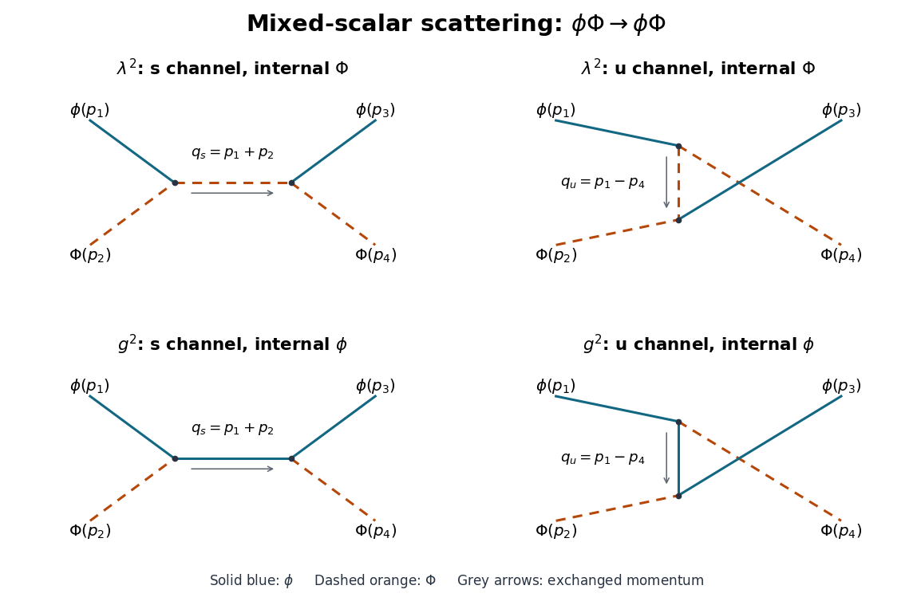

# 2019

↑ **Parent:** [Past exam of the quantum field theory course of the University of Oxford](../past-exam-of-the-quantum-field-theory-course-of-the-university-of-oxford.md)

Source paper: [https://www.whatdotheyknow.com/request/oxford_physics_past_papers_2/response/2340696/attach/7/Physics%20Papers%202018.pdf?cookie_passthrough=1](https://www.whatdotheyknow.com/request/oxford_physics_past_papers_2/response/2340696/attach/7/Physics%20Papers%202018.pdf?cookie_passthrough=1)

The cover establishes Hilary Term 2019 despite the bundle's 2018 filename. Use $\hbar=c=1$. For questions 2 and 3 the [Minkowski metric](../special-relativity.md#minkowski-metric) has signature $(+,-,\ldots,-)$. Question 1 has a preferred time coordinate and does not assume [Lorentz invariance](../special-relativity.md#lorentz-invariance).

**Table of contents**

- [1](#1)
  - [a](#1/a)
    - [Solution](#1/a/solution)
  - [b](#1/b)
    - [Solution](#1/b/solution)
  - [c](#1/c)
    - [Solution](#1/c/solution)
- [2](#2)
  - [a](#2/a)
    - [Solution](#2/a/solution)
  - [b](#2/b)
    - [Solution](#2/b/solution)
- [3](#3)
  - [a](#3/a)
    - [Solution](#3/a/solution)
  - [b](#3/b)
    - [Solution](#3/b/solution)
  - [c](#3/c)
    - [Solution](#3/c/solution)
  - [d](#3/d)
    - [Solution](#3/d/solution)
  - [e](#3/e)
    - [Solution](#3/e/solution)

## 1

↑ **Parent:** [2019](2019.md)

<h3 id="1/a">a</h3>

↑ **Parent:** [1](#1)

<h4 id="1/a/solution">Solution</h4>

↑ **Parent:** [A](#1/a)

A [real scalar field](../scalar-field-theory.md#real-scalar-field) suffices to describe one neutral species of bosonic [quasiparticle](../quantum-mechanics.md#quasiparticle). Let $\pi(\mathbf x)$ be its [canonical momentum](../hamiltonian-mechanics.md#canonical-momentum). In three spatial dimensions, choose the positive classical [Hamiltonian](../hamiltonian-mechanics.md#hamiltonian)

$$
\boxed{H[\phi,\pi]=\frac12\int d^3x\left[\pi^2+\kappa^2(\nabla^2\phi)^2+m^2\phi^2\right].}
$$

The same construction works in any number of spatial dimensions by replacing $d^3x$ appropriately. Under a spatial [Fourier transform](../fourier-transform.md), $\nabla^2\phi$ becomes $-|\mathbf p|^2\widetilde\phi$, so the [Hamiltonian](../hamiltonian-mechanics.md#hamiltonian) is a collection of independent [quantum harmonic oscillators](../quantum-harmonic-oscillator.md) with squared [angular frequency](../lagrangian-mechanics.md#angular-frequency) $\omega_{\mathbf p}^2=\kappa^2|\mathbf p|^4+m^2$. The usual reality condition pairs opposite [momenta](../momentum.md); it does not introduce a second species.

The canonical [action](../lagrangian-mechanics.md#action) is $S=\int dt\,[\int d^3x\,\pi\dot\phi-H]$. Varying $\pi$ gives $\pi=\dot\phi$; eliminating it by the [Legendre transform](../convex-optimization.md#convex-conjugate) gives

$$
\boxed{S[\phi]=\frac12\int dt\,d^3x\left[(\partial_t\phi)^2-\kappa^2(\nabla^2\phi)^2-m^2\phi^2\right].}
$$

This [Lagrangian density](../classical-field-theory.md#lagrangian-density) is local: only the field and finitely many derivatives at the same point occur. It contains second spatial derivatives but only first time derivatives, so no extra canonical time data are needed. A square root of a differential operator in the classical [Hamiltonian](../hamiltonian-mechanics.md#hamiltonian) is unnecessary. The fourth-order spatial term breaks [Lorentz invariance](../special-relativity.md#lorentz-invariance) while preserving spatial rotations and translations. This is a [free scalar field with quartic spatial dispersion](../scalar-field-theory.md#free-scalar-field-with-quartic-spatial-dispersion).

<h3 id="1/b">b</h3>

↑ **Parent:** [1](#1)

<h4 id="1/b/solution">Solution</h4>

↑ **Parent:** [B](#1/b)

For a [Lagrangian density](../classical-field-theory.md#lagrangian-density) depending on $\phi$, $\partial_t\phi$, $\partial_i\phi$ and $\partial_i\partial_j\phi$, direct variation gives

$$
\delta S=\int dt\,d^3x\left[
\mathcal L_\phi\delta\phi+
\mathcal L_{\dot\phi}\partial_t\delta\phi+
\mathcal L_{\partial_i\phi}\partial_i\delta\phi+
\mathcal L_{\partial_i\partial_j\phi}\partial_i\partial_j\delta\phi\right].
$$

Take $\delta\phi$ to have compact support, so every boundary term vanishes. One [integration by parts](../calculus.md#integration-by-parts) for the first-derivative terms and two for the second-derivative term yield the [Euler-Lagrange field equation with second derivatives](../classical-field-theory.md#euler-lagrange-field-equation-with-second-derivatives)

$$
\mathcal L_\phi-\partial_t\mathcal L_{\dot\phi}
-\partial_i\mathcal L_{\partial_i\phi}
+\partial_i\partial_j\mathcal L_{\partial_i\partial_j\phi}=0.
$$

The plus sign on the last term is essential. For the [action](../lagrangian-mechanics.md#action) in [a](#1/a), it is particularly transparent to vary the [Laplacian](../multivariable-calculus.md#laplacian) directly:

$$
\delta S=\int dt\,d^3x\left[
\dot\phi\,\partial_t\delta\phi-\kappa^2\nabla^2\phi\,\nabla^2\delta\phi-m^2\phi\,\delta\phi\right]
=-\int dt\,d^3x\left[\ddot\phi+\kappa^2\nabla^4\phi+m^2\phi\right]\delta\phi.
$$

Thus the classical [equation of motion](../classical-mechanics.md#equation-of-motion) is

$$
\boxed{\partial_t^2\phi+\kappa^2\nabla^4\phi+m^2\phi=0.}
$$

Here $\nabla^4=(\nabla^2)^2$ is the [biharmonic operator](../multivariable-calculus.md#biharmonic-operator). Substitution of the [plane wave](../wave-function.md#plane-wave) $\phi=Ae^{-i\omega t+i\mathbf p\cdot\mathbf x}$ gives

$$
[-\omega^2+\kappa^2|\mathbf p|^4+m^2]A=0,
\qquad
\boxed{\omega=\pm\sqrt{\kappa^2|\mathbf p|^4+m^2}.}
$$

A real classical solution combines complex-conjugate [plane waves](../wave-function.md#plane-wave). Quantization assigns the positive branch to the excitation [energy](../energy.md), giving the required [dispersion relation](../dispersion-relation.md). The negative-frequency branch supplies the [creation operator](../quantum-harmonic-oscillator.md#creation-operator) part of the field, rather than negative excitation [energy](../energy.md). Independently, the [Hamiltonian](../hamiltonian-mechanics.md#hamiltonian) in [a](#1/a) gives $\dot\phi=\pi$, $\dot\pi=-\kappa^2\nabla^4\phi-m^2\phi$, confirming the same sign.

<h3 id="1/c">c</h3>

↑ **Parent:** [1](#1)

<h4 id="1/c/solution">Solution</h4>

↑ **Parent:** [C](#1/c)

Define $E_{\mathbf p}=\sqrt{\kappa^2|\mathbf p|^4+m^2}$ and $\int_{\mathbf p}=\int d^3p/(2\pi)^3$. The Hermitian [quantum field](../quantum-field-theory.md#quantum-field) has the [mode expansion of a free field](../quantum-field-theory.md#mode-expansion-of-a-free-field)

$$
\boxed{\phi(t,\mathbf x)=\int_{\mathbf p}\frac1{\sqrt{2E_{\mathbf p}}}
\left[a_{\mathbf p}e^{-iE_{\mathbf p}t+i\mathbf p\cdot\mathbf x}
+a_{\mathbf p}^\dagger e^{iE_{\mathbf p}t-i\mathbf p\cdot\mathbf x}\right],}
$$

where the [annihilation operators](../quantum-harmonic-oscillator.md#annihilation-operator) and [creation operators](../quantum-harmonic-oscillator.md#creation-operator) obey the bosonic [canonical commutation relations](../quantum-mechanics.md#canonical-commutation-relation)

$$
\boxed{[a_{\mathbf p},a_{\mathbf q}^\dagger]=(2\pi)^3\delta^{(3)}(\mathbf p-\mathbf q),\qquad
[a_{\mathbf p},a_{\mathbf q}]=[a_{\mathbf p}^\dagger,a_{\mathbf q}^\dagger]=0.}
$$

Because $\pi=\dot\phi$, its [mode expansion of a free field](../quantum-field-theory.md#mode-expansion-of-a-free-field) is

$$
\pi(t,\mathbf x)=-i\int_{\mathbf p}\sqrt{\frac{E_{\mathbf p}}2}
\left[a_{\mathbf p}e^{-iE_{\mathbf p}t+i\mathbf p\cdot\mathbf x}
-a_{\mathbf p}^\dagger e^{iE_{\mathbf p}t-i\mathbf p\cdot\mathbf x}\right].
$$

The two nonzero cross [commutators](../lie-algebra.md#commutator) then give

$$
[\phi(t,\mathbf x),\pi(t,\mathbf y)]
=\frac i2\int_{\mathbf p}\left[e^{i\mathbf p\cdot(\mathbf x-\mathbf y)}+e^{-i\mathbf p\cdot(\mathbf x-\mathbf y)}\right]
=i\delta^{(3)}(\mathbf x-\mathbf y),
$$

and the equal-time field-field and momentum-momentum [commutators](../lie-algebra.md#commutator) vanish. This verifies the factor $1/\sqrt{2E_{\mathbf p}}$ without requiring [Lorentz invariance](../special-relativity.md#lorentz-invariance).

Substitution into the [Hamiltonian](../hamiltonian-mechanics.md#hamiltonian), followed by [normal ordering](../perturbative-quantum-field-theory.md#normal-ordering), yields

$$
\boxed{{:H:}=\int_{\mathbf p}E_{\mathbf p}a_{\mathbf p}^\dagger a_{\mathbf p}.}
$$

Consequently $[{:H:},a_{\mathbf p}^\dagger]=E_{\mathbf p}a_{\mathbf p}^\dagger$: one application of a [creation operator](../quantum-harmonic-oscillator.md#creation-operator) adds precisely the required [quasiparticle](../quantum-mechanics.md#quasiparticle) [energy](../energy.md). Before [normal ordering](../perturbative-quantum-field-theory.md#normal-ordering) there is the usual constant zero-point [vacuum energy](../perturbative-quantum-field-theory.md#vacuum-energy). If $m=0$, the exactly zero-[momentum](../momentum.md) mode has $E_{\mathbf0}=0$ and is a free canonical coordinate, not an oscillator with a normalizable oscillator [vacuum state](../quantum-field-theory.md#vacuum-state); in a finite box handle that mode separately or introduce a small positive [mass](../classical-mechanics.md#mass). The formula applies directly to all modes with $E_{\mathbf p}>0$.

## 2

↑ **Parent:** [2019](2019.md)

<h3 id="2/a">a</h3>

↑ **Parent:** [2](#2)

<h4 id="2/a/solution">Solution</h4>

↑ **Parent:** [A](#2/a)

Use the [Fourier transform](../fourier-transform.md) convention $\phi(x)=\int d^4p/(2\pi)^4\,e^{-ip\cdot x}\widetilde\phi(p)$, and similarly for $\Phi$. All [four-momenta](../special-relativity.md#four-momentum) at an [interaction vertex](../perturbative-quantum-field-theory.md#interaction-vertex) are incoming. The quadratic terms are diagonal, so the [scalar propagators](../scalar-field-theory.md#scalar-propagator) are

$$
\boxed{D_\phi(p)=\frac{i}{p^2-m^2+i0},\qquad
D_\Phi(p)=\frac{i}{p^2-M^2+i0},\qquad D_{\phi\Phi}=0.}
$$

The [field interaction terms](../classical-field-theory.md#field-interaction-term) are $\lambda\phi\Phi^2/2$ and $g\Phi\partial_\mu\phi\partial^\mu\phi/2$. The two identical field slots cancel the factor $1/2$ at either cubic [interaction vertex](../perturbative-quantum-field-theory.md#interaction-vertex). Expanding $\exp(iS_{\rm int})$ therefore gives

$$
\boxed{\begin{aligned}
\phi(p)\Phi(k)\Phi(\ell):&\quad i\lambda,\qquad p+k+\ell=0,\\
\Phi(k)\phi(p)\phi(q):&\quad -ig\,p\cdot q,\qquad k+p+q=0.
\end{aligned}}
$$

In the second rule $p,q$ are specifically the two $\phi$ [four-momenta](../special-relativity.md#four-momentum); there is no derivative acting on the $\Phi$ leg. Indeed the two derivatives give $(-ip_\mu)(-iq^\mu)=-p\cdot q$, fixing the minus sign. This is a [mixed scalar derivative cubic vertex](../perturbative-quantum-field-theory.md#mixed-scalar-derivative-cubic-vertex). For arbitrary off-shell legs one may equivalently write $-ig(k^2-p^2-q^2)/2$, but may not replace the squared [four-momenta](../special-relativity.md#four-momentum) by squared [masses](../classical-mechanics.md#mass) unless those legs are on their [mass shells](../special-relativity.md#mass-shell).

Each [interaction vertex](../perturbative-quantum-field-theory.md#interaction-vertex) also carries $(2\pi)^4\delta^{(4)}(\sum p)$ for [momentum conservation](../momentum.md#momentum-conservation). Integrate independent [loop momenta](../perturbative-quantum-field-theory.md#loop-momentum) with $d^4p/(2\pi)^4$ and divide by the [Feynman-diagram symmetry factor](../perturbative-quantum-field-theory.md#feynman-diagram-symmetry-factor). An amputated external scalar leg has factor 1. The [Feynman i-epsilon prescription](../quantum-field-theory.md#feynman-i-epsilon-prescription) fixes the propagator poles. As a dimensional check in four spacetime dimensions, $[\phi]=[\Phi]=1$, $[\lambda]=1$ and $[g]=-1$ in [mass dimensions](../perturbative-quantum-field-theory.md#mass-dimension); the two powers of [momentum](../momentum.md) in the derivative rule restore [mass dimension](../perturbative-quantum-field-theory.md#mass-dimension) one for its cubic [interaction vertex](../perturbative-quantum-field-theory.md#interaction-vertex).

<h3 id="2/b">b</h3>

↑ **Parent:** [2](#2)

<h4 id="2/b/solution">Solution</h4>

↑ **Parent:** [B](#2/b)

Let $p_1,p_2$ denote the incoming $\phi,\Phi$ [four-momenta](../special-relativity.md#four-momentum) and $p_3,p_4$ the outgoing $\phi,\Phi$ [four-momenta](../special-relativity.md#four-momentum). Thus $p_1+p_2=p_3+p_4$, $p_1^2=p_3^2=m^2$ and $p_2^2=p_4^2=M^2$. Define the [Mandelstam variables](../special-relativity.md#mandelstam-variables) and exchanged [four-momenta](../special-relativity.md#four-momentum) by

$$
s=(p_1+p_2)^2=q_s^2,\qquad u=(p_1-p_4)^2=q_u^2,
\qquad q_s=p_1+p_2,\quad q_u=p_1-p_4=p_3-p_2.
$$

The leading connected four-point [scattering amplitude](../quantum-scattering.md#scattering-amplitude) uses two cubic [interaction vertices](../perturbative-quantum-field-theory.md#interaction-vertex). There are four [tree-level Feynman diagrams](../perturbative-quantum-field-theory.md#tree-level-feynman-diagram): $s$ and $u$ exchange of $\Phi$ with two $\lambda$ vertices, and $s$ and $u$ exchange of $\phi$ with two $g$ vertices.

**[Figure 1](#2/b/image-the-four-tree-channels-for-mixed-scalar-scattering-blue-solid-lines-represent-phi-and-orange-dashed-lines-phi-external-momenta-are-incoming-on-the-left-and-outgoing-on-the-right-crossings-have-no-vertex). The four tree channels for mixed-scalar scattering. Blue solid lines represent $\phi$ and orange dashed lines $\Phi$. External momenta are incoming on the left and outgoing on the right; crossings have no vertex.**

There is no term proportional to $\lambda g$: one vertex of each kind has three field slots of each species altogether, whereas the external state uses two of each. This leaves one $\phi$ and one $\Phi$ to contract internally, and their mixed [scalar propagator](../scalar-field-theory.md#scalar-propagator) is zero. There is also no $t$ channel: grouping both external $\phi$ legs at one vertex would require a $g$ vertex with an internal $\Phi$, while grouping both external $\Phi$ legs at the other would require a $\lambda$ vertex with an internal $\phi$.

Define $i\mathcal M$ after removing the overall [momentum conservation](../momentum.md#momentum-conservation) delta function. The nonderivative exchange gives

$$
i\mathcal M_{\lambda^2}=(i\lambda)^2
\left[\frac{i}{s-M^2+i0}+\frac{i}{u-M^2+i0}\right].
$$

For the derivative $s$ channel, the incoming $\phi$ [four-momenta](../special-relativity.md#four-momentum) at the first vertex are $p_1,-q_s$, and at the second they are $q_s,-p_3$. The two [interaction vertices](../perturbative-quantum-field-theory.md#interaction-vertex) are therefore $ig\,p_1\cdot q_s$ and $ig\,p_3\cdot q_s$. The same reasoning with $q_u$ applies to the $u$ channel, giving

$$
i\mathcal M_{g^2}=-ig^2\left[
\frac{(p_1\cdot q_s)(p_3\cdot q_s)}{s-m^2+i0}
+\frac{(p_1\cdot q_u)(p_3\cdot q_u)}{u-m^2+i0}\right].
$$

The [mass shell](../special-relativity.md#mass-shell) conditions and [momentum conservation](../momentum.md#momentum-conservation) imply

$$
p_1\cdot q_s=p_3\cdot q_s=\frac{s+m^2-M^2}{2},\qquad
p_1\cdot q_u=p_3\cdot q_u=\frac{u+m^2-M^2}{2}.
$$

Combining the four [Feynman diagrams](../perturbative-quantum-field-theory.md#feynman-diagram) therefore yields

$$
\boxed{\begin{aligned}
\mathcal M={}&-\lambda^2\left[\frac1{s-M^2+i0}+\frac1{u-M^2+i0}\right]\\
&-\frac{g^2}{4}\left[
\frac{(s+m^2-M^2)^2}{s-m^2+i0}
+\frac{(u+m^2-M^2)^2}{u-m^2+i0}\right].
\end{aligned}}
$$

Each displayed [tree-level Feynman diagram](../perturbative-quantum-field-theory.md#tree-level-feynman-diagram) has [Feynman-diagram symmetry factor](../perturbative-quantum-field-theory.md#feynman-diagram-symmetry-factor) 1 for fixed external species and labels. The result is of order $\lambda^2,g^2$; if both couplings are scaled by a common parameter $\varepsilon$, the next connected corrections begin at order $\varepsilon^4$. A four-point cubic [Feynman diagram](../perturbative-quantum-field-theory.md#feynman-diagram) has $3V=2I+4$, so its vertex count $V$ is even. The internal lines remain off shell throughout: imposing an on-shell relation on an exchanged [four-momentum](../special-relativity.md#four-momentum) would incorrectly change the derivative vertices.

## 3

↑ **Parent:** [2019](2019.md)

<h3 id="3/a">a</h3>

↑ **Parent:** [3](#3)

<h4 id="3/a/solution">Solution</h4>

↑ **Parent:** [A](#3/a)

With $\eta=\operatorname{diag}(1,-1)$, the [Clifford algebra](../algebra-over-a-field.md#clifford-algebra) gives $(\gamma^0)^2=1$, $(\gamma^1)^2=-1$, and $\gamma^0\gamma^1=-\gamma^1\gamma^0$. Hence

$$
\gamma^5\gamma^0=-\gamma^1,\quad \gamma^0\gamma^5=\gamma^1,\qquad
\gamma^5\gamma^1=-\gamma^0,\quad \gamma^1\gamma^5=\gamma^0,
$$

so $\{\gamma^5,\gamma^0\}=\{\gamma^5,\gamma^1\}=0$. Its square is

$$
(\gamma^5)^2=\gamma^0\gamma^1\gamma^0\gamma^1
=-(\gamma^0)^2(\gamma^1)^2=1.
$$

Choose the following [gamma matrices](../algebra-over-a-field.md#gamma-matrices), expressed using the [Pauli matrices](../algebra.md#pauli-matrices):

$$
\boxed{\gamma^0=\sigma_1=\begin{pmatrix}0&1\\1&0\end{pmatrix},\qquad
\gamma^1=-i\sigma_2=\begin{pmatrix}0&-1\\1&0\end{pmatrix},\qquad
\gamma^5=\sigma_3=\begin{pmatrix}1&0\\0&-1\end{pmatrix}.}
$$

These satisfy $(\gamma^0)^\dagger=\gamma^0$, $(\gamma^1)^\dagger=-\gamma^1$ and $(\gamma^5)^\dagger=\gamma^5$. The [chirality](../relativistic-quantum-field.md#chirality-physics) [eigenvalues](../linear-operator-theory.md#eigenvalue) are therefore $\boxed{+1,-1}$, and we order the [spinor](../algebra-over-a-field.md#spinor) as $\psi=(\psi_R,\psi_L)^{\mathsf T}$ throughout. Its [Dirac adjoint](../relativistic-quantum-field.md#dirac-adjoint) is $\bar\psi=(\psi_L^\dagger,\psi_R^\dagger)$. No additional factor of $i$ multiplies $\gamma^0\gamma^1$ in this spacetime dimension. This realizes a [Dirac field in two spacetime dimensions](../relativistic-quantum-field.md#dirac-field-in-two-spacetime-dimensions).

<h3 id="3/b">b</h3>

↑ **Parent:** [3](#3)

<h4 id="3/b/solution">Solution</h4>

↑ **Parent:** [B](#3/b)

Variation of the [action](../lagrangian-mechanics.md#action) with respect to the independent [Dirac adjoint](../relativistic-quantum-field.md#dirac-adjoint) gives $(i\gamma^0\partial_t+i\gamma^1\partial_x-m)\psi=0$. The [gamma matrices](../algebra-over-a-field.md#gamma-matrices) chosen in [a](#3/a) make the [Dirac equation](../relativistic-quantum-field.md#dirac-equation)

$$
\boxed{\begin{pmatrix}
-m&i(\partial_t-\partial_x)\\
i(\partial_t+\partial_x)&-m
\end{pmatrix}\begin{pmatrix}\psi_R\\\psi_L\end{pmatrix}=0.}
$$

Multiplication by $\gamma^0$ gives the equivalent [Dirac Hamiltonian](../relativistic-quantum-field.md#dirac-hamiltonian) form

$$
i\partial_t\psi=(-i\sigma_3\partial_x+m\sigma_1)\psi.
$$

For a [plane wave](../wave-function.md#plane-wave) $\psi=u\,e^{-iEt+ipx}$, where $p$ is the signed one-dimensional [momentum](../momentum.md), the equation is

$$
\begin{pmatrix}E-p&-m\\-m&E+p\end{pmatrix}u=0.
$$

A nonzero [spinor](../algebra-over-a-field.md#spinor) exists precisely when the [determinant](../multilinear-algebra.md#determinant) vanishes:

$$
\boxed{E^2-p^2-m^2=0,\qquad E=\pm\sqrt{p^2+m^2}.}
$$

For $m\ne0$, one possible unnormalized [spinor](../algebra-over-a-field.md#spinor) solution is $u=(E+p,m)^{\mathsf T}$. Alternatively, $(p\sigma_3+m\sigma_1)^2=(p^2+m^2)1$ follows from the [Pauli matrix multiplication law](../algebra.md#pauli-matrix-multiplication-law), proving the same [relativistic energy-momentum relation](../special-relativity.md#energy-momentum-relation). Acting on the [Dirac equation](../relativistic-quantum-field.md#dirac-equation) with $i\gamma^\mu\partial_\mu+m$ also shows that each component satisfies $(\partial_t^2-\partial_x^2+m^2)\psi=0$, the [Klein-Gordon equation](../wave-equation.md#klein-gordon-equation).

<h3 id="3/c">c</h3>

↑ **Parent:** [3](#3)

<h4 id="3/c/solution">Solution</h4>

↑ **Parent:** [C](#3/c)

In the [chirality](../relativistic-quantum-field.md#chirality-physics) basis of [a](#3/a), the two rows of the [Dirac Hamiltonian](../relativistic-quantum-field.md#dirac-hamiltonian) equation give

$$
\boxed{i(\partial_t+\partial_x)\psi_R=m\psi_L,\qquad
i(\partial_t-\partial_x)\psi_L=m\psi_R.}
$$

The [Dirac mass term](../relativistic-quantum-field.md#dirac-mass-term) thus couples the two opposite [chirality](../relativistic-quantum-field.md#chirality-physics) components. In particular, the [Lagrangian density](../classical-field-theory.md#lagrangian-density) is

$$
\mathcal L=i\psi_R^\dagger(\partial_t+\partial_x)\psi_R
+i\psi_L^\dagger(\partial_t-\partial_x)\psi_L
-m(\psi_L^\dagger\psi_R+\psi_R^\dagger\psi_L).
$$

For $m=0$, the coupling disappears and the [massless Dirac equation](../relativistic-quantum-field.md#massless-dirac-equation) splits into the independent transport equations

$$
\boxed{(\partial_t+\partial_x)\psi_R=0,\qquad
(\partial_t-\partial_x)\psi_L=0.}
$$

These are the two [chiral transport equations in two spacetime dimensions](../relativistic-quantum-field.md#chiral-transport-equations-in-two-spacetime-dimensions). The [chiral projectors](../relativistic-quantum-field.md#chiral-projector) are $P_R=(1+\gamma^5)/2$ and $P_L=(1-\gamma^5)/2$; in this basis they simply select the upper and lower components.

<h3 id="3/d">d</h3>

↑ **Parent:** [3](#3)

<h4 id="3/d/solution">Solution</h4>

↑ **Parent:** [D](#3/d)

Continue with $m=0$. Along a characteristic $x=x_0+t$, the [chain rule](../calculus.md#chain-rule) gives

$$
\frac{d}{dt}\psi_R(t,x_0+t)=(\partial_t+\partial_x)\psi_R=0.
$$

Thus the initial [wave packet](../dispersion-relation.md#wave-packet) $\psi_R(0,x)=f(x)$ evolves as $\psi_R(t,x)=f(x-t)$. Similarly, along $x=x_0-t$, the left component is constant, giving

$$
\boxed{\psi_R(t,x)=f(x-t),\qquad \psi_L(t,x)=h(x+t).}
$$

A feature initially at $x_0$ therefore appears at $x_0+t$ for the right component and $x_0-t$ for the left component. The profiles translate without changing shape at the [speed of light](../special-relativity.md#speed-of-light), which is 1 in these units. For positive-[energy](../energy.md) [plane waves](../wave-function.md#plane-wave), the right component has $E=p>0$ and the left component has $E=-p>0$, another way to identify their propagation directions.

The conclusion concerns the [massless Dirac equation](../relativistic-quantum-field.md#massless-dirac-equation). For $m\ne0$, the components couple as in [c](#3/c), and a positive-[energy](../energy.md) packet has [group velocity](../dispersion-relation.md#group-velocity) $p/\sqrt{p^2+m^2}$, rather than a universal speed $\pm1$. For example, a massive positive-[energy](../energy.md) rest solution has $p=0$ and $\psi_R=\psi_L$, so neither component alone describes an independently moving light-speed packet.

<h3 id="3/e">e</h3>

↑ **Parent:** [3](#3)

<h4 id="3/e/solution">Solution</h4>

↑ **Parent:** [E](#3/e)

A continuous [Lorentz transformation](../special-relativity.md#lorentz-transformation) in one spatial dimension must preserve $t^2-x^2$. In the component connected to the identity, take the image of the time axis to have velocity $v$, with $|v|<1$, and write $B_v(1,0)^{\mathsf T}=\gamma(1,v)^{\mathsf T}$. Preservation of the [Minkowski norm](../special-relativity.md#minkowski-norm) gives $\gamma^2(1-v^2)=1$, so $\gamma=(1-v^2)^{-1/2}$. The spacelike column must be orthogonal to the timelike column and have squared [Minkowski norm](../special-relativity.md#minkowski-norm) $-1$; continuity fixes it to $\gamma(v,1)^{\mathsf T}$. Thus

$$
\boxed{x'=B_vx,\qquad
B_v=\frac1{\sqrt{1-v^2}}\begin{pmatrix}1&v\\v&1\end{pmatrix}.}
$$

Here $x=(t,x)^{\mathsf T}$ denotes the coordinate pair. This is the positive off-diagonal convention in the source; describing a passive frame moving at $+v$ instead reverses the sign of $v$.

Define the [rapidity](../special-relativity.md#rapidity) $\alpha=\operatorname{artanh}v$. The [hyperbolic function](../calculus.md#hyperbolic-function) identities give

$$
\cosh\alpha=\frac1{\sqrt{1-v^2}},\qquad
\sinh\alpha=\frac v{\sqrt{1-v^2}},\qquad
\boxed{B(\alpha)=\begin{pmatrix}\cosh\alpha&\sinh\alpha\\\sinh\alpha&\cosh\alpha\end{pmatrix}.}
$$

In [light-cone coordinates](../special-relativity.md#light-cone-coordinates), $t'+x'=e^\alpha(t+x)$ and $t'-x'=e^{-\alpha}(t-x)$. Therefore the derivatives transform oppositely:

$$
\partial_{t'}+\partial_{x'}=e^{-\alpha}(\partial_t+\partial_x),\qquad
\partial_{t'}-\partial_{x'}=e^{\alpha}(\partial_t-\partial_x).
$$

Use the field-transformation convention $\psi'(x')=S(\alpha)\psi(x)$. The component [action](../lagrangian-mechanics.md#action) in [c](#3/c) is invariant under

$$
\boxed{\psi_R'(x')=e^{\alpha/2}\psi_R(x),\qquad
\psi_L'(x')=e^{-\alpha/2}\psi_L(x),\qquad
\Lambda_R(\alpha)=e^{\alpha/2},\quad\Lambda_L(\alpha)=e^{-\alpha/2}.}
$$

Indeed, the right-component [kinetic term](../classical-field-theory.md#kinetic-term) gains $e^{\alpha/2}e^{-\alpha}e^{\alpha/2}=1$, and the left-component [kinetic term](../classical-field-theory.md#kinetic-term) gains $e^{-\alpha/2}e^{\alpha}e^{-\alpha/2}=1$. The two factors in each [Dirac mass term](../relativistic-quantum-field.md#dirac-mass-term) cancel as well. Finally $\det B=1$, so $dt'\,dx'=dt\,dx$ and the whole [action](../lagrangian-mechanics.md#action) is unchanged. These are the [chiral boost weights in two spacetime dimensions](../relativistic-quantum-field.md#chiral-boost-weights-in-two-spacetime-dimensions).

In [spinor](../algebra-over-a-field.md#spinor) notation, $S(\alpha)=\exp(\alpha\gamma^5/2)$ satisfies $S^{-1}\gamma^\mu S=B^\mu{}_{\nu}\gamma^\nu$ and $S^\dagger\gamma^0S=\gamma^0$, so $\bar\psi'=\bar\psi S^{-1}$. These identities directly verify covariance of the [Dirac equation](../relativistic-quantum-field.md#dirac-equation) and the [Lorentz invariance](../special-relativity.md#lorentz-invariance) of its [action](../lagrangian-mechanics.md#action). The matrices $S$ are not unitary with respect to the ordinary component norm; the [Dirac adjoint](../relativistic-quantum-field.md#dirac-adjoint) supplies the invariant bilinear.

The statement about there being only [Lorentz boosts](../special-relativity.md#lorentz-boost) applies to the identity component of the [One-dimensional Lorentz group](../special-relativity.md#one-dimensional-lorentz-group). The full [Lorentz group](../special-relativity.md#lorentz-group) also has discrete transformations: the concrete [spatial reflection](../quantum-mechanics.md#spatial-reflection) $\operatorname{diag}(1,-1)$ preserves the [Minkowski metric](../special-relativity.md#minkowski-metric) but has [determinant](../multilinear-algebra.md#determinant) $-1$, so it cannot equal any displayed $B(\alpha)$, whose [determinant](../multilinear-algebra.md#determinant) is $+1$.

## ↑ Ancestors (9)

1. [Past exam of the quantum field theory course of the University of Oxford](../past-exam-of-the-quantum-field-theory-course-of-the-university-of-oxford.md)
2. [Quantum field theory course of the University of Oxford](../university-of-oxford.md#quantum-field-theory-course-of-the-university-of-oxford)
3. [Year 4 of the mathematical and theoretical physics course of the University of Oxford](../university-of-oxford.md#year-4-of-the-mathematical-and-theoretical-physics-course-of-the-university-of-oxford)
4. [Mathematical and theoretical physics course of the University of Oxford](../university-of-oxford.md#mathematical-and-theoretical-physics-course-of-the-university-of-oxford)
5. [Undergraduate course of the University of Oxford](../university-of-oxford.md#undergraduate-course-of-the-university-of-oxford)
6. [Course of the University of Oxford](../university-of-oxford.md#course-of-the-university-of-oxford)
7. [University of Oxford](../university-of-oxford.md)
8. [List of universities](../README.md#list-of-universities)
9. [Codex Wiki](../README.md)
