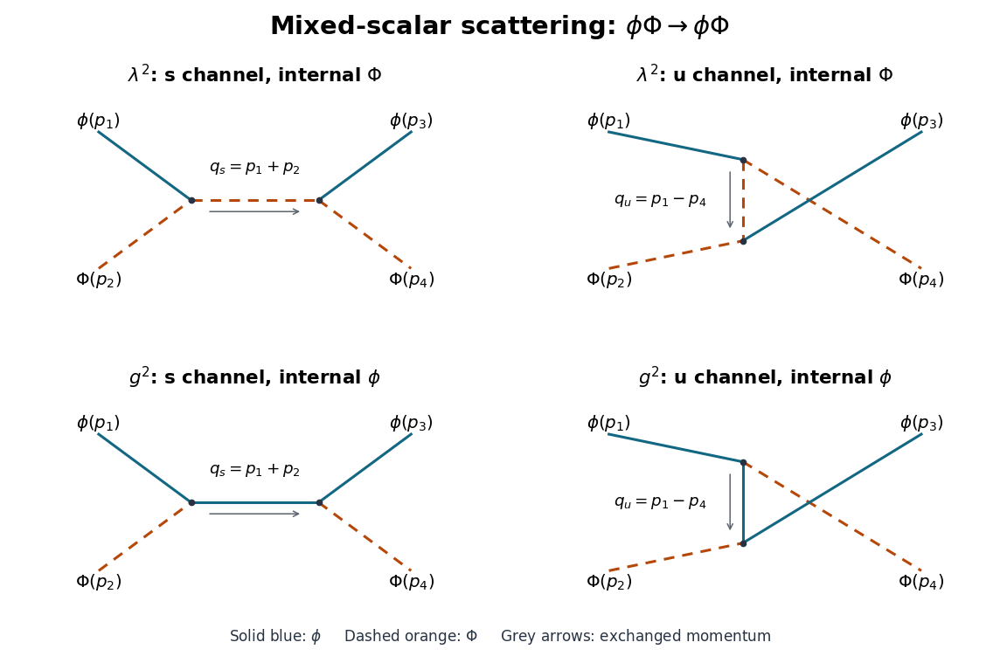

<h1 id="2/b/solution">Solution</h1>

↑ **Parent:** [B](../b.md)

Let $p_1,p_2$ denote the incoming $\phi,\Phi$ [four-momenta](../../../../four-momentum.md) and $p_3,p_4$ the outgoing $\phi,\Phi$ [four-momenta](../../../../four-momentum.md). Thus $p_1+p_2=p_3+p_4$, $p_1^2=p_3^2=m^2$ and $p_2^2=p_4^2=M^2$. Define the [Mandelstam variables](../../../../mandelstam-variables.md) and exchanged [four-momenta](../../../../four-momentum.md) by

$$
s=(p_1+p_2)^2=q_s^2,\qquad u=(p_1-p_4)^2=q_u^2,
\qquad q_s=p_1+p_2,\quad q_u=p_1-p_4=p_3-p_2.
$$

The leading connected four-point [scattering amplitude](../../../../scattering-amplitude.md) uses two cubic [interaction vertices](../../../../interaction-vertex.md). There are four [tree-level Feynman diagrams](../../../../tree-level-feynman-diagram.md): $s$ and $u$ exchange of $\Phi$ with two $\lambda$ vertices, and $s$ and $u$ exchange of $\phi$ with two $g$ vertices.

**[Figure 1](#2/b/image-the-four-tree-channels-for-mixed-scalar-scattering-blue-solid-lines-represent-phi-and-orange-dashed-lines-phi-external-momenta-are-incoming-on-the-left-and-outgoing-on-the-right-crossings-have-no-vertex). The four tree channels for mixed-scalar scattering. Blue solid lines represent $\phi$ and orange dashed lines $\Phi$. External momenta are incoming on the left and outgoing on the right; crossings have no vertex.**

There is no term proportional to $\lambda g$: one vertex of each kind has three field slots of each species altogether, whereas the external state uses two of each. This leaves one $\phi$ and one $\Phi$ to contract internally, and their mixed [scalar propagator](../../../../scalar-propagator.md) is zero. There is also no $t$ channel: grouping both external $\phi$ legs at one vertex would require a $g$ vertex with an internal $\Phi$, while grouping both external $\Phi$ legs at the other would require a $\lambda$ vertex with an internal $\phi$.

Define $i\mathcal M$ after removing the overall [momentum conservation](../../../../momentum-conservation.md) delta function. The nonderivative exchange gives

$$
i\mathcal M_{\lambda^2}=(i\lambda)^2
\left[\frac{i}{s-M^2+i0}+\frac{i}{u-M^2+i0}\right].
$$

For the derivative $s$ channel, the incoming $\phi$ [four-momenta](../../../../four-momentum.md) at the first vertex are $p_1,-q_s$, and at the second they are $q_s,-p_3$. The two [interaction vertices](../../../../interaction-vertex.md) are therefore $ig\,p_1\cdot q_s$ and $ig\,p_3\cdot q_s$. The same reasoning with $q_u$ applies to the $u$ channel, giving

$$
i\mathcal M_{g^2}=-ig^2\left[
\frac{(p_1\cdot q_s)(p_3\cdot q_s)}{s-m^2+i0}
+\frac{(p_1\cdot q_u)(p_3\cdot q_u)}{u-m^2+i0}\right].
$$

The [mass shell](../../../../mass-shell.md) conditions and [momentum conservation](../../../../momentum-conservation.md) imply

$$
p_1\cdot q_s=p_3\cdot q_s=\frac{s+m^2-M^2}{2},\qquad
p_1\cdot q_u=p_3\cdot q_u=\frac{u+m^2-M^2}{2}.
$$

Combining the four [Feynman diagrams](../../../../feynman-diagram.md) therefore yields

$$
\boxed{\begin{aligned}
\mathcal M={}&-\lambda^2\left[\frac1{s-M^2+i0}+\frac1{u-M^2+i0}\right]\\
&-\frac{g^2}{4}\left[
\frac{(s+m^2-M^2)^2}{s-m^2+i0}
+\frac{(u+m^2-M^2)^2}{u-m^2+i0}\right].
\end{aligned}}
$$

Each displayed [tree-level Feynman diagram](../../../../tree-level-feynman-diagram.md) has [Feynman-diagram symmetry factor](../../../../feynman-diagram-symmetry-factor.md) 1 for fixed external species and labels. The result is of order $\lambda^2,g^2$; if both couplings are scaled by a common parameter $\varepsilon$, the next connected corrections begin at order $\varepsilon^4$. A four-point cubic [Feynman diagram](../../../../feynman-diagram.md) has $3V=2I+4$, so its vertex count $V$ is even. The internal lines remain off shell throughout: imposing an on-shell relation on an exchanged [four-momentum](../../../../four-momentum.md) would incorrectly change the derivative vertices.

## ↑ Ancestors (12)

1. [B](../b.md)
2. [2](../../2.md)
3. [2019](../../../2019-split.md)
4. [Past exam of the quantum field theory course of the University of Oxford](../../../split.md)
5. [Quantum field theory course of the University of Oxford](../../../../quantum-field-theory-course-of-the-university-of-oxford.md)
6. [Year 4 of the mathematical and theoretical physics course of the University of Oxford](../../../../year-4-of-the-mathematical-and-theoretical-physics-course-of-the-university-of-oxford.md)
7. [Mathematical and theoretical physics course of the University of Oxford](../../../../mathematical-and-theoretical-physics-course-of-the-university-of-oxford.md)
8. [Undergraduate course of the University of Oxford](../../../../undergraduate-course-of-the-university-of-oxford.md)
9. [Course of the University of Oxford](../../../../course-of-the-university-of-oxford.md)
10. [University of Oxford](../../../../university-of-oxford-split.md)
11. [List of universities](../../../../list-of-universities.md)
12. [Codex Wiki](../../../../split.md)
