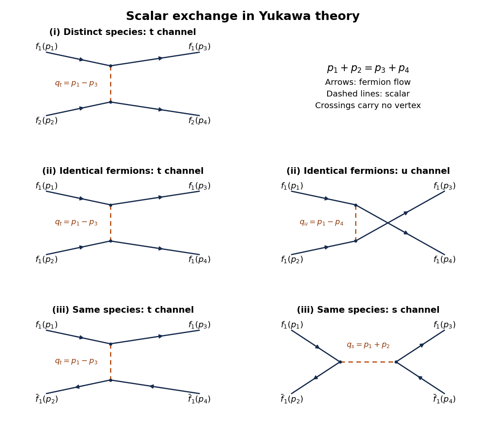

# 2020

↑ **Parent:** [Past exam of the quantum field theory course of the University of Oxford](../past-exam-of-the-quantum-field-theory-course-of-the-university-of-oxford.md)

Source paper: [https://www.whatdotheyknow.com/request/oxford_physics_past_papers_2/response/2340696/attach/8/Physics%20Papers%202019.pdf?cookie_passthrough=1](https://www.whatdotheyknow.com/request/oxford_physics_past_papers_2/response/2340696/attach/8/Physics%20Papers%202019.pdf?cookie_passthrough=1)

The cover establishes Hilary Term 2020 despite the source bundle's 2019 filename. Use $\hbar=c=1$, the [Minkowski metric](../special-relativity.md#minkowski-metric) $\eta=\operatorname{diag}(1,-1,-1,-1)$, and $\not p=\gamma^\mu p_\mu$ for [Feynman slash notation](../algebra-over-a-field.md#feynman-slash-notation). In question 1, the repeated species index in the [Yukawa interaction](../standard-model.md#yukawa-interaction) is summed over $i=1,2$. The spatial [mode expansions](../quantum-field-theory.md#mode-expansion-of-a-free-field) in question 2 are at a fixed time.

**Table of contents**

- [1](#1)
  - [a](#1/a)
    - [Solution](#1/a/solution)
  - [b](#1/b)
    - [i](#1/b/i)
      - [Solution](#1/b/i/solution)
    - [ii](#1/b/ii)
      - [Solution](#1/b/ii/solution)
    - [iii](#1/b/iii)
      - [Solution](#1/b/iii/solution)
  - [c](#1/c)
    - [Solution](#1/c/solution)
  - [d](#1/d)
    - [Solution](#1/d/solution)
- [2](#2)
  - [a](#2/a)
    - [Solution](#2/a/solution)
  - [b](#2/b)
    - [Solution](#2/b/solution)
  - [c](#2/c)
    - [Solution](#2/c/solution)
  - [d](#2/d)
    - [Solution](#2/d/solution)
- [3](#3)
  - [a](#3/a)
    - [Solution](#3/a/solution)
  - [b](#3/b)
    - [Solution](#3/b/solution)
  - [c](#3/c)
    - [Solution](#3/c/solution)

## 1

↑ **Parent:** [2020](2020.md)

<h3 id="1/a">a</h3>

↑ **Parent:** [1](#1)

<h4 id="1/a/solution">Solution</h4>

↑ **Parent:** [A](#1/a)

For [four-momentum](../special-relativity.md#four-momentum) $k$ flowing along the [fermion flow](../perturbative-quantum-field-theory.md#fermion-flow), the [momentum space](../momentum.md#momentum-space) [Feynman rules](../perturbative-quantum-field-theory.md#feynman-rules) are

$$
\boxed{\begin{aligned}
\text{scalar line: }&\frac{i}{k^2-m^2+i0},\\
\text{fermion line of species }i\text{ to }j:\quad&\delta_{ij}\frac{i(\not k+m)}{k^2-m^2+i0},\\
\phi\bar\psi_i\psi_j\text{ vertex: }&-ig\delta_{ij}.
\end{aligned}}
$$

The [scalar propagator](../scalar-field-theory.md#scalar-propagator) and [Dirac propagator](../quantum-field-theory.md#dirac-propagator) invert their respective quadratic kernels. The [interaction vertex](../perturbative-quantum-field-theory.md#interaction-vertex) follows by expanding $\exp(i\int\mathcal L_{\rm int})$, fixing its sign. Species is conserved along each open [fermion](../tensor-product-of-quantum-systems.md#fermion) line; there is no vertex changing species 1 into species 2.

An [interaction vertex](../perturbative-quantum-field-theory.md#interaction-vertex) carries $(2\pi)^4\delta^{(4)}(\sum k)$ with inward [four-momenta](../special-relativity.md#four-momentum). Impose [momentum conservation](../momentum.md#momentum-conservation) and integrate each independent [loop momentum](../perturbative-quantum-field-theory.md#loop-momentum) with $d^4k/(2\pi)^4$. Include the [closed fermion loop sign](../perturbative-quantum-field-theory.md#closed-fermion-loop-sign) $-1$ for every [fermion loop](../perturbative-quantum-field-theory.md#fermion-loop), the relevant [fermionic signs](../perturbative-quantum-field-theory.md#fermionic-sign) when rearranging external states, and the [Feynman-diagram symmetry factor](../perturbative-quantum-field-theory.md#feynman-diagram-symmetry-factor). External incoming and outgoing [fermions](../tensor-product-of-quantum-systems.md#fermion) carry $u_s(p)$ and $\bar u_s(p)$; incoming and outgoing [antifermions](../relativistic-quantum-field.md#antifermion) carry $\bar v_s(p)$ and $v_s(p)$. An external [real scalar field](../scalar-field-theory.md#real-scalar-field) leg has factor 1 in an amputated [scattering amplitude](../quantum-scattering.md#scattering-amplitude). The [Feynman i-epsilon prescription](../quantum-field-theory.md#feynman-i-epsilon-prescription) specifies the poles.

<h3 id="1/b">b</h3>

↑ **Parent:** [1](#1)

**[Figure 1](#1/b/image-momentum-labelled-tree-diagrams-for-the-three-yukawa-scattering-processes-solid-arrows-show-fermion-flow-dashed-lines-are-scalar-exchange-each-row-contains-every-allowed-tree-channel-for-that-process). Momentum-labelled tree diagrams for the three Yukawa scattering processes. Solid arrows show fermion flow; dashed lines are scalar exchange. Each row contains every allowed tree channel for that process.**

<h4 id="1/b/i">i</h4>

↑ **Parent:** [B](#1/b)

<h5 id="1/b/i/solution">Solution</h5>

↑ **Parent:** [I](#1/b/i)

Label the initial species-1 and species-2 [fermions](../tensor-product-of-quantum-systems.md#fermion) by $(p_1,s_1)$ and $(p_2,s_2)$, and the final species-1 and species-2 [fermions](../tensor-product-of-quantum-systems.md#fermion) by $(p_3,s_3)$ and $(p_4,s_4)$. There is exactly one [tree-level Feynman diagram](../perturbative-quantum-field-theory.md#tree-level-feynman-diagram): the $t$-channel [scalar propagator](../scalar-field-theory.md#scalar-propagator) joins the continuous species-1 line $1\to3$ to the continuous species-2 line $2\to4$. Its exchanged [four-momentum](../special-relativity.md#four-momentum) $q_t$ determines $t$, in the notation of [Mandelstam variables](../special-relativity.md#mandelstam-variables):

$$
\boxed{q_t=p_1-p_3=p_4-p_2,\qquad t=q_t^2.}
$$

The top row of the figure displays this [Feynman diagram](../perturbative-quantum-field-theory.md#feynman-diagram). A crossed attachment $1\to4$ would change species at an [interaction vertex](../perturbative-quantum-field-theory.md#interaction-vertex) and is forbidden. There is no initial [antifermion](../relativistic-quantum-field.md#antifermion) for an annihilation channel.

<h4 id="1/b/ii">ii</h4>

↑ **Parent:** [B](#1/b)

<h5 id="1/b/ii/solution">Solution</h5>

↑ **Parent:** [Ii](#1/b/ii)

With all four external [fermions](../tensor-product-of-quantum-systems.md#fermion) of species 1, both final attachments are possible. The middle row of the figure gives the two [tree-level Feynman diagrams](../perturbative-quantum-field-theory.md#tree-level-feynman-diagram):

- The $t$ channel has lines $1\to3$ and $2\to4$, joined by a [scalar propagator](../scalar-field-theory.md#scalar-propagator) with $q_t=p_1-p_3=p_4-p_2$.
- The $u$ channel has lines $1\to4$ and $2\to3$, joined by a [scalar propagator](../scalar-field-theory.md#scalar-propagator) with $q_u=p_1-p_4=p_3-p_2$.

For a fixed ordering of external [fermion](../tensor-product-of-quantum-systems.md#fermion) states, the [fermionic sign](../perturbative-quantum-field-theory.md#fermionic-sign) from exchanging the final identical [fermions](../tensor-product-of-quantum-systems.md#fermion) gives

$$
\boxed{\mathcal M=-g^2\left[
\frac{(\bar u_3u_1)(\bar u_4u_2)}{t-m^2+i0}
-\frac{(\bar u_4u_1)(\bar u_3u_2)}{u-m^2+i0}
\right],\qquad u=q_u^2.}
$$

Here $u_j=u_{s_j}(p_j)$ are [Dirac spinors](../relativistic-quantum-field.md#dirac-spinor). In particular, the [scattering amplitude](../quantum-scattering.md#scattering-amplitude) changes sign when the complete final labels $3$ and $4$ are exchanged, as required for identical [fermions](../tensor-product-of-quantum-systems.md#fermion).

<h4 id="1/b/iii">iii</h4>

↑ **Parent:** [B](#1/b)

<h5 id="1/b/iii/solution">Solution</h5>

↑ **Parent:** [Iii](#1/b/iii)

Let $p_1,p_3$ label the incoming and outgoing [fermion](../tensor-product-of-quantum-systems.md#fermion), and $p_2,p_4$ the incoming and outgoing [antifermion](../relativistic-quantum-field.md#antifermion). The bottom row of the figure gives the two [tree-level Feynman diagrams](../perturbative-quantum-field-theory.md#tree-level-feynman-diagram):

- The $t$ channel has an open [fermion](../tensor-product-of-quantum-systems.md#fermion) line $1\to3$ and an open [antifermion](../relativistic-quantum-field.md#antifermion) line with [fermion flow](../perturbative-quantum-field-theory.md#fermion-flow) $4\to2$. The [scalar propagator](../scalar-field-theory.md#scalar-propagator) carries $q_t=p_1-p_3=p_4-p_2$.
- The $s$ channel has initial [particle-antiparticle annihilation](../relativistic-quantum-field.md#annihilation) into a [scalar propagator](../scalar-field-theory.md#scalar-propagator) with $q_s=p_1+p_2=p_3+p_4$, followed by creation of the final pair.

Thus the [Mandelstam variables](../special-relativity.md#mandelstam-variables) in the two denominators are

$$
\boxed{t=(p_1-p_3)^2,\qquad s=(p_1+p_2)^2.}
$$

The two [scattering amplitude](../quantum-scattering.md#scattering-amplitude) terms have a relative [fermionic sign](../perturbative-quantum-field-theory.md#fermionic-sign) of minus when written with spinor products $(\bar u_3u_1)(\bar v_2v_4)$ and $(\bar v_2u_1)(\bar u_3v_4)$. The overall phase depends on the chosen ordering of the external states. No $u$ channel joins an incoming [fermion](../tensor-product-of-quantum-systems.md#fermion) to an outgoing [antifermion](../relativistic-quantum-field.md#antifermion) through a species-preserving [Yukawa interaction](../standard-model.md#yukawa-interaction).

<h3 id="1/c">c</h3>

↑ **Parent:** [1](#1)

<h4 id="1/c/solution">Solution</h4>

↑ **Parent:** [C](#1/c)

Define $\mathcal M$ by removing the factor $i(2\pi)^4\delta^{(4)}(p_1+p_2-p_3-p_4)$ from the connected transition [matrix element](../vector-space.md#matrix-element). The single [tree-level Feynman diagram](../perturbative-quantum-field-theory.md#tree-level-feynman-diagram) in [i](#1/b/i) gives

$$
i\mathcal M=(-ig)^2\frac{i}{q^2-m^2+i0}
[\bar u_{s_3}(p_3)u_{s_1}(p_1)]
[\bar u_{s_4}(p_4)u_{s_2}(p_2)],
\qquad q=p_1-p_3.
$$

There is no identical-particle exchange term because the species differ. Each incoming [fermion](../tensor-product-of-quantum-systems.md#fermion) has two equally populated [spin angular momentum](../angular-momentum-operator.md#spin) states in an unpolarized beam. Their probabilities multiply to $1/4$, giving a [spin average](../relativistic-quantum-field.md#spin-average) over the four initial choices. The unobserved final [spin angular momentum](../angular-momentum-operator.md#spin) states are distinct outcomes, so their probabilities are added by a [spin sum](../relativistic-quantum-field.md#spin-sum), with no final averaging:

$$
\overline{|\mathcal M|^2}=\frac14\sum_{s_1,s_2,s_3,s_4}|\mathcal M|^2.
$$

Taking the complex conjugate of $\bar u_3u_1$ gives $\bar u_1u_3$. The [fermion spin sum](../relativistic-quantum-field.md#fermion-spin-sum) therefore converts each squared bilinear into a [gamma-matrix trace](../relativistic-quantum-field.md#gamma-matrix-trace):

$$
\overline{|\mathcal M|^2}
=\frac{g^4}{4(q^2-m^2)^2}
\operatorname{tr}[(\not p_3+m)(\not p_1+m)]
\operatorname{tr}[(\not p_4+m)(\not p_2+m)].
$$

Using $\operatorname{tr}1=4$, $\operatorname{tr}\gamma^\mu=0$, $\operatorname{tr}(\gamma^\mu\gamma^\nu)=4\eta^{\mu\nu}$, and the [mass shell](../special-relativity.md#mass-shell) conditions $p_j^2=m^2$, each [gamma-matrix trace](../relativistic-quantum-field.md#gamma-matrix-trace) is

$$
4(p_1\cdot p_3+m^2)=4\left(2m^2-\frac{q^2}{2}\right)
=2(4m^2-q^2).
$$

The second equality follows from $q^2=2m^2-2p_1\cdot p_3$; [momentum conservation](../momentum.md#momentum-conservation) gives the identical result for $p_2,p_4$. Hence

$$
\boxed{\overline{|\mathcal M|^2}
=g^4\left(\frac{4m^2-q^2}{m^2-q^2}\right)^2.}
$$

**The printed prefactor $g^2$ is incorrect for the stated coupling.** Each of the two [Yukawa interaction](../standard-model.md#yukawa-interaction) vertices contributes one $g$ to the [scattering amplitude](../quantum-scattering.md#scattering-amplitude), so its square is proportional to $g^4$. As a concrete counterexample, take $g=2$, $m>0$, and forward elastic kinematics $p_3=p_1$, $p_4=p_2$. Then $q^2=0$ and the [spin average](../relativistic-quantum-field.md#spin-average) is $16g^4=256$, whereas the printed expression gives $16g^2=64$.

<h3 id="1/d">d</h3>

↑ **Parent:** [1](#1)

<h4 id="1/d/solution">Solution</h4>

↑ **Parent:** [D](#1/d)

For a connected amputated [Feynman diagram](../perturbative-quantum-field-theory.md#feynman-diagram), write $L$ for the number of independent [loop momenta](../perturbative-quantum-field-theory.md#loop-momentum). Each [loop momentum](../perturbative-quantum-field-theory.md#loop-momentum) integration scales as $\lambda^4$, each internal [scalar propagator](../scalar-field-theory.md#scalar-propagator) as $\lambda^{-2}$, and each internal [Dirac propagator](../quantum-field-theory.md#dirac-propagator) as $\lambda^{-1}$ when both [four-momenta](../special-relativity.md#four-momentum) and [mass](../classical-mechanics.md#mass) are scaled. The [Yukawa coupling](../standard-model.md#yukawa-interaction) has [mass dimension](../perturbative-quantum-field-theory.md#mass-dimension) zero. Thus

$$
d_S=4L-n_f-2n_s.
$$

Counting the two [fermion](../tensor-product-of-quantum-systems.md#fermion) ends and one scalar end at each [interaction vertex](../perturbative-quantum-field-theory.md#interaction-vertex), and using connectedness, gives

$$
2n_f=2n_v,\qquad 2n_s+n=n_v,\qquad
L=n_f+n_s-n_v+1.
$$

Consequently $n_f=n_v$, $L=n_s+1$, and

$$
\boxed{d_S=4+2n_s-n_v=4-n.}
$$

**The requested exponent requires amputation and removal of the overall momentum delta function.** An ordinary unamputated connected [Green function](../green-s-function.md) has an additional $n$ external [scalar propagators](../scalar-field-theory.md#scalar-propagator), giving [mass dimension](../perturbative-quantum-field-theory.md#mass-dimension) $4-3n$ after stripping that delta function, or $-3n$ if it is retained. For a concrete check, the free two-point [scalar propagator](../scalar-field-theory.md#scalar-propagator) scales as $\lambda^{-2}$, not $\lambda^2$. The exponent $4-n$ is the engineering result for the amputated object. A fixed [renormalization scale](../perturbative-quantum-field-theory.md#renormalization-scale) introduces logarithms; the displayed homogeneity is a naive [power counting](../perturbative-quantum-field-theory.md#power-counting-in-quantum-field-theory) statement rather than an exact quantum scaling law at fixed subtraction scale.

More generally, with $E_s$ external scalar ends and $E_f$ external [fermion](../tensor-product-of-quantum-systems.md#fermion) ends, the same counting gives the [superficial degree of divergence](../perturbative-quantum-field-theory.md#superficial-degree-of-divergence)

$$
\boxed{D=4-E_s-\frac32E_f.}
$$

This is an upper bound on the overall [ultraviolet divergence](../perturbative-quantum-field-theory.md#ultraviolet-divergence). Numerator cancellations and [Lorentz invariance](../special-relativity.md#lorentz-invariance) may lower it; an apparently convergent whole [Feynman diagram](../perturbative-quantum-field-theory.md#feynman-diagram) can still have [ultraviolet subdivergences](../perturbative-quantum-field-theory.md#ultraviolet-subdivergence). Local subtraction of those [ultraviolet subdivergences](../perturbative-quantum-field-theory.md#ultraviolet-subdivergence) is required first.

For pure scalar ends, $E_s=0,1,2,3,4$ can require [counterterms](../perturbative-quantum-field-theory.md#counterterm). [Lorentz invariance](../special-relativity.md#lorentz-invariance) reduces the two-point terms to a [mass counterterm](../perturbative-quantum-field-theory.md#mass-counterterm) and [wave-function renormalization](../perturbative-quantum-field-theory.md#wave-function-renormalization); derivatives of a single scalar field are total derivatives, and a one-derivative cubic scalar term cannot be a [Lorentz scalar](../special-relativity.md#lorentz-scalar). With two external [fermions](../tensor-product-of-quantum-systems.md#fermion), $E_s=0$ requires their [kinetic term](../classical-field-theory.md#kinetic-term) and [mass counterterm](../perturbative-quantum-field-theory.md#mass-counterterm), while $E_s=1$ requires [Yukawa coupling](../standard-model.md#yukawa-interaction) renormalization. Four external [fermions](../tensor-product-of-quantum-systems.md#fermion) give $D=-2$, so no independent four-[fermion](../tensor-product-of-quantum-systems.md#fermion) [counterterm](../perturbative-quantum-field-theory.md#counterterm) is required.

A complete [counterterm Lagrangian](../perturbative-quantum-field-theory.md#counterterm-lagrangian) consistent with the species symmetry can therefore be written

$$
\boxed{\begin{aligned}
\mathcal L_{\rm ct}={}&\frac{\delta Z_\phi}{2}(\partial\phi)^2
-\frac{\delta m_s^2}{2}\phi^2-\delta t\,\phi
-\frac{\delta\kappa}{3!}\phi^3-\frac{\delta\lambda_4}{4!}\phi^4-\delta\mathcal E\\
&+\sum_{i=1}^2\bar\psi_i(\delta Z_\psi i\not\partial-\delta m_f)\psi_i
-\delta g\,\phi\sum_{i=1}^2\bar\psi_i\psi_i.
\end{aligned}}
$$

The [vacuum energy density](../perturbative-quantum-field-theory.md#vacuum-energy-density) term matters for an unnormalized [vacuum functional](../perturbative-quantum-field-theory.md#vacuum-functional) and cancels from normalized [Green functions](../green-s-function.md). The [tadpole counterterm](../perturbative-quantum-field-theory.md#tadpole-counterterm) can impose $\langle\phi\rangle=0$. There is no $\phi\mapsto-\phi$ symmetry of the massive [Yukawa interaction](../standard-model.md#yukawa-interaction), so linear, cubic and quartic scalar terms cannot be excluded. For instance, in a constant background the divergent [fermion loop](../perturbative-quantum-field-theory.md#fermion-loop) contribution contains $(m+g\phi)^4$, exhibiting all these powers. This is [counterterm closure of a massive Yukawa theory](../perturbative-quantum-field-theory.md#counterterm-closure-of-a-massive-yukawa-theory).

The two species have identical couplings, so their common unitary flavour rotations preserve the [Lagrangian density](../classical-field-theory.md#lagrangian-density) and their [counterterms](../perturbative-quantum-field-theory.md#counterterm) can be chosen species independent. Equality of the scalar and [fermion](../tensor-product-of-quantum-systems.md#fermion) masses, however, is not protected: $\delta m_s^2$ and $\delta m_f$ are independent. Including the displayed finite set of operators yields a [renormalizable quantum field theory](../perturbative-quantum-field-theory.md#renormalizable-quantum-field-theory). Restricting the bare [Lagrangian density](../classical-field-theory.md#lagrangian-density) to the terms printed in the question is not closed under [renormalization](../perturbative-quantum-field-theory.md#renormalization).

## 2

↑ **Parent:** [2020](2020.md)

<h3 id="2/a">a</h3>

↑ **Parent:** [2](#2)

<h4 id="2/a/solution">Solution</h4>

↑ **Parent:** [A](#2/a)

Write $\int_{\mathbf p}=\int d^3p/(2\pi)^3$ and $d_{\mathbf p}=a_{\mathbf p}-b_{\mathbf p}$. The nonzero [canonical commutation relations](../quantum-mechanics.md#canonical-commutation-relation) are

$$
[a_{\mathbf p},a_{\mathbf q}^\dagger]
=[b_{\mathbf p},b_{\mathbf q}^\dagger]
=(2\pi)^3\delta^{(3)}(\mathbf p-\mathbf q),
$$

with cross-species brackets zero. The [commutator product rule](../lie-algebra.md#commutator-product-rule) gives

$$
\begin{aligned}
[Q,a_{\mathbf q}]&=\int_{\mathbf p}d_{\mathbf p}[d_{\mathbf p}^\dagger,a_{\mathbf q}]=-d_{\mathbf q},\\
[Q,b_{\mathbf q}]&=\int_{\mathbf p}d_{\mathbf p}[d_{\mathbf p}^\dagger,b_{\mathbf q}]=+d_{\mathbf q},\\
[Q,a_{\mathbf q}^\dagger]&=\int_{\mathbf p}[d_{\mathbf p},a_{\mathbf q}^\dagger]d_{\mathbf p}^\dagger=d_{\mathbf q}^\dagger,\\
[Q,b_{\mathbf q}^\dagger]&=\int_{\mathbf p}[d_{\mathbf p},b_{\mathbf q}^\dagger]d_{\mathbf p}^\dagger=-d_{\mathbf q}^\dagger.
\end{aligned}
$$

Linearity of the [commutator](../lie-algebra.md#commutator) now yields, for the real coefficient $s$,

$$
\boxed{\begin{aligned}
[Q,a_{\mathbf q}+sb_{\mathbf q}]&=-(1-s)(a_{\mathbf q}-b_{\mathbf q}),\\
[Q,a_{\mathbf q}^\dagger+sb_{\mathbf q}^\dagger]&=(1-s)(a_{\mathbf q}^\dagger-b_{\mathbf q}^\dagger).
\end{aligned}}
$$

Strictly, the printed $Q$ contains an infinite constant in continuum [Fock space](../quantum-field-theory.md#fock-space). Work first with finitely many modes, or replace it by its [normal ordering](../perturbative-quantum-field-theory.md#normal-ordering) $:Q:=\int_{\mathbf p}d_{\mathbf p}^\dagger d_{\mathbf p}$. Their difference is a constant, so every displayed [commutator](../lie-algebra.md#commutator) and every conjugation below is unchanged. The latter convention fixes the [vacuum state](../quantum-field-theory.md#vacuum-state) phase without an infinite phase ambiguity.

<h3 id="2/b">b</h3>

↑ **Parent:** [2](#2)

<h4 id="2/b/solution">Solution</h4>

↑ **Parent:** [B](#2/b)

For a [Hermitian operator](../hilbert-space.md#hermitian-operator) $Q$, the [operator exponential](../linear-operator-theory.md#operator-exponential) $C_\lambda=e^{i\lambda Q}$ is a [unitary operator](../vector-space.md#unitary-operator), with $C_\lambda^\dagger=e^{-i\lambda Q}$. Differentiation and $[Q,C_\lambda]=0$ give

$$
\frac{d}{d\lambda}(C_\lambda A C_\lambda^\dagger)
=iQC_\lambda A C_\lambda^\dagger-iC_\lambda A C_\lambda^\dagger Q
=iC_\lambda[Q,A]C_\lambda^\dagger.
$$

When $[Q,A]=cA$, this is the first-order [ordinary differential equation](../differential-equation.md#ordinary-differential-equation) $A'(\lambda)=icA(\lambda)$ with $A(0)=A$. Multiplication by $e^{-ic\lambda}$ makes its derivative zero, proving

$$
\boxed{A(\lambda)=e^{ic\lambda}A.}
$$

Equivalently, the [commutator expansion for exponential conjugation](../lie-algebra.md#commutator-expansion-for-exponential-conjugation) has successive nested [commutators](../lie-algebra.md#commutator) $c^r A$, whose [exponential series](../calculus.md#exponential-series) sums to this expression.

<h3 id="2/c">c</h3>

↑ **Parent:** [2](#2)

<h4 id="2/c/solution">Solution</h4>

↑ **Parent:** [C](#2/c)

Use the combinations $a_\pm=a\pm b$ at each [momentum](../momentum.md). Part [a](#2/a) gives $[Q,a_+]=0$, $[Q,a_-]=-2a_-$, while their [creation operators](../quantum-harmonic-oscillator.md#creation-operator) obey $[Q,a_+^\dagger]=0$, $[Q,a_-^\dagger]=2a_-^\dagger$. Applying [b](#2/b) gives

$$
\begin{aligned}
C_\lambda a C_\lambda^\dagger
&=\frac{1+e^{-2i\lambda}}2a+\frac{1-e^{-2i\lambda}}2b,\\
C_\lambda b C_\lambda^\dagger
&=\frac{1-e^{-2i\lambda}}2a+\frac{1+e^{-2i\lambda}}2b.
\end{aligned}
$$

The [creation operators](../quantum-harmonic-oscillator.md#creation-operator) transform by the [Hermitian adjoint](../hilbert-space.md#adjoint-operator) formulas with $e^{+2i\lambda}$. At $\lambda=\pi/2$, both exponentials are $-1$, so

$$
\boxed{Ca_{\mathbf p}C^\dagger=b_{\mathbf p},\quad
Cb_{\mathbf p}C^\dagger=a_{\mathbf p},\quad
Ca_{\mathbf p}^\dagger C^\dagger=b_{\mathbf p}^\dagger,\quad
Cb_{\mathbf p}^\dagger C^\dagger=a_{\mathbf p}^\dagger,\qquad C=C_{\pi/2}.}
$$

Substituting into the fixed-time [mode expansion of a free field](../quantum-field-theory.md#mode-expansion-of-a-free-field) of the [complex scalar field](../scalar-field-theory.md#complex-scalar-field) gives

$$
C\phi(\mathbf x)C^\dagger
=\int_{\mathbf p}\frac{a_{-\mathbf p}^\dagger+b_{\mathbf p}}{\sqrt{2E_{\mathbf p}}}
 e^{i\mathbf p\cdot\mathbf x}
=\phi^\dagger(\mathbf x).
$$

Thus $C$ exchanges particles and [antiparticles](../relativistic-quantum-field.md#antiparticle), as required for [charge conjugation](../quantum-field-theory.md#charge-conjugation). To see the charge reversal explicitly, the conserved charge $Q_{\rm em}=\int_{\mathbf p}(a_{\mathbf p}^\dagger a_{\mathbf p}-b_{\mathbf p}^\dagger b_{\mathbf p})$ obeys $CQ_{\rm em}C^\dagger=-Q_{\rm em}$. The generator $Q$ in the question is distinct from this charge.

The two occupation terms in the [Hamiltonian](../hamiltonian-mechanics.md#hamiltonian) are exchanged, with the same [relativistic energy](../special-relativity.md#relativistic-energy) $E_{\mathbf p}$, and therefore

$$
\boxed{CHC^\dagger=H.}
$$

In fact $[Q,H]=0$ because its mixing terms exchange equal-[energy](../energy.md) modes. With [normal ordering](../perturbative-quantum-field-theory.md#normal-ordering), $:Q:=2\int_{\mathbf p}c_{-,\mathbf p}^\dagger c_{-,\mathbf p}$ for $c_-=(a-b)/\sqrt2$. Then $C=e^{i\pi N_-}$ fixes the [vacuum state](../quantum-field-theory.md#vacuum-state) and satisfies $C^2=1$. The construction is a [bosonic species-swap generator](../quantum-field-theory.md#bosonic-species-swap-generator).

<h3 id="2/d">d</h3>

↑ **Parent:** [2](#2)

<h4 id="2/d/solution">Solution</h4>

↑ **Parent:** [D](#2/d)

Take [parity symmetry in quantum field theory](../quantum-field-theory.md#parity-symmetry-in-quantum-field-theory) to preserve free time evolution, so the conjugate initial data reflect along with the field. Substitute the [mode expansion of a free field](../quantum-field-theory.md#mode-expansion-of-a-free-field) into the defining [parity operator](../quantum-mechanics.md#parity-operator) relation and change the integration variable $\mathbf p\mapsto-\mathbf p$. Since $E_{-\mathbf p}=E_{\mathbf p}$, coefficient comparison, or comparison of both the field and its conjugate initial data, gives the intrinsic-even convention

$$
\boxed{\begin{aligned}
\mathcal P a_{\mathbf p}\mathcal P^\dagger&=a_{-\mathbf p},&
\mathcal P b_{\mathbf p}\mathcal P^\dagger&=b_{-\mathbf p},\\
\mathcal P a_{\mathbf p}^\dagger\mathcal P^\dagger&=a_{-\mathbf p}^\dagger,&
\mathcal P b_{\mathbf p}^\dagger\mathcal P^\dagger&=b_{-\mathbf p}^\dagger.
\end{aligned}}
$$

Here [parity symmetry in quantum field theory](../quantum-field-theory.md#parity-symmetry-in-quantum-field-theory) reverses spatial [momentum](../momentum.md) and preserves time. The [creation operator](../quantum-harmonic-oscillator.md#creation-operator) formulas follow by taking [Hermitian adjoints](../hilbert-space.md#adjoint-operator). The given field relation has fixed the intrinsic phase to $+1$.

For one [real scalar field](../scalar-field-theory.md#real-scalar-field), let $R$ act on one-particle [wave functions](../wave-function.md) by $(Rf)(\mathbf p)=f(-\mathbf p)$. It is a [Hermitian operator](../hilbert-space.md#hermitian-operator) with $R^2=1$, so $P_-=(1-R)/2$ is the [orthogonal projector](../hilbert-space.md#orthogonal-projection) onto odd [wave functions](../wave-function.md). Its [second quantization](../quantum-mechanics.md#second-quantization) is the odd-mode [number operator](../quantum-harmonic-oscillator.md#number-operator)

$$
N_{\rm odd}=\frac12\int_{\mathbf p}a_{\mathbf p}^\dagger(a_{\mathbf p}-a_{-\mathbf p})
=\frac14\int_{\mathbf p}(a_{\mathbf p}^\dagger-a_{-\mathbf p}^\dagger)(a_{\mathbf p}-a_{-\mathbf p}).
$$

The full [momentum space](../momentum.md#momentum-space) is integrated in both expressions; the factors prevent double counting the pairs $\{\mathbf p,-\mathbf p\}$. A suitable [parity operator](../quantum-mechanics.md#parity-operator) is

$$
\boxed{\mathcal P=\exp(i\pi N_{\rm odd})
=\exp\left[\frac{i\pi}{2}\int_{\mathbf p}a_{\mathbf p}^\dagger(a_{\mathbf p}-a_{-\mathbf p})\right].}
$$

For verification, $[N_{\rm odd},a_{\mathbf p}]=-(a_{\mathbf p}-a_{-\mathbf p})/2$. Thus the even combination $a_{\mathbf p}+a_{-\mathbf p}$ is unchanged, and the odd combination $a_{\mathbf p}-a_{-\mathbf p}$ changes sign under conjugation by $e^{i\pi N_{\rm odd}}$, exactly reproducing $a_{\mathbf p}\mapsto a_{-\mathbf p}$. The same holds for [creation operators](../quantum-harmonic-oscillator.md#creation-operator). The odd-mode [number operator](../quantum-harmonic-oscillator.md#number-operator) has integer [eigenvalues](../linear-operator-theory.md#eigenvalue), so $\mathcal P^2=1$, and $\mathcal P|0\rangle=|0\rangle$. Multiplying by an overall constant phase would not change its conjugation action. This is [parity as odd-mode number parity](../quantum-mechanics.md#parity-as-odd-mode-number-parity).

## 3

↑ **Parent:** [2020](2020.md)

<h3 id="3/a">a</h3>

↑ **Parent:** [3](#3)

<h4 id="3/a/solution">Solution</h4>

↑ **Parent:** [A](#3/a)

Keep $\lambda$ for the cubic coupling and $j$ for the external [source](../perturbative-quantum-field-theory.md#source-quantum-field-theory). Expanding the interaction part of the [scalar field path integral](../quantum-field-theory.md#scalar-field-path-integral) yields

$$
Z[\lambda;j]=\sum_{V=0}^\infty\frac1{V!}
\left(-\frac{i\lambda}{3!}\right)^V
\int\prod_{v=1}^V d^4y_v\int D\phi\,
\prod_{v=1}^V\phi(y_v)^3\,
 e^{iS_0[\phi]+i\int j\phi}.
$$

A [functional derivative](../calculus-of-variations.md#functional-derivative) of the source exponential inserts $i\phi(y)$. In particular, $\delta_j(y)^3 e^{i\int j\phi}=-i\phi(y)^3e^{i\int j\phi}$, so $-i\lambda\phi(y)^3$ can be replaced by $\lambda\delta_j(y)^3$. The [functional derivatives](../calculus-of-variations.md#functional-derivative) commute and can be taken outside the free [path integral](../quantum-field-theory.md#path-integral). Resumming the [exponential series](../calculus.md#exponential-series) gives

$$
\boxed{Z[\lambda;j]=\exp\left[\frac\lambda{3!}\int d^4y\,
\frac{\delta^3}{\delta j(y)^3}\right]Z[0;j].}
$$

This is a formal [perturbation series](../perturbative-quantum-field-theory.md#perturbation-series); a real cubic [scalar potential](../classical-field-theory.md#scalar-potential) is unbounded and the expression does not assert a stable nonperturbative [vacuum state](../quantum-field-theory.md#vacuum-state).

To evaluate the free [Gaussian path integral](../quantum-field-theory.md#gaussian-path-integral), use [integration by parts](../calculus.md#integration-by-parts) to write

$$
S_0[\phi]+\int j\phi=\frac12\int\phi K\phi+\int j\phi,
\qquad K=-\Box-m^2+i\epsilon.
$$

The inverse kernel is

$$
K^{-1}(x,y)=D(x-y)
=\int\frac{d^4p}{(2\pi)^4}
\frac{e^{-ip\cdot(x-y)}}{p^2-m^2+i\epsilon}.
$$

[Completing the square](../polynomial.md#completing-the-square) with $\phi=\chi-K^{-1}j$ changes the exponent to $i\int\chi K\chi/2-i\int jK^{-1}j/2$. The translation-invariant [functional measure](../quantum-field-theory.md#functional-measure) makes the remaining [Gaussian path integral](../quantum-field-theory.md#gaussian-path-integral) precisely $Z[0;0]$, hence

$$
\boxed{Z[0;j]=Z[0;0]\exp\left[-\frac i2\int d^4x\,d^4y
\int\frac{d^4p}{(2\pi)^4}
\frac{j(x)j(y)e^{-ip\cdot(x-y)}}{p^2-m^2+i\epsilon}\right].}
$$

For $\epsilon>0$, the exponent includes $-\epsilon\int\phi^2/2$, which damps the regulated finite-dimensional integrals. The [Feynman i-epsilon prescription](../quantum-field-theory.md#feynman-i-epsilon-prescription) displaces the positive-[energy](../energy.md) pole below the real $p^0$ axis and the negative-[energy](../energy.md) pole above it, selecting the time-ordered [vacuum expectation value](../quantum-field-theory.md#vacuum-expectation-value). Indeed the [Feynman propagator](../quantum-field-theory.md#feynman-propagator) is $\Delta_F=iD$. Thus $i\epsilon$ specifies both convergence and the [vacuum state](../quantum-field-theory.md#vacuum-state) boundary conditions, with $\epsilon\to0^+$ taken after integration.

<h3 id="3/b">b</h3>

↑ **Parent:** [3](#3)

<h4 id="3/b/solution">Solution</h4>

↑ **Parent:** [B](#3/b)

For the interacting [vacuum state](../quantum-field-theory.md#vacuum-state) defined perturbatively by the same [Feynman i-epsilon prescription](../quantum-field-theory.md#feynman-i-epsilon-prescription), the normalized [time-ordered product](../perturbative-quantum-field-theory.md#time-ordered-product) is

$$
\boxed{\left\langle T\prod_{r=1}^m\phi(x_r)\right\rangle
=\left.\frac{1}{Z[\lambda;0]}\frac1{i^m}
\frac{\delta^m Z[\lambda;j]}{\delta j(x_1)\cdots\delta j(x_m)}\right|_{j=0}.}
$$

Each [functional derivative](../calculus-of-variations.md#functional-derivative) inserts $i\phi$, accounting for $i^{-m}$. The denominator implements [cancellation of vacuum bubbles](../perturbative-quantum-field-theory.md#cancellation-of-vacuum-bubbles), while disconnected pieces carrying external insertions still contribute. The lower limit $i=i$ in the printed product is a typographical error; the product here runs from 1 to $m$.

At order $V$ in the cubic scalar [field interaction term](../classical-field-theory.md#field-interaction-term), the expansion of the [generating functional](../perturbative-quantum-field-theory.md#generating-functional) supplies $1/[V!(3!)^V]$. The $V!$ counts permutations of indistinguishable integrated [interaction vertices](../perturbative-quantum-field-theory.md#interaction-vertex), and $3!$ counts permutations of the three field slots at each [interaction vertex](../perturbative-quantum-field-theory.md#interaction-vertex). Applying the [Wick theorem](../perturbative-quantum-field-theory.md#wick-s-theorem) pairs fields into [Feynman propagators](../quantum-field-theory.md#feynman-propagator). Several pairings produce the same [Feynman diagram](../perturbative-quantum-field-theory.md#feynman-diagram); their number $N_G$ multiplies the expansion coefficient. For fixed labelled external points, the net combinatorial weight is

$$
\boxed{w_G=\frac{N_G}{V!(3!)^V}=\frac1{S_G}.}
$$

Here $S_G$ is the order of the graph's [automorphism group](../group-theory.md#automorphism-group) when the external labels are fixed, with permutations of identical parallel lines and reversal of a self-loop included as applicable. This is the [Feynman-diagram symmetry factor](../perturbative-quantum-field-theory.md#feynman-diagram-symmetry-factor) convention in which a [Feynman diagram](../perturbative-quantum-field-theory.md#feynman-diagram) is divided by $S_G$. Each cubic [interaction vertex](../perturbative-quantum-field-theory.md#interaction-vertex) then contributes $-i\lambda$, each line contributes $\Delta_F$, and each internal vertex is integrated over its position. External labelled points are not divided by $m!$.

<h3 id="3/c">c</h3>

↑ **Parent:** [3](#3)

<h4 id="3/c/solution">Solution</h4>

↑ **Parent:** [C](#3/c)

Hold the external endpoints fixed and distinguish the three [Feynman diagrams](../perturbative-quantum-field-theory.md#feynman-diagram) by their left-to-right order in the source. Write $S$ for the divisor and $w=1/S$ for the multiplying combinatorial weight. Each line below includes external [Feynman propagators](../quantum-field-theory.md#feynman-propagator); [amputation](../perturbative-quantum-field-theory.md#amputation-of-external-propagators) leaves the same $w$.

**Left: two-point bubble.** There are two cubic [interaction vertices](../perturbative-quantum-field-theory.md#interaction-vertex) and two parallel internal lines. Interchanging those lines preserves the labelled external endpoints, giving $S=2$. Direct [Wick contraction](../perturbative-quantum-field-theory.md#wick-contraction) counting gives two assignments of the external endpoints to the vertices, $3^2$ choices of their field slots, and $2!$ pairings of the remaining slots:

$$
N_{\rm left}=2\cdot3^2\cdot2=36,\qquad
\boxed{w_{\rm left}=\frac{36}{2!(3!)^2}=\frac12.}
$$

With $\Delta=\Delta_F$ and external points $x_1,x_2$, its contribution is

$$
\frac{(-i\lambda)^2}{2}\int d^4y\,d^4z\,
\Delta(x_1-y)\Delta(y-z)^2\Delta(z-x_2).
$$

**Middle: three-point triangle.** The three labelled external endpoints fix their three adjacent cubic [interaction vertices](../perturbative-quantum-field-theory.md#interaction-vertex), so no nonidentity [graph automorphism](../graph.md#graph-automorphism) remains. Counting gives $3!$ assignments of endpoints to vertices, $3^3$ choices of external field slots, and $2^3$ assignments of remaining slots to the two specified neighbours:

$$
N_{\rm middle}=3!\,3^3\,2^3=1296,\qquad
\boxed{w_{\rm middle}=\frac{1296}{3!(3!)^3}=1.}
$$

Its contribution is

$$
(-i\lambda)^3\int\prod_{r=1}^3 d^4y_r\,
\left[\prod_{r=1}^3\Delta(x_r-y_r)\right]
\Delta(y_1-y_2)\Delta(y_2-y_3)\Delta(y_3-y_1).
$$

The apparent rotational symmetry of an unlabelled triangle does not survive fixing three distinct external endpoints.

**Right: two-point graph with a chord.** There are four cubic [interaction vertices](../perturbative-quantum-field-theory.md#interaction-vertex): the left and right attachment vertices $A,B$ and the two chord ends $C,D$. Its internal edges are $AC,AD,BC,BD,CD$. Reflection interchanges $C,D$, fixes $A,B$, and preserves the two external labels. This is the only nontrivial [graph automorphism](../graph.md#graph-automorphism), so $S=2$.

For a separate [Wick contraction](../perturbative-quantum-field-theory.md#wick-contraction) count, choose the ordered external attachment vertices in $4\cdot3$ ways and their field slots in $3^2$ ways. Assign their two remaining slots to $C,D$ in $2^2$ ways. At each of $C,D$, choose the slot joining $A$ and then the slot joining $B$ in $3\cdot2$ ways; the last slots join each other. Thus

$$
N_{\rm right}=12\cdot9\cdot4\cdot6^2=15552,\qquad
\boxed{w_{\rm right}=\frac{15552}{4!(3!)^4}=\frac12.}
$$

Its contribution is

$$
\frac{(-i\lambda)^4}{2}\int d^4A\,d^4B\,d^4C\,d^4D\,
\Delta(x_1-A)\Delta(B-x_2)
\Delta(A-C)\Delta(A-D)\Delta(B-C)\Delta(B-D)\Delta(C-D).
$$

Consequently the three multiplying weights are $\boxed{(1/2,1,1/2)}$, or divisors $\boxed{(2,1,2)}$. The central chord is a single internal line joining two vertices, not a vertex at the centre of the circle.

## ↑ Ancestors (9)

1. [Past exam of the quantum field theory course of the University of Oxford](../past-exam-of-the-quantum-field-theory-course-of-the-university-of-oxford.md)
2. [Quantum field theory course of the University of Oxford](../university-of-oxford.md#quantum-field-theory-course-of-the-university-of-oxford)
3. [Year 4 of the mathematical and theoretical physics course of the University of Oxford](../university-of-oxford.md#year-4-of-the-mathematical-and-theoretical-physics-course-of-the-university-of-oxford)
4. [Mathematical and theoretical physics course of the University of Oxford](../university-of-oxford.md#mathematical-and-theoretical-physics-course-of-the-university-of-oxford)
5. [Undergraduate course of the University of Oxford](../university-of-oxford.md#undergraduate-course-of-the-university-of-oxford)
6. [Course of the University of Oxford](../university-of-oxford.md#course-of-the-university-of-oxford)
7. [University of Oxford](../university-of-oxford.md)
8. [List of universities](../README.md#list-of-universities)
9. [Codex Wiki](../README.md)
