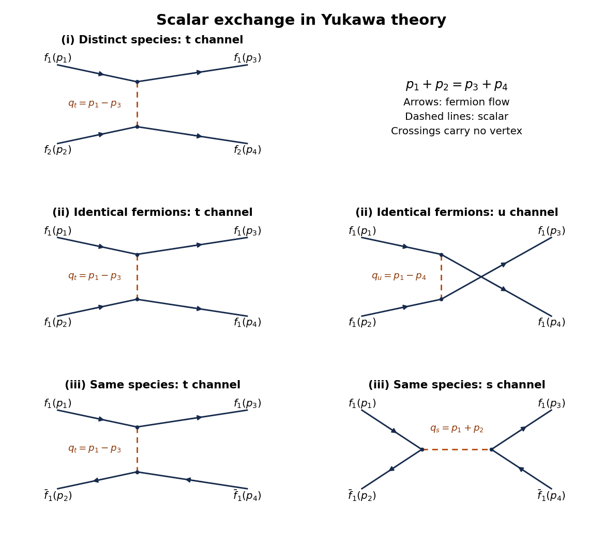

<h1 id="1/b">b</h1>

↑ **Parent:** [1](../1.md)

**[Figure 1](#1/b/image-momentum-labelled-tree-diagrams-for-the-three-yukawa-scattering-processes-solid-arrows-show-fermion-flow-dashed-lines-are-scalar-exchange-each-row-contains-every-allowed-tree-channel-for-that-process). Momentum-labelled tree diagrams for the three Yukawa scattering processes. Solid arrows show fermion flow; dashed lines are scalar exchange. Each row contains every allowed tree channel for that process.**

**Table of contents**

- [i](b/i.md)
  - [Solution](b/i/solution.md)
- [ii](b/ii.md)
  - [Solution](b/ii/solution.md)
- [iii](b/iii.md)
  - [Solution](b/iii/solution.md)

## ↑ Ancestors (11)

1. [1](../1.md)
2. [2020](../../2020-split.md)
3. [Past exam of the quantum field theory course of the University of Oxford](../../split.md)
4. [Quantum field theory course of the University of Oxford](../../../quantum-field-theory-course-of-the-university-of-oxford.md)
5. [Year 4 of the mathematical and theoretical physics course of the University of Oxford](../../../year-4-of-the-mathematical-and-theoretical-physics-course-of-the-university-of-oxford.md)
6. [Mathematical and theoretical physics course of the University of Oxford](../../../mathematical-and-theoretical-physics-course-of-the-university-of-oxford.md)
7. [Undergraduate course of the University of Oxford](../../../undergraduate-course-of-the-university-of-oxford.md)
8. [Course of the University of Oxford](../../../course-of-the-university-of-oxford.md)
9. [University of Oxford](../../../university-of-oxford-split.md)
10. [List of universities](../../../list-of-universities.md)
11. [Codex Wiki](../../../split.md)
