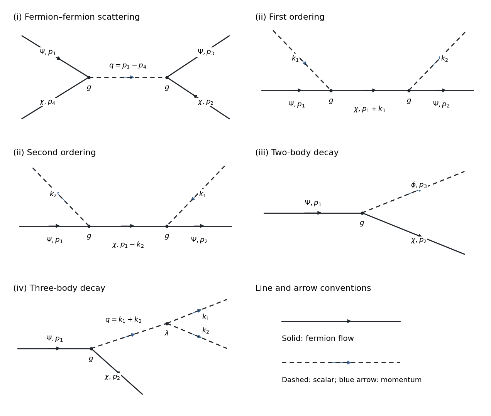
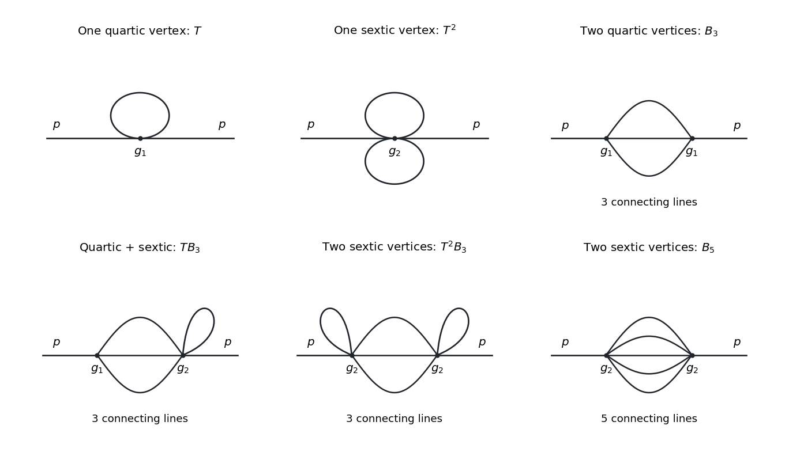

# 2021

↑ **Parent:** [Past exam of the quantum field theory course of the University of Oxford](../past-exam-of-the-quantum-field-theory-course-of-the-university-of-oxford.md)

Source paper: [https://www.whatdotheyknow.com/request/oxford_physics_past_papers_2/response/2340696/attach/9/Physics%20Papers%202020.pdf?cookie_passthrough=1](https://www.whatdotheyknow.com/request/oxford_physics_past_papers_2/response/2340696/attach/9/Physics%20Papers%202020.pdf?cookie_passthrough=1)

The source cover identifies Hilary Term 2021 despite the attachment's filename. Use [natural units](../mathematical-physics.md#natural-units) $\hbar=c=1$, the [Minkowski metric](../special-relativity.md#minkowski-metric) $\eta=\operatorname{diag}(1,-1,-1,-1)$, and $\not p=\gamma^\mu p_\mu$. The three-dimensional [scalar field theory](../scalar-field-theory.md) in [3](#3) has two spatial dimensions and one time dimension. Results are at the stated order of [perturbative quantum field theory](../perturbative-quantum-field-theory.md).

**Table of contents**

- [1](#1)
  - [a](#1/a)
    - [Solution](#1/a/solution)
  - [b](#1/b)
    - [i](#1/b/i)
      - [Solution](#1/b/i/solution)
    - [ii](#1/b/ii)
      - [Solution](#1/b/ii/solution)
    - [iii](#1/b/iii)
      - [Solution](#1/b/iii/solution)
    - [iv](#1/b/iv)
      - [Solution](#1/b/iv/solution)
  - [c](#1/c)
    - [Solution](#1/c/solution)
  - [d](#1/d)
    - [Solution](#1/d/solution)
  - [e](#1/e)
    - [Solution](#1/e/solution)
- [2](#2)
  - [a](#2/a)
    - [Solution](#2/a/solution)
  - [b](#2/b)
    - [Solution](#2/b/solution)
  - [c](#2/c)
    - [Solution](#2/c/solution)
  - [d](#2/d)
    - [Solution](#2/d/solution)
- [3](#3)
  - [a](#3/a)
    - [Solution](#3/a/solution)
  - [b](#3/b)
    - [Solution](#3/b/solution)
  - [c](#3/c)
    - [i](#3/c/i)
      - [Solution](#3/c/i/solution)
    - [ii](#3/c/ii)
      - [Solution](#3/c/ii/solution)
  - [d](#3/d)
    - [Solution](#3/d/solution)

## 1

↑ **Parent:** [2021](2021.md)

<h3 id="1/a">a</h3>

↑ **Parent:** [1](#1)

<h4 id="1/a/solution">Solution</h4>

↑ **Parent:** [A](#1/a)

The [momentum space](../momentum.md#momentum-space) [Feynman rules](../perturbative-quantum-field-theory.md#feynman-rules) use the [scalar propagator](../scalar-field-theory.md#scalar-propagator) and two [Dirac propagators](../quantum-field-theory.md#dirac-propagator)

$$
\boxed{\Delta_\phi(p)=\frac{i}{p^2-m^2+i0},\qquad
S_\chi(p)=\frac{i(\not p+m)}{p^2-m^2+i0},\qquad
S_\Psi(p)=\frac{i(\not p+M)}{p^2-M^2+i0}.}
$$

The cubic [scalar field](../classical-field-theory.md#scalar-field) [interaction vertex](../perturbative-quantum-field-theory.md#interaction-vertex) is $-i\lambda$. Each of the two flavour-changing [Yukawa coupling](../standard-model.md#yukawa-interaction) [interaction vertices](../perturbative-quantum-field-theory.md#interaction-vertex), $\phi\bar\Psi\chi$ and $\phi\bar\chi\Psi$, has factor $-ig\,\delta_{ab}$ in [Dirac spinor](../relativistic-quantum-field.md#dirac-spinor) indices. A [fermion flow](../perturbative-quantum-field-theory.md#fermion-flow) arrow continues through each [interaction vertex](../perturbative-quantum-field-theory.md#interaction-vertex), but its species changes. There is no $\phi\bar\Psi\Psi$ or $\phi\bar\chi\chi$ [interaction vertex](../perturbative-quantum-field-theory.md#interaction-vertex).

Every [interaction vertex](../perturbative-quantum-field-theory.md#interaction-vertex) carries $(2\pi)^4\delta^{(4)}(\sum p)$ with inward [four-momenta](../special-relativity.md#four-momentum). Integrate each independent [loop momentum](../perturbative-quantum-field-theory.md#loop-momentum) with $d^4\ell/(2\pi)^4$, divide by the [Feynman-diagram symmetry factor](../perturbative-quantum-field-theory.md#feynman-diagram-symmetry-factor), and include a minus sign and a [gamma-matrix trace](../relativistic-quantum-field.md#gamma-matrix-trace) for each closed [fermion loop](../perturbative-quantum-field-theory.md#fermion-loop). The $i0$ is the [Feynman i-epsilon prescription](../quantum-field-theory.md#feynman-i-epsilon-prescription).

For an amputated [scattering amplitude](../quantum-scattering.md#scattering-amplitude), incoming [fermions](../tensor-product-of-quantum-systems.md#fermion) supply $u^s(p)$ and outgoing [fermions](../tensor-product-of-quantum-systems.md#fermion) supply $\bar u^s(p)$; incoming [antifermions](../relativistic-quantum-field.md#antifermion) supply $\bar v^s(p)$ and outgoing [antifermions](../relativistic-quantum-field.md#antifermion) supply $v^s(p)$. An external [real scalar field](../scalar-field-theory.md#real-scalar-field) particle supplies $1$. Use the standard [relativistic normalization of a one-particle state](../quantum-field-theory.md#relativistic-normalization-of-a-one-particle-state); the external factors $1/\sqrt{2E}$ belong to that normalization and the [Lorentz-invariant phase-space measure](../quantum-scattering.md#lorentz-invariant-phase-space-measure), rather than an additional factor in the invariant [scattering amplitude](../quantum-scattering.md#scattering-amplitude).

<h3 id="1/b">b</h3>

↑ **Parent:** [1](#1)

The original [tree-level Feynman diagrams](../perturbative-quantum-field-theory.md#tree-level-feynman-diagram) below use solid arrowed [fermion](../tensor-product-of-quantum-systems.md#fermion) lines and dashed [scalar field](../classical-field-theory.md#scalar-field) lines. The labelled internal [momenta](../momentum.md) run in the indicated directions; $g$ and $\lambda$ label the corresponding [interaction vertices](../perturbative-quantum-field-theory.md#interaction-vertex).

**[Figure 1](#1/b/image-momentum-labelled-tree-diagrams-for-the-four-processes-the-middle-row-contains-the-two-exchange-orderings). Momentum-labelled tree diagrams for the four processes; the middle row contains the two exchange orderings.**

<h4 id="1/b/i">i</h4>

↑ **Parent:** [B](#1/b)

<h5 id="1/b/i/solution">Solution</h5>

↑ **Parent:** [I](#1/b/i)

Label the external [four-momenta](../special-relativity.md#four-momentum) by $\Psi(p_1)+\chi(p_2)\to\Psi(p_3)+\chi(p_4)$. The only [tree-level Feynman diagram](../perturbative-quantum-field-theory.md#tree-level-feynman-diagram) exchanges a [scalar field](../classical-field-theory.md#scalar-field) particle between the transitions $\Psi(p_1)\to\chi(p_4)$ and $\chi(p_2)\to\Psi(p_3)$. Its internal [four-momentum](../special-relativity.md#four-momentum) is $q=p_1-p_4=p_3-p_2$. Thus its [scattering amplitude](../quantum-scattering.md#scattering-amplitude), with a consistent external-state ordering, is

$$
i\mathcal M=(-ig)^2\,[\bar u_\chi(p_4)u_\Psi(p_1)]\,
\frac{i}{(p_1-p_4)^2-m^2+i0}\,
[\bar u_\Psi(p_3)u_\chi(p_2)].
$$

It is the crossed, or $u$-channel, exchange with these labels. A direct $t$-channel [scalar field](../classical-field-theory.md#scalar-field) exchange would need a flavour-preserving [Yukawa coupling](../standard-model.md#yukawa-interaction), which the [Lagrangian density](../classical-field-theory.md#lagrangian-density) does not contain. There is no annihilation [Feynman diagram](../perturbative-quantum-field-theory.md#feynman-diagram) for two incoming [fermions](../tensor-product-of-quantum-systems.md#fermion).

<h4 id="1/b/ii">ii</h4>

↑ **Parent:** [B](#1/b)

<h5 id="1/b/ii/solution">Solution</h5>

↑ **Parent:** [Ii](#1/b/ii)

For $\Psi(p_1)+\phi(k_1)\to\Psi(p_2)+\phi(k_2)$, there are two [tree-level Feynman diagrams](../perturbative-quantum-field-theory.md#tree-level-feynman-diagram), both with an internal $\chi$ [fermion](../tensor-product-of-quantum-systems.md#fermion). Their internal [four-momenta](../special-relativity.md#four-momentum) are $p_1+k_1$ and $p_1-k_2$. The [scattering amplitude](../quantum-scattering.md#scattering-amplitude) is

$$
i\mathcal M=(-ig)^2\bar u_\Psi(p_2)
\left[S_\chi(p_1+k_1)+S_\chi(p_1-k_2)\right]u_\Psi(p_1).
$$

These are the two possible absorption/emission orderings along the [fermion flow](../perturbative-quantum-field-theory.md#fermion-flow). There is no third [tree-level Feynman diagram](../perturbative-quantum-field-theory.md#tree-level-feynman-diagram) using the cubic [scalar field](../classical-field-theory.md#scalar-field) [interaction vertex](../perturbative-quantum-field-theory.md#interaction-vertex), since attaching its remaining [scalar field](../classical-field-theory.md#scalar-field) line to the external $\Psi$ line would require a forbidden $\phi\bar\Psi\Psi$ [interaction vertex](../perturbative-quantum-field-theory.md#interaction-vertex).

<h4 id="1/b/iii">iii</h4>

↑ **Parent:** [B](#1/b)

<h5 id="1/b/iii/solution">Solution</h5>

↑ **Parent:** [Iii](#1/b/iii)

For $\Psi(p_1)\to\chi(p_2)+\phi(p_3)$, the sole [tree-level Feynman diagram](../perturbative-quantum-field-theory.md#tree-level-feynman-diagram) is a single flavour-changing [Yukawa coupling](../standard-model.md#yukawa-interaction) [interaction vertex](../perturbative-quantum-field-theory.md#interaction-vertex), with $p_1=p_2+p_3$. Its invariant [decay amplitude](../relativistic-quantum-field.md#decay-amplitude) is

$$
\boxed{i\mathcal M_{s_1s_2}=-ig\,\bar u_\chi^{s_2}(p_2)u_\Psi^{s_1}(p_1).}
$$

The solid arrow passes from the incoming $\Psi$ to the outgoing $\chi$; the dashed outgoing line carries $p_3$.

<h4 id="1/b/iv">iv</h4>

↑ **Parent:** [B](#1/b)

<h5 id="1/b/iv/solution">Solution</h5>

↑ **Parent:** [Iv](#1/b/iv)

For $\Psi(p_1)\to\chi(p_2)+\phi(k_1)+\phi(k_2)$, the sole [tree-level Feynman diagram](../perturbative-quantum-field-theory.md#tree-level-feynman-diagram) has a [Yukawa coupling](../standard-model.md#yukawa-interaction) [interaction vertex](../perturbative-quantum-field-theory.md#interaction-vertex) producing an off-shell [scalar field](../classical-field-theory.md#scalar-field) particle of [four-momentum](../special-relativity.md#four-momentum) $q=p_1-p_2=k_1+k_2$, followed by its cubic [scalar field](../classical-field-theory.md#scalar-field) [interaction vertex](../perturbative-quantum-field-theory.md#interaction-vertex). Its invariant [decay amplitude](../relativistic-quantum-field.md#decay-amplitude) is

$$
\boxed{i\mathcal M=(-ig)(-i\lambda)\,
\bar u_\chi(p_2)u_\Psi(p_1)\,
\frac{i}{(k_1+k_2)^2-m^2+i0}.}
$$

Two successive [Yukawa coupling](../standard-model.md#yukawa-interaction) [interaction vertices](../perturbative-quantum-field-theory.md#interaction-vertex) would change the [fermion](../tensor-product-of-quantum-systems.md#fermion) species twice and leave a $\Psi$, so they cannot produce this final state. Interchanging the two identical outgoing [bosons](../tensor-product-of-quantum-systems.md#boson) does not create another [Feynman diagram](../perturbative-quantum-field-theory.md#feynman-diagram); the cubic factorial is already included in the [Feynman rule](../perturbative-quantum-field-theory.md#feynman-rule). The integrated [decay width](../relativistic-quantum-field.md#decay-width) instead includes the [identical final-state symmetry factor](../quantum-scattering.md#identical-particle-factor-in-a-final-state-phase-space-integral) $1/2!$.

<h3 id="1/c">c</h3>

↑ **Parent:** [1](#1)

<h4 id="1/c/solution">Solution</h4>

↑ **Parent:** [C](#1/c)

In the convention of [iii](#1/b/iii), the invariant [decay amplitude](../relativistic-quantum-field.md#decay-amplitude) is $\mathcal M_{s_1s_2}=-g\bar u_\chi^{s_2}(p_2)u_\Psi^{s_1}(p_1)$. Including the common overall $i$ in the definition changes no squared [decay amplitude](../relativistic-quantum-field.md#decay-amplitude). An unpolarized ensemble is an incoherent equal mixture of the two initial [spin](../angular-momentum-operator.md#spin) states; hence take a [spin average](../relativistic-quantum-field.md#spin-average) over $s_1$ and a [spin sum](../relativistic-quantum-field.md#spin-sum) over the unobserved final $s_2$. Different final [spin](../angular-momentum-operator.md#spin) states are orthogonal outcomes, so their probabilities, rather than their [decay amplitudes](../relativistic-quantum-field.md#decay-amplitude), add.

Using the [Dirac adjoint](../relativistic-quantum-field.md#dirac-adjoint) and the [fermion spin sum](../relativistic-quantum-field.md#fermion-spin-sum) gives

$$
\begin{aligned}
\overline{|\mathcal M|^2}
&=\frac{g^2}{2}\sum_{s_1,s_2}
(\bar u_2u_1)(\bar u_1u_2)\\
&=\frac{g^2}{2}\operatorname{tr}[(\not p_2+m)(\not p_1+M)]
=2g^2(p_1\cdot p_2+mM).
\end{aligned}
$$

The [gamma-matrix trace](../relativistic-quantum-field.md#gamma-matrix-trace) identities used here are $\operatorname{tr}\gamma^\mu=0$ and $\operatorname{tr}(\gamma^\mu\gamma^\nu)=4\eta^{\mu\nu}$. The [mass-shell conditions](../bosonic-string-theory.md#string-mass-shell-condition) $p_1^2=M^2$ and $p_2^2=p_3^2=m^2$, together with [four-momentum conservation](../special-relativity.md#four-momentum-conservation), imply

$$
m^2=(p_1-p_2)^2=M^2+m^2-2p_1\cdot p_2,
\qquad p_1\cdot p_2=\frac{M^2}{2}.
$$

Therefore

$$
\boxed{\overline{|\mathcal M|^2}=g^2M(M+2m).}
$$

In the parent's rest frame this also says $E_2=E_3=M/2$.

<h3 id="1/d">d</h3>

↑ **Parent:** [1](#1)

<h4 id="1/d/solution">Solution</h4>

↑ **Parent:** [D](#1/d)

**The printed integration labels need correction.** The parent's [four-momentum](../special-relativity.md#four-momentum) is fixed, so the two [Lorentz-invariant phase-space measures](../quantum-scattering.md#lorentz-invariant-phase-space-measure) must integrate $p_2$ and $p_3$, rather than the printed $p_1$ and $p_2$. Write $P=p_1=(M,\mathbf0)$ and $p=p_2$, $k=p_3$. The physical [decay width](../relativistic-quantum-field.md#decay-width) is

$$
\Gamma=\frac{\overline{|\mathcal M|^2}}{2M}
\int\frac{d^3p}{(2\pi)^3\,2E_p}
\frac{d^3k}{(2\pi)^3\,2E_k}
(2\pi)^4\delta^{(4)}(P-p-k).
$$

The spatial [Dirac delta function](../distribution-theory.md#dirac-delta-function) sets $\mathbf k=-\mathbf p$. Performing the angular integral in [spherical coordinates](../multivariable-calculus.md#spherical-coordinate-system), with $E=\sqrt{p^2+m^2}$, gives the integrated [two-body decay phase space](../quantum-scattering.md#two-body-decay-phase-space)

$$
\Phi_2=\frac1{4\pi}\int_0^\infty\frac{p^2\,dp}{E^2}\delta(M-2E).
$$

The positive root is $p_*=\sqrt{M^2/4-m^2}$. Since $d(2E)/dp=2p/E$, the [Dirac delta function](../distribution-theory.md#dirac-delta-function) integration yields $\Phi_2=p_*/(4\pi M)$. Thus

$$
\boxed{\Gamma=\frac{\overline{|\mathcal M|^2}\,p_*}{8\pi M^2}
=\frac{g^2(M+2m)}{16\pi}\sqrt{1-\frac{4m^2}{M^2}},\qquad M>2m.}
$$

The two final particles have different species, so there is no [identical final-state symmetry factor](../quantum-scattering.md#identical-particle-factor-in-a-final-state-phase-space-integral). The result tends to $g^2M/(16\pi)$ as $m\to0$ and vanishes at the two-particle [decay threshold](../physics.md#decay-threshold).

<h3 id="1/e">e</h3>

↑ **Parent:** [1](#1)

<h4 id="1/e/solution">Solution</h4>

↑ **Parent:** [E](#1/e)

Put $Q=M-3m$. For $Q<0$ the [decay width](../relativistic-quantum-field.md#decay-width) is zero by [conservation of energy](../mathematical-physics.md#conservation-of-energy). Just above the three-particle [decay threshold](../physics.md#decay-threshold), all three daughters are nonrelativistic. The [decay amplitude](../relativistic-quantum-field.md#decay-amplitude) of [iv](#1/b/iv) remains finite: the internal [scalar propagator](../scalar-field-theory.md#scalar-propagator) denominator approaches $(2m)^2-m^2=3m^2$, and the [Dirac scalar bilinear](../relativistic-quantum-field.md#dirac-scalar-bilinear) does not vanish at rest. Thus, for nonzero fixed $g$ and $\lambda$, the leading suppression comes entirely from [three-body threshold phase space](../relativistic-quantum-field.md#three-body-threshold-phase-space).

Use the spatial [Dirac delta function](../distribution-theory.md#dirac-delta-function) to eliminate one daughter [momentum](../momentum.md). The remaining integral has six independent [momentum](../momentum.md) coordinates and one [conservation of energy](../mathematical-physics.md#conservation-of-energy) constraint,

$$
\int d^3p\,d^3q\,
\delta\!\left(Q-\frac{p^2+q^2+(\mathbf p+\mathbf q)^2}{2m}\right).
$$

Rescaling both [momenta](../momentum.md) by $\sqrt{mQ}$ gives $Q^3$ from the measure and $Q^{-1}$ from the [Dirac delta function](../distribution-theory.md#dirac-delta-function). The smooth factors $1/(2E)$ do not change the power. Consequently

$$
\boxed{\Gamma=C(M,g,\lambda)\,(M-3m)^2[1+O((M-3m)/M)]\quad\text{as }m\uparrow M/3,}
$$

with a finite positive leading coefficient when $g\lambda\ne0$; $\Gamma=0$ for $m\geq M/3$. The $1/2!$ for the identical [bosons](../tensor-product-of-quantum-systems.md#boson) changes only this coefficient. Equivalently, at fixed $M$ the opening is quadratic in $M/3-m$. If $g\lambda=0$, this leading [tree-level Feynman diagram](../perturbative-quantum-field-theory.md#tree-level-feynman-diagram) vanishes, so the stated leading coefficient is zero.

## 2

↑ **Parent:** [2021](2021.md)

<h3 id="2/a">a</h3>

↑ **Parent:** [2](#2)

<h4 id="2/a/solution">Solution</h4>

↑ **Parent:** [A](#2/a)

Let $A=\mathbf p\cdot\boldsymbol\sigma$ and $E=\sqrt{\mathbf p^2+m^2}$. The [Pauli multiplication identity](../algebra.md#pauli-multiplication-identity) gives $A^2=\mathbf p^2I_2$, and the orthonormal two-component [spinors](../algebra-over-a-field.md#spinor) obey $\sum_s\xi^s\xi^{s\dagger}=I_2$. Taking the [Dirac adjoint](../relativistic-quantum-field.md#dirac-adjoint) of the supplied [Dirac spinor](../relativistic-quantum-field.md#dirac-spinor) therefore gives, directly,

$$
\begin{aligned}
\sum_su^s(\mathbf p)\bar u^s(\mathbf p)
&=\begin{pmatrix}(E+m)I_2&-A\\ A&-A^2/(E+m)\end{pmatrix}\\
&=\begin{pmatrix}(E+m)I_2&-A\\ A&(m-E)I_2\end{pmatrix}
=\boxed{\not p+m}.
\end{aligned}
$$

For the antiparticle deduction, specify the standard normalization $v^{r\dagger}(-\mathbf p)v^s(-\mathbf p)=2E\delta^{rs}$, just as $u^{r\dagger}u^s=2E\delta^{rs}$. **Spanning alone does not specify a normalization:** replacing every $v$ by $2v$ preserves the spanning property but multiplies its proposed [fermion spin sum](../relativistic-quantum-field.md#fermion-spin-sum) by four. The standard normalization is the convention implicit in the [mode expansion of a Dirac field](../relativistic-quantum-field.md#mode-expansion-of-a-dirac-field) with the standard [canonical anticommutation relations](../supersymmetric-quantum-mechanics.md#canonical-anticommutation-relations).

To use completeness correctly, introduce the [Hermitian](../hilbert-space.md#hermitian-operator) [Dirac Hamiltonian](../relativistic-quantum-field.md#dirac-hamiltonian)

$$
h(\mathbf p)=\boldsymbol\alpha\cdot\mathbf p+\beta m,
\qquad\alpha^i=\gamma^0\gamma^i,\quad\beta=\gamma^0.
$$

The [Dirac equation](../relativistic-quantum-field.md#dirac-equation) makes $u^s(\mathbf p)$ and $v^s(-\mathbf p)$ its [eigenvectors](../linear-operator-theory.md#eigenvector) with [eigenvalues](../linear-operator-theory.md#eigenvalue) $E$ and $-E$. Their mutual orthogonality and spanning property give complementary [orthogonal projectors](../hilbert-space.md#orthogonal-projection)

$$
\frac1{2E}\sum_su^s(\mathbf p)u^{s\dagger}(\mathbf p)=\frac{E+h(\mathbf p)}{2E},\qquad
\frac1{2E}\sum_sv^s(-\mathbf p)v^{s\dagger}(-\mathbf p)=\frac{E-h(\mathbf p)}{2E}.
$$

Multiply the second equality by $2E\gamma^0$ on the right and replace $\mathbf p$ by $-\mathbf p$. For the positive-energy [four-momentum](../special-relativity.md#four-momentum) $p=(E,\mathbf p)$,

$$
[E-h(-\mathbf p)]\gamma^0
=E\gamma^0-\boldsymbol\gamma\cdot\mathbf p-m=\not p-m,
\qquad\boxed{\sum_sv^s(\mathbf p)\bar v^s(\mathbf p)=\not p-m}.
$$

<h3 id="2/b">b</h3>

↑ **Parent:** [2](#2)

<h4 id="2/b/solution">Solution</h4>

↑ **Parent:** [B](#2/b)

The [canonical anticommutation relations](../supersymmetric-quantum-mechanics.md#canonical-anticommutation-relations) are

$$
\{a_{\mathbf p}^s,a_{\mathbf q}^{r\dagger}\}
=\{b_{\mathbf p}^s,b_{\mathbf q}^{r\dagger}\}
=(2\pi)^3\delta^{sr}\delta^{(3)}(\mathbf p-\mathbf q),
$$

with the mixed and equal-type [anticommutators](../vector-space.md#anticommutator) zero. Insert the [mode expansion of a Dirac field](../relativistic-quantum-field.md#mode-expansion-of-a-dirac-field). The phases cancel at equal time, and [a](#2/a) gives

$$
\begin{aligned}
\{\psi_\alpha(t,\mathbf y),\psi_\beta^\dagger(t,\mathbf x)\}
&=\int\frac{d^3p}{(2\pi)^3}\,e^{i\mathbf p\cdot(\mathbf y-\mathbf x)}
\frac{\sum_s[u^s_\alpha(\mathbf p)u^{s*}_\beta(\mathbf p)
+v^s_\alpha(-\mathbf p)v^{s*}_\beta(-\mathbf p)]}{2E}\\
&=\delta_{\alpha\beta}\delta^{(3)}(\mathbf x-\mathbf y).
\end{aligned}
$$

Since $\bar\psi\gamma^0=\psi^\dagger$, the requested componentwise answer is

$$
\boxed{\{(i\bar\psi\gamma^0)_\alpha(t,\mathbf x),\psi_\beta(t,\mathbf y)\}
=i\delta_{\alpha\beta}\delta^{(3)}(\mathbf x-\mathbf y).}
$$

This is the [Equal-time canonical anticommutator of a Dirac field](../supersymmetric-quantum-mechanics.md#equal-time-canonical-anticommutator-of-a-dirac-field): the [canonical momentum](../hamiltonian-mechanics.md#canonical-momentum) conjugate to $\psi_\alpha$ is $\pi_\alpha=i\psi_\alpha^\dagger$. It is the fermionic counterpart of the canonical field [canonical commutation relation](../quantum-mechanics.md#canonical-commutation-relation), ensuring the correct local [canonical quantization](../quantum-mechanics.md#canonical-quantization). For this first-order [Lagrangian density](../classical-field-theory.md#lagrangian-density), the conjugate variables are constrained; the displayed relation is the standard result after handling that constraint. It does not assert a nonzero [anticommutator](../vector-space.md#anticommutator) between the fields at separated spatial points.

<h3 id="2/c">c</h3>

↑ **Parent:** [2](#2)

<h4 id="2/c/solution">Solution</h4>

↑ **Parent:** [C](#2/c)

Take a spatial [Fourier transform](../fourier-transform.md) of the [mode expansion of a Dirac field](../relativistic-quantum-field.md#mode-expansion-of-a-dirac-field):

$$
\widetilde\psi(t,\mathbf p)=\int d^3x\,e^{-i\mathbf p\cdot\mathbf x}\psi(t,\mathbf x)
=\frac1{\sqrt{2E}}\sum_r
\left[b_{-\mathbf p}^{r\dagger}v^r(-\mathbf p)e^{iEt}
+a_{\mathbf p}^ru^r(\mathbf p)e^{-iEt}\right].
$$

The [orthogonality](../inner-product.md#orthogonal-vectors) relations $u^{s\dagger}(\mathbf p)u^r(\mathbf p)=2E\delta^{sr}$ and $u^{s\dagger}(\mathbf p)v^r(-\mathbf p)=0$ isolate the [fermionic annihilation operator](../relativistic-quantum-field.md#fermionic-annihilation-operator). Projecting onto $v^s(-\mathbf p)$ instead isolates the [fermionic creation operator](../relativistic-quantum-field.md#fermionic-creation-operator):

$$
\boxed{\begin{aligned}
a_{\mathbf p}^s&=\frac{e^{iEt}}{\sqrt{2E}}u^{s\dagger}(\mathbf p)
\int d^3x\,e^{-i\mathbf p\cdot\mathbf x}\psi(t,\mathbf x),\\
b_{-\mathbf p}^{s\dagger}&=\frac{e^{-iEt}}{\sqrt{2E}}v^{s\dagger}(-\mathbf p)
\int d^3x\,e^{-i\mathbf p\cdot\mathbf x}\psi(t,\mathbf x).
\end{aligned}}
$$

The opposite time phases and reversed antiparticle [momentum](../momentum.md) are essential. Both denominators are $\sqrt{2E}$, because the [Dirac spinors](../relativistic-quantum-field.md#dirac-spinor) have norm squared $2E$.

<h3 id="2/d">d</h3>

↑ **Parent:** [2](#2)

<h4 id="2/d/solution">Solution</h4>

↑ **Parent:** [D](#2/d)

Read the unsuperscripted $a_{\mathbf p}$ in the printed [Hamiltonian](../hamiltonian-mechanics.md#hamiltonian) as $a_{\mathbf p}^s$: the repeated [spin](../angular-momentum-operator.md#spin) label is otherwise missing. Relabel $\mathbf p\mapsto-\mathbf p$ in its antiparticle term, and insert both projections from [c](#2/c). Keeping the original operator ordering gives

$$
\begin{aligned}
H&=\int\frac{d^3p}{(2\pi)^3}\,
\widetilde\psi^\dagger(t,\mathbf p)
\left[\frac12\sum_s\left(u^s(\mathbf p)u^{s\dagger}(\mathbf p)
-v^s(-\mathbf p)v^{s\dagger}(-\mathbf p)\right)\right]
\widetilde\psi(t,\mathbf p)\\
&=\int\frac{d^3p}{(2\pi)^3}\,
\widetilde\psi^\dagger(t,\mathbf p)
(\boldsymbol\alpha\cdot\mathbf p+\beta m)
\widetilde\psi(t,\mathbf p).
\end{aligned}
$$

The difference of the two [orthogonal projectors](../hilbert-space.md#orthogonal-projection) in [a](#2/a) is $h(\mathbf p)/E$, explaining the cancellation of the factors $E$. Under inverse [Fourier transformation](../fourier-transform.md), $\mathbf p$ becomes $-i\boldsymbol\nabla$ acting on $\psi$. Hence

$$
\boxed{H=\int d^3x\,\mathcal H,\qquad
\mathcal H=\psi^\dagger(-i\boldsymbol\alpha\cdot\boldsymbol\nabla+\beta m)\psi
=\bar\psi(-i\gamma^i\partial_i+m)\psi.}
$$

Spatial indices run from $1$ to $3$. This is the local [Hamiltonian density](../classical-field-theory.md#hamiltonian-density) of the free [Dirac field](../relativistic-quantum-field.md#dirac-field). It also follows from $\mathcal H=\pi\dot\psi-\mathcal L$ with $\pi=i\psi^\dagger$.

The original antiparticle term is $-bb^\dagger$, so the result retains its infinite additive [vacuum energy](../perturbative-quantum-field-theory.md#vacuum-energy). If the [Hamiltonian](../hamiltonian-mechanics.md#hamiltonian) is [normal-ordered](../perturbative-quantum-field-theory.md#normal-ordering), its occupation-number expression becomes $\int d^3p/(2\pi)^3\,E\sum_s(a^{s\dagger}a^s+b^{s\dagger}b^s)$ and its local expression is $:\!\mathcal H\!:$, with the same subtraction. The displayed unsymmetrized [Hamiltonian density](../classical-field-theory.md#hamiltonian-density) is [Hermitian](../hilbert-space.md#hermitian-operator) after spatial integration under vanishing boundary terms; a manifestly [Hermitian](../hilbert-space.md#hermitian-operator) local form replaces the derivative term by $-\tfrac i2\psi^\dagger\boldsymbol\alpha\cdot\overleftrightarrow{\boldsymbol\nabla}\psi$ and differs by a spatial [divergence](../multivariable-calculus.md#divergence).

## 3

↑ **Parent:** [2021](2021.md)

<h3 id="3/a">a</h3>

↑ **Parent:** [3](#3)

<h4 id="3/a/solution">Solution</h4>

↑ **Parent:** [A](#3/a)

Here three means the total spacetime dimension. A dimensionless [action](../lagrangian-mechanics.md#action) requires $[\mathcal L]=3$ in [mass dimensions](../perturbative-quantum-field-theory.md#mass-dimension). The [kinetic term](../classical-field-theory.md#kinetic-term) gives $2+2[\phi]=3$, so $[\phi]=1/2$. Matching the [mass dimensions](../perturbative-quantum-field-theory.md#mass-dimension) of both [field interaction terms](../classical-field-theory.md#field-interaction-term) gives

$$
\boxed{[g_1]=3-4[\phi]=1,\qquad [g_2]=3-6[\phi]=0.}
$$

Thus $g_1$ has units of [mass](../classical-mechanics.md#mass) and $g_2$ is dimensionless. The quartic interaction is superrenormalizable by [power counting](../perturbative-quantum-field-theory.md#power-counting-in-quantum-field-theory), and $g_2$ is a [marginal coupling](../perturbative-quantum-field-theory.md#marginal-coupling) by [power counting](../perturbative-quantum-field-theory.md#power-counting-in-quantum-field-theory).

<h3 id="3/b">b</h3>

↑ **Parent:** [3](#3)

<h4 id="3/b/solution">Solution</h4>

↑ **Parent:** [B](#3/b)

Let $L$ be the number of independent [loop momenta](../perturbative-quantum-field-theory.md#loop-momentum) in a connected [Feynman diagram](../perturbative-quantum-field-theory.md#feynman-diagram). Every [scalar propagator](../scalar-field-theory.md#scalar-propagator) falls as $k^{-2}$, and every [loop momentum](../perturbative-quantum-field-theory.md#loop-momentum) integration contributes three powers, so $\omega=3L-2e$. Counting line ends and using connectedness gives

$$
4n_4+6n_6=2e+n,\qquad L=e-n_4-n_6+1.
$$

Eliminating $L$ and $e$ yields

$$
\boxed{\omega=3(e-n_4-n_6+1)-2e=3-\frac n2-n_4.}
$$

Thus increasing the sextic [interaction vertex](../perturbative-quantum-field-theory.md#interaction-vertex) count does not worsen the [superficial degree of divergence](../perturbative-quantum-field-theory.md#superficial-degree-of-divergence); adding a quartic [interaction vertex](../perturbative-quantum-field-theory.md#interaction-vertex) improves it. Only finitely many external-line structures can have an overall [ultraviolet divergence](../perturbative-quantum-field-theory.md#ultraviolet-divergence), even though arbitrarily high [loop order](../perturbative-quantum-field-theory.md#loop-order) is possible.

After subtracting [ultraviolet subdivergences](../perturbative-quantum-field-theory.md#ultraviolet-subdivergence), locality and [Lorentz invariance](../special-relativity.md#lorentz-invariance) restrict the divergent [counterterms](../perturbative-quantum-field-theory.md#counterterm) to a constant [vacuum energy density](../perturbative-quantum-field-theory.md#vacuum-energy-density), a [mass counterterm](../perturbative-quantum-field-theory.md#mass-counterterm), a [wave-function renormalization](../perturbative-quantum-field-theory.md#wave-function-renormalization), and quartic and sextic [field interaction terms](../classical-field-theory.md#field-interaction-term). Odd powers are forbidden by the $\phi\mapsto-\phi$ [Z2 symmetry](../quantum-field-theory.md#z2-symmetry). In particular, $n=2$ permits a constant and $p^2$, $n=4$ permits only a constant, and $n=6$ permits only a constant. This is perturbative [renormalizability](../perturbative-quantum-field-theory.md#renormalizable-quantum-field-theory), not a guarantee that every superficially allowed divergence actually occurs or that every unrenormalized graph with $\omega<0$ lacks divergent subgraphs.

<h3 id="3/c">c</h3>

↑ **Parent:** [3](#3)

For the [two-point function](../critical-phenomenon.md#two-point-correlation-function), the original [Feynman diagrams](../perturbative-quantum-field-theory.md#feynman-diagram) below show both one-vertex graphs and every two-vertex topology with external [momentum](../momentum.md) flowing between distinct [interaction vertices](../perturbative-quantum-field-theory.md#interaction-vertex). All lines represent the same [real scalar field](../scalar-field-theory.md#real-scalar-field). The lower row labels the number of parallel connecting lines; a small closed line at a vertex is a [tadpole diagram](../perturbative-quantum-field-theory.md#tadpole-diagram).

**[Figure 2](#3/c/image-one-vertex-self-energies-and-the-four-momentum-dependent-two-vertex-topologies-in-the-three-dimensional-quartic-sextic-scalar-theory). One-vertex self-energies and the four momentum-dependent two-vertex topologies in the three-dimensional quartic-sextic scalar theory.**

<h4 id="3/c/i">i</h4>

↑ **Parent:** [C](#3/c)

<h5 id="3/c/i/solution">Solution</h5>

↑ **Parent:** [I](#3/c/i)

With a single quartic [interaction vertex](../perturbative-quantum-field-theory.md#interaction-vertex), the two unused line ends close into one [tadpole diagram](../perturbative-quantum-field-theory.md#tadpole-diagram). With a single sextic [interaction vertex](../perturbative-quantum-field-theory.md#interaction-vertex), the four unused ends pair into two [tadpole diagrams](../perturbative-quantum-field-theory.md#tadpole-diagram). These are the only one-vertex [one-particle irreducible](../perturbative-quantum-field-theory.md#one-particle-irreducible-feynman-diagram) [Feynman diagrams](../perturbative-quantum-field-theory.md#feynman-diagram) for the [two-point function](../critical-phenomenon.md#two-point-correlation-function).

Define the Minkowski [Feynman integrals](../perturbative-quantum-field-theory.md#feynman-integral)

$$
D(k)=\frac{i}{k^2-m^2+i0},\qquad
T_M=\int\frac{d^3k}{(2\pi)^3}D(k).
$$

The amputated [two-point function](../critical-phenomenon.md#two-point-correlation-function) contributions are

$$
\boxed{C_4(-ig_1)T_M,\qquad C_6(-ig_2)T_M^2,}
$$

where $C_4,C_6$ are the reciprocals of the corresponding [Feynman-diagram symmetry factors](../perturbative-quantum-field-theory.md#feynman-diagram-symmetry-factor). Both are independent of external [momentum](../momentum.md), and hence affect the [mass counterterm](../perturbative-quantum-field-theory.md#mass-counterterm) rather than [wave-function renormalization](../perturbative-quantum-field-theory.md#wave-function-renormalization). No numerical [Feynman-diagram symmetry factors](../perturbative-quantum-field-theory.md#feynman-diagram-symmetry-factor) are needed here.

<h4 id="3/c/ii">ii</h4>

↑ **Parent:** [C](#3/c)

<h5 id="3/c/ii/solution">Solution</h5>

↑ **Parent:** [Ii](#3/c/ii)

To include all momentum-dependent contributions to the [two-point function](../critical-phenomenon.md#two-point-correlation-function), put one external line at each [interaction vertex](../perturbative-quantum-field-theory.md#interaction-vertex). Let $r$ be the number of lines connecting the vertices, and $t_A,t_B$ their numbers of [tadpole diagrams](../perturbative-quantum-field-theory.md#tadpole-diagram). For vertex valences $v_A,v_B\in\{4,6\}$,

$$
r+2t_A=v_A-1,\qquad r+2t_B=v_B-1.
$$

The integer $r$ is odd, and $r=1$ gives a [one-particle-reducible Feynman diagram](../perturbative-quantum-field-theory.md#one-particle-reducible-feynman-diagram) and is excluded. Thus the complete list is

- $v_A=v_B=4$: $r=3$, $t_A=t_B=0$, the [sunset diagram](../perturbative-quantum-field-theory.md#sunset-diagram).
- $v_A=4,v_B=6$: $r=3$, $t_A=0,t_B=1$, the [sunset diagram](../perturbative-quantum-field-theory.md#sunset-diagram) with one [tadpole diagram](../perturbative-quantum-field-theory.md#tadpole-diagram).
- $v_A=v_B=6$: $r=3$, $t_A=t_B=1$, the [sunset diagram](../perturbative-quantum-field-theory.md#sunset-diagram) with one [tadpole diagram](../perturbative-quantum-field-theory.md#tadpole-diagram) at each vertex.
- $v_A=v_B=6$: $r=5$, $t_A=t_B=0$, the [five-line banana integral](../perturbative-quantum-field-theory.md#five-line-banana-integral) topology.

The coefficient of the mixed graph includes the reflected external attachment as well as its reciprocal [Feynman-diagram symmetry factor](../perturbative-quantum-field-theory.md#feynman-diagram-symmetry-factor). If both external lines attach to the same [interaction vertex](../perturbative-quantum-field-theory.md#interaction-vertex), no external [momentum](../momentum.md) enters the connecting internal lines, and that [Feynman diagram](../perturbative-quantum-field-theory.md#feynman-diagram) cannot contribute to [wave-function renormalization](../perturbative-quantum-field-theory.md#wave-function-renormalization).

For incoming external [momentum](../momentum.md) $p$, assign the connecting lines [momenta](../momentum.md) $k_1,\ldots,k_{r-1},p-\sum_jk_j$. Define

$$
B_{r,M}(p)=\int\prod_{j=1}^{r-1}\frac{d^3k_j}{(2\pi)^3}
\left[\prod_{j=1}^{r-1}D(k_j)\right]D\!\left(p-\sum_{j=1}^{r-1}k_j\right),\qquad r=3,5.
$$

The [momentum space](../momentum.md#momentum-space) [Feynman rules](../perturbative-quantum-field-theory.md#feynman-rules) give, in the order listed,

$$
\boxed{\begin{aligned}
&C_{44}(-ig_1)^2B_{3,M}(p),\\
&C_{46}(-ig_1)(-ig_2)T_MB_{3,M}(p),\\
&C_{66,3}(-ig_2)^2T_M^2B_{3,M}(p),\\
&C_{66,5}(-ig_2)^2B_{5,M}(p).
\end{aligned}}
$$

Each $C$ is a reciprocal [Feynman-diagram symmetry factor](../perturbative-quantum-field-theory.md#feynman-diagram-symmetry-factor), including any equivalent external attachments. There are respectively $2,3,4,4$ independent [loop momenta](../perturbative-quantum-field-theory.md#loop-momentum).

**If “contribute to wavefunction renormalization” means requiring a divergent kinetic counterterm after subtraction of all subdivergences, only the last topology qualifies.** The first three still have nontrivial external [momentum](../momentum.md) dependence and give finite contributions to a normalization condition; their raw divergent factors arise from [mass counterterms](../perturbative-quantum-field-theory.md#mass-counterterm) and [interaction vertex](../perturbative-quantum-field-theory.md#interaction-vertex) [counterterms](../perturbative-quantum-field-theory.md#counterterm). Keeping all four here makes this distinction explicit. The [ultraviolet divergence](../perturbative-quantum-field-theory.md#ultraviolet-divergence) analysis in [d](#3/d) establishes it directly.

<h3 id="3/d">d</h3>

↑ **Parent:** [3](#3)

<h4 id="3/d/solution">Solution</h4>

↑ **Parent:** [D](#3/d)

There are **three independent nonfactorized [momentum integrals](../momentum.md#momentum-space-integral)**, namely a [tadpole integral](../perturbative-quantum-field-theory.md#tadpole-integral), the three-line [sunset diagram](../perturbative-quantum-field-theory.md#sunset-diagram) integral, and the [five-line banana integral](../perturbative-quantum-field-theory.md#five-line-banana-integral). The six displayed [Feynman diagrams](../perturbative-quantum-field-theory.md#feynman-diagram) involve **six complete integral expressions**:

$$
\boxed{T,\quad T^2,\quad B_3(P),\quad T B_3(P),\quad T^2B_3(P),\quad B_5(P).}
$$

The distinction between independent building blocks and their products removes an ambiguity in counting “different momentum integrals”. For the strict divergent-[wave-function renormalization](../perturbative-quantum-field-theory.md#wave-function-renormalization) interpretation of [ii](#3/c/ii), the graphs in [c](#3/c) reduce to $T,T^2,B_5$, comprising **three full integral expressions and two independent nonfactorized building blocks**.

Make a [Wick rotation](../perturbative-quantum-field-theory.md#wick-rotation) and use $m>0$ to separate [ultraviolet divergences](../perturbative-quantum-field-theory.md#ultraviolet-divergence) from [infrared divergences](../quantum-field-theory.md#infrared-divergence). Write $D_E(k)=1/(k^2+m^2)$, and let $T,B_r(P)$ be the Euclidean versions of the integrals above, with their harmless overall factors of $i$ removed. A spherical [ultraviolet cutoff](../quantum-field-theory.md#ultraviolet-cutoff) gives

$$
T_\Lambda=\frac1{2\pi^2}\int_0^\Lambda\frac{k^2\,dk}{k^2+m^2}
=\frac1{2\pi^2}\left[\Lambda-m\arctan(\Lambda/m)\right]
=\frac{\Lambda}{2\pi^2}-\frac{m}{4\pi}+O(\Lambda^{-1}).
$$

Thus the one-vertex quartic graph is linearly divergent, and the one-vertex sextic graph is quadratically divergent as $T_\Lambda^2$.

For the other two building blocks, the spatial [Fourier transform](../fourier-transform.md) is especially transparent. The three-dimensional Euclidean [scalar propagator](../scalar-field-theory.md#scalar-propagator) is

$$
G(x)=\int\frac{d^3k}{(2\pi)^3}\frac{e^{ik\cdot x}}{k^2+m^2}
=\frac{e^{-m|x|}}{4\pi|x|}.
$$

The [convolution theorem](../fourier-analysis.md#convolution-theorem) converts the $r$ parallel lines into $G(x)^r$. Angular integration gives, with a short-distance cutoff $a=\Lambda^{-1}$,

$$
B_r^{(a)}(P)=\frac{4\pi}{(4\pi)^r}\int_a^\infty
\rho^{2-r}e^{-rm\rho}\frac{\sin(P\rho)}{P\rho}\,d\rho,
\qquad P=|P_E|.
$$

This is a different convenient [cutoff regularization](../perturbative-quantum-field-theory.md#cutoff-regularization) for the connected block; power-divergent coefficients depend on the cutoff convention, whereas the conclusions about powers and the presence of a kinetic logarithm do not. The [sinc function](../fourier-transform.md#sinc-function) is understood to be $1$ at $P=0$.

For $r=3$, the integrand starts as $\rho^{-1}+O(1)$, so

$$
B_3^{(a)}(P)=\frac1{16\pi^2}\log\frac1{ma}+O(1).
$$

Its divergent part is independent of external [momentum](../momentum.md). In particular,

$$
B_3(P)-B_3(0)=\frac1{16\pi^2}\int_0^\infty\frac{e^{-3m\rho}}\rho
\left[\frac{\sin(P\rho)}{P\rho}-1\right]d\rho
=-\frac{P^2}{864\pi^2m^2}+O(P^4).
$$

The finite difference and its finite derivative show why the pure three-line [sunset diagram](../perturbative-quantum-field-theory.md#sunset-diagram) does not need a divergent [wave-function renormalization](../perturbative-quantum-field-theory.md#wave-function-renormalization) in three dimensions.

For $r=5$, the small-distance [Taylor expansion](../calculus.md#taylor-expansion) is

$$
\rho^{-3}e^{-5m\rho}\frac{\sin(P\rho)}{P\rho}
=\rho^{-3}-5m\rho^{-2}
+\left(\frac{25m^2}{2}-\frac{P^2}{6}\right)\rho^{-1}+O(1).
$$

Consequently

$$
\boxed{B_5^{(a)}(P)\big|_{\mathrm{div}}
=\frac1{256\pi^4}\left[\frac1{2a^2}-\frac{5m}{a}
+\left(\frac{25m^2}{2}-\frac{P^2}{6}\right)\log\frac1{ma}\right].}
$$

In particular, the nonzero $P^2\log\Lambda$ term requires a genuine divergent [wave-function renormalization](../perturbative-quantum-field-theory.md#wave-function-renormalization), in addition to the [mass counterterm](../perturbative-quantum-field-theory.md#mass-counterterm). The coefficients here refer to the displayed position-space cutoff and have not included [Feynman-diagram symmetry factors](../perturbative-quantum-field-theory.md#feynman-diagram-symmetry-factor) or [bare couplings](../perturbative-quantum-field-theory.md#bare-coupling).

The comparison with the [superficial degree of divergence](../perturbative-quantum-field-theory.md#superficial-degree-of-divergence) is

$$
\begin{array}{c|c|c|c}
\text{vertices and integral}&(n_4,n_6)&\omega&\text{leading unrenormalized growth}\\\hline
4:\ T&(1,0)&1&\Lambda\\
6:\ T^2&(0,1)&2&\Lambda^2\\
4,4:\ B_3&(2,0)&0&\log\Lambda\\
4,6:\ TB_3&(1,1)&1&\Lambda\log\Lambda\\
6,6:\ T^2B_3&(0,2)&2&\Lambda^2\log\Lambda\\
6,6:\ B_5&(0,2)&2&\Lambda^2
\end{array}
$$

Thus the actual leading power agrees with $\omega$ in every case. The additional logarithms in products come from [ultraviolet subdivergences](../perturbative-quantum-field-theory.md#ultraviolet-subdivergence), which uniform [power counting](../perturbative-quantum-field-theory.md#power-counting-in-quantum-field-theory) alone does not resolve.

For $TB_3$ and $T^2B_3$, differentiation with respect to $P^2$ removes the logarithmic divergence of $B_3$, but leaves divergent factors $T$ or $T^2$ multiplying a finite, nonpolynomial function of $P^2$. These are subdivergent contributions, not new nonlocal [counterterms](../perturbative-quantum-field-theory.md#counterterm): subtracting each [tadpole diagram](../perturbative-quantum-field-theory.md#tadpole-diagram) subdivergence and the momentum-independent $B_3$ subdivergence removes them. For example, in a factorized subtraction scheme $TB_3\mapsto(T-T_{\mathrm{div}})(B_3-B_{3,\mathrm{div}})$, and likewise for $T^2B_3$. The remaining $B_5$ kinetic logarithm explains the strict interpretation in [ii](#3/c/ii). A [dimensional regularization](../perturbative-quantum-field-theory.md#dimensional-regularization) scheme can suppress power divergences; it does not invalidate this cutoff-based comparison with $\omega$.

## ↑ Ancestors (9)

1. [Past exam of the quantum field theory course of the University of Oxford](../past-exam-of-the-quantum-field-theory-course-of-the-university-of-oxford.md)
2. [Quantum field theory course of the University of Oxford](../university-of-oxford.md#quantum-field-theory-course-of-the-university-of-oxford)
3. [Year 4 of the mathematical and theoretical physics course of the University of Oxford](../university-of-oxford.md#year-4-of-the-mathematical-and-theoretical-physics-course-of-the-university-of-oxford)
4. [Mathematical and theoretical physics course of the University of Oxford](../university-of-oxford.md#mathematical-and-theoretical-physics-course-of-the-university-of-oxford)
5. [Undergraduate course of the University of Oxford](../university-of-oxford.md#undergraduate-course-of-the-university-of-oxford)
6. [Course of the University of Oxford](../university-of-oxford.md#course-of-the-university-of-oxford)
7. [University of Oxford](../university-of-oxford.md)
8. [List of universities](../README.md#list-of-universities)
9. [Codex Wiki](../README.md)
