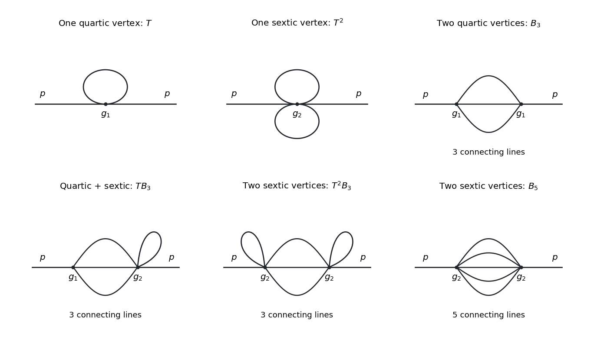

<h1 id="3/c">c</h1>

↑ **Parent:** [3](../3.md)

For the [two-point function](../../../two-point-correlation-function.md), the original [Feynman diagrams](../../../feynman-diagram.md) below show both one-vertex graphs and every two-vertex topology with external [momentum](../../../momentum-split.md) flowing between distinct [interaction vertices](../../../interaction-vertex.md). All lines represent the same [real scalar field](../../../real-scalar-field.md). The lower row labels the number of parallel connecting lines; a small closed line at a vertex is a [tadpole diagram](../../../tadpole-diagram.md).

**[Figure 2](#3/c/image-one-vertex-self-energies-and-the-four-momentum-dependent-two-vertex-topologies-in-the-three-dimensional-quartic-sextic-scalar-theory). One-vertex self-energies and the four momentum-dependent two-vertex topologies in the three-dimensional quartic-sextic scalar theory.**

**Table of contents**

- [i](c/i.md)
  - [Solution](c/i/solution.md)
- [ii](c/ii.md)
  - [Solution](c/ii/solution.md)

## ↑ Ancestors (11)

1. [3](../3.md)
2. [2021](../../2021-split.md)
3. [Past exam of the quantum field theory course of the University of Oxford](../../split.md)
4. [Quantum field theory course of the University of Oxford](../../../quantum-field-theory-course-of-the-university-of-oxford.md)
5. [Year 4 of the mathematical and theoretical physics course of the University of Oxford](../../../year-4-of-the-mathematical-and-theoretical-physics-course-of-the-university-of-oxford.md)
6. [Mathematical and theoretical physics course of the University of Oxford](../../../mathematical-and-theoretical-physics-course-of-the-university-of-oxford.md)
7. [Undergraduate course of the University of Oxford](../../../undergraduate-course-of-the-university-of-oxford.md)
8. [Course of the University of Oxford](../../../course-of-the-university-of-oxford.md)
9. [University of Oxford](../../../university-of-oxford-split.md)
10. [List of universities](../../../list-of-universities.md)
11. [Codex Wiki](../../../split.md)

## ← Incoming links (1)

- [Solution](d/solution.md)
