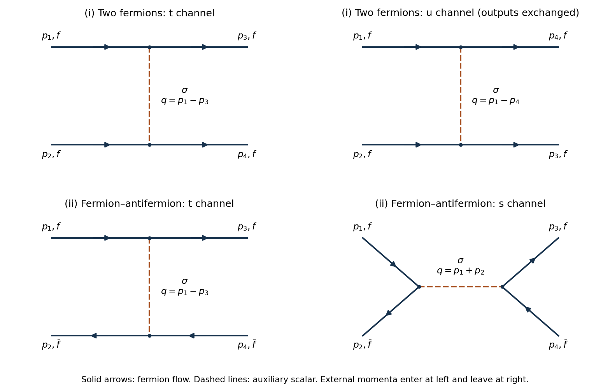

# 2022

↑ **Parent:** [Past exam of the quantum field theory course of the University of Oxford](../past-exam-of-the-quantum-field-theory-course-of-the-university-of-oxford.md)

Source: [https://www.whatdotheyknow.com/request/oxford_physics_past_papers_2/response/2340696/attach/10/Physics%20Papers%202021.pdf?cookie_passthrough=1](https://www.whatdotheyknow.com/request/oxford_physics_past_papers_2/response/2340696/attach/10/Physics%20Papers%202021.pdf?cookie_passthrough=1)

Source bundle pages 100–103. The cover establishes Hilary Term 2022 despite the attachment's 2021 filename. Throughout, use $\hbar=c=1$ and the [Minkowski metric](../special-relativity.md#minkowski-metric) with signature $(+,-,\ldots,-)$.

**Table of contents**

- [1](#1)
  - [a](#1/a)
    - [Solution](#1/a/solution)
  - [b](#1/b)
    - [Solution](#1/b/solution)
  - [c](#1/c)
    - [Solution](#1/c/solution)
  - [d](#1/d)
    - [Solution](#1/d/solution)
- [2](#2)
  - [a](#2/a)
    - [Solution](#2/a/solution)
  - [b](#2/b)
    - [i](#2/b/i)
      - [Solution](#2/b/i/solution)
    - [ii](#2/b/ii)
      - [Solution](#2/b/ii/solution)
  - [c](#2/c)
    - [Solution](#2/c/solution)
  - [d](#2/d)
    - [Solution](#2/d/solution)
- [3](#3)
  - [a](#3/a)
    - [Solution](#3/a/solution)
  - [b](#3/b)
    - [Solution](#3/b/solution)
  - [c](#3/c)
    - [Solution](#3/c/solution)
  - [d](#3/d)
    - [Solution](#3/d/solution)

## 1

↑ **Parent:** [2022](2022.md)

<h3 id="1/a">a</h3>

↑ **Parent:** [1](#1)

<h4 id="1/a/solution">Solution</h4>

↑ **Parent:** [A](#1/a)

A dimensionless [action](../lagrangian-mechanics.md#action) in six spacetime dimensions requires the [Lagrangian density](../classical-field-theory.md#lagrangian-density) to have [mass dimension](../perturbative-quantum-field-theory.md#mass-dimension) six. The [kinetic term](../classical-field-theory.md#kinetic-term) then fixes $2+2[\phi]=6$, and each [field interaction term](../classical-field-theory.md#field-interaction-term) must have the same [mass dimension](../perturbative-quantum-field-theory.md#mass-dimension). Therefore

$$
\boxed{[\phi]=2,\qquad [g_1]=0,\qquad [g_2]=-2.}
$$

Equivalently, in powers of a length unit $L$, $\phi$ has units $L^{-2}$, $g_1$ has units $L^0$, and $g_2$ has units $L^2$. Thus literal _length exponents_ would be $(-2,0,2)$; the $d$'s in the supplied [superficial degree of divergence](../perturbative-quantum-field-theory.md#superficial-degree-of-divergence) formula must instead mean [mass dimensions](../perturbative-quantum-field-theory.md#mass-dimension), namely $(2,0,-2)$. This distinction resolves the wording's convention mismatch.

To check the convention independently, let $I,V_3,V_4,\ell$ count internal lines, cubic [interaction vertices](../perturbative-quantum-field-theory.md#interaction-vertex), quartic [interaction vertices](../perturbative-quantum-field-theory.md#interaction-vertex), and independent [loop momenta](../perturbative-quantum-field-theory.md#loop-momentum). A connected [Feynman diagram](../perturbative-quantum-field-theory.md#feynman-diagram) obeys $2I+n=3V_3+4V_4$ and $\ell=I-V_3-V_4+1$. Hence its [superficial degree of divergence](../perturbative-quantum-field-theory.md#superficial-degree-of-divergence) is $6\ell-2I=6-2n+2V_4$, agreeing with the supplied formula only with the [mass dimensions](../perturbative-quantum-field-theory.md#mass-dimension) above.

<h3 id="1/b">b</h3>

↑ **Parent:** [1](#1)

<h4 id="1/b/solution">Solution</h4>

↑ **Parent:** [B](#1/b)

In [momentum space](../momentum.md#momentum-space), the [Feynman rules](../perturbative-quantum-field-theory.md#feynman-rules) for the [real scalar field](../scalar-field-theory.md#real-scalar-field) are

$$
\boxed{\text{internal line: }\frac{i}{p^2-m^2+i0},\qquad
\text{cubic vertex: }-ig_1,\qquad
\text{quartic vertex: }-ig_2.}
$$

Each [interaction vertex](../perturbative-quantum-field-theory.md#interaction-vertex) supplies $(2\pi)^6\delta^{(6)}(\sum p)$, with all its [momenta](../momentum.md) counted inward. Impose [momentum conservation](../momentum.md#momentum-conservation), integrate each independent [loop momentum](../perturbative-quantum-field-theory.md#loop-momentum) with $d^6p/(2\pi)^6$, and divide by the [Feynman-diagram symmetry factor](../perturbative-quantum-field-theory.md#feynman-diagram-symmetry-factor). For a connected amputated [scattering amplitude](../quantum-scattering.md#scattering-amplitude), remove the external [scalar propagators](../scalar-field-theory.md#scalar-propagator) and retain a single overall [momentum conservation](../momentum.md#momentum-conservation) factor. These signs follow by expanding $\exp(i\int\mathcal L_{\mathrm{int}})$; the factorials in the [Lagrangian density](../classical-field-theory.md#lagrangian-density) cancel the corresponding attachments in the [Wick theorem](../perturbative-quantum-field-theory.md#wick-s-theorem). The [Feynman i-epsilon prescription](../quantum-field-theory.md#feynman-i-epsilon-prescription) specifies the [scalar propagator](../scalar-field-theory.md#scalar-propagator) poles.

<h3 id="1/c">c</h3>

↑ **Parent:** [1](#1)

<h4 id="1/c/solution">Solution</h4>

↑ **Parent:** [C](#1/c)

Set $g=g_1$ and $g_2=0$. The [superficial degree of divergence](../perturbative-quantum-field-theory.md#superficial-degree-of-divergence) is then $\omega=6-2n$, independently of the number of cubic [interaction vertices](../perturbative-quantum-field-theory.md#interaction-vertex). After subtracting [ultraviolet subdivergences](../perturbative-quantum-field-theory.md#ultraviolet-subdivergence), the divergent part of a [one-particle irreducible](../perturbative-quantum-field-theory.md#one-particle-irreducible-feynman-diagram) [Feynman diagram](../perturbative-quantum-field-theory.md#feynman-diagram) is a local [polynomial](../polynomial.md) in external [momenta](../momentum.md) of degree at most $\omega$. [Lorentz invariance](../special-relativity.md#lorentz-invariance) and [momentum conservation](../momentum.md#momentum-conservation) leave the following possibilities:

- $n=0$: a constant [vacuum energy density](../perturbative-quantum-field-theory.md#vacuum-energy-density).
- $n=1$: a linear [tadpole counterterm](../perturbative-quantum-field-theory.md#tadpole-counterterm). The single external [momentum](../momentum.md) is zero, so derivatives cannot generate further independent terms.
- $n=2$: a [mass counterterm](../perturbative-quantum-field-theory.md#mass-counterterm) and a [wave-function renormalization](../perturbative-quantum-field-theory.md#wave-function-renormalization), since the [polynomial](../polynomial.md) has the form $A+Bp^2$.
- $n=3$: a constant cubic [interaction vertex](../perturbative-quantum-field-theory.md#interaction-vertex).
- $n\geq4$: no overall [ultraviolet divergence](../perturbative-quantum-field-theory.md#ultraviolet-divergence), although [ultraviolet subdivergences](../perturbative-quantum-field-theory.md#ultraviolet-subdivergence) still require their lower-point [counterterms](../perturbative-quantum-field-theory.md#counterterm).

Thus a finite set of [counterterms](../perturbative-quantum-field-theory.md#counterterm) closes under [perturbation theory](../asymptotic-expansion.md#perturbation-theory). In terms of renormalized coefficients, write

$$
\boxed{\mathcal L+\mathcal L_{\mathrm{ct}}
=\frac{1+\delta_Z}{2}(\partial\phi)^2
-\frac{m^2+\delta_m}{2}\phi^2
-\frac{g+\delta_g}{3!}\phi^3-\delta_h\phi-\delta_\mathcal E.}
$$

Here $\delta_m$ is a coefficient of squared [mass](../classical-mechanics.md#mass), rather than a correction to $m$ itself. The [tadpole counterterm](../perturbative-quantum-field-theory.md#tadpole-counterterm) fixes the chosen expansion point, for example $\langle\phi\rangle=0$; it cannot be omitted merely because the original [Lagrangian density](../classical-field-theory.md#lagrangian-density) lacks a linear term. The [vacuum energy density](../perturbative-quantum-field-theory.md#vacuum-energy-density) term cancels out of normalized [Green functions](../green-s-function.md), but is required if the unnormalized [vacuum functional](../perturbative-quantum-field-theory.md#vacuum-functional) is also to be renormalized. This establishes perturbative [renormalizability](../perturbative-quantum-field-theory.md#renormalizable-quantum-field-theory); the unbounded [scalar potential](../classical-field-theory.md#scalar-potential) of a real cubic [scalar field theory](../scalar-field-theory.md) does not by itself define a stable nonperturbative [vacuum state](../quantum-field-theory.md#vacuum-state).

<h3 id="1/d">d</h3>

↑ **Parent:** [1](#1)

<h4 id="1/d/solution">Solution</h4>

↑ **Parent:** [D](#1/d)

Continue with the cubic [scalar field theory](../scalar-field-theory.md) of [c](#1/c), and use precisely its [counterterm](../perturbative-quantum-field-theory.md#counterterm) signs. Take $m^2>0$ to separate [ultraviolet divergences](../perturbative-quantum-field-theory.md#ultraviolet-divergence) from [infrared divergences](../quantum-field-theory.md#infrared-divergence). Make a [Wick rotation](../perturbative-quantum-field-theory.md#wick-rotation) and impose the rotationally invariant [cutoff regularization](../perturbative-quantum-field-theory.md#cutoff-regularization) $|q_E|<\Lambda$. Put

$$
C=\frac{\operatorname{area}(S^5)}{2(2\pi)^6}
=\frac1{128\pi^3},\qquad L_\Lambda=\log\frac{\Lambda^2}{m^2},\qquad
I_r=\int_{|q_E|<\Lambda}\frac{d^6q_E}{(2\pi)^6}(q_E^2+m^2)^{-r}.
$$

For example, [spherical coordinates](../multivariable-calculus.md#spherical-coordinate-system) give $I_1=C\int_0^{\Lambda^2} t^2/(t+m^2)\,dt$. Polynomial division and then differentiation with respect to $m^2$ give the divergent parts

$$
\begin{aligned}
I_1\big|_{\mathrm{div}}&=C\left(\frac{\Lambda^4}{2}-m^2\Lambda^2+m^4L_\Lambda\right),\\
I_2\big|_{\mathrm{div}}&=C(\Lambda^2-2m^2L_\Lambda),\qquad
I_3\big|_{\mathrm{div}}=CL_\Lambda.
\end{aligned}
$$

The derivative relations are $I_2=-\partial_{m^2}I_1$ and $I_3=\tfrac12\partial_{m^2}^2I_1$; differentiation also generates finite terms, which are irrelevant here. The first supplied integral identity is consistent with these divergent parts after [Wick rotation](../perturbative-quantum-field-theory.md#wick-rotation).

**The second supplied expansion is incorrect.** Write $A=p^2-m^2$. Direct multiplication of the two denominators gives $(A+k^2)^2-4(p\cdot k)^2$, so the correct [Taylor expansion](../calculus.md#taylor-expansion) is

$$
\frac1{[(p-k)^2-m^2][(p+k)^2-m^2]}
=\frac1{A^2}\left(1-\frac{2k^2}{A}+\frac{4(p\cdot k)^2}{A^2}+O(k^4)\right).
$$

A concrete counterexample is $p=0$, $m=1$, $k=(\epsilon,\mathbf0)$: the exact expression is $(1-\epsilon^2)^{-2}=1+2\epsilon^2+O(\epsilon^4)$, whereas the printed expansion gives $1+\epsilon^2/2+O(\epsilon^4)$. We therefore compute the [self-energy](../perturbative-quantum-field-theory.md#self-energy) without that identity.

For Euclidean external [momentum](../momentum.md) $P$, define the [scalar bubble integral](../perturbative-quantum-field-theory.md#scalar-bubble-integral)

$$
B(P)=\int\frac{d^6q_E}{(2\pi)^6}
\frac1{(q_E^2+m^2)((q_E+P)^2+m^2)}.
$$

A [Feynman parameter](../perturbative-quantum-field-theory.md#feynman-parameter) $x$ combines its denominators into one squared denominator with $K=m^2+x(1-x)P^2$. Applying the radial result above and integrating $\int_0^1x(1-x)\,dx=1/6$ yields

$$
B(P)\big|_{\mathrm{div}}
=C\left(\Lambda^2-2m^2L_\Lambda-\frac{P^2}{3}L_\Lambda\right).
$$

One can instead expand with the [ultraviolet cutoff](../quantum-field-theory.md#ultraviolet-cutoff) fixed on the unshifted [loop momentum](../perturbative-quantum-field-theory.md#loop-momentum): the $P^2$ coefficient of the integrand is $-(q_E^2+m^2)^{-3}+\tfrac23q_E^2(q_E^2+m^2)^{-4}$, using rotational averaging in six dimensions. Its leading radial term is $-1/(3q_E^6)$, giving the same logarithm. Shifting a sharp integration boundary changes finite terms in this [scalar bubble integral](../perturbative-quantum-field-theory.md#scalar-bubble-integral), and does not change the displayed divergent coefficients.

To fix all signs and [symmetry factors](../perturbative-quantum-field-theory.md#feynman-diagram-symmetry-factor) together, expand the one-loop [Euclidean effective action](../perturbative-quantum-field-theory.md#euclidean-effective-action) around a background [scalar field](../classical-field-theory.md#scalar-field):

$$
\Gamma_{1,E}[\phi]=\frac12\operatorname{Tr}\log(D+g\phi),\qquad D=-\partial_E^2+m^2,
$$

$$
\Gamma_{1,E}[\phi]-\Gamma_{1,E}[0]
=\frac g2\operatorname{Tr}(D^{-1}\phi)
-\frac{g^2}{4}\operatorname{Tr}(D^{-1}\phi D^{-1}\phi)
+\frac{g^3}{6}\operatorname{Tr}(D^{-1}\phi)^3+\cdots.
$$

These terms are the [tadpole diagram](../perturbative-quantum-field-theory.md#tadpole-diagram), the two-point [bubble diagram](../perturbative-quantum-field-theory.md#bubble-diagram), and the [triangle Feynman diagram](../perturbative-quantum-field-theory.md#triangle-feynman-diagram). The [tadpole diagram](../perturbative-quantum-field-theory.md#tadpole-diagram) has factor $1/2$; the two-point [bubble diagram](../perturbative-quantum-field-theory.md#bubble-diagram) also has factor $1/2$ after two differentiations with respect to the background [scalar field](../classical-field-theory.md#scalar-field). The local three-point [interaction vertex](../perturbative-quantum-field-theory.md#interaction-vertex) is $g^3I_3$. Thus their divergent contributions to the one-, two-, and three-point Euclidean [one-particle irreducible](../perturbative-quantum-field-theory.md#one-particle-irreducible-feynman-diagram) vertices are respectively

$$
\frac g2 I_1,\qquad -\frac{g^2}{2}B(P),\qquad g^3I_3.
$$

The Euclidean [counterterm Lagrangian](../perturbative-quantum-field-theory.md#counterterm-lagrangian) is $\delta_Z(\partial_E\phi)^2/2+\delta_m\phi^2/2+\delta_g\phi^3/6+\delta_h\phi+\delta_\mathcal E$. Cancelling each divergent [one-particle irreducible](../perturbative-quantum-field-theory.md#one-particle-irreducible-feynman-diagram) vertex therefore gives

$$
\boxed{\begin{aligned}
\delta_h\big|_{\mathrm{div}}&=-\frac{Cg}{2}\left(\frac{\Lambda^4}{2}-m^2\Lambda^2+m^4L_\Lambda\right),\\
\delta_m\big|_{\mathrm{div}}&=\frac{Cg^2}{2}(\Lambda^2-2m^2L_\Lambda),\\
\delta_Z\big|_{\mathrm{div}}&=-\frac{Cg^2}{6}L_\Lambda,\\
\delta_g\big|_{\mathrm{div}}&=-Cg^3L_\Lambda.
\end{aligned}}
$$

For example, the two-point sum is $\delta_ZP^2+\delta_m-g^2B(P)/2$ and its divergent coefficients cancel separately. Finite [counterterms](../perturbative-quantum-field-theory.md#counterterm) depend on the chosen [renormalization conditions](../perturbative-quantum-field-theory.md#renormalization-condition). The zero-[mass](../classical-mechanics.md#mass) limit can use a positive subtraction scale in the logarithms after [infrared regularization](../quantum-field-theory.md#infrared-regularization).

If unnormalized [vacuum functionals](../perturbative-quantum-field-theory.md#vacuum-functional) are retained, specify the determinant measure by

$$
V_{1,E}(0)=\frac12\int_{|q_E|<\Lambda}\frac{d^6q_E}{(2\pi)^6}
\log\frac{q_E^2+m^2}{\mu^2}.
$$

Expanding its radial integrand at large $q_E$ fixes the additional [vacuum energy density](../perturbative-quantum-field-theory.md#vacuum-energy-density) [counterterm](../perturbative-quantum-field-theory.md#counterterm):

$$
\boxed{\delta_\mathcal E\big|_{\mathrm{div}}=-\frac C2\left[
\frac{\Lambda^6}{3}\log\frac{\Lambda^2}{\mu^2}-\frac{\Lambda^6}{9}
+\frac{m^2\Lambda^4}{2}-\frac{m^4\Lambda^2}{2}
+\frac{m^6}{3}L_\Lambda\right].}
$$

The purely [mass](../classical-mechanics.md#mass)-independent terms depend on the determinant normalization. Normalized [Green functions](../green-s-function.md) eliminate this entire constant.

## 2

↑ **Parent:** [2022](2022.md)

<h3 id="2/a">a</h3>

↑ **Parent:** [2](#2)

<h4 id="2/a/solution">Solution</h4>

↑ **Parent:** [A](#2/a)

The [auxiliary field](../supersymmetry.md#auxiliary-field) $\sigma$ has quadratic kernel $-1$ and no [kinetic term](../classical-field-theory.md#kinetic-term). Inverting that kernel, rather than introducing an artificial [scalar mass](../classical-field-theory.md#scalar-mass), gives the [momentum space](../momentum.md#momentum-space) [Feynman rules](../perturbative-quantum-field-theory.md#feynman-rules)

$$
\boxed{\sigma\text{ line: }-i,\qquad
\psi\text{ line: }\frac{i(\not p+m)}{p^2-m^2+i0},\qquad
\sigma\bar\psi\psi\text{ vertex: }ig.}
$$

The [auxiliary-field propagator](../supersymmetry.md#auxiliary-field-propagator) is independent of [momentum](../momentum.md); in position space it is $-i\delta^{(4)}(x-y)$. At each [interaction vertex](../perturbative-quantum-field-theory.md#interaction-vertex) attach $(2\pi)^4\delta^{(4)}(\sum p)$ for [momentum conservation](../momentum.md#momentum-conservation). Integrate independent [loop momenta](../perturbative-quantum-field-theory.md#loop-momentum) with $d^4p/(2\pi)^4$, respect [fermion flow](../perturbative-quantum-field-theory.md#fermion-flow), include the [closed fermion loop sign](../perturbative-quantum-field-theory.md#closed-fermion-loop-sign) $-1$, and use the appropriate [symmetry factor](../perturbative-quantum-field-theory.md#feynman-diagram-symmetry-factor). Incoming and outgoing [fermions](../tensor-product-of-quantum-systems.md#fermion) carry $u_s(p)$ and $\bar u_s(p)$; incoming and outgoing [antiparticles](../relativistic-quantum-field.md#antiparticle) carry $\bar v_s(p)$ and $v_s(p)$. Exchanging external [fermions](../tensor-product-of-quantum-systems.md#fermion) introduces the [fermionic sign](../perturbative-quantum-field-theory.md#fermionic-sign). Here $\not p=\gamma^\mu p_\mu$ is [Feynman slash notation](../algebra-over-a-field.md#feynman-slash-notation).

For a dimensional check, $[\psi]=3/2$, $[\sigma]=2$, $[g]=-1$ in [mass dimensions](../perturbative-quantum-field-theory.md#mass-dimension). Eliminating $\sigma$ consequently produces a [four-fermion interaction](../quantum-field-theory.md#four-fermion-interaction) of negative coupling [mass dimension](../perturbative-quantum-field-theory.md#mass-dimension), not a propagating scalar degree of freedom.

<h3 id="2/b">b</h3>

↑ **Parent:** [2](#2)

**[Figure 1](#2/b/image-original-tree-diagrams-with-external-momentum-labels-and-fermion-flow-arrows-the-upper-row-gives-two-fermion-t-and-u-exchange-the-lower-row-gives-fermion-antifermion-t-exchange-and-s-annihilation-dashed-lines-denote-the-auxiliary-scalar). Original tree diagrams with external momentum labels and fermion-flow arrows. The upper row gives two-fermion t and u exchange; the lower row gives fermion–antifermion t exchange and s annihilation. Dashed lines denote the auxiliary scalar.**

<h4 id="2/b/i">i</h4>

↑ **Parent:** [B](#2/b)

<h5 id="2/b/i/solution">Solution</h5>

↑ **Parent:** [I](#2/b/i)

Label the incoming [fermion](../tensor-product-of-quantum-systems.md#fermion) [momenta](../momentum.md) $p_1,p_2$ and outgoing [fermion](../tensor-product-of-quantum-systems.md#fermion) [momenta](../momentum.md) $p_3,p_4$, with $p_1+p_2=p_3+p_4$. There are two [tree-level Feynman diagrams](../perturbative-quantum-field-theory.md#tree-level-feynman-diagram): the $t$ channel connects $1$ to $3$ and $2$ to $4$, with exchanged [momentum](../momentum.md) $q_t=p_1-p_3=p_4-p_2$; the $u$ channel connects $1$ to $4$ and $2$ to $3$, with $q_u=p_1-p_4=p_3-p_2$. Both internal lines are [auxiliary-field propagators](../supersymmetry.md#auxiliary-field-propagator). The upper row in the figure gives these labelled connections; the outgoing labels are exchanged in its second panel to avoid a visually unnecessary crossing.

Each [tree-level Feynman diagram](../perturbative-quantum-field-theory.md#tree-level-feynman-diagram) contains two factors $ig$ and one factor $-i$, giving $ig^2$. The exchange of the two identical outgoing [fermions](../tensor-product-of-quantum-systems.md#fermion) gives the relative [fermionic sign](../perturbative-quantum-field-theory.md#fermionic-sign). Up to a common external-state phase, the corresponding [scattering amplitude](../quantum-scattering.md#scattering-amplitude) is

$$
\boxed{\mathcal M_{ff}=g^2\left[(\bar u_3u_1)(\bar u_4u_2)-(\bar u_4u_1)(\bar u_3u_2)\right].}
$$

There is no annihilation channel: both incoming particles carry the same [fermion number](../relativistic-quantum-field.md#fermion-number), whereas a $\sigma\bar\psi\psi$ [interaction vertex](../perturbative-quantum-field-theory.md#interaction-vertex) couples one [fermion](../tensor-product-of-quantum-systems.md#fermion) to one [antiparticle](../relativistic-quantum-field.md#antiparticle) when both are incoming.

<h4 id="2/b/ii">ii</h4>

↑ **Parent:** [B](#2/b)

<h5 id="2/b/ii/solution">Solution</h5>

↑ **Parent:** [Ii](#2/b/ii)

Use incoming [fermion](../tensor-product-of-quantum-systems.md#fermion) $p_1$ and [antiparticle](../relativistic-quantum-field.md#antiparticle) $p_2$, outgoing [fermion](../tensor-product-of-quantum-systems.md#fermion) $p_3$ and [antiparticle](../relativistic-quantum-field.md#antiparticle) $p_4$. The two [tree-level Feynman diagrams](../perturbative-quantum-field-theory.md#tree-level-feynman-diagram) are the $t$ channel, with $q_t=p_1-p_3=p_4-p_2$, and the $s$ channel, with $q_s=p_1+p_2=p_3+p_4$. They occupy the lower row of the figure. In the $t$ channel the [fermion flow](../perturbative-quantum-field-theory.md#fermion-flow) follows $1\to3$ and $4\to2$; in the $s$ channel it follows $1\to2$ at the incoming [interaction vertex](../perturbative-quantum-field-theory.md#interaction-vertex) and $4\to3$ at the outgoing [interaction vertex](../perturbative-quantum-field-theory.md#interaction-vertex).

The two contractions again have a relative [fermionic sign](../perturbative-quantum-field-theory.md#fermionic-sign). With the same harmless common-phase convention as [i](#2/b/i), their sum is

$$
\boxed{\mathcal M_{f\bar f}=g^2\left[(\bar u_3u_1)(\bar v_2v_4)-(\bar v_2u_1)(\bar u_3v_4)\right].}
$$

The [auxiliary-field propagator](../supersymmetry.md#auxiliary-field-propagator) is the same constant $-i$ in both channels. There is no $u$ channel preserving the external [fermion number](../relativistic-quantum-field.md#fermion-number) assignments.

<h3 id="2/c">c</h3>

↑ **Parent:** [2](#2)

<h4 id="2/c/solution">Solution</h4>

↑ **Parent:** [C](#2/c)

Write $u_i=u^{s_i}(p_i)$ and $v_i=v^{s_i}(p_i)$. With $S_{fi}=\delta_{fi}+i(2\pi)^4\delta^{(4)}(p_1+p_2-p_3-p_4)\mathcal M_{fi}$, choose

$$
\boxed{\mathcal M_{p_1,p_2,p_3,p_4}^{s_1,s_2,s_3,s_4}=g^2(T-A),\qquad
T=(\bar u_3u_1)(\bar v_2v_4),\quad A=(\bar v_2u_1)(\bar u_3v_4).}
$$

The relative minus sign is fixed by the [canonical anticommutation relations](../supersymmetric-quantum-mechanics.md#canonical-anticommutation-relations), not by the [Mandelstam variables](../special-relativity.md#mandelstam-variables). It follows by [crossing symmetry](../quantum-scattering.md#crossing-symmetry) from the identical-[fermion](../tensor-product-of-quantum-systems.md#fermion) [scattering amplitude](../quantum-scattering.md#scattering-amplitude) in [i](#2/b/i), or directly by the two inequivalent external contractions of $g^2(\bar\psi\psi)^2/2$. For an explicit sign check, fix incoming state order $b_1^\dagger d_2^\dagger|0\rangle$ and outgoing order $b_3^\dagger d_4^\dagger|0\rangle$. The direct contraction contains $(b_3^\dagger b_1)(d_2d_4^\dagger)$, whose coefficient in the ordered product $b_3^\dagger d_4^\dagger d_2b_1$ is $-1$; the annihilation contraction $(b_3^\dagger d_4^\dagger)(d_2b_1)$ has coefficient $+1$. The common sign can change with the external-state convention, while their relative minus sign cannot.

Let $r=m^2$. The external particles are [on shell](../classical-field-theory.md#on-shell), so $s+t+u=4r$ and

$$
p_1\cdot p_2=p_3\cdot p_4=\frac s2-r,\qquad
p_1\cdot p_3=p_2\cdot p_4=r-\frac t2,\qquad
p_1\cdot p_4=p_2\cdot p_3=r-\frac u2.
$$

Use the supplied [spin sums](../relativistic-quantum-field.md#spin-sum) and [gamma matrix trace identities](../algebra-over-a-field.md#gamma-matrix-trace-identities). The two diagonal terms in the initial [spin average](../relativistic-quantum-field.md#spin-average) are

$$
\frac14\sum|T|^2
=\frac14\operatorname{Tr}[(\not p_3+m)(\not p_1+m)]
\operatorname{Tr}[(\not p_2-m)(\not p_4-m)]
=(t-4r)^2,
$$

$$
\frac14\sum|A|^2
=\frac14\operatorname{Tr}[(\not p_2-m)(\not p_1+m)]
\operatorname{Tr}[(\not p_3+m)(\not p_4-m)]
=(s-4r)^2.
$$

For the interference term, the [spin sum](../relativistic-quantum-field.md#spin-sum) is a single [Dirac trace](../relativistic-quantum-field.md#gamma-matrix-trace):

$$
R:=\sum TA^*
=\operatorname{Tr}[(\not p_3+m)(\not p_1+m)(\not p_2-m)(\not p_4-m)].
$$

Terms with an odd number of [Dirac gamma matrices](../algebra-over-a-field.md#gamma-matrices) vanish. Expanding the remaining terms gives

$$
\begin{aligned}
\frac R4={}&(p_3\cdot p_1)(p_2\cdot p_4)
-(p_3\cdot p_2)(p_1\cdot p_4)
+(p_3\cdot p_4)(p_1\cdot p_2)\\
&+r(p_3\cdot p_1-p_3\cdot p_2-p_3\cdot p_4-p_1\cdot p_2-p_1\cdot p_4+p_2\cdot p_4)+r^2.
\end{aligned}
$$

Substituting the [Mandelstam variables](../special-relativity.md#mandelstam-variables) reduces this to

$$
R=s^2+t^2-u^2+16ru-16r^2
=(s-4r)^2+(t-4r)^2-(u-4r)^2.
$$

It is real. The initial [spin average](../relativistic-quantum-field.md#spin-average) therefore yields

$$
\overline{|\mathcal M|^2}=g^4\left[(t-4r)^2+(s-4r)^2-\frac R2\right],
$$

$$
\boxed{\overline{|\mathcal M|^2}=\frac{g^4}{2}\left[(s-4m^2)^2+(t-4m^2)^2+(u-4m^2)^2\right].}
$$

**The displayed answer in the source is false.** At threshold, $p_i=(m,\mathbf0)$, hence $s=4m^2$ and $t=u=0$. Then $\bar vu=\bar uv=0$, while the [spin sums](../relativistic-quantum-field.md#spin-sum) give $\overline{|\mathcal M|^2}=16g^4m^4$. The printed expression instead gives $20g^4m^4$. This is also a counterexample in the continuous threshold limit from physical nonzero incoming [momenta](../momentum.md). At $m=0$ there is a further discrepancy: the correct result is $g^4(s^2+t^2+u^2)/2$, rather than the printed $g^4(3s^2+3t^2-u^2)/2$. Changing a common phase of the [scattering amplitude](../quantum-scattering.md#scattering-amplitude) cannot change either comparison.

The requested $s\leftrightarrow t$ symmetry nevertheless holds for the correct answer. [Crossing symmetry](../quantum-scattering.md#crossing-symmetry) exchanges the two ways of pairing the four external [fermion](../tensor-product-of-quantum-systems.md#fermion) lines; the momentum-independent [auxiliary-field propagator](../supersymmetry.md#auxiliary-field-propagator) supplies no channel-dependent denominator. The relative [fermionic sign](../perturbative-quantum-field-theory.md#fermionic-sign) can reverse the crossed [scattering amplitude](../quantum-scattering.md#scattering-amplitude), but disappears in its squared modulus. With $u=4m^2-s-t$, the boxed expression is manifestly symmetric under $s\leftrightarrow t$. This is an analytic crossing relation, not a statement that positive physical $s$ and negative physical $t$ have interchangeable scattering kinematics.

<h3 id="2/d">d</h3>

↑ **Parent:** [2](#2)

<h4 id="2/d/solution">Solution</h4>

↑ **Parent:** [D](#2/d)

Set $B(x)=\bar\psi(x)\psi(x)$, a Grassmann-even [Dirac scalar bilinear](../relativistic-quantum-field.md#dirac-scalar-bilinear). Completing the square gives

$$
-\frac12\sigma^2+g\sigma B
=-\frac12(\sigma-gB)^2+\frac{g^2}{2}B^2.
$$

Introduce external Grassmann [sources](../perturbative-quantum-field-theory.md#source-quantum-field-theory) $\eta,\bar\eta$ for the [Dirac field](../relativistic-quantum-field.md#dirac-field), but no source for $\sigma$. The [generating functional](../perturbative-quantum-field-theory.md#generating-functional) is

$$
Z[\eta,\bar\eta]=\int\mathcal D\bar\psi\,\mathcal D\psi\,\mathcal D\sigma\,
\exp\left\{i\int d^4x\left[\bar\psi(i\not\partial-m)\psi
-\frac12(\sigma-gB)^2+\frac{g^2}{2}B^2
+\bar\eta\psi+\bar\psi\eta\right]\right\}.
$$

At a finite regulator the change of variable $\sigma'=\sigma-gB$ has unit Jacobian: it translates a bosonic integration variable by a Grassmann-even expression independent of that variable. Its oscillatory [Gaussian integral](../integral.md#gaussian-integral) can be defined with a convergence prescription and then continued. It is a constant $\mathcal N$ independent of $\psi,\eta,\bar\eta$. Thus

$$
Z[\eta,\bar\eta]=\mathcal N\int\mathcal D\bar\psi\,\mathcal D\psi\,
\exp\left\{i\int d^4x\left[\bar\psi(i\not\partial-m)\psi
+\frac{g^2}{2}(\bar\psi\psi)^2+\bar\eta\psi+\bar\psi\eta\right]\right\}.
$$

The factor $\mathcal N$ cancels in $Z[\eta,\bar\eta]/Z[0,0]$. Every normalized [Green function](../green-s-function.md) with only external [fermion](../tensor-product-of-quantum-systems.md#fermion) lines is a Grassmann source derivative of this same normalized [generating functional](../perturbative-quantum-field-theory.md#generating-functional), so

$$
\boxed{G_{\mathrm{auxiliary}}^{(n)}=G_{\mathrm{four\text{-}fermion}}^{(n)}.}
$$

This is an exact [Hubbard–Stratonovich transformation](../quantum-field-theory.md#hubbard-stratonovich-transformation) in reverse, rather than just an approximation based on [tree-level Feynman diagrams](../perturbative-quantum-field-theory.md#tree-level-feynman-diagram). At the diagrammatic level the contact [auxiliary-field propagator](../supersymmetry.md#auxiliary-field-propagator) $-i\delta^{(4)}(x-y)$ collapses each exchanged line into the same local [four-fermion interaction](../quantum-field-theory.md#four-fermion-interaction). The equality uses a common regulator and does not assert perturbative [renormalizability](../perturbative-quantum-field-theory.md#renormalizable-quantum-field-theory) of that four-dimensional [four-fermion interaction](../quantum-field-theory.md#four-fermion-interaction).

## 3

↑ **Parent:** [2022](2022.md)

<h3 id="3/a">a</h3>

↑ **Parent:** [3](#3)

<h4 id="3/a/solution">Solution</h4>

↑ **Parent:** [A](#3/a)

For arbitrary [linear operators](../vector-space.md#linear-operator), expansion of the [anticommutators](../vector-space.md#anticommutator) gives

$$
\{X,Y\}Z-Y\{X,Z\}=(XY+YX)Z-Y(XZ+ZX)=XYZ-YZX=[X,YZ].
$$

Now use the [commutator product rule](../lie-algebra.md#commutator-product-rule) $[VX,W]=V[X,W]+[V,W]X$, with $W=YZ$, twice. The result is

$$
\boxed{[VX,YZ]=V\{X,Y\}Z-VY\{X,Z\}+\{V,Y\}ZX-Y\{V,Z\}X.}
$$

No grading assumption is needed for these algebraic identities.

For the [Dirac field](../relativistic-quantum-field.md#dirac-field), supplement the supplied equal-time [canonical anticommutation relations](../supersymmetric-quantum-mechanics.md#canonical-anticommutation-relations) with $\{\psi_a(x),\psi_b(y)\}=\{\psi_a^\dagger(x),\psi_b^\dagger(y)\}=0$. Define the [fermion number](../relativistic-quantum-field.md#fermion-number) density $n(\mathbf x)=\sum_a\psi_a^\dagger(\mathbf x)\psi_a(\mathbf x)$. In the preceding identity take $V=\psi_a^\dagger(\mathbf x)$, $X=\psi_a(\mathbf x)$, $Y=\psi_b^\dagger(\mathbf y)$, $Z=\psi_c(\mathbf z)$ and sum over $a$. Only its first and last [anticommutators](../vector-space.md#anticommutator) survive, giving

$$
\boxed{[n(\mathbf x),\psi_b^\dagger(\mathbf y)\psi_c(\mathbf z)]
=\left[\delta^{(3)}(\mathbf x-\mathbf y)-\delta^{(3)}(\mathbf x-\mathbf z)\right]
\psi_b^\dagger(\mathbf y)\psi_c(\mathbf z).}
$$

This is an identity of operator-valued [distributions](../distribution-theory.md#distribution-mathematical-analysis). Point splitting, or smearing with test functions, gives a precise meaning to coincident bilinears. [Normal ordering](../perturbative-quantum-field-theory.md#normal-ordering) only subtracts a constant from the density and does not alter this [commutator](../lie-algebra.md#commutator).

<h3 id="3/b">b</h3>

↑ **Parent:** [3](#3)

<h4 id="3/b/solution">Solution</h4>

↑ **Parent:** [B](#3/b)

Define the constant [Dirac gamma matrix](../algebra-over-a-field.md#gamma-matrices) combinations $\alpha^k=\gamma^0\gamma^k$ and $\beta=\gamma^0$. The [Hamiltonian operator](../quantum-system.md#hamiltonian-quantum-mechanics) is

$$
H=\int d^3y\,\psi_b^\dagger(\mathbf y)
(-i\alpha^k_{bc}\partial_{y^k}+m\beta_{bc})\psi_c(\mathbf y).
$$

Evaluate its [commutator](../lie-algebra.md#commutator) with $n(\mathbf x)$ using the bilocal result in [a](#3/a). The [mass term](../classical-field-theory.md#mass-term) cancels immediately when $\mathbf z=\mathbf y$, because its two [Dirac delta distributions](../distribution-theory.md#dirac-delta-function) coincide. For the derivative term first keep the two points distinct:

$$
C(\mathbf x)=-i\int d^3y\,\alpha^k_{bc}\left.
\partial_{z^k}\left\{[\delta^{(3)}(\mathbf x-\mathbf y)-\delta^{(3)}(\mathbf x-\mathbf z)]
\psi_b^\dagger(\mathbf y)\psi_c(\mathbf z)\right\}\right|_{\mathbf z=\mathbf y}.
$$

The terms in which the derivative acts on $\psi_c$ cancel against each other; the derivative of the second [Dirac delta distribution](../distribution-theory.md#dirac-delta-function) remains. Thus

$$
C(\mathbf x)=i\int d^3y\,\psi^\dagger(\mathbf y)\alpha^k\psi(\mathbf y)
\partial_{y^k}\delta^{(3)}(\mathbf x-\mathbf y)
=-i\partial_{x^k}[\psi^\dagger(\mathbf x)\alpha^k\psi(\mathbf x)].
$$

The last equality is [integration by parts](../calculus.md#integration-by-parts), or the defining derivative rule for a [distribution](../distribution-theory.md#distribution-mathematical-analysis). Consequently the literal [conserved current](../classical-field-theory.md#conserved-current) whose [divergence](../multivariable-calculus.md#divergence) equals $C$ is

$$
\boxed{C=\boldsymbol\nabla\cdot\mathbf J,\qquad
J^k=-i\psi^\dagger\alpha^k\psi=-i\bar\psi\gamma^k\psi.}
$$

Because a [commutator](../lie-algebra.md#commutator) of two [Hermitian operators](../hilbert-space.md#hermitian-operator) is anti-Hermitian, this $\mathbf J$ includes $-i$. The physical Hermitian [Dirac current](../classical-field-theory.md#dirac-current) is instead $j^k=\bar\psi\gamma^k\psi$, so $C=-i\boldsymbol\nabla\cdot\mathbf j$. The [Heisenberg equation of motion](../quantum-system.md#heisenberg-equation-of-motion) now gives

$$
\boxed{\partial_t n=i[H,n]=-iC=-\boldsymbol\nabla\cdot\mathbf j,\qquad
j^\mu=\bar\psi\gamma^\mu\psi.}
$$

This establishes the [continuity equation](../mathematical-physics.md#continuity-equation) directly from the required [commutator](../lie-algebra.md#commutator), without assuming the [Dirac equation](../relativistic-quantum-field.md#dirac-equation) or invoking the [Noether theorem](../calculus-of-variations.md#noether-theorem) as a substitute for the computation.

<h3 id="3/c">c</h3>

↑ **Parent:** [3](#3)

<h4 id="3/c/solution">Solution</h4>

↑ **Parent:** [C](#3/c)

The [Hamiltonian operator](../quantum-system.md#hamiltonian-quantum-mechanics) is invariant under the constant [global phase symmetry](../classical-field-theory.md#global-phase-symmetry) $\psi\mapsto e^{i\theta}\psi$, $\bar\psi\mapsto\bar\psi e^{-i\theta}$. The [Noether current](../classical-field-theory.md#noether-current) of this [unitary group](../topological-group.md#unitary-group) $U(1)$ is the [Dirac current](../classical-field-theory.md#dirac-current) obtained in [b](#3/b). For fields with vanishing flux at infinity, or periodic boundary conditions, the [divergence theorem](../multivariable-calculus.md#divergence-theorem) and that [continuity equation](../mathematical-physics.md#continuity-equation) imply

$$
\boxed{Q=\int d^3x\,:\!\psi^\dagger\psi\!:\ ,\qquad [Q,H]=0,\qquad \frac{dQ}{dt}=0.}
$$

The [canonical anticommutation relations](../supersymmetric-quantum-mechanics.md#canonical-anticommutation-relations) also give $[Q,\psi]=-\psi$ and $[Q,\psi^\dagger]=\psi^\dagger$, hence $e^{i\theta Q}\psi e^{-i\theta Q}=e^{-i\theta}\psi$. Reversing the parameter sign recovers the stated phase convention. Thus $Q$ generates the [global phase symmetry](../classical-field-theory.md#global-phase-symmetry). With [normal ordering](../perturbative-quantum-field-theory.md#normal-ordering), $Q$ counts [fermions](../tensor-product-of-quantum-systems.md#fermion) minus [antiparticles](../relativistic-quantum-field.md#antiparticle), rather than the sum of both populations. Its [conservation law](../mathematical-physics.md#conservation-law) is [Dirac fermion number conservation](../relativistic-quantum-field.md#dirac-fermion-number-conservation). A position-dependent phase produces derivative terms in this free [Hamiltonian operator](../quantum-system.md#hamiltonian-quantum-mechanics); the symmetry under discussion is global.

<h3 id="3/d">d</h3>

↑ **Parent:** [3](#3)

<h4 id="3/d/solution">Solution</h4>

↑ **Parent:** [D](#3/d)

Combine the two equal-[mass](../classical-mechanics.md#mass) [Dirac fields](../relativistic-quantum-field.md#dirac-field) into $\Psi=(\psi^1,\psi^2)^T$. A constant [unitary matrix](../linear-operator-theory.md#unitary-matrix) $U$ acting on this flavour index commutes with the common [Dirac Hamiltonian](../relativistic-quantum-field.md#dirac-hamiltonian), so $\Psi\mapsto U\Psi$ gives the [unitary flavour symmetry of degenerate Dirac fields](../classical-field-theory.md#unitary-flavour-symmetry-of-degenerate-dirac-fields) $U(2)$. Its real [Lie algebra](../lie-algebra.md) has dimension four. A convenient Hermitian generator basis is $T^0=\mathbf1_2/2$, $T^a=\tau^a/2$, $a=1,2,3$, where $\tau^a$ are the [Pauli matrices](../algebra.md#pauli-matrices).

For each generator the [canonical anticommutation relations](../supersymmetric-quantum-mechanics.md#canonical-anticommutation-relations) give

$$
\rho_A=\Psi^\dagger T^A\Psi,\qquad
j_A^k=\bar\Psi\gamma^kT^A\Psi,\qquad
[\rho_A(\mathbf x),H]=-i\partial_k j_A^k(\mathbf x).
$$

The calculation is exactly the one in [b](#3/b), since $T^A$ commutes with both the [Dirac gamma matrices](../algebra-over-a-field.md#gamma-matrices) and the common [fermion mass matrix](../standard-model.md#fermion-mass-matrix). Thus

$$
\boxed{\text{Four independent number-preserving vector currents:}\qquad
j_A^\mu=\bar\Psi\gamma^\mu T^A\Psi,\quad A=0,1,2,3.}
$$

Explicitly their densities are

$$
\rho_0=\tfrac12(\psi^{1\dagger}\psi^1+\psi^{2\dagger}\psi^2),\qquad
\rho_3=\tfrac12(\psi^{1\dagger}\psi^1-\psi^{2\dagger}\psi^2),
$$

$$
\rho_1=\tfrac12(\psi^{1\dagger}\psi^2+\psi^{2\dagger}\psi^1),\qquad
\rho_2=\tfrac12(-i\psi^{1\dagger}\psi^2+i\psi^{2\dagger}\psi^1).
$$

The two off-diagonal [conserved currents](../classical-field-theory.md#conserved-current) are why counting only the individual [fermion numbers](../relativistic-quantum-field.md#fermion-number) misses two generators. The singlet generates $U(1)$; the other three generate [special unitary group](../topological-group.md#special-unitary-group) $SU(2)$. Unequal [masses](../classical-mechanics.md#mass) would break the off-diagonal [conservation laws](../mathematical-physics.md#conservation-law).

**Scope of the count.** Four is the count of currents of the displayed $\bar\psi^A\gamma^\mu T_{AB}\psi^B$ form. The completely free system also has an [enhanced internal symmetry of free Dirac fields](../classical-field-theory.md#enhanced-internal-symmetry-of-free-dirac-fields) if mixing with [charge-conjugate fields](../quantum-field-theory.md#charge-conjugate-field) is admitted. For $m\ne0$, write its two [Dirac fields](../relativistic-quantum-field.md#dirac-field) as four equal-[mass](../classical-mechanics.md#mass) [Majorana spinors](../relativistic-quantum-field.md#majorana-spinor) $\chi^I$. Their [orthogonal group](../linear-algebra.md#orthogonal-group) $O(4)$ rotations have six continuous generators, with [conserved currents](../classical-field-theory.md#conserved-current) proportional to $i\bar\chi^I\gamma^\mu\chi^J$ for $I<J$; the four $U(2)$ currents form a subgroup. This larger count is relevant if “similar” means _all_ local internal currents of the free system, without preserving a chosen [fermion number](../relativistic-quantum-field.md#fermion-number). If $m=0$, the usual number-preserving [chiral flavour symmetry of massless Dirac fields](../classical-field-theory.md#chiral-flavour-symmetry-of-massless-dirac-fields) is $U(2)_L\times U(2)_R$ with eight currents; allowing [charge conjugation](../quantum-field-theory.md#charge-conjugation) mixing enlarges it to $U(4)$ with sixteen. These counts concern internal currents, excluding spacetime [Noether currents](../classical-field-theory.md#noether-current).

## ↑ Ancestors (9)

1. [Past exam of the quantum field theory course of the University of Oxford](../past-exam-of-the-quantum-field-theory-course-of-the-university-of-oxford.md)
2. [Quantum field theory course of the University of Oxford](../university-of-oxford.md#quantum-field-theory-course-of-the-university-of-oxford)
3. [Year 4 of the mathematical and theoretical physics course of the University of Oxford](../university-of-oxford.md#year-4-of-the-mathematical-and-theoretical-physics-course-of-the-university-of-oxford)
4. [Mathematical and theoretical physics course of the University of Oxford](../university-of-oxford.md#mathematical-and-theoretical-physics-course-of-the-university-of-oxford)
5. [Undergraduate course of the University of Oxford](../university-of-oxford.md#undergraduate-course-of-the-university-of-oxford)
6. [Course of the University of Oxford](../university-of-oxford.md#course-of-the-university-of-oxford)
7. [University of Oxford](../university-of-oxford.md)
8. [List of universities](../README.md#list-of-universities)
9. [Codex Wiki](../README.md)
