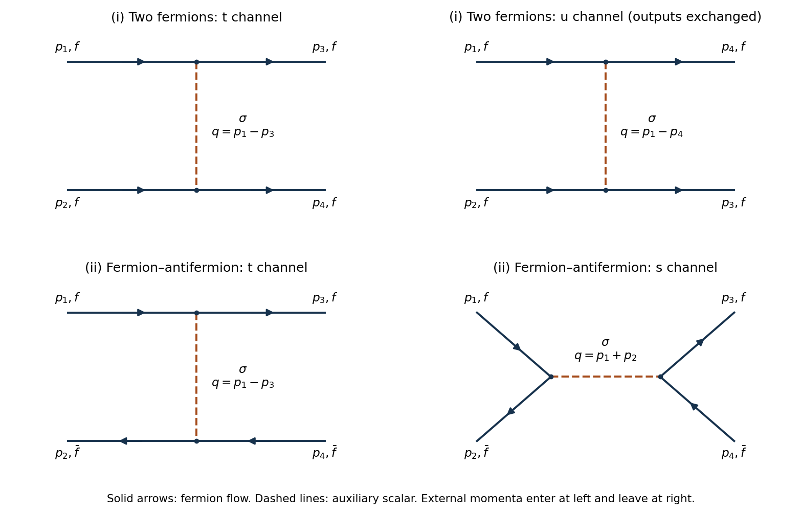

<h1 id="2/b">b</h1>

↑ **Parent:** [2](../2.md)

**[Figure 1](#2/b/image-original-tree-diagrams-with-external-momentum-labels-and-fermion-flow-arrows-the-upper-row-gives-two-fermion-t-and-u-exchange-the-lower-row-gives-fermion-antifermion-t-exchange-and-s-annihilation-dashed-lines-denote-the-auxiliary-scalar). Original tree diagrams with external momentum labels and fermion-flow arrows. The upper row gives two-fermion t and u exchange; the lower row gives fermion–antifermion t exchange and s annihilation. Dashed lines denote the auxiliary scalar.**

**Table of contents**

- [i](b/i.md)
  - [Solution](b/i/solution.md)
- [ii](b/ii.md)
  - [Solution](b/ii/solution.md)

## ↑ Ancestors (11)

1. [2](../2.md)
2. [2022](../../2022-split.md)
3. [Past exam of the quantum field theory course of the University of Oxford](../../split.md)
4. [Quantum field theory course of the University of Oxford](../../../quantum-field-theory-course-of-the-university-of-oxford.md)
5. [Year 4 of the mathematical and theoretical physics course of the University of Oxford](../../../year-4-of-the-mathematical-and-theoretical-physics-course-of-the-university-of-oxford.md)
6. [Mathematical and theoretical physics course of the University of Oxford](../../../mathematical-and-theoretical-physics-course-of-the-university-of-oxford.md)
7. [Undergraduate course of the University of Oxford](../../../undergraduate-course-of-the-university-of-oxford.md)
8. [Course of the University of Oxford](../../../course-of-the-university-of-oxford.md)
9. [University of Oxford](../../../university-of-oxford-split.md)
10. [List of universities](../../../list-of-universities.md)
11. [Codex Wiki](../../../split.md)
