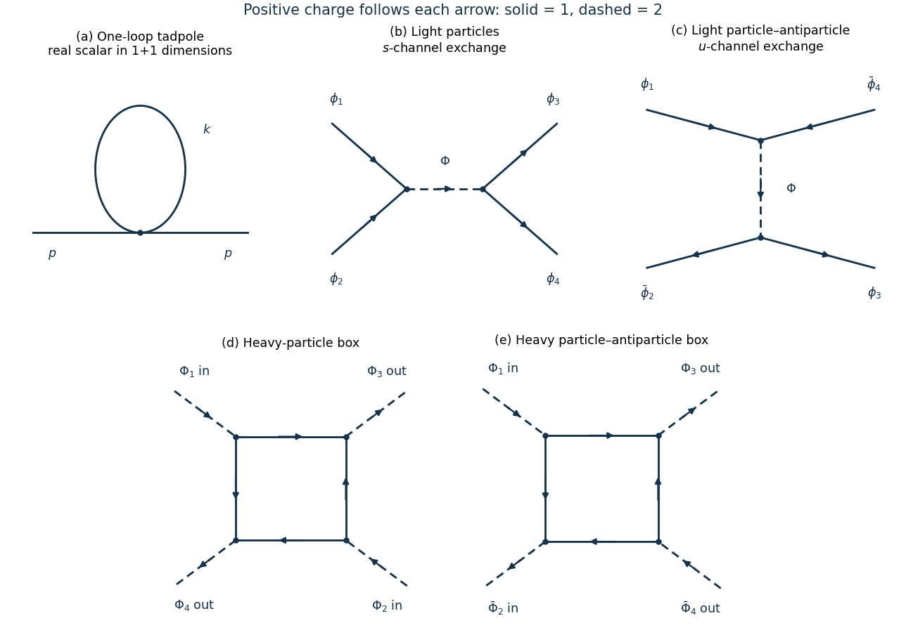

# 2023

↑ **Parent:** [Past exam of the quantum field theory course of the University of Oxford](../past-exam-of-the-quantum-field-theory-course-of-the-university-of-oxford.md)

Source PDF: [https://mmathphys.web.ox.ac.uk/sitefiles/quantum-field-theory.pdf](https://mmathphys.web.ox.ac.uk/sitefiles/quantum-field-theory.pdf)

**Table of contents**

- [1](#1)
  - [a](#1/a)
    - [Solution](#1/a/solution)
  - [b](#1/b)
    - [Solution](#1/b/solution)
  - [c](#1/c)
    - [Solution](#1/c/solution)
  - [d](#1/d)
    - [Solution](#1/d/solution)
  - [e](#1/e)
    - [Solution](#1/e/solution)
- [2](#2)
  - [a](#2/a)
    - [Solution](#2/a/solution)
  - [b](#2/b)
    - [Solution](#2/b/solution)
  - [c](#2/c)
    - [i](#2/c/i)
      - [Solution](#2/c/i/solution)
    - [ii](#2/c/ii)
      - [Solution](#2/c/ii/solution)
  - [d](#2/d)
    - [i](#2/d/i)
      - [Solution](#2/d/i/solution)
    - [ii](#2/d/ii)
      - [Solution](#2/d/ii/solution)
- [3](#3)
  - [a](#3/a)
    - [Solution](#3/a/solution)
  - [b](#3/b)
    - [Solution](#3/b/solution)
  - [c](#3/c)
    - [Solution](#3/c/solution)
  - [d](#3/d)
    - [Solution](#3/d/solution)
  - [e](#3/e)
    - [Solution](#3/e/solution)

## 1

↑ **Parent:** [2023](2023.md)

<h3 id="1/a">a</h3>

↑ **Parent:** [1](#1)

<h4 id="1/a/solution">Solution</h4>

↑ **Parent:** [A](#1/a)

Use $\hbar=c=1$, the [Minkowski metric](../special-relativity.md#minkowski-metric) $\eta=\operatorname{diag}(1,-1)$, and $p^2=(p^0)^2-(p^1)^2$. The momentum-space [Feynman rules](../perturbative-quantum-field-theory.md#feynman-rules) for the [real scalar field](../scalar-field-theory.md#real-scalar-field) are

$$
\boxed{\text{internal line: }\frac{i}{p^2-m^2+i\epsilon},\qquad
\text{four-leg vertex: }-ig_4.}
$$

At each [interaction vertex](../perturbative-quantum-field-theory.md#interaction-vertex) impose two-dimensional [momentum conservation](../momentum.md#momentum-conservation); before removing the overall conservation factor this is $(2\pi)^2\delta^{(2)}(\sum_jp_j)$. Integrate each independent [loop momentum](../perturbative-quantum-field-theory.md#loop-momentum) with $d^2k/(2\pi)^2$, and divide a [Feynman diagram](../perturbative-quantum-field-theory.md#feynman-diagram) by its [symmetry factor](../perturbative-quantum-field-theory.md#feynman-diagram-symmetry-factor). External lines carry the same [scalar propagator](../scalar-field-theory.md#scalar-propagator) in an unamputated [two-point correlation function](../critical-phenomenon.md#two-point-correlation-function); they are removed in an amputated [scattering amplitude](../quantum-scattering.md#scattering-amplitude).

The quadratic [action](../lagrangian-mechanics.md#action) is inverted with the [Feynman i-epsilon prescription](../quantum-field-theory.md#feynman-i-epsilon-prescription) to obtain the [scalar propagator](../scalar-field-theory.md#scalar-propagator). Expanding the [Dyson series](../perturbative-quantum-field-theory.md#dyson-series) gives $-ig_4/4!$ per insertion; the $4!$ attachments in the [Wick theorem](../perturbative-quantum-field-theory.md#wick-s-theorem) cancel the factorial. Fourier integration over the insertion point supplies the [momentum conservation](../momentum.md#momentum-conservation) factor. Automorphisms that leave the labelled external attachments fixed account for the remaining [symmetry factor](../perturbative-quantum-field-theory.md#feynman-diagram-symmetry-factor). In two spacetime dimensions the [mass dimensions](../perturbative-quantum-field-theory.md#mass-dimension) are $[\phi]=0$ and $[g_4]=2$.

<h3 id="1/b">b</h3>

↑ **Parent:** [1](#1)

<h4 id="1/b/solution">Solution</h4>

↑ **Parent:** [B](#1/b)

The one-loop [one-particle irreducible](../perturbative-quantum-field-theory.md#one-particle-irreducible-feynman-diagram) correction is a [tadpole diagram](../perturbative-quantum-field-theory.md#tadpole-diagram): two external lines meet one [quartic interaction](../scalar-field-theory.md#quartic-interaction) and the other two legs are joined. Interchanging the two ends of its loop gives the [symmetry factor](../perturbative-quantum-field-theory.md#feynman-diagram-symmetry-factor) $2$.

**[Figure 1](#1/b/image-original-scalar-diagrams-the-two-dimensional-tadpole-charge-conserving-light-scalar-exchange-and-heavy-scalar-box-amplitudes-dashed-lines-carry-charge-two-solid-lines-carry-charge-one). Original scalar diagrams: the two-dimensional tadpole, charge-conserving light-scalar exchange, and heavy-scalar box amplitudes. Dashed lines carry charge two; solid lines carry charge one.**

Define the [self-energy](../perturbative-quantum-field-theory.md#self-energy) by an insertion $-i\Sigma(p^2)$ and a full [scalar propagator](../scalar-field-theory.md#scalar-propagator) $i/[p^2-m^2-\Sigma(p^2)+i\epsilon]$ before [counterterms](../perturbative-quantum-field-theory.md#counterterm). The supplied [cutoff regularization](../perturbative-quantum-field-theory.md#cutoff-regularization) integral gives

$$
T_\Lambda:=\int_{|k_E|<\Lambda}\frac{d^2k_E}{(2\pi)^2}\frac1{k_E^2+m^2}
=\frac1{4\pi}\log\left(1+\frac{\Lambda^2}{m^2}\right),
\qquad
-i\Sigma_1=\frac{-ig_4}{2}\int\frac{d^2k}{(2\pi)^2}\frac{i}{k^2-m^2+i\epsilon}.
$$

Thus

$$
\boxed{\Sigma_1(p^2)=\frac{g_4}{2}T_\Lambda
=\frac{g_4}{8\pi}\log\left(1+\frac{\Lambda^2}{m^2}\right).}
$$

It has no external [momentum](../momentum.md) dependence. The correction to the unamputated [two-point correlation function](../critical-phenomenon.md#two-point-correlation-function) in [momentum space](../momentum.md#momentum-space) is

$$
\Delta G(p)=\frac{i}{p^2-m^2+i\epsilon}[-i\Sigma_1]
\frac{i}{p^2-m^2+i\epsilon}
=\frac{i\Sigma_1}{(p^2-m^2+i\epsilon)^2}.
$$

The positive sign of $\Sigma_1$ raises the unrenormalized squared [pole mass](../perturbative-quantum-field-theory.md#pole-mass) for $g_4>0$.

<h3 id="1/c">c</h3>

↑ **Parent:** [1](#1)

<h4 id="1/c/solution">Solution</h4>

↑ **Parent:** [C](#1/c)

Write $\phi_B=Z^{1/2}\phi$, $Z=1+\delta_Z$, and define the [mass counterterm](../perturbative-quantum-field-theory.md#mass-counterterm) $\delta_m$ as a squared-mass coefficient:

$$
\mathcal L_{\rm ct}=\frac12\delta_Z(\partial\phi)^2-\frac12\delta_m\phi^2,
\qquad \delta_m=Zm_B^2-m^2.
$$

With the [self-energy](../perturbative-quantum-field-theory.md#self-energy) convention in [b](#1/b), the inverse [scalar propagator](../scalar-field-theory.md#scalar-propagator) is $p^2-m^2+\delta_Zp^2-\delta_m-\Sigma(p^2)$. Requiring the [pole mass](../perturbative-quantum-field-theory.md#pole-mass) to equal $m$ therefore gives the [on-shell renormalization scheme](../perturbative-quantum-field-theory.md#on-shell-renormalization-scheme) condition

$$
\delta_m=m^2\delta_Z-\Sigma(m^2).
$$

At one [loop order](../perturbative-quantum-field-theory.md#loop-order), $\Sigma_1'=0$; hence a unit [pole residue](../perturbative-quantum-field-theory.md#pole-residue) also gives $\delta_Z^{(1)}=0$, and

$$
\boxed{\delta_m^{(1)}=-\frac{g_4}{8\pi}\log\left(1+\frac{\Lambda^2}{m^2}\right),\qquad
m_B^2=m^2+\delta_m^{(1)}+O(g_4^2).}
$$

The [mass counterterm](../perturbative-quantum-field-theory.md#mass-counterterm) [Feynman rule](../perturbative-quantum-field-theory.md#feynman-rule) is $-i\delta_m$, cancelling the [tadpole diagram](../perturbative-quantum-field-theory.md#tadpole-diagram). A convention defining a positive mass subtraction by $m_B^2=m^2-\delta_m^{\rm sub}$ instead has $\delta_m^{\rm sub}=-\delta_m$; specifying this convention avoids a spurious sign disagreement.

There is no one-loop [wave-function renormalization](../perturbative-quantum-field-theory.md#wave-function-renormalization) because the [tadpole diagram](../perturbative-quantum-field-theory.md#tadpole-diagram) is independent of [momentum](../momentum.md). Each one-loop four-point [bubble diagram](../perturbative-quantum-field-theory.md#bubble-diagram) has two [scalar propagators](../scalar-field-theory.md#scalar-propagator), so its large Euclidean [loop momentum](../perturbative-quantum-field-theory.md#loop-momentum) integral behaves as $\int d^2k_E/k_E^4$ and is [ultraviolet finite](../perturbative-quantum-field-theory.md#ultraviolet-finiteness). Thus no divergent [quartic interaction](../scalar-field-theory.md#quartic-interaction) [counterterm](../perturbative-quantum-field-theory.md#counterterm) is required. Finite coupling redefinitions remain possible. At higher [loop orders](../perturbative-quantum-field-theory.md#loop-order), finite [wave-function renormalization](../perturbative-quantum-field-theory.md#wave-function-renormalization) may be needed if unit [pole residue](../perturbative-quantum-field-theory.md#pole-residue) is imposed; [power counting](../perturbative-quantum-field-theory.md#power-counting-in-quantum-field-theory) only rules out its [ultraviolet divergence](../perturbative-quantum-field-theory.md#ultraviolet-divergence).

<h3 id="1/d">d</h3>

↑ **Parent:** [1](#1)

<h4 id="1/d/solution">Solution</h4>

↑ **Parent:** [D](#1/d)

Let $I,L,V$ count internal lines, independent loops, and [interaction vertices](../perturbative-quantum-field-theory.md#interaction-vertex) of a [connected Feynman diagram](../perturbative-quantum-field-theory.md#connected-feynman-diagram). The graph identity $L=I-V+1$ and the two inverse powers from each [scalar propagator](../scalar-field-theory.md#scalar-propagator) give its [superficial degree of divergence](../perturbative-quantum-field-theory.md#superficial-degree-of-divergence):

$$
\boxed{\omega=2L-2I=2(1-V).}
$$

The same formula applies to every connected subgraph. Graphs with $V\geq2$ have negative [superficial degree of divergence](../perturbative-quantum-field-theory.md#superficial-degree-of-divergence), but this alone does not remove a possible [ultraviolet subdivergence](../perturbative-quantum-field-theory.md#ultraviolet-subdivergence). A one-vertex subgraph with external legs in the [quartic scalar field theory](../scalar-field-theory.md#quartic-interaction) can diverge only by a [tadpole diagram](../perturbative-quantum-field-theory.md#tadpole-diagram), whose subtraction was fixed in [c](#1/c). Subtract every such [tadpole diagram](../perturbative-quantum-field-theory.md#tadpole-diagram); every remaining loop subgraph then has $V\geq2$ and negative [superficial degree of divergence](../perturbative-quantum-field-theory.md#superficial-degree-of-divergence). Its [ultraviolet divergence](../perturbative-quantum-field-theory.md#ultraviolet-divergence) is absent. Equivalently, [normal ordering](../perturbative-quantum-field-theory.md#normal-ordering) the [quartic interaction](../scalar-field-theory.md#quartic-interaction) removes all self-contractions at a single [interaction vertex](../perturbative-quantum-field-theory.md#interaction-vertex). Thus **no new divergent field-dependent counterterm structure is needed**, and in a [normal-ordering subtraction scheme in two dimensions](../perturbative-quantum-field-theory.md#normal-ordering-subtraction-scheme-in-two-dimensions) the one-loop mass subtraction exhausts these divergent coefficients.

The literal assertion that there are no further [counterterm](../perturbative-quantum-field-theory.md#counterterm) contributions in the [on-shell renormalization scheme](../perturbative-quantum-field-theory.md#on-shell-renormalization-scheme) is stronger and generally false. A concrete counterexample is the two-loop [sunset diagram](../perturbative-quantum-field-theory.md#sunset-diagram). After analytic continuation below its three-particle threshold, the magnitude of its [self-energy](../perturbative-quantum-field-theory.md#self-energy) at $p^2=m^2$ contains the strictly positive finite integral

$$
\left|\Sigma_{\rm sunset}(m^2)\right|
=\frac{g_4^2}{6(4\pi)^2m^2}
\int_{x,y,z\geq0}dx\,dy\,dz\,
\frac{\delta(1-x-y-z)}{xy+xz+yz-xyz}>0
\quad(g_4\ne0).
$$

The integrable corners do not spoil convergence. Its nonzero value shifts the [pole mass](../perturbative-quantum-field-theory.md#pole-mass), requiring an additional _finite_ [mass counterterm](../perturbative-quantum-field-theory.md#mass-counterterm) if $m$ is to remain the exact [pole mass](../perturbative-quantum-field-theory.md#pole-mass); its derivative can likewise change the [pole residue](../perturbative-quantum-field-theory.md#pole-residue). These are compatible with the [power counting](../perturbative-quantum-field-theory.md#power-counting-in-quantum-field-theory) result. If [vacuum diagrams](../perturbative-quantum-field-theory.md#vacuum-feynman-diagram) are retained rather than divided out in normalized [correlation functions](../critical-phenomenon.md#correlation-function), a separate constant [vacuum energy](../perturbative-quantum-field-theory.md#vacuum-energy) [counterterm](../perturbative-quantum-field-theory.md#counterterm) is also required: the one-vertex double-loop [vacuum diagram](../perturbative-quantum-field-theory.md#vacuum-feynman-diagram) is already divergent. The claim about the mass subtraction concerns field-dependent [counterterms](../perturbative-quantum-field-theory.md#counterterm) and normalized [correlation functions](../critical-phenomenon.md#correlation-function).

<h3 id="1/e">e</h3>

↑ **Parent:** [1](#1)

<h4 id="1/e/solution">Solution</h4>

↑ **Parent:** [E](#1/e)

The additional six-leg [interaction vertex](../perturbative-quantum-field-theory.md#interaction-vertex) has [Feynman rule](../perturbative-quantum-field-theory.md#feynman-rule) $-ig_6$. Since both interactions lack derivatives, the graph identity still gives $\omega=2(1-V)$, with $V=V_4+V_6$. The difference is that a one-vertex contraction of the [phi-six theory](../scalar-field-theory.md#phi-six-theory) can leave four external legs: choosing the contracted pair gives $\binom62=15$. Its [quartic interaction](../scalar-field-theory.md#quartic-interaction) correction is

$$
\frac{g_6}{6!}\,15T_\Lambda\phi^4
=\frac1{4!}\frac{g_6T_\Lambda}{2}\phi^4.
$$

Consequently a one-loop [quartic interaction](../scalar-field-theory.md#quartic-interaction) [counterterm](../perturbative-quantum-field-theory.md#counterterm) is now necessary:

$$
\boxed{\delta g_4^{(1)}=-\frac{g_6}{2}T_\Lambda
=-\frac{g_6}{8\pi}\log\left(1+\frac{\Lambda^2}{m^2}\right).}
$$

The one-loop [mass counterterm](../perturbative-quantum-field-theory.md#mass-counterterm) from [c](#1/c) is unchanged. Contracting four legs of a single six-leg [interaction vertex](../perturbative-quantum-field-theory.md#interaction-vertex) gives $\binom62\,3=45$ double contractions, hence a two-loop raw [self-energy](../perturbative-quantum-field-theory.md#self-energy) $g_6T_\Lambda^2/8$. Its subtraction must include the [quartic interaction](../scalar-field-theory.md#quartic-interaction) [counterterm](../perturbative-quantum-field-theory.md#counterterm) insertion, rather than subtracting this raw expression in isolation.

All divergent field-dependent coefficients are most simply organized by the [normal-ordering subtraction scheme in two dimensions](../perturbative-quantum-field-theory.md#normal-ordering-subtraction-scheme-in-two-dimensions). With $T=T_\Lambda$, express a potential normal ordered at mass $m$ in ordinary fields:

$$
V_B(\phi)=\frac{g_4}{24}(\phi^4-6T\phi^2+3T^2)
+\frac{g_6}{720}(\phi^6-15T\phi^4+45T^2\phi^2-15T^3).
$$

Thus its divergent subtraction coefficients, in this scheme, are

$$
\boxed{\delta g_4=-\frac{g_6T}{2},\qquad
\delta_m=-\frac{g_4T}{2}+\frac{g_6T^2}{8},\qquad
\delta g_6=\delta_Z=0.}
$$

Indeed the two-loop [self-energy](../perturbative-quantum-field-theory.md#self-energy) terms are $g_6T^2/8+\delta g_4T/2=-g_6T^2/8$, which the displayed [mass counterterm](../perturbative-quantum-field-theory.md#mass-counterterm) cancels. The constant terms only affect [vacuum energy](../perturbative-quantum-field-theory.md#vacuum-energy). After removing all one-vertex self-contractions, every remaining subgraph is [ultraviolet finite](../perturbative-quantum-field-theory.md#ultraviolet-finiteness). Additional finite [on-shell renormalization scheme](../perturbative-quantum-field-theory.md#on-shell-renormalization-scheme) adjustments are subject to the same qualification as [d](#1/d).

## 2

↑ **Parent:** [2023](2023.md)

<h3 id="2/a">a</h3>

↑ **Parent:** [2](#2)

<h4 id="2/a/solution">Solution</h4>

↑ **Parent:** [A](#2/a)

For nonzero real $g$, the continuous [internal symmetry of a classical field theory](../classical-field-theory.md#internal-symmetry-of-a-classical-field-theory) is the [global U(1) symmetry](../scalar-field-theory.md#global-u-1-symmetry)

$$
\phi\longmapsto e^{-i\alpha}\phi,\qquad
\Phi\longmapsto e^{-2i\alpha}\Phi,
\qquad \alpha\text{ constant}.
$$

The [kinetic terms](../classical-field-theory.md#kinetic-term) and mass terms are invariant separately, while the phases in $\phi^2\Phi^\dagger$ cancel. Independent phase rotations would instead require $2\alpha_\phi-\alpha_\Phi=0$ modulo $2\pi$, leaving one connected circle. Simultaneous [complex conjugation](../complex-analysis.md#complex-conjugation) is also a discrete symmetry, reversing the continuous charge; including it gives $U(1)\rtimes\mathbb Z_2\cong O(2)$ for generic parameters. At $g=0$ the continuous symmetry enlarges to $U(1)\times U(1)$.

The [Noether current](../classical-field-theory.md#noether-current) with particles assigned positive charges is

$$
\boxed{j^\mu=i\bigl(\phi^\dagger\partial^\mu\phi-(\partial^\mu\phi^\dagger)\phi\bigr)
+2i\bigl(\Phi^\dagger\partial^\mu\Phi-(\partial^\mu\Phi^\dagger)\Phi\bigr).}
$$

For example, put $A=\phi^2\Phi^\dagger$ and $B=\phi^{\dagger2}\Phi$. The [Euler-Lagrange equations](../analysis.md#euler-lagrange-equation) give $\partial_\mu j_\phi^\mu=ig(A-B)$ and $\partial_\mu j_\Phi^\mu=ig(B-A)$, with the factor $2$ already included in $j_\Phi^\mu$. Their sum vanishes. The [Noether charge](../classical-field-theory.md#noether-charge) $Q=\int d^3x\,j^0$ is conserved and, after [normal ordering](../perturbative-quantum-field-theory.md#normal-ordering), counts

$$
Q=N_\phi-N_{\bar\phi}+2(N_\Phi-N_{\bar\Phi}).
$$

Thus a $\Phi$ particle carries two units of the same [conserved charge](../classical-field-theory.md#conserved-charge) carried by a $\phi$ particle; their [antiparticles](../relativistic-quantum-field.md#antiparticle) carry the negatives. The interaction permits conversion of one $\Phi$ particle into two $\phi$ particles when allowed by [conservation of energy](../mathematical-physics.md#conservation-of-energy), while preserving this weighted number.

<h3 id="2/b">b</h3>

↑ **Parent:** [2](#2)

<h4 id="2/b/solution">Solution</h4>

↑ **Parent:** [B](#2/b)

The two [complex scalar fields](../scalar-field-theory.md#complex-scalar-field) have [scalar propagators](../scalar-field-theory.md#scalar-propagator)

$$
\langle T\phi\phi^\dagger\rangle(p)=\frac{i}{p^2-m^2+i\epsilon},\qquad
\langle T\Phi\Phi^\dagger\rangle(p)=\frac{i}{p^2-M^2+i\epsilon};
$$

contractions of two unconjugated fields or two conjugated fields vanish. Draw an arrow on each line in the direction of positive [conserved charge](../classical-field-theory.md#conserved-charge) flow: a solid line carries one unit and a dashed line two units. A particle arrow follows its physical [momentum](../momentum.md); an [antiparticle](../relativistic-quantum-field.md#antiparticle) arrow opposes it.

There are two conjugate three-leg [interaction vertices](../perturbative-quantum-field-theory.md#interaction-vertex), both with [Feynman rule](../perturbative-quantum-field-theory.md#feynman-rule) $-ig$: one has a charge-two arrow entering and two charge-one arrows leaving, and the other reverses every arrow. These describe the two conjugate terms $\phi^2\Phi^\dagger$ and $\phi^{\dagger2}\Phi$. The two identical $\phi$ attachments cancel the $1/2$ in the [Lagrangian density](../classical-field-theory.md#lagrangian-density). All crossed assignments are obtained by moving external lines between initial and final states while maintaining the arrows. There is no [interaction vertex](../perturbative-quantum-field-theory.md#interaction-vertex) with three equal-sign charges.

Each [interaction vertex](../perturbative-quantum-field-theory.md#interaction-vertex) conserves [four-momentum](../special-relativity.md#four-momentum), supplying $(2\pi)^4\delta^4(\sum p_j)$ with all momenta entering. Integrate each independent [loop momentum](../perturbative-quantum-field-theory.md#loop-momentum) with $d^4k/(2\pi)^4$ and divide by the [Feynman-diagram symmetry factor](../perturbative-quantum-field-theory.md#feynman-diagram-symmetry-factor). No minus sign is assigned to a closed scalar loop. These rules are for $i\mathcal M$ after amputating external lines and removing the overall [four-momentum conservation](../special-relativity.md#four-momentum-conservation) factor.

<h3 id="2/c">c</h3>

↑ **Parent:** [2](#2)

<h4 id="2/c/i">i</h4>

↑ **Parent:** [C](#2/c)

<h5 id="2/c/i/solution">Solution</h5>

↑ **Parent:** [I](#2/c/i)

Label the incoming [four-momenta](../special-relativity.md#four-momentum) $p_1,p_2$ and the outgoing ones $p_3,p_4$. Define the [Mandelstam variables](../special-relativity.md#mandelstam-variables) $s=(p_1+p_2)^2$, $t=(p_1-p_3)^2$, $u=(p_1-p_4)^2$. Two incoming $\phi$ particles have [conserved charge](../classical-field-theory.md#conserved-charge) $+2$, so the only [tree-level Feynman diagram](../perturbative-quantum-field-theory.md#tree-level-feynman-diagram) is an $s$-channel $\Phi$ exchange, shown in panel (b) of [b](#1/b)'s figure. Each end converts two charge-one lines into one charge-two line. There are no $t$- or $u$-channel exchanges: an incoming and an outgoing particle at such an end would transfer zero charge, for which this theory has no cubic [interaction vertex](../perturbative-quantum-field-theory.md#interaction-vertex).

$$
i\mathcal M_{\phi\phi}=(-ig)^2\frac{i}{s-M^2+i\epsilon},
\qquad
\boxed{\mathcal M_{\phi\phi}=-\frac{g^2}{s-M^2+i\epsilon}.}
$$

The single [Feynman diagram](../perturbative-quantum-field-theory.md#feynman-diagram) is already symmetric under exchanging the two outgoing particles. This does not add another copy of the [scattering amplitude](../quantum-scattering.md#scattering-amplitude); the [identical final-state symmetry factor](../quantum-scattering.md#identical-particle-factor-in-a-final-state-phase-space-integral) enters the integrated [scattering cross-section](../quantum-scattering.md#scattering-cross-section) instead.

<h4 id="2/c/ii">ii</h4>

↑ **Parent:** [C](#2/c)

<h5 id="2/c/ii/solution">Solution</h5>

↑ **Parent:** [Ii](#2/c/ii)

Take $\phi(p_1)+\bar\phi(p_2)\to\phi(p_3)+\bar\phi(p_4)$ with the [Mandelstam variables](../special-relativity.md#mandelstam-variables) of [i](#2/c/i). The allowed [tree-level Feynman diagram](../perturbative-quantum-field-theory.md#tree-level-feynman-diagram) is the crossed $u$-channel $\Phi$ exchange in panel (c) of [b](#1/b)'s figure. At one end the incoming particle and outgoing [antiparticle](../relativistic-quantum-field.md#antiparticle) transfer charge $+2$; the other end absorbs that charge. The zero-charge $s$- and $t$-channel assignments are forbidden by the [interaction vertices](../perturbative-quantum-field-theory.md#interaction-vertex). Thus

$$
\boxed{\mathcal M_{\phi\bar\phi}=-\frac{g^2}{u-M^2+i\epsilon}.}
$$

In the [center-of-mass frame](../special-relativity.md#center-of-momentum-frame) with $|\mathbf p|\ll m$, $s=4m^2+O(|\mathbf p|^2)$ and $u=O(|\mathbf p|^2)$. For $M\gg m$, both [scattering amplitudes](../quantum-scattering.md#scattering-amplitude) approach $g^2/M^2$. The elastic two-body [Lorentz-invariant phase space](../relativistic-quantum-field.md#lorentz-invariant-phase-space) and incident flux agree for the two experiments. Using

$$
\frac{d\sigma}{d\Omega}=\frac{|\mathcal M|^2}{64\pi^2s}
$$

for distinguishable final particles, and an extra factor $1/2!$ when integrating the identical-particle final state over the whole sphere, gives

$$
\sigma_{\phi\phi}\simeq\frac{g^4}{32\pi sM^4},\qquad
\sigma_{\phi\bar\phi}\simeq\frac{g^4}{16\pi sM^4},\qquad
\boxed{\frac{\sigma_{\phi\phi}}{\sigma_{\phi\bar\phi}}\longrightarrow\frac12.}
$$

There is no additional division for identical incoming particles in the definition of a beam [scattering cross-section](../quantum-scattering.md#scattering-cross-section). Before taking $M/m\to\infty$, the zero-[momentum](../momentum.md) ratio is $\tfrac12[M^2/(M^2-4m^2)]^2$, provided the threshold is away from the heavy pole.

Near $s=M^2$, the bare $s$-channel [scalar propagator](../scalar-field-theory.md#scalar-propagator) makes fixed-order [perturbation theory](../asymptotic-expansion.md#perturbation-theory) fail: repeated [self-energy](../perturbative-quantum-field-theory.md#self-energy) insertions contain powers of $\Sigma_\Phi(s)/(s-M^2)$. The $\Phi\to\phi\phi$ channel is open for $M>2m$, giving the leading [decay width](../relativistic-quantum-field.md#decay-width)

$$
\Gamma_\Phi=\frac{g^2}{32\pi M}\sqrt{1-\frac{4m^2}{M^2}}.
$$

Resumming the [self-energy](../perturbative-quantum-field-theory.md#self-energy) gives a finite [Breit-Wigner resonance cross section](../quantum-scattering.md#breit-wigner-resonance-cross-section), with denominator $s-M_{\rm pole}^2+iM_{\rm pole}\Gamma_\Phi$ near the pole, rather than an infinite [scattering cross-section](../quantum-scattering.md#scattering-cross-section). Also, $s\simeq M^2$ with $M\gg m$ lies outside the assumed nonrelativistic incoming kinematics; the ratio $1/2$ is not a resonance prediction.

<h3 id="2/d">d</h3>

↑ **Parent:** [2](#2)

<h4 id="2/d/i">i</h4>

↑ **Parent:** [D](#2/d)

<h5 id="2/d/i/solution">Solution</h5>

↑ **Parent:** [I](#2/d/i)

Four external $\Phi$ lines require four cubic [interaction vertices](../perturbative-quantum-field-theory.md#interaction-vertex), since each such [interaction vertex](../perturbative-quantum-field-theory.md#interaction-vertex) contains only one heavy field. Their other eight endpoints must form four light internal lines. A [connected Feynman diagram](../perturbative-quantum-field-theory.md#connected-feynman-diagram) therefore has $V=I=4$ and $L=1$: the leading contribution is a one-loop [box diagram](../perturbative-quantum-field-theory.md#box-diagram), of order $g^4$, with four $\phi$ [scalar propagators](../scalar-field-theory.md#scalar-propagator). Charge-two incoming and outgoing heavy lines attach alternately around the box, as shown in panel (d) of [b](#1/b)'s figure. Each incoming heavy line supplies the two outgoing light-charge arrows at its corner, and each outgoing heavy line absorbs them. With external labels fixed there is one such box and its [symmetry factor](../perturbative-quantum-field-theory.md#feynman-diagram-symmetry-factor) is one.

For $|\mathbf p|\ll M\ll m$, the external energies are also small compared with $m$, so expand the loop integrand in all external [four-momenta](../special-relativity.md#four-momentum). Its leading term is

$$
i\mathcal M_{\Phi\Phi}=g^4\int\frac{d^4k}{(2\pi)^4}\frac1{(k^2-m^2+i\epsilon)^4}
+O\left(\frac{i g^4M^2}{m^6}\right).
$$

A [Wick rotation](../perturbative-quantum-field-theory.md#wick-rotation) and the [Euclidean massive loop integral](../perturbative-quantum-field-theory.md#euclidean-massive-loop-integral) give

$$
\int\frac{d^4k}{(2\pi)^4}\frac1{(k^2-m^2+i\epsilon)^4}
=i\int\frac{d^4k_E}{(2\pi)^4}\frac1{(k_E^2+m^2)^4}
=\frac{i}{96\pi^2m^4}.
$$

Hence, more precisely than just its requested scaling,

$$
\boxed{\mathcal M_{\Phi\Phi}=\frac{g^4}{96\pi^2m^4}
\left[1+O\left(\frac{M^2}{m^2},\frac{|\mathbf p|^2}{m^2}\right)\right].}
$$

The [mass dimension](../perturbative-quantum-field-theory.md#mass-dimension) $[g]=1$ makes $g^4/m^4$ dimensionless, as a four-dimensional [scattering amplitude](../quantum-scattering.md#scattering-amplitude) should be. The leading amplitude has no extra identical-particle multiplicity.

<h4 id="2/d/ii">ii</h4>

↑ **Parent:** [D](#2/d)

<h5 id="2/d/ii/solution">Solution</h5>

↑ **Parent:** [Ii](#2/d/ii)

Cross the second incoming heavy particle and one outgoing heavy particle in [i](#2/d/i) to obtain $\Phi\bar\Phi\to\Phi\bar\Phi$. Panel (e) of [b](#1/b)'s figure shows the resulting [box diagram](../perturbative-quantum-field-theory.md#box-diagram). Its four light-charge arrows again alternate source and sink corners; it is the only connected order-$g^4$ topology. There is no tree exchange because every cubic [interaction vertex](../perturbative-quantum-field-theory.md#interaction-vertex) has only one heavy leg. With $|\mathbf p|\ll M\ll m$, crossing does not affect the zero-external-[momentum](../momentum.md) loop integral, so

$$
\boxed{\mathcal M_{\Phi\bar\Phi}=\frac{g^4}{96\pi^2m^4}
\left[1+O\left(\frac{M^2}{m^2},\frac{|\mathbf p|^2}{m^2}\right)\right].}
$$

An independent check is to integrate out the [complex scalar field](../scalar-field-theory.md#complex-scalar-field) $\phi$ at constant $\Phi$. Its two real-component squared masses are $m^2\pm g|\Phi|$. The one-loop [quantum effective potential](../perturbative-quantum-field-theory.md#quantum-effective-potential) is therefore

$$
V_1(\Phi)=\frac12\int\frac{d^4k_E}{(2\pi)^4}
\left[\log(k_E^2+m^2+g|\Phi|)+\log(k_E^2+m^2-g|\Phi|)\right].
$$

Expanding the logarithms to fourth order in $\Phi$ gives

$$
V_1\supset-\frac{g^4|\Phi|^4}{4}\int\frac{d^4k_E}{(2\pi)^4}\frac1{(k_E^2+m^2)^4}
=-\frac{g^4}{384\pi^2m^4}(\Phi^\dagger\Phi)^2.
$$

Thus the [effective Lagrangian](../quantum-field-theory.md#effective-lagrangian) has the positive local coefficient $g^4/(384\pi^2m^4)$. Its $2!2!$ external attachments give the common [scattering amplitude](../quantum-scattering.md#scattering-amplitude) $g^4/(96\pi^2m^4)$ in both channels. This also checks the box multiplicity and sign.

## 3

↑ **Parent:** [2023](2023.md)

<h3 id="3/a">a</h3>

↑ **Parent:** [3](#3)

<h4 id="3/a/solution">Solution</h4>

↑ **Parent:** [A](#3/a)

In terms of the [Pauli matrices](../algebra.md#pauli-matrices), $\gamma^0=\sigma_3$, $\gamma^1=i\sigma_1$, $\gamma^2=i\sigma_2$. The [Pauli matrix multiplication law](../algebra.md#pauli-matrix-multiplication-law) implies $\sigma_j^2=I_2$ and $\sigma_j\sigma_k=-\sigma_k\sigma_j$ for $j\ne k$. Consequently

$$
(\gamma^0)^2=I_2,\qquad (\gamma^1)^2=(\gamma^2)^2=-I_2,
\qquad \gamma^\mu\gamma^\nu=-\gamma^\nu\gamma^\mu\quad(\mu\ne\nu).
$$

These diagonal and off-diagonal cases are exactly the [Clifford algebra](../algebra-over-a-field.md#clifford-algebra) relation

$$
\boxed{\{\gamma^\mu,\gamma^\nu\}=2\eta^{\mu\nu}I_2.}
$$

The identity matrix is implicit on the right-hand side in the source. Useful conventions for the remaining parts are $(\gamma^0)^\dagger=\gamma^0$, $(\gamma^j)^\dagger=-\gamma^j$ for $j=1,2$, and $\gamma^{0*}=\gamma^0$, $\gamma^{1*}=-\gamma^1$, $\gamma^{2*}=\gamma^2$.

<h3 id="3/b">b</h3>

↑ **Parent:** [3](#3)

<h4 id="3/b/solution">Solution</h4>

↑ **Parent:** [B](#3/b)

A [parity symmetry in quantum field theory](../quantum-field-theory.md#parity-symmetry-in-quantum-field-theory) reverses spatial orientation, so its spatial matrix must lie in the determinant-$-1$ component of the [orthogonal group](../linear-algebra.md#orthogonal-group). In two spatial dimensions, reversing both coordinates gives $-I_2$, which has determinant $+1$ and is a rotation through $\pi$ in the [special orthogonal group in two dimensions](../linear-algebra.md#special-orthogonal-group-in-two-dimensions). It cannot test a discrete orientation-reversing symmetry independent of ordinary rotations. Reflecting one coordinate, for example $\operatorname{diag}(-1,1)$, has determinant $-1$ and supplies the required [parity symmetry in quantum field theory](../quantum-field-theory.md#parity-symmetry-in-quantum-field-theory).

In three spatial dimensions, $-I_3$ has determinant $-1$, so simultaneous inversion of all three coordinates is the standard choice. A single-coordinate reflection also reverses orientation there, and differs from $-I_3$ by a proper rotation through $\pi$. Thus, in a rotationally invariant theory, it tests the same discrete symmetry. The word _is_ in the source specifies conventional representatives: the essential distinction is orientation reversal, rather than a unique choice of axis. Both transformations preserve the ordinary spatial integration measure through the absolute value of their [Jacobian determinants](../multivariable-calculus.md#jacobian-determinant).

<h3 id="3/c">c</h3>

↑ **Parent:** [3](#3)

<h4 id="3/c/solution">Solution</h4>

↑ **Parent:** [C](#3/c)

Put $x_P=(t,-x,y)$ and $U_P=\gamma^1$. Since $U_P^\dagger=-\gamma^1$ and $\gamma^0\gamma^1\gamma^0=-\gamma^1$, the [Dirac adjoint](../relativistic-quantum-field.md#dirac-adjoint) transforms as

$$
\bar\psi'(x)=\psi^\dagger(x_P)(-\gamma^1)\gamma^0
=\bar\psi(x_P)\gamma^1.
$$

The [chain rule](../calculus.md#chain-rule) gives $\partial_\mu\psi(x_P)=r_\mu(\partial_\mu\psi)(x_P)$, with $(r_0,r_1,r_2)=(1,-1,1)$ and no sum in this formula. The [Clifford algebra](../algebra-over-a-field.md#clifford-algebra) gives

$$
\gamma^1\gamma^0\gamma^1=\gamma^0,\qquad
\gamma^1\gamma^1\gamma^1=-\gamma^1,\qquad
\gamma^1\gamma^2\gamma^1=\gamma^2.
$$

Multiplication by $r_\mu$ therefore restores each [kinetic term](../classical-field-theory.md#kinetic-term):

$$
\bar\psi'i\gamma^\mu\partial_\mu\psi'
=\bar\psi(x_P)i\gamma^\mu(\partial_\mu\psi)(x_P).
$$

However, the [Dirac scalar bilinear](../relativistic-quantum-field.md#dirac-scalar-bilinear) changes sign because $(\gamma^1)^2=-I_2$:

$$
\bar\psi'\psi'=-\bar\psi(x_P)\psi(x_P).
$$

Changing variables in the [action](../lagrangian-mechanics.md#action) has unit absolute [Jacobian determinant](../multivariable-calculus.md#jacobian-determinant). Hence

$$
\boxed{S_m\xrightarrow{P}S_{-m}:\quad S_{\rm kin}\to S_{\rm kin},\quad
-m\int\bar\psi\psi\to+m\int\bar\psi\psi.}
$$

A nonzero [Dirac mass term](../relativistic-quantum-field.md#dirac-mass-term) for this single two-component field breaks [parity symmetry in quantum field theory](../quantum-field-theory.md#parity-symmetry-in-quantum-field-theory) with the specified transformation.

<h3 id="3/d">d</h3>

↑ **Parent:** [3](#3)

<h4 id="3/d/solution">Solution</h4>

↑ **Parent:** [D](#3/d)

The specified [time reversal](../quantum-field-theory.md#t-symmetry) includes complex conjugating $i\gamma^\mu\partial_\mu$; omitting that operation changes the answer. Put $x_T=(-t,x,y)$, $U_T=\gamma^2$, and $(r_0,r_1,r_2)=(-1,1,1)$. As in [c](#3/c), the [Dirac adjoint](../relativistic-quantum-field.md#dirac-adjoint) in the source's transformed bilinear is $\bar\psi'(x)=\bar\psi(x_T)\gamma^2$. The conjugated [Dirac operator](../riemannian-geometry.md#dirac-operator) has coefficient matrices

$$
(i\gamma^0)^*=-i\gamma^0,\qquad
(i\gamma^1)^*=+i\gamma^1,\qquad
(i\gamma^2)^*=-i\gamma^2.
$$

Combining these coefficients with the [chain rule](../calculus.md#chain-rule) signs and the [Clifford algebra](../algebra-over-a-field.md#clifford-algebra) gives, without summing over $\mu$,

$$
\gamma^2(i\gamma^\mu)^*\gamma^2r_\mu=i\gamma^\mu
\quad(\mu=0,1,2).
$$

For example the time coefficient is $\gamma^2(-i\gamma^0)\gamma^2(-1)=i\gamma^0$, and the second spatial coefficient is $\gamma^2(-i\gamma^2)\gamma^2=i\gamma^2$. Thus the [kinetic term](../classical-field-theory.md#kinetic-term) is invariant. The real [Dirac mass term](../relativistic-quantum-field.md#dirac-mass-term) again reverses sign since $\bar\psi'\psi'=\bar\psi(\gamma^2)^2\psi=-\bar\psi\psi$. The spacetime integration has unit absolute [Jacobian determinant](../multivariable-calculus.md#jacobian-determinant), so

$$
\boxed{T:S_m\mapsto S_{-m},\qquad TP:S_m\mapsto S_m.}
$$

Each operation reverses the sign of the mass, while their composition reverses it twice and preserves the [kinetic term](../classical-field-theory.md#kinetic-term). In an operator formulation the complex conjugation of coefficients expresses the [antiunitary operator](../vector-space.md#antiunitary-operator) character of [time reversal](../quantum-field-theory.md#t-symmetry); the transformation must not be treated as an ordinary unitary substitution with all $i$'s held fixed. These statements concern the stated free [action](../lagrangian-mechanics.md#action).

<h3 id="3/e">e</h3>

↑ **Parent:** [3](#3)

<h4 id="3/e/solution">Solution</h4>

↑ **Parent:** [E](#3/e)

First conjugate the [Dirac equation](../relativistic-quantum-field.md#dirac-equation): $(-i\gamma^{\mu*}\partial_\mu-m)\psi^*=0$. A matrix $\Gamma$ taking $\psi^*$ into another solution of the same [Dirac equation](../relativistic-quantum-field.md#dirac-equation) must obey

$$
\gamma^\mu\Gamma=-\Gamma\gamma^{\mu*}.
$$

Because $\gamma^1$ anticommutes with the real $\gamma^0,\gamma^2$ and commutes with the purely imaginary $\gamma^1$, a unitary choice is

$$
\boxed{\Gamma=\gamma^1=i\begin{pmatrix}0&1\\1&0\end{pmatrix},\qquad
\psi_C=\gamma^1\psi^*.}
$$

Any constant overall phase is equally valid. To verify invariance of the [action](../lagrangian-mechanics.md#action), rather than only of its equation, keep the [fermion](../tensor-product-of-quantum-systems.md#fermion) exchange signs. Define the [charge-conjugation matrix](../quantum-field-theory.md#charge-conjugation-matrix) $C=\Gamma\gamma^0=\sigma_2$. It obeys

$$
C^T=-C,\qquad C^{-1}=C,\qquad
C^{-1}\gamma^\mu C=-(\gamma^\mu)^T,
\qquad
\psi_C=C\bar\psi^T,\quad \bar\psi_C=-\psi^TC^{-1}.
$$

For a classical [Grassmann field](../quantum-field-theory.md#grassmann-field), interchanging two components contributes a minus sign; equivalently use [normal ordering](../perturbative-quantum-field-theory.md#normal-ordering) for quantum [fermionic operators](../supersymmetric-quantum-mechanics.md#fermionic-operator). Thus

$$
\bar\psi_C\psi_C=-\psi^T\bar\psi^T=\bar\psi\psi,
$$

and

$$
\bar\psi_Ci\gamma^\mu\partial_\mu\psi_C
=i\psi^T(\gamma^\mu)^T(\partial_\mu\bar\psi)^T
=-i(\partial_\mu\bar\psi)\gamma^\mu\psi
=\bar\psi i\gamma^\mu\partial_\mu\psi
-i\partial_\mu(\bar\psi\gamma^\mu\psi).
$$

The last term integrates to a boundary term, vanishing with the usual decay or compatible boundary conditions. Both the [kinetic term](../classical-field-theory.md#kinetic-term) and the [Dirac mass term](../relativistic-quantum-field.md#dirac-mass-term) therefore leave $S$ invariant under [charge conjugation](../quantum-field-theory.md#charge-conjugation). Treating the components as commuting numbers would give the wrong mass-bilinear sign; the [fermion](../tensor-product-of-quantum-systems.md#fermion) statistics is essential.

## ↑ Ancestors (9)

1. [Past exam of the quantum field theory course of the University of Oxford](../past-exam-of-the-quantum-field-theory-course-of-the-university-of-oxford.md)
2. [Quantum field theory course of the University of Oxford](../university-of-oxford.md#quantum-field-theory-course-of-the-university-of-oxford)
3. [Year 4 of the mathematical and theoretical physics course of the University of Oxford](../university-of-oxford.md#year-4-of-the-mathematical-and-theoretical-physics-course-of-the-university-of-oxford)
4. [Mathematical and theoretical physics course of the University of Oxford](../university-of-oxford.md#mathematical-and-theoretical-physics-course-of-the-university-of-oxford)
5. [Undergraduate course of the University of Oxford](../university-of-oxford.md#undergraduate-course-of-the-university-of-oxford)
6. [Course of the University of Oxford](../university-of-oxford.md#course-of-the-university-of-oxford)
7. [University of Oxford](../university-of-oxford.md)
8. [List of universities](../README.md#list-of-universities)
9. [Codex Wiki](../README.md)
