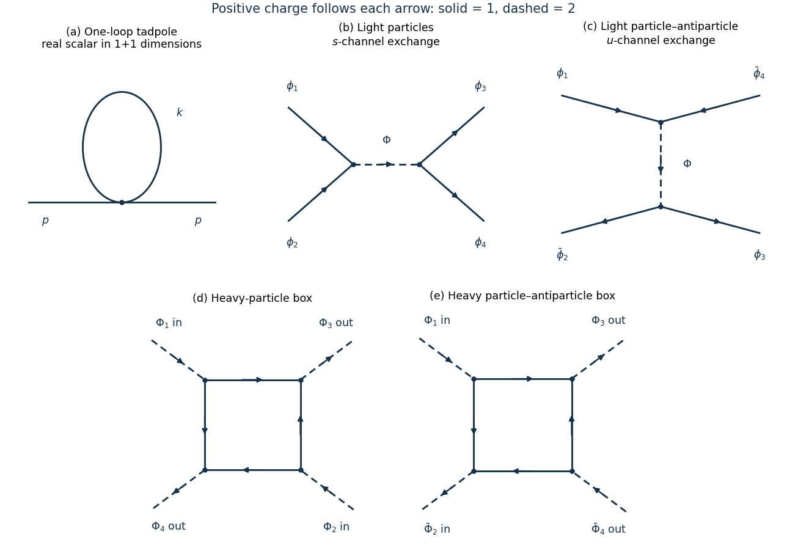

<h1 id="1/b/solution">Solution</h1>

↑ **Parent:** [B](../b.md)

The one-loop [one-particle irreducible](../../../../one-particle-irreducible-feynman-diagram.md) correction is a [tadpole diagram](../../../../tadpole-diagram.md): two external lines meet one [quartic interaction](../../../../quartic-interaction.md) and the other two legs are joined. Interchanging the two ends of its loop gives the [symmetry factor](../../../../feynman-diagram-symmetry-factor.md) $2$.

**[Figure 1](#1/b/image-original-scalar-diagrams-the-two-dimensional-tadpole-charge-conserving-light-scalar-exchange-and-heavy-scalar-box-amplitudes-dashed-lines-carry-charge-two-solid-lines-carry-charge-one). Original scalar diagrams: the two-dimensional tadpole, charge-conserving light-scalar exchange, and heavy-scalar box amplitudes. Dashed lines carry charge two; solid lines carry charge one.**

Define the [self-energy](../../../../self-energy.md) by an insertion $-i\Sigma(p^2)$ and a full [scalar propagator](../../../../scalar-propagator.md) $i/[p^2-m^2-\Sigma(p^2)+i\epsilon]$ before [counterterms](../../../../counterterm.md). The supplied [cutoff regularization](../../../../cutoff-regularization.md) integral gives

$$
T_\Lambda:=\int_{|k_E|<\Lambda}\frac{d^2k_E}{(2\pi)^2}\frac1{k_E^2+m^2}
=\frac1{4\pi}\log\left(1+\frac{\Lambda^2}{m^2}\right),
\qquad
-i\Sigma_1=\frac{-ig_4}{2}\int\frac{d^2k}{(2\pi)^2}\frac{i}{k^2-m^2+i\epsilon}.
$$

Thus

$$
\boxed{\Sigma_1(p^2)=\frac{g_4}{2}T_\Lambda
=\frac{g_4}{8\pi}\log\left(1+\frac{\Lambda^2}{m^2}\right).}
$$

It has no external [momentum](../../../../momentum-split.md) dependence. The correction to the unamputated [two-point correlation function](../../../../two-point-correlation-function.md) in [momentum space](../../../../momentum-space.md) is

$$
\Delta G(p)=\frac{i}{p^2-m^2+i\epsilon}[-i\Sigma_1]
\frac{i}{p^2-m^2+i\epsilon}
=\frac{i\Sigma_1}{(p^2-m^2+i\epsilon)^2}.
$$

The positive sign of $\Sigma_1$ raises the unrenormalized squared [pole mass](../../../../pole-mass.md) for $g_4>0$.

## ↑ Ancestors (12)

1. [B](../b.md)
2. [1](../../1.md)
3. [2023](../../../2023-split.md)
4. [Past exam of the quantum field theory course of the University of Oxford](../../../split.md)
5. [Quantum field theory course of the University of Oxford](../../../../quantum-field-theory-course-of-the-university-of-oxford.md)
6. [Year 4 of the mathematical and theoretical physics course of the University of Oxford](../../../../year-4-of-the-mathematical-and-theoretical-physics-course-of-the-university-of-oxford.md)
7. [Mathematical and theoretical physics course of the University of Oxford](../../../../mathematical-and-theoretical-physics-course-of-the-university-of-oxford.md)
8. [Undergraduate course of the University of Oxford](../../../../undergraduate-course-of-the-university-of-oxford.md)
9. [Course of the University of Oxford](../../../../course-of-the-university-of-oxford.md)
10. [University of Oxford](../../../../university-of-oxford-split.md)
11. [List of universities](../../../../list-of-universities.md)
12. [Codex Wiki](../../../../split.md)
