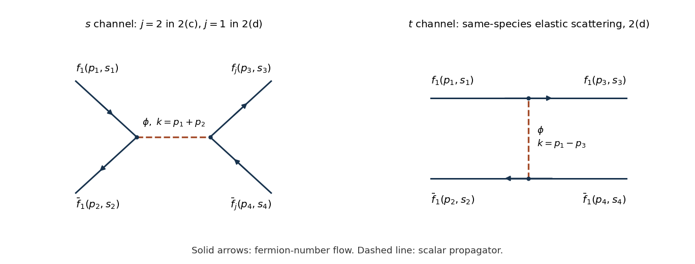

# 2024

↑ **Parent:** [Past exam of the quantum field theory course of the University of Oxford](../past-exam-of-the-quantum-field-theory-course-of-the-university-of-oxford.md)

Source PDF: [https://mmathphys.physics.ox.ac.uk/sites/g/files/vzsiac2991/files/mmathphys/documents/media/a15088w1.pdf](https://mmathphys.physics.ox.ac.uk/sites/g/files/vzsiac2991/files/mmathphys/documents/media/a15088w1.pdf)

Use [natural units](../mathematical-physics.md#natural-units) $\hbar=c=1$ and the mostly-minus [Minkowski metric](../special-relativity.md#minkowski-metric). Question 3 has two spatial dimensions: its [gamma matrices](../algebra-over-a-field.md#gamma-matrices) are the specified two-by-two matrices. The printed $\sigma^\mu$ in its [kinetic term](../classical-field-theory.md#kinetic-term) is interpreted as those $\gamma^\mu$, rather than as three unmodified [Pauli matrices](../algebra.md#pauli-matrices). All [spin sums](../relativistic-quantum-field.md#spin-sum) in question 2 instead use four-component [Dirac spinors](../relativistic-quantum-field.md#dirac-spinor) in four spacetime dimensions.

**Table of contents**

- [1](#1)
  - [a](#1/a)
    - [Solution](#1/a/solution)
  - [b](#1/b)
    - [Solution](#1/b/solution)
  - [c](#1/c)
    - [Solution](#1/c/solution)
  - [d](#1/d)
    - [Solution](#1/d/solution)
  - [e](#1/e)
    - [Solution](#1/e/solution)
- [2](#2)
  - [a](#2/a)
    - [Solution](#2/a/solution)
  - [b](#2/b)
    - [Solution](#2/b/solution)
  - [c](#2/c)
    - [Solution](#2/c/solution)
  - [d](#2/d)
    - [Solution](#2/d/solution)
- [3](#3)
  - [a](#3/a)
    - [Solution](#3/a/solution)
  - [b](#3/b)
    - [Solution](#3/b/solution)
  - [c](#3/c)
    - [Solution](#3/c/solution)
  - [d](#3/d)
    - [Solution](#3/d/solution)

## 1

↑ **Parent:** [2024](2024.md)

<h3 id="1/a">a</h3>

↑ **Parent:** [1](#1)

<h4 id="1/a/solution">Solution</h4>

↑ **Parent:** [A](#1/a)

Write $\int_{\mathbf p}=\int d^3\mathbf p/(2\pi)^3$. The [canonical commutation relations](../quantum-mechanics.md#canonical-commutation-relation) and the product rule for a [commutator](../lie-algebra.md#commutator) give

$$
[a_{\mathbf p},a_{\mathbf q}^\dagger a_{\mathbf q}]=(2\pi)^3\delta^3(\mathbf p-\mathbf q)a_{\mathbf q},\qquad
[b_{\mathbf p}^\dagger,b_{\mathbf q}^\dagger b_{\mathbf q}]=-(2\pi)^3\delta^3(\mathbf p-\mathbf q)b_{\mathbf q}^\dagger.
$$

The other-species terms vanish. Integrating the [Dirac delta distributions](../distribution-theory.md#dirac-delta-function) in the [Hamiltonian](../hamiltonian-mechanics.md#hamiltonian) therefore gives

$$
[a_{\mathbf p},H]=E_p a_{\mathbf p},\qquad [b_{-\mathbf p}^\dagger,H]=-E_p b_{-\mathbf p}^\dagger,
$$

where $E_{-p}=E_p$. Consequently the [complex scalar field](../scalar-field-theory.md#complex-scalar-field) satisfies

$$
[\phi(t,\mathbf x),H]=\int_{\mathbf p}\frac{E_p}{\sqrt{2E_p}}\left(-b_{-\mathbf p}^\dagger e^{iE_pt}+a_{\mathbf p}e^{-iE_pt}\right)e^{i\mathbf p\cdot\mathbf x}.
$$

Direct [differentiation](../calculus.md#differentiation) of the time factors gives the same expression, proving the [Heisenberg equation of motion](../quantum-system.md#heisenberg-equation-of-motion)

$$
\boxed{i\partial_t\phi(t,\mathbf x)=[\phi(t,\mathbf x),H].}
$$

<h3 id="1/b">b</h3>

↑ **Parent:** [1](#1)

<h4 id="1/b/solution">Solution</h4>

↑ **Parent:** [B](#1/b)

Both a [particle](../physics.md#particle-physics) and its [antiparticle](../relativistic-quantum-field.md#antiparticle) carry the [momentum](../momentum.md) of their mode label. Thus the [normal-ordered](../perturbative-quantum-field-theory.md#normal-ordering) total [momentum operator](../quantum-mechanics.md#momentum-operator) is

$$
\boxed{\mathbf P=\int_{\mathbf p}\mathbf p\left(a_{\mathbf p}^\dagger a_{\mathbf p}+b_{\mathbf p}^\dagger b_{\mathbf p}\right).}
$$

The [canonical commutation relations](../quantum-mechanics.md#canonical-commutation-relation) give

$$
[a_{\mathbf p},\mathbf P]=\mathbf p\,a_{\mathbf p},\qquad
[b_{-\mathbf p}^\dagger,\mathbf P]=-(-\mathbf p)b_{-\mathbf p}^\dagger=\mathbf p\,b_{-\mathbf p}^\dagger.
$$

The minus sign in the [antiparticle](../relativistic-quantum-field.md#antiparticle) mode label is essential: both terms in the printed [mode expansion of a free field](../quantum-field-theory.md#mode-expansion-of-a-free-field) contain $e^{i\mathbf p\cdot\mathbf x}$. Hence

$$
[\phi,\mathbf P]=\int_{\mathbf p}\frac{\mathbf p}{\sqrt{2E_p}}\left(b_{-\mathbf p}^\dagger e^{iE_pt}+a_{\mathbf p}e^{-iE_pt}\right)e^{i\mathbf p\cdot\mathbf x}
=\boxed{-i\nabla\phi.}
$$

<h3 id="1/c">c</h3>

↑ **Parent:** [1](#1)

<h4 id="1/c/solution">Solution</h4>

↑ **Parent:** [C](#1/c)

For a small real time displacement $\epsilon$, the [unitary time evolution](../quantum-system.md#unitary-time-evolution) operator is $T_t(\epsilon)=1-i\epsilon H+O(\epsilon^2)$. The corresponding [Heisenberg picture](../quantum-system.md#heisenberg-picture) field transformation is conjugation by its inverse:

$$
\begin{aligned}
T_t(\epsilon)^\dagger\phi(t,\mathbf x)T_t(\epsilon)
&=\phi+i\epsilon[H,\phi]+O(\epsilon^2)\\
&=\phi+\epsilon\partial_t\phi+O(\epsilon^2)
=\boxed{\phi(t+\epsilon,\mathbf x)+O(\epsilon^2).}
\end{aligned}
$$

Here [a](#1/a) gives $[H,\phi]=-i\partial_t\phi$.

Likewise let $T_s(\mathbf a)=1+i\mathbf a\cdot\mathbf P+O(|\mathbf a|^2)$, with the paper's sign for its [spatial translation operator](../quantum-mechanics.md#spatial-translation-operator). From [b](#1/b),

$$
\begin{aligned}
T_s(\mathbf a)^\dagger\phi(t,\mathbf x)T_s(\mathbf a)
&=\phi+i\mathbf a\cdot[\phi,\mathbf P]+O(|\mathbf a|^2)\\
&=\phi+\mathbf a\cdot\nabla\phi+O(|\mathbf a|^2)
=\boxed{\phi(t,\mathbf x+\mathbf a)+O(|\mathbf a|^2).}
\end{aligned}
$$

These are precisely the first-order [Taylor expansions](../calculus.md#taylor-expansion). Since $H$ and $\mathbf P$ commute in this translation-invariant theory, the finite result is

$$
\boxed{\phi(x)=e^{iP\cdot x}\phi(0)e^{-iP\cdot x},\qquad P\cdot x=Ht-\mathbf P\cdot\mathbf x.}
$$

<h3 id="1/d">d</h3>

↑ **Parent:** [1](#1)

<h4 id="1/d/solution">Solution</h4>

↑ **Parent:** [D](#1/d)

Choose the zero of [energy](../energy.md) so that the translation-invariant [vacuum state](../quantum-field-theory.md#vacuum-state) has $P^\mu|\Omega\rangle=0$. A [one-particle state](../quantum-field-theory.md#one-particle-state) of [rest mass](../special-relativity.md#invariant-mass) $m_\psi$ obeys the [relativistic energy-momentum relation](../special-relativity.md#energy-momentum-relation)

$$
\boxed{p^\mu=(E_{\mathbf p},\mathbf p),\qquad E_{\mathbf p}=\sqrt{m_\psi^2+|\mathbf p|^2},\qquad p^2=m_\psi^2.}
$$

The [translation covariance of a quantum field](../quantum-field-theory.md#translation-covariance-of-a-quantum-field) in [c](#1/c) remains valid for the full interacting [four-momentum operator](../quantum-mechanics.md#four-momentum-operator). Acting its [exponential functions](../calculus.md#exponential-function) on the two [momentum eigenstates](../energy-eigenvalue.md#momentum-eigenstate) gives

$$
\begin{aligned}
\langle\Omega|\phi(x)|\psi,\mathbf p\rangle
&=\langle\Omega|e^{iP\cdot x}\phi(0)e^{-iP\cdot x}|\psi,\mathbf p\rangle\\
&=\boxed{e^{-ip\cdot x}\langle\Omega|\phi(0)|\psi,\mathbf p\rangle.}
\end{aligned}
$$

Here $p\cdot x=E_{\mathbf p}t-\mathbf p\cdot\mathbf x$. A different additive [vacuum energy](../perturbative-quantum-field-theory.md#vacuum-energy) must be subtracted consistently from both [energy eigenvalues](../energy-eigenvalue.md) before identifying the physical $p^0$.

<h3 id="1/e">e</h3>

↑ **Parent:** [1](#1)

<h4 id="1/e/solution">Solution</h4>

↑ **Parent:** [E](#1/e)

Assume $m_\psi>0$, as required to have a [rest frame](../mathematical-physics.md#rest-frame). Choose the [Lorentz boost](../special-relativity.md#lorentz-boost) $\Lambda$ for which $\Lambda p=(m_\psi,\mathbf0)$, and write its [unitary operator](../vector-space.md#unitary-operator) as $U$. The stipulated [one-particle state](../quantum-field-theory.md#one-particle-state) normalization gives $U|\psi,\mathbf p\rangle=|\psi,\mathbf0\rangle$ without a momentum-dependent prefactor. A [Lorentz scalar](../special-relativity.md#lorentz-scalar) at the origin satisfies $U\phi(0)U^\dagger=\phi(0)$, and the [vacuum state](../quantum-field-theory.md#vacuum-state) satisfies $U|\Omega\rangle=|\Omega\rangle$. Inserting $U^\dagger U$ therefore proves

$$
\boxed{\langle\Omega|\phi(0)|\psi,\mathbf p\rangle=\langle\Omega|\phi(0)|\psi,\mathbf0\rangle.}
$$

With a noncovariant normalization of [momentum eigenstates](../energy-eigenvalue.md#momentum-eigenstate), the assumed boost law would instead contain a square-root energy factor, so this equality is specifically tied to the paper's assumption.

Let $q^\mu=(E_{\mathbf q}^{\chi},\mathbf q)$ denote the [four-momentum](../special-relativity.md#four-momentum) of the other [energy eigenstate](../energy-eigenvalue.md#energy-eigenstate). Translation covariance first gives

$$
\langle\chi,\mathbf q|\phi(x)|\psi,\mathbf p\rangle
=e^{i(q-p)\cdot x}\langle\chi,\mathbf q|\phi(0)|\psi,\mathbf p\rangle
=e^{i(q-p)\cdot x}\langle U\chi,\mathbf q|\phi(0)|\psi,\mathbf0\rangle.
$$

Thus a suitable ket, including the phase whose complex conjugate appears in its bra, is

$$
\boxed{|\Psi\rangle=e^{-i(q-p)\cdot x}U|\chi,\mathbf q\rangle.}
$$

Here $\langle U\chi,\mathbf q|$ means $(U|\chi,\mathbf q\rangle)^\dagger$. The overall phase depends on the fixed insertion point $x$; it does not change the [energy eigenvalue](../energy-eigenvalue.md). It cannot simply be dropped if the equality of complex [matrix elements](../vector-space.md#matrix-element) is to hold exactly.

The transformed state has [four-momentum](../special-relativity.md#four-momentum) $q'=\Lambda q$. [Lorentz invariance](../special-relativity.md#lorentz-invariance) of the [Minkowski inner product](../hyperbolic-geometry.md#minkowski-inner-product) gives

$$
p\cdot q=(\Lambda p)\cdot(\Lambda q)=m_\psi q'^0,
\qquad
\boxed{E^\Psi=\frac{p\cdot q}{m_\psi}=\frac{E_{\mathbf p}E_{\mathbf q}^{\chi}-\mathbf p\cdot\mathbf q}{m_\psi}.}
$$

There is no boost to a [rest frame](../mathematical-physics.md#rest-frame) for a nonzero massless [four-momentum](../special-relativity.md#four-momentum), so the rest-state statements require the positive-mass assumption.

## 2

↑ **Parent:** [2024](2024.md)

<h3 id="2/a">a</h3>

↑ **Parent:** [2](#2)

<h4 id="2/a/solution">Solution</h4>

↑ **Parent:** [A](#2/a)

Using [Feynman slash notation](../algebra-over-a-field.md#feynman-slash-notation), the symmetric tensor $p_\mu p_\nu$ kills the antisymmetric [commutator](../lie-algebra.md#commutator) of the [gamma matrices](../algebra-over-a-field.md#gamma-matrices). The [Clifford algebra](../algebra-over-a-field.md#clifford-algebra) gives

$$
\boxed{\not p\,\not p=\tfrac12p_\mu p_\nu\{\gamma^\mu,\gamma^\nu\}=p^2I.}
$$

Consequently $(\not p)^{2r}=(p^2)^rI$ and $(\not p)^{2r+1}=(p^2)^r\not p$. For a scalar-coefficient [polynomial](../polynomial.md) $F(z)=\sum_nc_nz^n$, split its even and odd powers:

$$
\boxed{F(\not p)=A(p^2)\not p+B(p^2)I,\quad A(z)=\sum_rc_{2r+1}z^r,\quad B(z)=\sum_rc_{2r}z^r.}
$$

This reduction assumes scalar coefficients; arbitrary noncommuting matrix coefficients would not give the stated scalar functions $A,B$.

<h3 id="2/b">b</h3>

↑ **Parent:** [2](#2)

<h4 id="2/b/solution">Solution</h4>

↑ **Parent:** [B](#2/b)

Every positive-energy [Dirac spinor](../relativistic-quantum-field.md#dirac-spinor) obeys $(\not p-m)u^s(\mathbf p)=0$. Therefore the [fermion spin sum](../relativistic-quantum-field.md#fermion-spin-sum) satisfies

$$
(\not p-m)P=\sum_s[(\not p-m)u^s]\bar u^s=0.
$$

Since $\bar u^s=u^{s\dagger}\gamma^0$ and $(\gamma^0)^2=I$, the [trace](../linear-algebra.md#matrix-trace) of each outer product is its contracted scalar. The prescribed normalization and the two [spin](../angular-momentum-operator.md#spin) states yield

$$
\boxed{\operatorname{tr}(P\gamma^0)=\sum_su^{s\dagger}u^s=2(2E_p)=4E_p.}
$$

Now make exactly the stated [polynomial](../polynomial.md) assumption and apply [polynomial reduction of a slashed vector](../algebra-over-a-field.md#polynomial-reduction-of-a-slashed-vector). By [a](#2/a), on the [mass shell](../special-relativity.md#mass-shell) $p^2=m^2$ write $P=A\not p+BI$. Then

$$
0=(\not p-m)P=(Am^2-mB)I+(B-mA)\not p.
$$

The [matrices](../vector-space.md#matrix) $I$ and $\not p$ are linearly independent for a physical nonzero $p$, so $B=mA$. The [gamma matrix trace identities](../algebra-over-a-field.md#gamma-matrix-trace-identities), $\operatorname{tr}\gamma^0=0$ and $\operatorname{tr}(\gamma^\mu\gamma^0)=4\eta^{\mu0}$, give

$$
4E_p=\operatorname{tr}[A(\not p+m)\gamma^0]=4AE_p.
$$

Thus $A=1$ and

$$
\boxed{P(\mathbf p)=\not p+m.}
$$

No explicit representation of the [Dirac spinors](../relativistic-quantum-field.md#dirac-spinor) has been used. The same reasoning covers $m=0$ provided $p^0>0$.

<h3 id="2/c">c</h3>

↑ **Parent:** [2](#2)

<h4 id="2/c/solution">Solution</h4>

↑ **Parent:** [C](#2/c)

Interpret the repeated species label in the [Yukawa interaction](../standard-model.md#yukawa-interaction) as summed over $i=1,2$: each [Feynman vertex](../perturbative-quantum-field-theory.md#interaction-vertex) is diagonal in species and equals $-ig$. Define the [invariant scattering amplitude](../quantum-scattering.md#invariant-scattering-amplitude) by $S-1=i(2\pi)^4\delta^{(4)}(P_f-P_i)\mathcal M$. There is one [tree-level Feynman diagram](../perturbative-quantum-field-theory.md#tree-level-feynman-diagram), an $s$-channel scalar exchange. In the left panel, $j=2$ for this part; the right panel only occurs in [d](#2/d). Arrows show fermion-number flow, so an [antifermion](../relativistic-quantum-field.md#antifermion) arrow opposes its physical [momentum](../momentum.md).

**[Figure 1](#2/c/image-labelled-scalar-exchange-annihilation-and-elastic-diagrams-with-arrows-following-fermion-number-flow). Labelled scalar-exchange annihilation and elastic diagrams, with arrows following fermion-number flow**.

Writing $k=p_1+p_2=p_3+p_4$ and $s=k^2$, the momentum-space [Feynman rules](../perturbative-quantum-field-theory.md#feynman-rules) give

$$
i\mathcal M=[\bar v^{s_2}(p_2)(-ig)u^{s_1}(p_1)]\frac{i}{s-M^2+i0}[\bar u^{s_3}(p_3)(-ig)v^{s_4}(p_4)],
\qquad
\boxed{\mathcal M=-\frac{g^2[\bar v_2u_1][\bar u_3v_4]}{s-M^2+i0}.}
$$

The scalar carries no [spin](../angular-momentum-operator.md#spin) label. Average over the $2\times2$ incoming [spin](../angular-momentum-operator.md#spin) states and sum the four outgoing combinations. For the real scalar [Yukawa interaction](../standard-model.md#yukawa-interaction), the conjugate of $\bar v_2u_1$ is $\bar u_1v_2$. The [fermion spin sums](../relativistic-quantum-field.md#fermion-spin-sum) then yield

$$
\overline{|\mathcal M|^2}=\frac{g^4}{4(s-M^2)^2}\operatorname{tr}[(\not p_2-m)(\not p_1+m)]\operatorname{tr}[(\not p_3+m)(\not p_4-m)].
$$

The bar denotes the initial [spin average](../relativistic-quantum-field.md#spin-average), not a [Dirac adjoint](../relativistic-quantum-field.md#dirac-adjoint). The [gamma matrix trace identities](../algebra-over-a-field.md#gamma-matrix-trace-identities) give

$$
\operatorname{tr}[(\not p_2-m)(\not p_1+m)]=4(p_1\cdot p_2-m^2)=2(s-4m^2),
$$

and the second [trace](../linear-algebra.md#matrix-trace) has the same value because $p_3+p_4=p_1+p_2$ and all external masses are $m$. Therefore

$$
\boxed{\overline{|\mathcal M|^2}=g^4\frac{(s-4m^2)^2}{(s-M^2)^2}=g^4\left(\frac{4m^2-s}{M^2-s}\right)^2.}
$$

This is the fixed-order expression away from $s=M^2$. If that [pole](../isolated-singularity.md#pole) is accessible, a physical [scattering resonance](../quantum-scattering.md#scattering-resonance) requires a scalar [self-energy](../perturbative-quantum-field-theory.md#self-energy) and [decay width](../relativistic-quantum-field.md#decay-width); the tree formula alone is not finite there.

<h3 id="2/d">d</h3>

↑ **Parent:** [2](#2)

<h4 id="2/d/solution">Solution</h4>

↑ **Parent:** [D](#2/d)

For a single species both panels of the figure in [c](#2/c) contribute, now with $j=1$. They are the $s$-channel annihilation and $t$-channel scalar exchange, where the [Mandelstam variables](../special-relativity.md#mandelstam-variables) are $s=(p_1+p_2)^2$, $t=(p_1-p_3)^2$, $u=(p_1-p_4)^2$ and $s+t+u=4m^2$. Fix the external-state order consistently with [c](#2/c). The exchange of identical external [fermionic operators](../supersymmetric-quantum-mechanics.md#fermionic-operator) gives a relative minus sign:

$$
\boxed{\mathcal M=-g^2\left(\frac{(\bar v_2u_1)(\bar u_3v_4)}{s-M^2+i0}-\frac{(\bar u_3u_1)(\bar v_2v_4)}{t-M^2+i0}\right).}
$$

Changing the convention for ordering all external states can change the overall sign, but not this relative [fermionic sign](../perturbative-quantum-field-theory.md#fermionic-sign).

The exchange $p_1\leftrightarrow-p_4$ must include [crossing symmetry](../quantum-scattering.md#crossing-symmetry) the associated external [spinors](../algebra-over-a-field.md#spinor), as well as continuing the [four-momenta](../special-relativity.md#four-momentum). It interchanges $s$ and $t$, leaves $u$ fixed, and interchanges the two spinor pairings. Hence the analytically continued [invariant scattering amplitude](../quantum-scattering.md#invariant-scattering-amplitude) is antisymmetric:

$$
\boxed{\mathcal M\longmapsto-\mathcal M,\qquad \overline{|\mathcal M|^2}(s,t)=\overline{|\mathcal M|^2}(t,s).}
$$

The first relation is understood with consistently chosen spinor crossing phases. It is not a substitution of negative-energy arguments into the original positive-energy $u$ spinors without changing external states.

Without repeating the [spin sum](../relativistic-quantum-field.md#spin-sum) calculation, [c](#2/c) fixes the square of the first diagram. [Crossing symmetry](../quantum-scattering.md#crossing-symmetry) fixes the second by $s\leftrightarrow t$. Consequently the strongest immediate inference is

$$
\boxed{\overline{|\mathcal M|^2}=g^4\left[\frac{(s-4m^2)^2}{(s-M^2)^2}+\frac{(t-4m^2)^2}{(t-M^2)^2}+\frac{C(s,t)}{(s-M^2)(t-M^2)}\right],\quad C(s,t)=C(t,s).}
$$

The [interference](../physical-optics.md#interference-wave-propagation) function is not determined by the separate diagram squares. In particular **adding the two squares and dropping [interference](../physical-optics.md#interference-wave-propagation) is unjustified**. The [Cauchy-Schwarz inequality](../probability-and-statistics.md#cauchy-schwarz-inequality) applied to the arrays of spin amplitudes also gives $|C(s,t)|\leq2|(s-4m^2)(t-4m^2)|$ on the physical scattering region.

For completeness, its value can be checked with one contracted [trace](../linear-algebra.md#matrix-trace), without another diagram calculation. The cross product is

$$
K=\frac14\operatorname{tr}[(\not p_2-m)(\not p_1+m)(\not p_3+m)(\not p_4-m)]
=-\frac12st-2m^2(s+t)+8m^4.
$$

The relative minus in the [invariant scattering amplitude](../quantum-scattering.md#invariant-scattering-amplitude) gives $C=-2K$. Thus the fully evaluated result, beyond the symmetry inference alone, is

$$
\boxed{\overline{|\mathcal M|^2}=g^4\left[\frac{(s-4m^2)^2}{(s-M^2)^2}+\frac{(t-4m^2)^2}{(t-M^2)^2}+\frac{st+4m^2(s+t)-16m^4}{(s-M^2)(t-M^2)}\right].}
$$

Every term respects the inferred $s,t$ symmetry. In the massless limit the [interference](../physical-optics.md#interference-wave-propagation) numerator reduces to $st$, which is nonzero at a generic scattering angle.

## 3

↑ **Parent:** [2024](2024.md)

<h3 id="3/a">a</h3>

↑ **Parent:** [3](#3)

<h4 id="3/a/solution">Solution</h4>

↑ **Parent:** [A](#3/a)

In $2+1$ spacetime dimensions, the dimensionless [action](../lagrangian-mechanics.md#action) gives $[\mathcal L]=3$ and $[\partial_\mu]=1$. The scalar [kinetic term](../classical-field-theory.md#kinetic-term) requires $2[\phi]+2=3$, whereas the fermion [kinetic term](../classical-field-theory.md#kinetic-term) requires $2[\psi]+1=3$. Thus the [engineering dimensions of relativistic fields](../perturbative-quantum-field-theory.md#engineering-dimensions-of-relativistic-fields) are

$$
[\phi]=\frac12,\qquad[\psi]=[\bar\psi]=1.
$$

Matching each interaction to [mass dimension](../perturbative-quantum-field-theory.md#mass-dimension) three gives

$$
\boxed{[g_1]=3-(2[\phi]+2[\psi])=0,\quad[g_2]=3-4[\phi]=1,\quad[g_3]=3-6[\phi]=0.}
$$

Here the brackets mean exponents of mass in [natural units](../mathematical-physics.md#natural-units). The coefficients $g_1,g_3$ are [marginal couplings](../perturbative-quantum-field-theory.md#marginal-coupling) by classical [power counting](../perturbative-quantum-field-theory.md#power-counting-in-quantum-field-theory), and $g_2$ is a [relevant coupling](../perturbative-quantum-field-theory.md#relevant-coupling).

<h3 id="3/b">b</h3>

↑ **Parent:** [3](#3)

<h4 id="3/b/solution">Solution</h4>

↑ **Parent:** [B](#3/b)

Let $I_b,I_f$ count internal scalar and fermion lines and $L$ count independent loops in a connected amputated [Feynman diagram](../perturbative-quantum-field-theory.md#feynman-diagram). At large [loop momentum](../perturbative-quantum-field-theory.md#loop-momentum), the [scalar propagator](../scalar-field-theory.md#scalar-propagator) falls as $k^{-2}$ and the [Dirac propagator](../quantum-field-theory.md#dirac-propagator) falls as $k^{-1}$, including its numerator. Each loop integration is $d^3k$. The nonderivative [interaction vertices](../perturbative-quantum-field-theory.md#interaction-vertex) add no powers. Therefore

$$
\omega=3L-2I_b-I_f.
$$

Count endpoints of each kind of line and use the connected-graph [loop order](../perturbative-quantum-field-theory.md#loop-order) identity:

$$
2I_b+b=2n_1+4n_2+6n_3,\qquad
2I_f+f=2n_1,\qquad
L=I_b+I_f-(n_1+n_2+n_3)+1.
$$

Eliminating $L,I_b,I_f$ gives

$$
\begin{aligned}
\omega&=I_b+2I_f-3(n_1+n_2+n_3)+3\\
&=\left(n_1+2n_2+3n_3-\frac b2\right)+2\left(n_1-\frac f2\right)-3(n_1+n_2+n_3)+3\\
&=\boxed{3-\frac b2-f-n_2.}
\end{aligned}
$$

The cancellation of $n_1,n_3$ reflects their dimensionless couplings; every insertion of the positive-dimensional $g_2$ improves the [superficial degree of divergence](../perturbative-quantum-field-theory.md#superficial-degree-of-divergence) by one.

The printed exact homogeneity is shorthand for ultraviolet [power counting](../perturbative-quantum-field-theory.md#power-counting-in-quantum-field-theory), not an identity for a massive integrated [correlation function](../critical-phenomenon.md#correlation-function). For example, even the free amputated scalar two-point vertex $\Gamma^{(2)}(p)=p^2-M^2$ obeys $\Gamma^{(2)}(\lambda p)=\lambda^2p^2-M^2$, which differs from $\lambda^2\Gamma^{(2)}(p)$ when $M\ne0$. [Logarithmic divergences](../real-analysis.md#logarithmic-divergence), actual numerator cancellations and [ultraviolet subdivergences](../perturbative-quantum-field-theory.md#ultraviolet-subdivergence) also require separate treatment.

<h3 id="3/c">c</h3>

↑ **Parent:** [3](#3)

<h4 id="3/c/solution">Solution</h4>

↑ **Parent:** [C](#3/c)

Use [one-particle-irreducible correlation functions](../perturbative-quantum-field-theory.md#one-particle-irreducible-correlation-function) to identify independent local [counterterms](../perturbative-quantum-field-theory.md#counterterm). The exact internal symmetry $\phi\mapsto-\phi$ excludes odd $b$, and [Dirac fermion number conservation](../relativistic-quantum-field.md#dirac-fermion-number-conservation) requires equal numbers of $\psi$ and $\bar\psi$, so $f$ is even. From [b](#3/b), the complete list of potentially overall divergent vertices with external legs is:

- $\Gamma_{\phi\phi}$: $(b,f)=(2,0)$, $\omega=2-n_2$, potentially divergent for $n_2\leq2$.
- $\Gamma_{\phi^4}$: $(b,f)=(4,0)$, $\omega=1-n_2$, potentially divergent for $n_2\leq1$.
- $\Gamma_{\phi^6}$: $(b,f)=(6,0)$, $\omega=-n_2$, potentially divergent only for $n_2=0$.
- $\Gamma_{\bar\psi\psi}$: $(b,f)=(0,2)$, $\omega=1-n_2$, potentially divergent for $n_2\leq1$.
- $\Gamma_{\phi^2\bar\psi\psi}$: $(b,f)=(2,2)$, $\omega=-n_2$, potentially divergent only for $n_2=0$.

The zero-leg [vacuum diagrams](../perturbative-quantum-field-theory.md#vacuum-feynman-diagram), with $\omega=3-n_2$, may also require a [vacuum energy density](../perturbative-quantum-field-theory.md#vacuum-energy-density) subtraction. Four-fermion vertices have $\omega\leq-1$ and do not require a new four-fermion [counterterm](../perturbative-quantum-field-theory.md#counterterm). These are superficial bounds: a particular allowed diagram can vanish or be convergent.

Locality and [Lorentz invariance](../special-relativity.md#lorentz-invariance) restrict the divergent parts to a finite basis. The scalar two-point vertex can contain a constant and $p^2$; there is no [Lorentz scalar](../special-relativity.md#lorentz-scalar) linear in a single [momentum](../momentum.md). The fermion two-point vertex can contain $I$ and $\not p$. The remaining listed vertices have no allowed derivative divergence. A complete [counterterm Lagrangian](../perturbative-quantum-field-theory.md#counterterm-lagrangian), up to [total derivatives](../calculus.md#total-derivative), is therefore

$$
\boxed{\begin{aligned}
\mathcal L_{\rm ct}={}&-\delta\Lambda+\frac{\delta Z_\phi}{2}(\partial_\mu\phi)(\partial^\mu\phi)-\frac{\delta M^2}{2}\phi^2
+\delta Z_\psi\bar\psi i\gamma^\mu\partial_\mu\psi-\delta m\bar\psi\psi\\
&-\frac{\delta g_1}{2}\phi^2\bar\psi\psi-\frac{\delta g_2}{4!}\phi^4-\frac{\delta g_3}{6!}\phi^6.
\end{aligned}}
$$

The coefficients supply [wavefunction renormalization](../perturbative-quantum-field-theory.md#wave-function-renormalization), [mass counterterms](../perturbative-quantum-field-theory.md#mass-counterterm) and renormalizations of the three interactions already present. Recursive subtraction of [ultraviolet subdivergences](../perturbative-quantum-field-theory.md#ultraviolet-subdivergence) then leaves only these local overall divergences. This finite [counterterm closure](../perturbative-quantum-field-theory.md#counterterm-closure) is why the complete theory is expected to have perturbative [renormalizability](../perturbative-quantum-field-theory.md#renormalizable-quantum-field-theory). It does not mean every listed coefficient first becomes nonzero at one loop, or that setting an allowed coupling to zero is stable under [renormalization](../perturbative-quantum-field-theory.md#renormalization).

<h3 id="3/d">d</h3>

↑ **Parent:** [3](#3)

<h4 id="3/d/solution">Solution</h4>

↑ **Parent:** [D](#3/d)

Set the renormalized $g_3$ to zero. For a six-scalar vertex, [b](#3/b) gives $\omega=-n_2$, so a new overall [logarithmic divergence](../real-analysis.md#logarithmic-divergence) can only occur in graphs with $n_2=0$. With $b=6,f=0$, the line counts become $I_f=n_1$ and $I_b=n_1-3$, hence $L=n_1-2$.

At one loop this forces $n_1=3$ and $I_b=0$: the only candidate is a closed [triangle Feynman diagram](../perturbative-quantum-field-theory.md#triangle-feynman-diagram) with two external scalar legs at each vertex. Its numerator at large [loop momentum](../perturbative-quantum-field-theory.md#loop-momentum) is proportional to

$$
\operatorname{tr}[(\not k)^3]=k^2\operatorname{tr}(\not k)=0.
$$

This vanishes for the specified two-component [gamma matrices](../algebra-over-a-field.md#gamma-matrices), each of which is traceless. Replacing one leading $\not k$ by the fermion mass or an external [momentum](../momentum.md) lowers the [superficial degree of divergence](../perturbative-quantum-field-theory.md#superficial-degree-of-divergence) from zero to at most $-1$. Thus the apparent logarithm cancels. Graphs with a $g_2$ vertex already have negative overall degree; the pure-scalar one-loop triangle, for instance, has $\omega=-3$. There is no one-loop [ultraviolet subdivergence](../perturbative-quantum-field-theory.md#ultraviolet-subdivergence) inside these proper one-loop vertices. Therefore

$$
\boxed{\delta g_3^{\text{one loop}}=0.}
$$

The six-point [correlation function](../critical-phenomenon.md#correlation-function) need not vanish: finite terms are allowed. Nor is it correct to say that all odd [gamma-matrix traces](../relativistic-quantum-field.md#gamma-matrix-trace) vanish in $2+1$ dimensions. In this representation,

$$
\gamma^0\gamma^1\gamma^2=-iI_2,\qquad\operatorname{tr}(\gamma^0\gamma^1\gamma^2)=-2i\ne0.
$$

The cancellation above follows from repeating the same leading [loop momentum](../perturbative-quantum-field-theory.md#loop-momentum), not from a false four-dimensional trace rule.

At two loops, $n_1=4$, $I_f=4$ and $I_b=1$ are possible. A closed fermion box with a scalar line joining two of its vertices leaves six external scalar legs. It has $L=2$, $\omega=0$, and four leading [gamma matrices](../algebra-over-a-field.md#gamma-matrices); the one-loop odd-numerator argument no longer applies.

A background-field check demonstrates that its logarithm is actually nonzero. Put $\phi=v+\eta$ with constant $v$. Define the background fermion mass $\mu=m+g_1v^2/2$, the background scalar squared mass $\mathcal B^2=M^2+g_2v^2/2$, and the induced three-leg [Yukawa coupling](../standard-model.md#yukawa-interaction) $y=g_1v$. The two-loop [quantum effective potential](../perturbative-quantum-field-theory.md#quantum-effective-potential) contains the [sunset diagram](../perturbative-quantum-field-theory.md#sunset-diagram) with two fermion lines and one scalar line. After a [Wick rotation](../perturbative-quantum-field-theory.md#wick-rotation), its relevant integral, apart from a nonzero overall combinatorial factor, is

$$
y^2\int\frac{d^3k\,d^3l}{(2\pi)^6}\frac{2(-k\cdot l+\mu^2)}{(k^2+\mu^2)(l^2+\mu^2)((k-l)^2+\mathcal B^2)}.
$$

Here the dots and [gamma-matrix traces](../relativistic-quantum-field.md#gamma-matrix-trace) are Euclidean. With $A=k^2+\mu^2$, $B=l^2+\mu^2$, $C=(k-l)^2+\mathcal B^2$, its numerator is exactly

$$
2(-k\cdot l+\mu^2)=-A-B+C+4\mu^2-\mathcal B^2.
$$

The first three terms reduce to products of one-loop [tadpole integrals](../perturbative-quantum-field-theory.md#tadpole-integral), which have no logarithmic pole near three dimensions in [dimensional regularization](../perturbative-quantum-field-theory.md#dimensional-regularization). The remaining term is

$$
y^2(4\mu^2-\mathcal B^2)H,\qquad H=\int\frac{d^3k\,d^3l}{(2\pi)^6}\frac1{ABC}.
$$

For positive regulator masses, the large-momentum region of $H$ has a positive, nonzero logarithmic divergence. One can see this directly by restricting the relative angles and the ratio $|k|/|l|$ to compact intervals away from zero: the remaining common radial integral is proportional to $\int^\Lambda dr/r$. Its proper one-loop subgraphs are ultraviolet convergent.

Finally, the coefficient multiplying $H$ contains

$$
y^2(4\mu^2-\mathcal B^2)=g_1^2v^2\left[4m^2- M^2+\left(4mg_1-\frac{g_2}{2}\right)v^2+g_1^2v^4\right].
$$

The [two-loop sextic counterterm in quartic Yukawa theory](../standard-model.md#two-loop-sextic-counterterm-in-quartic-yukawa-theory) follows because its $v^6$ coefficient is $g_1^4\ne0$ for a nonzero coupling. Other two-loop vacuum topologies reduce to products of finite-in-dimensional-regularization tadpoles and do not cancel this logarithmic pole. Thus

$$
\boxed{\delta g_3^{\text{two loops}}\ \text{is generically nonzero and proportional to }g_1^4.}
$$

A sextic [counterterm](../perturbative-quantum-field-theory.md#counterterm) is required even if the renormalized sextic coupling is set to zero at a chosen [renormalization scale](../perturbative-quantum-field-theory.md#renormalization-scale). A theory constrained to $g_3=0$ at every scale lacks [counterterm closure](../perturbative-quantum-field-theory.md#counterterm-closure) when $g_1\ne0$. The decoupled exception $g_1=0$ is the three-dimensional scalar [quartic interaction](../scalar-field-theory.md#quartic-interaction), which needs no sextic [counterterm](../perturbative-quantum-field-theory.md#counterterm) by [power counting](../perturbative-quantum-field-theory.md#power-counting-in-quantum-field-theory).

## ↑ Ancestors (9)

1. [Past exam of the quantum field theory course of the University of Oxford](../past-exam-of-the-quantum-field-theory-course-of-the-university-of-oxford.md)
2. [Quantum field theory course of the University of Oxford](../university-of-oxford.md#quantum-field-theory-course-of-the-university-of-oxford)
3. [Year 4 of the mathematical and theoretical physics course of the University of Oxford](../university-of-oxford.md#year-4-of-the-mathematical-and-theoretical-physics-course-of-the-university-of-oxford)
4. [Mathematical and theoretical physics course of the University of Oxford](../university-of-oxford.md#mathematical-and-theoretical-physics-course-of-the-university-of-oxford)
5. [Undergraduate course of the University of Oxford](../university-of-oxford.md#undergraduate-course-of-the-university-of-oxford)
6. [Course of the University of Oxford](../university-of-oxford.md#course-of-the-university-of-oxford)
7. [University of Oxford](../university-of-oxford.md)
8. [List of universities](../README.md#list-of-universities)
9. [Codex Wiki](../README.md)
