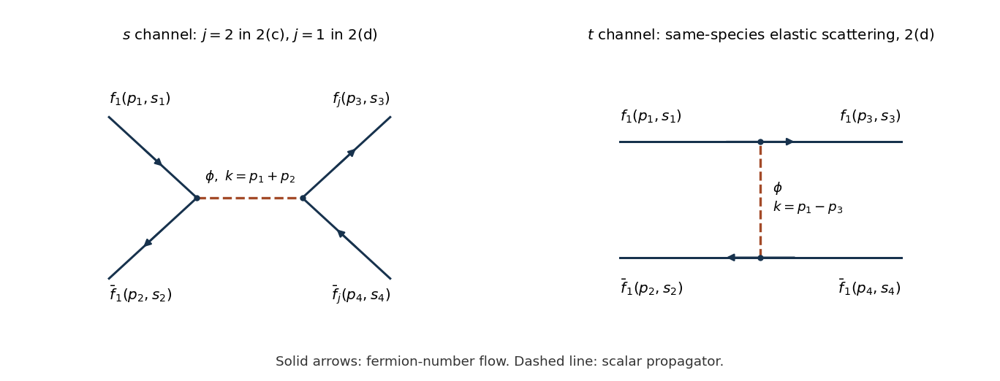

<h1 id="2/c/solution">Solution</h1>

↑ **Parent:** [C](../c.md)

Interpret the repeated species label in the [Yukawa interaction](../../../../yukawa-interaction.md) as summed over $i=1,2$: each [Feynman vertex](../../../../interaction-vertex.md) is diagonal in species and equals $-ig$. Define the [invariant scattering amplitude](../../../../invariant-scattering-amplitude.md) by $S-1=i(2\pi)^4\delta^{(4)}(P_f-P_i)\mathcal M$. There is one [tree-level Feynman diagram](../../../../tree-level-feynman-diagram.md), an $s$-channel scalar exchange. In the left panel, $j=2$ for this part; the right panel only occurs in [d](../d.md). Arrows show fermion-number flow, so an [antifermion](../../../../antifermion.md) arrow opposes its physical [momentum](../../../../momentum-split.md).

**[Figure 1](#2/c/image-labelled-scalar-exchange-annihilation-and-elastic-diagrams-with-arrows-following-fermion-number-flow). Labelled scalar-exchange annihilation and elastic diagrams, with arrows following fermion-number flow**.

Writing $k=p_1+p_2=p_3+p_4$ and $s=k^2$, the momentum-space [Feynman rules](../../../../feynman-rules.md) give

$$
i\mathcal M=[\bar v^{s_2}(p_2)(-ig)u^{s_1}(p_1)]\frac{i}{s-M^2+i0}[\bar u^{s_3}(p_3)(-ig)v^{s_4}(p_4)],
\qquad
\boxed{\mathcal M=-\frac{g^2[\bar v_2u_1][\bar u_3v_4]}{s-M^2+i0}.}
$$

The scalar carries no [spin](../../../../spin.md) label. Average over the $2\times2$ incoming [spin](../../../../spin.md) states and sum the four outgoing combinations. For the real scalar [Yukawa interaction](../../../../yukawa-interaction.md), the conjugate of $\bar v_2u_1$ is $\bar u_1v_2$. The [fermion spin sums](../../../../fermion-spin-sum.md) then yield

$$
\overline{|\mathcal M|^2}=\frac{g^4}{4(s-M^2)^2}\operatorname{tr}[(\not p_2-m)(\not p_1+m)]\operatorname{tr}[(\not p_3+m)(\not p_4-m)].
$$

The bar denotes the initial [spin average](../../../../spin-average.md), not a [Dirac adjoint](../../../../dirac-adjoint.md). The [gamma matrix trace identities](../../../../gamma-matrix-trace-identities.md) give

$$
\operatorname{tr}[(\not p_2-m)(\not p_1+m)]=4(p_1\cdot p_2-m^2)=2(s-4m^2),
$$

and the second [trace](../../../../matrix-trace.md) has the same value because $p_3+p_4=p_1+p_2$ and all external masses are $m$. Therefore

$$
\boxed{\overline{|\mathcal M|^2}=g^4\frac{(s-4m^2)^2}{(s-M^2)^2}=g^4\left(\frac{4m^2-s}{M^2-s}\right)^2.}
$$

This is the fixed-order expression away from $s=M^2$. If that [pole](../../../../pole.md) is accessible, a physical [scattering resonance](../../../../scattering-resonance.md) requires a scalar [self-energy](../../../../self-energy.md) and [decay width](../../../../decay-width.md); the tree formula alone is not finite there.

## ↑ Ancestors (12)

1. [C](../c.md)
2. [2](../../2.md)
3. [2024](../../../2024-split.md)
4. [Past exam of the quantum field theory course of the University of Oxford](../../../split.md)
5. [Quantum field theory course of the University of Oxford](../../../../quantum-field-theory-course-of-the-university-of-oxford.md)
6. [Year 4 of the mathematical and theoretical physics course of the University of Oxford](../../../../year-4-of-the-mathematical-and-theoretical-physics-course-of-the-university-of-oxford.md)
7. [Mathematical and theoretical physics course of the University of Oxford](../../../../mathematical-and-theoretical-physics-course-of-the-university-of-oxford.md)
8. [Undergraduate course of the University of Oxford](../../../../undergraduate-course-of-the-university-of-oxford.md)
9. [Course of the University of Oxford](../../../../course-of-the-university-of-oxford.md)
10. [University of Oxford](../../../../university-of-oxford-split.md)
11. [List of universities](../../../../list-of-universities.md)
12. [Codex Wiki](../../../../split.md)
