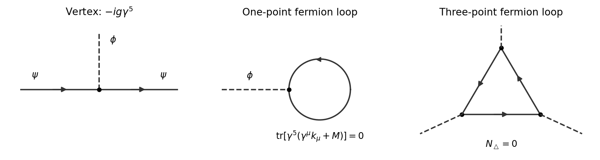
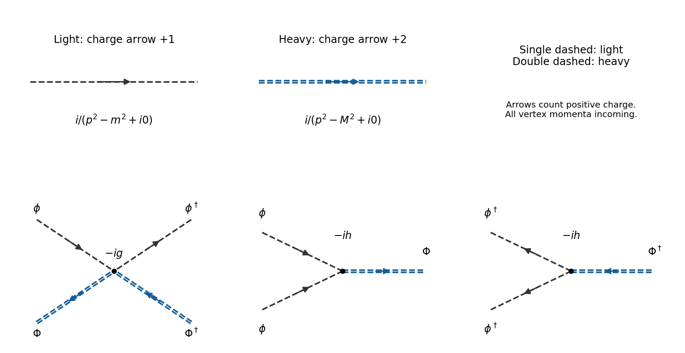
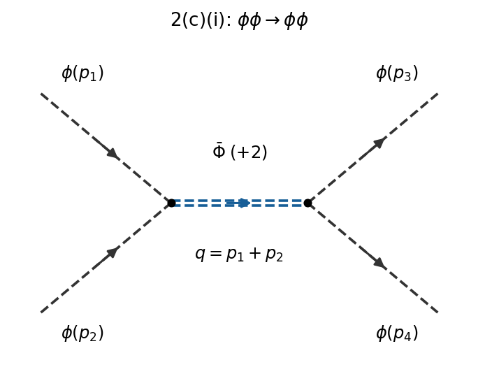
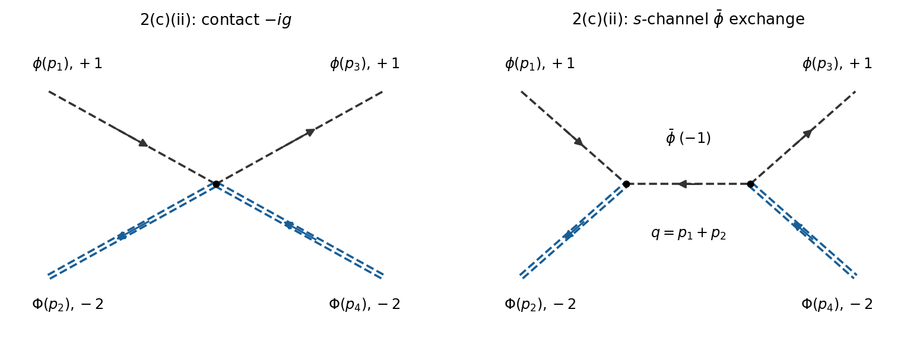
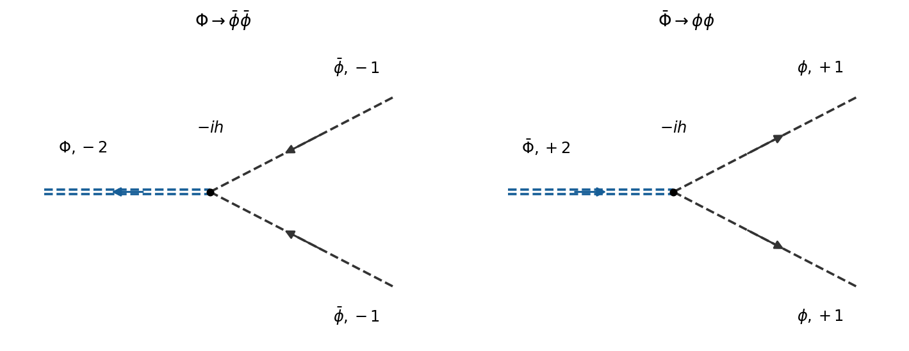

# 2025

↑ **Parent:** [Past exam of the quantum field theory course of the University of Oxford](../past-exam-of-the-quantum-field-theory-course-of-the-university-of-oxford.md)

Source PDF: [https://mmathphys.physics.ox.ac.uk/sites/g/files/vzsiac2991/files/mmathphys/documents/media/a15088h1.pdf](https://mmathphys.physics.ox.ac.uk/sites/g/files/vzsiac2991/files/mmathphys/documents/media/a15088h1.pdf)

The solutions use [natural units](../mathematical-physics.md#natural-units) $\hbar=c=1$ and the [Minkowski metric](../special-relativity.md#minkowski-metric) $\eta=\operatorname{diag}(1,-1,-1,-1)$. In question 1, $\gamma^5=\gamma^0\gamma^1\gamma^2\gamma^3$ is exactly the paper's convention: it contains no factor $i$. The qualifications in [iii](#2/c/iii), [d](#2/d) and [d](#3/d) distinguish the printed expressions from the results of [charge conservation](../electric-charge.md#charge-conservation), [identical final-state symmetry factors](../quantum-scattering.md#identical-particle-factor-in-a-final-state-phase-space-integral) and [fermionic time ordering](../perturbative-quantum-field-theory.md#fermionic-time-ordering).

**Table of contents**

- [1](#1)
  - [a](#1/a)
    - [Solution](#1/a/solution)
  - [b](#1/b)
    - [Solution](#1/b/solution)
  - [c](#1/c)
    - [Solution](#1/c/solution)
  - [d](#1/d)
    - [Solution](#1/d/solution)
- [2](#2)
  - [a](#2/a)
    - [Solution](#2/a/solution)
  - [b](#2/b)
    - [Solution](#2/b/solution)
  - [c](#2/c)
    - [i](#2/c/i)
      - [Solution](#2/c/i/solution)
    - [ii](#2/c/ii)
      - [Solution](#2/c/ii/solution)
    - [iii](#2/c/iii)
      - [Solution](#2/c/iii/solution)
  - [d](#2/d)
    - [Solution](#2/d/solution)
  - [e](#2/e)
    - [Solution](#2/e/solution)
- [3](#3)
  - [a](#3/a)
    - [Solution](#3/a/solution)
  - [b](#3/b)
    - [Solution](#3/b/solution)
  - [c](#3/c)
    - [Solution](#3/c/solution)
  - [d](#3/d)
    - [Solution](#3/d/solution)
  - [e](#3/e)
    - [Solution](#3/e/solution)

## 1

↑ **Parent:** [2025](2025.md)

<h3 id="1/a">a</h3>

↑ **Parent:** [1](#1)

<h4 id="1/a/solution">Solution</h4>

↑ **Parent:** [A](#1/a)

Distinct [gamma matrices](../algebra-over-a-field.md#gamma-matrices) anticommute, and $(\gamma^0)^2=I$, $(\gamma^j)^2=-I$ for $j=1,2,3$. Moving a particular $\gamma^\mu$ through the other three factors in $\gamma^5$ gives three minus signs. Therefore

$$
\boxed{\{\gamma^5,\gamma^\mu\}=0.}
$$

Pairing equal factors in the square involves $3+2+1=6$ interchanges. The [Clifford algebra](../algebra-over-a-field.md#clifford-algebra) consequently gives

$$
\boxed{(\gamma^5)^2=(-1)^6\prod_{\mu=0}^3(\gamma^\mu)^2=-I.}
$$

In particular $(\gamma^5)^{-1}=-\gamma^5$; replacing it by the conventional [chirality](../relativistic-quantum-field.md#chirality-physics) matrix would change this answer.

The [trace](../linear-algebra.md#matrix-trace) is unchanged by a [similarity transformation](../linear-algebra.md#similarity-transformation). Since $(\gamma^0)^{-1}=\gamma^0$ and $\gamma^0\gamma^5\gamma^0=-\gamma^5$, [cyclic property of the trace](../linear-algebra.md#cyclic-property-of-the-trace) gives $\operatorname{tr}\gamma^5=-\operatorname{tr}\gamma^5$. Also

$$
\operatorname{tr}(\gamma^5\gamma^\mu)=\operatorname{tr}(\gamma^\mu\gamma^5)=-\operatorname{tr}(\gamma^5\gamma^\mu).
$$

Thus

$$
\boxed{\operatorname{tr}\gamma^5=\operatorname{tr}(\gamma^5\gamma^\mu)=0.}
$$

<h3 id="1/b">b</h3>

↑ **Parent:** [1](#1)

<h4 id="1/b/solution">Solution</h4>

↑ **Parent:** [B](#1/b)

The [mass dimensions](../perturbative-quantum-field-theory.md#mass-dimension) are $[\phi]=1$, $[\psi]=3/2$, $[g]=0$. Up to [total derivatives](../calculus.md#total-derivative), [power counting](../perturbative-quantum-field-theory.md#power-counting-in-quantum-field-theory) allows local [counterterms](../perturbative-quantum-field-theory.md#counterterm) of [mass dimension](../perturbative-quantum-field-theory.md#mass-dimension) at most four. A convenient basis for the [counterterm Lagrangian](../perturbative-quantum-field-theory.md#counterterm-lagrangian) compatible with the actual [parity symmetry in quantum field theory](../quantum-field-theory.md#parity-symmetry-in-quantum-field-theory) and [Dirac fermion number conservation](../relativistic-quantum-field.md#dirac-fermion-number-conservation) is

$$
\boxed{\begin{aligned}
\mathcal L_{\rm ct}^{(+)}={}&-\delta\Lambda+\delta Z_\psi\bar\psi i\gamma^\mu\partial_\mu\psi-\delta M\bar\psi\psi
+\tfrac12\delta Z_\phi\partial_\mu\phi\partial^\mu\phi-\tfrac12\delta m^2\phi^2\\
&-\delta g\,\phi\bar\psi\gamma^5\psi-\frac{\delta\lambda}{4!}\phi^4.
\end{aligned}}
$$

The optional constant $\delta\Lambda$ renormalizes the [vacuum energy density](../perturbative-quantum-field-theory.md#vacuum-energy-density). The [wavefunction renormalization](../perturbative-quantum-field-theory.md#wave-function-renormalization), [mass counterterms](../perturbative-quantum-field-theory.md#mass-counterterm) and [Yukawa coupling](../standard-model.md#yukawa-interaction) renormalization correct the terms already present. The [quartic interaction](../scalar-field-theory.md#quartic-interaction) must also be included: the [fermion loop](../perturbative-quantum-field-theory.md#fermion-loop) with four external bosonic legs is logarithmically divergent, even if the [renormalized](../perturbative-quantum-field-theory.md#renormalization) quartic coupling is set to zero at one chosen [renormalization scale](../perturbative-quantum-field-theory.md#renormalization-scale). The displayed original interactions alone do not form a closed set of [counterterms](../perturbative-quantum-field-theory.md#counterterm).

If “most general” is interpreted before imposing the [parity symmetry in quantum field theory](../quantum-field-theory.md#parity-symmetry-in-quantum-field-theory) examined in [d](#1/d), [Lorentz invariance](../special-relativity.md#lorentz-invariance), a [Hermitian](../hilbert-space.md#hermitian-operator) [action](../lagrangian-mechanics.md#action) and [Dirac fermion number conservation](../relativistic-quantum-field.md#dirac-fermion-number-conservation) also allow

$$
\begin{aligned}
\mathcal L_{\rm ct}^{(-)}={}&-\delta t\,\phi-\frac{\delta\kappa}{3!}\phi^3-\delta y\,\phi\bar\psi\psi-\delta M_5\bar\psi\gamma^5\psi
+\delta Z_5\bar\psi\gamma^\mu\gamma^5\partial_\mu\psi.
\end{aligned}
$$

Here all coefficients can be real in the paper's [gamma matrix](../algebra-over-a-field.md#gamma-matrices) convention; the last term is Hermitian in the [action](../lagrangian-mechanics.md#action) up to a [total derivative](../calculus.md#total-derivative). It is an axial kinetic normalization, which could alternatively be removed by a suitable perturbative field redefinition. Every term in $\mathcal L_{\rm ct}^{(-)}$ is odd under the actual [parity symmetry in quantum field theory](../quantum-field-theory.md#parity-symmetry-in-quantum-field-theory), so its coefficient vanishes in a symmetry-preserving [renormalization scheme](../perturbative-quantum-field-theory.md#renormalization-scheme). Listing these terms makes explicit which assumption excludes a [tadpole counterterm](../perturbative-quantum-field-theory.md#tadpole-counterterm), a cubic scalar term, a scalar [Yukawa interaction](../standard-model.md#yukawa-interaction), a pseudoscalar [Dirac mass term](../relativistic-quantum-field.md#dirac-mass-term) and an axial kinetic term.

<h3 id="1/c">c</h3>

↑ **Parent:** [1](#1)

<h4 id="1/c/solution">Solution</h4>

↑ **Parent:** [C](#1/c)

Expanding $e^{iS_{\rm int}}$ gives the [Feynman vertex](../perturbative-quantum-field-theory.md#interaction-vertex)

$$
\boxed{V_{ab}=-ig(\gamma^5)_{ab}.}
$$

There is one scalar leg and a continuous oriented fermion line; no extra factor $i$ is absorbed into $\gamma^5$. The [Dirac propagator](../quantum-field-theory.md#dirac-propagator) is $S_F(k)=i(\not{k}+M)/(k^2-M^2+i0)$, where $\not{k}=\gamma^\mu k_\mu$. Each closed [fermion loop](../perturbative-quantum-field-theory.md#fermion-loop) supplies a minus sign.

**[Figure 1](#1/c/image-pseudoscalar-yukawa-vertex-and-the-vanishing-one-loop-bosonic-one-point-and-three-point-diagrams). Pseudoscalar Yukawa vertex and the vanishing one-loop bosonic one-point and three-point diagrams**.

The [tadpole diagram](../perturbative-quantum-field-theory.md#tadpole-diagram) is proportional to

$$
-\int\frac{d^4k}{(2\pi)^4}\operatorname{tr}\left[(-ig\gamma^5)\frac{i(\not{k}+M)}{k^2-M^2+i0}\right]=0,
$$

because both numerator [traces](../linear-algebra.md#matrix-trace) vanish by [a](#1/a). This is zero before the [loop momentum](../perturbative-quantum-field-theory.md#loop-momentum) integration.

For either orientation of the [triangle Feynman diagram](../perturbative-quantum-field-theory.md#triangle-feynman-diagram), let $a,b,c$ be its three internal [four-momenta](../special-relativity.md#four-momentum). Its numerator [trace](../linear-algebra.md#matrix-trace) is

$$
\begin{aligned}
N&=\operatorname{tr}\left[\gamma^5(\not{a}+M)\gamma^5(\not{b}+M)\gamma^5(\not{c}+M)\right]\\
&=\operatorname{tr}\left[(\not{a}-M)(\not{b}+M)\gamma^5(\not{c}+M)\right]=0.
\end{aligned}
$$

After using [cyclic property of the trace](../linear-algebra.md#cyclic-property-of-the-trace), each expanded term is a [trace](../linear-algebra.md#matrix-trace) of $\gamma^5$ times at most three ordinary [gamma matrices](../algebra-over-a-field.md#gamma-matrices). Such [traces](../linear-algebra.md#matrix-trace) vanish in four dimensions. For an odd number of ordinary [gamma matrices](../algebra-over-a-field.md#gamma-matrices), conjugation by $\gamma^5$ changes the sign. For two ordinary [gamma matrices](../algebra-over-a-field.md#gamma-matrices), the contracted [Clifford algebra](../algebra-over-a-field.md#clifford-algebra) identity $\gamma_\rho\gamma^\mu\gamma^\nu\gamma^\rho=4\eta^{\mu\nu}I$ gives

$$
4\operatorname{tr}(\gamma^5\gamma^\mu\gamma^\nu)=-4\eta^{\mu\nu}\operatorname{tr}\gamma^5=0.
$$

The zero-matrix case is [a](#1/a). Hence **both the one-point and three-point one-loop bosonic vertices vanish**, independently of their external [momenta](../momentum.md). No cancellation between different loop orientations or delicate shift of a divergent [integral](../integral.md) is needed.

<h3 id="1/d">d</h3>

↑ **Parent:** [1](#1)

<h4 id="1/d/solution">Solution</h4>

↑ **Parent:** [D](#1/d)

Writing $x_P=(t,-\mathbf x)$, the standard [parity transformation of a Dirac field](../quantum-field-theory.md#parity-transformation-of-a-dirac-field) is

$$
\boxed{\psi'(x)=\eta_P\gamma^0\psi(x_P),\qquad \bar\psi'(x)=\eta_P^*\bar\psi(x_P)\gamma^0,\qquad |\eta_P|=1.}
$$

Since $\gamma^0\gamma^5\gamma^0=-\gamma^5$, the [fermion bilinear](../relativistic-quantum-field.md#fermion-bilinear) $\bar\psi\gamma^5\psi$ changes sign. Invariance of the [pseudoscalar Yukawa interaction](../standard-model.md#pseudoscalar-yukawa-interaction) therefore requires

$$
\boxed{\phi'(x)=-\phi(x_P).}
$$

Thus $\phi$ is a [pseudoscalar](../quantum-mechanics.md#pseudoscalar), despite having the usual scalar-form [kinetic term](../classical-field-theory.md#kinetic-term) and [mass term](../classical-field-theory.md#mass-term). In this convention $(\gamma^5)^\dagger=-\gamma^5$, but $\bar\psi\gamma^5\psi$ is Hermitian because of the additional $\gamma^0$ in the [Dirac adjoint](../relativistic-quantum-field.md#dirac-adjoint). A real $g$ is consequently consistent with a Hermitian [Lagrangian density](../classical-field-theory.md#lagrangian-density).

In [perturbation theory](../asymptotic-expansion.md#perturbation-theory) about the parity-invariant [vacuum state](../quantum-field-theory.md#vacuum-state), [renormalization](../perturbative-quantum-field-theory.md#renormalization) can preserve this non-anomalous [parity symmetry in quantum field theory](../quantum-field-theory.md#parity-symmetry-in-quantum-field-theory). Every local [counterterm](../perturbative-quantum-field-theory.md#counterterm) must then be parity even, at every [loop order](../perturbative-quantum-field-theory.md#loop-order). The allowed terms are precisely $\mathcal L_{\rm ct}^{(+)}$ in [b](#1/b); all coefficients in $\mathcal L_{\rm ct}^{(-)}$ are zero. In particular, **no $\phi$ or $\phi^3$ counterterm is generated**, whereas $\phi^4$ is allowed and required. The one-point and three-point pure-boson vertices also vanish to all orders: a parity-odd [Lorentz scalar](../special-relativity.md#lorentz-scalar) cannot be formed from their at most two independent external [four-momenta](../special-relativity.md#four-momentum). This last reasoning is specific to these low-point vertices; it does not assert that [parity symmetry in quantum field theory](../quantum-field-theory.md#parity-symmetry-in-quantum-field-theory) is an independent $\phi\mapsto-\phi$ internal symmetry with the fermions held fixed.

## 2

↑ **Parent:** [2025](2025.md)

For the [complex scalar fields](../scalar-field-theory.md#complex-scalar-field), use the conventional [particle](../physics.md#particle-physics) names: $\phi$ annihilates a light $\phi$ particle and creates a light [antiparticle](../relativistic-quantum-field.md#antiparticle) $\bar\phi$; $\Phi$ annihilates a heavy $\Phi$ particle and creates $\bar\Phi$. These choices make the distinction between [particle](../physics.md#particle-physics) labels and field symbols explicit throughout [ii](#2/c/ii) and [iii](#2/c/iii). The couplings $g,h$ are real as required by the printed Hermitian [Lagrangian density](../classical-field-theory.md#lagrangian-density).

<h3 id="2/a">a</h3>

↑ **Parent:** [2](#2)

<h4 id="2/a/solution">Solution</h4>

↑ **Parent:** [A](#2/a)

Independent [global phase symmetries](../classical-field-theory.md#global-phase-symmetry) would rotate $\phi\mapsto e^{-i\alpha}\phi$ and $\Phi\mapsto e^{-i\beta}\Phi$. The cubic [interaction vertex](../perturbative-quantum-field-theory.md#interaction-vertex) preserves only $2\alpha+\beta=0$ modulo $2\pi$. The continuous [internal symmetry of a classical field theory](../classical-field-theory.md#internal-symmetry-of-a-classical-field-theory) is therefore the [circle group](../lie-theory.md#circle-group)

$$
\boxed{U(1):\quad\phi\mapsto e^{-i\alpha}\phi,\qquad\Phi\mapsto e^{2i\alpha}\Phi.}
$$

Normalize the [Noether charge](../classical-field-theory.md#noether-charge) so that $q_\phi=1$. Then $q_\Phi=-2$, $q_{\bar\phi}=-1$ and $q_{\bar\Phi}=2$. The [Noether current](../classical-field-theory.md#noether-current) is

$$
\boxed{j^\mu=i\phi^\dagger\overleftrightarrow{\partial^\mu}\phi-2i\Phi^\dagger\overleftrightarrow{\partial^\mu}\Phi,\qquad\partial_\mu j^\mu=0,}
$$

where $A\overleftrightarrow\partial B=A\partial B-(\partial A)B$. For example, the [Euler-Lagrange field equations](../classical-field-theory.md#euler-lagrange-field-equation) give

$$
\partial_\mu(i\phi^\dagger\overleftrightarrow{\partial^\mu}\phi)=ih(\phi^2\Phi-\phi^{\dagger2}\Phi^\dagger),\qquad
\partial_\mu(i\Phi^\dagger\overleftrightarrow{\partial^\mu}\Phi)=\frac{ih}{2}(\phi^2\Phi-\phi^{\dagger2}\Phi^\dagger),
$$

which cancel with the relative coefficient $-2$. The quartic [interaction vertex](../perturbative-quantum-field-theory.md#interaction-vertex) separately preserves both original phase rotations.

There is also a discrete [charge conjugation](../quantum-field-theory.md#charge-conjugation) symmetry $(\phi,\Phi)\mapsto(\phi^\dagger,\Phi^\dagger)$ for these real couplings. Including it, the internal symmetry is $U(1)\rtimes\mathbb Z_2\cong O(2)$, with [charge conjugation](../quantum-field-theory.md#charge-conjugation) reversing the [Noether charge](../classical-field-theory.md#noether-charge). The connected symmetry and its [conserved current](../classical-field-theory.md#conserved-current) are the $U(1)$ above.

<h3 id="2/b">b</h3>

↑ **Parent:** [2](#2)

<h4 id="2/b/solution">Solution</h4>

↑ **Parent:** [B](#2/b)

The nonzero free [scalar propagators](../scalar-field-theory.md#scalar-propagator) join a field to its adjoint:

$$
\boxed{\langle T\phi\phi^\dagger\rangle(p)=\frac{i}{p^2-m^2+i0},\qquad \langle T\Phi\Phi^\dagger\rangle(p)=\frac{i}{p^2-M^2+i0}.}
$$

Contractions $\langle T\phi\phi\rangle$, $\langle T\Phi\Phi\rangle$ and mixed-species contractions vanish. With all [momenta](../momentum.md) incoming, the [Feynman vertices](../perturbative-quantum-field-theory.md#interaction-vertex) are

$$
\boxed{V_{\phi\phi^\dagger\Phi\Phi^\dagger}=-ig,\qquad V_{\phi\phi\Phi}=-ih,\qquad V_{\phi^\dagger\phi^\dagger\Phi^\dagger}=-ih.}
$$

The two identical light legs cancel the $1/2!$ in each cubic [interaction vertex](../perturbative-quantum-field-theory.md#interaction-vertex); there is no remaining factor $1/2$ in its [Feynman rule](../perturbative-quantum-field-theory.md#feynman-rule). Multiply each [Feynman vertex](../perturbative-quantum-field-theory.md#interaction-vertex) by $(2\pi)^4\delta^{(4)}(\sum p)$, and integrate an internal unconstrained [four-momentum](../special-relativity.md#four-momentum) with $d^4p/(2\pi)^4$.

**[Figure 2](#2/b/image-charged-scalar-propagators-and-vertices-with-arrows-following-positive-conserved-charge-and-heavy-arrows-carrying-two-units). Charged scalar propagators and vertices, with arrows following positive conserved charge and heavy arrows carrying two units**.

The arrows in the figure follow positive [Noether charge](../classical-field-theory.md#noether-charge): a light arrow carries one unit and a heavy arrow two. Consequently a heavy [particle](../physics.md#particle-physics) $\Phi$ travels opposite its charge arrow, whereas its [antiparticle](../relativistic-quantum-field.md#antiparticle) $\bar\Phi$ travels along it. At a $\phi^2\Phi$ [Feynman vertex](../perturbative-quantum-field-theory.md#interaction-vertex), two unit-charge arrows enter and a two-unit arrow leaves; the conjugate [Feynman vertex](../perturbative-quantum-field-theory.md#interaction-vertex) reverses every arrow. The quartic [Feynman vertex](../perturbative-quantum-field-theory.md#interaction-vertex) has one incoming and one outgoing arrow of each weight. These rules prevent attaching a [propagator](../quantum-field-theory.md#propagator) between two unconjugated fields.

<h3 id="2/c">c</h3>

↑ **Parent:** [2](#2)

<h4 id="2/c/i">i</h4>

↑ **Parent:** [C](#2/c)

<h5 id="2/c/i/solution">Solution</h5>

↑ **Parent:** [I](#2/c/i)

Let $p_1,p_2$ be the incoming and $p_3,p_4$ the outgoing [four-momenta](../special-relativity.md#four-momentum), and set $s=(p_1+p_2)^2$, $t=(p_1-p_3)^2$, $u=(p_1-p_4)^2$, the [Mandelstam variables](../special-relativity.md#mandelstam-variables). The only connected [tree-level Feynman diagram](../perturbative-quantum-field-theory.md#tree-level-feynman-diagram) is the $s$-channel exchange of $\bar\Phi$, with [Noether charge](../classical-field-theory.md#noether-charge) $+2$. The two incoming light [particles](../physics.md#particle-physics) attach to $\phi^2\Phi$, and the two outgoing light [particles](../physics.md#particle-physics) to its conjugate. There is no four-light contact [Feynman vertex](../perturbative-quantum-field-theory.md#interaction-vertex), nor a charge-allowed $t$ or $u$ exchange with these external labels.

**[Figure 3](#2/c/i/image-light-particle-scattering-through-a-heavy-antiparticle-in-the-s-channel). Light-particle scattering through a heavy antiparticle in the s channel**.

Define the [invariant scattering amplitude](../quantum-scattering.md#invariant-scattering-amplitude) by $\langle f|S-1|i\rangle=i(2\pi)^4\delta^{(4)}(P_f-P_i)\mathcal M$. Then

$$
i\mathcal M=(-ih)\frac{i}{s-M^2+i0}(-ih),\qquad
\boxed{\mathcal M(\phi\phi\to\phi\phi)=-\frac{h^2}{s-M^2+i0}.}
$$

The [Feynman vertices](../perturbative-quantum-field-theory.md#interaction-vertex) already contain the identical-leg combinatorics. No extra factor of two multiplies this [invariant scattering amplitude](../quantum-scattering.md#invariant-scattering-amplitude); the distinct [identical final-state symmetry factor](../quantum-scattering.md#identical-particle-factor-in-a-final-state-phase-space-integral) enters a [cross section](../physics.md#cross-section-physics) integral.

<h4 id="2/c/ii">ii</h4>

↑ **Parent:** [C](#2/c)

<h5 id="2/c/ii/solution">Solution</h5>

↑ **Parent:** [Ii](#2/c/ii)

Keep the [particle](../physics.md#particle-physics) labels specified under [2](#2). There are two connected [tree-level Feynman diagrams](../perturbative-quantum-field-theory.md#tree-level-feynman-diagram): the quartic contact [interaction vertex](../perturbative-quantum-field-theory.md#interaction-vertex) and an $s$-channel light [antiparticle](../relativistic-quantum-field.md#antiparticle) exchange. The initial [Noether charge](../classical-field-theory.md#noether-charge) is $1-2=-1$, exactly the charge of $\bar\phi$. At the first cubic [Feynman vertex](../perturbative-quantum-field-theory.md#interaction-vertex), the incoming $\phi$ and $\Phi$ leave the second $\phi$ leg internal; the conjugate [Feynman vertex](../perturbative-quantum-field-theory.md#interaction-vertex) supplies both outgoing [particles](../physics.md#particle-physics).

**[Figure 4](#2/c/ii/image-scattering-of-a-light-particle-and-a-heavy-particle-with-contact-and-s-channel-light-antiparticle-exchange-diagrams). Scattering of a light particle and a heavy particle, with contact and s-channel light-antiparticle exchange diagrams**.

Thus

$$
i\mathcal M=-ig+(-ih)\frac{i}{s-m^2+i0}(-ih),\qquad
\boxed{\mathcal M(\phi\Phi\to\phi\Phi)=-g-\frac{h^2}{s-m^2+i0}.}
$$

Here $s=(p_1+p_2)^2$ for incoming $\phi(p_1),\Phi(p_2)$. Both terms have the same sign in the chosen [S-matrix](../quantum-scattering.md#s-matrix) convention.

The distinction from [antiparticles](../relativistic-quantum-field.md#antiparticle) matters. If the paper's heavy “$\Phi$ particle” is instead intended to mean the charge-$+2$ state $\bar\Phi$, so that its printed decay into $\phi\phi$ is allowed, the exchange diagram is crossed. For that alternative physical process,

$$
\boxed{\mathcal M(\phi\bar\Phi\to\phi\bar\Phi)=-g-\frac{h^2}{u-m^2+i0},\qquad u=(p_1-p_4)^2.}
$$

This is a consistent alternative naming convention only if it is also applied to the decay in [iii](#2/c/iii); one cannot use the same heavy [particle](../physics.md#particle-physics) label for both charge assignments.

<h4 id="2/c/iii">iii</h4>

↑ **Parent:** [C](#2/c)

<h5 id="2/c/iii/solution">Solution</h5>

↑ **Parent:** [Iii](#2/c/iii)

With the conventional [particle](../physics.md#particle-physics) labels, the allowed cubic [decay channels](../physics.md#decay-channel) are

$$
\boxed{\Phi\to\bar\phi\bar\phi,\qquad\bar\Phi\to\phi\phi,\qquad\mathcal M=-h\quad\hbox{for either channel}.}
$$

Each has one [tree-level Feynman diagram](../perturbative-quantum-field-theory.md#tree-level-feynman-diagram), consisting of one cubic [Feynman vertex](../perturbative-quantum-field-theory.md#interaction-vertex). The final identical-leg contractions supply $2!$ and cancel the $1/2!$ in the [Lagrangian density](../classical-field-theory.md#lagrangian-density).

**[Figure 5](#2/c/iii/image-the-two-charge-conjugate-heavy-scalar-decays-with-explicit-antiparticle-labels-and-conserved-charge-arrows). The two charge-conjugate heavy-scalar decays, with explicit antiparticle labels and conserved charge arrows**.

Taken literally with these labels, **the printed $\Phi\to\phi\phi$ channel is forbidden**: its initial [Noether charge](../classical-field-theory.md#noether-charge) is $-2$ and its final [Noether charge](../classical-field-theory.md#noether-charge) is $+2$. Its [decay amplitude](../relativistic-quantum-field.md#decay-amplitude) is zero, at every order preserving the [global phase symmetry](../classical-field-theory.md#global-phase-symmetry). If the source uses “$\Phi$” to name the heavy [antiparticle](../relativistic-quantum-field.md#antiparticle) instead, its intended answer is the nonzero [decay amplitude](../relativistic-quantum-field.md#decay-amplitude) $-h$ for $\bar\Phi\to\phi\phi$. The following [decay width](../relativistic-quantum-field.md#decay-width) calculation concerns either allowed channel, whose widths are equal by [charge conjugation](../quantum-field-theory.md#charge-conjugation).

<h3 id="2/d">d</h3>

↑ **Parent:** [2](#2)

<h4 id="2/d/solution">Solution</h4>

↑ **Parent:** [D](#2/d)

For an allowed [decay channel](../physics.md#decay-channel) in [iii](#2/c/iii), $|\mathcal M|^2=h^2$. Integrating the spatial [Dirac delta distribution](../distribution-theory.md#dirac-delta-function) in the printed [Lorentz-invariant phase-space measure](../quantum-scattering.md#lorentz-invariant-phase-space-measure) sets $\mathbf p_2=-\mathbf p_1$. With $p=|\mathbf p_1|$ and $E_p=\sqrt{p^2+m^2}$, its remaining value is

$$
\begin{aligned}
I_2&=\int d\Phi_2=\frac1{4(2\pi)^2}\int\frac{d^3\mathbf p}{E_p^2}\,\delta(2E_p-M)\\
&=\frac1{4\pi}\int_0^\infty\frac{p^2\,dp}{E_p^2}\,\delta(2E_p-M).
\end{aligned}
$$

The positive root is $p_*=(M/2)\beta$, where $\beta=\sqrt{1-4m^2/M^2}$, and the [Dirac delta distribution](../distribution-theory.md#dirac-delta-function) contributes the [Jacobian determinant](../multivariable-calculus.md#jacobian-determinant) $E_*/(2p_*)$. Hence

$$
I_2=\frac{p_*}{8\pi E_*}=\frac{\beta}{8\pi},\qquad E_*=\frac M2.
$$

It follows that the **literal printed integral** evaluates to

$$
\boxed{\Gamma_{\rm printed}=\frac{h^2}{16\pi M}\sqrt{1-\frac{4m^2}{M^2}}.}
$$

The printed integration ranges count each final configuration twice, once as $(\mathbf p_1,\mathbf p_2)$ and once in the opposite order. For two identical final [bosons](../tensor-product-of-quantum-systems.md#boson), the physical [decay width](../relativistic-quantum-field.md#decay-width) therefore requires an additional [identical final-state symmetry factor](../quantum-scattering.md#identical-particle-factor-in-a-final-state-phase-space-integral) $1/2!$:

$$
\boxed{\Gamma_{\rm phys}=\frac{h^2}{32\pi M}\sqrt{1-\frac{4m^2}{M^2}}\simeq\frac{h^2}{32\pi M}\quad(M\gg m).}
$$

There is one allowed [decay channel](../physics.md#decay-channel) per heavy [particle](../physics.md#particle-physics), not an extra factor of two from summing the two charge-conjugate heavy species. Both expressions vanish below the [two-body decay threshold](../special-relativity.md#two-body-decay-threshold) $M=2m$, and the limiting value at threshold is zero. For the literally forbidden labels $\Phi\to\phi\phi$, the [decay width](../relativistic-quantum-field.md#decay-width) is instead zero because its [decay amplitude](../relativistic-quantum-field.md#decay-amplitude) vanishes, as explained in [iii](#2/c/iii).

<h3 id="2/e">e</h3>

↑ **Parent:** [2](#2)

<h4 id="2/e/solution">Solution</h4>

↑ **Parent:** [E](#2/e)

For $g=0$, the [invariant scattering amplitude](../quantum-scattering.md#invariant-scattering-amplitude) from the [tree-level Feynman diagram](../perturbative-quantum-field-theory.md#tree-level-feynman-diagram) in [i](#2/c/i) has a [pole](../isolated-singularity.md#pole) at $s=M^2$. The intermediate heavy [antiparticle](../relativistic-quantum-field.md#antiparticle) can go on shell and live for a time of order its [mean lifetime](../relativistic-quantum-field.md#mean-lifetime-physics). Near this [scattering resonance](../quantum-scattering.md#scattering-resonance), inserting a single [self-energy](../perturbative-quantum-field-theory.md#self-energy) is no longer a uniformly small correction. [Dyson resummation](../perturbative-quantum-field-theory.md#dyson-resummation) gives, to leading accuracy in a narrow [decay width](../relativistic-quantum-field.md#decay-width),

$$
\boxed{\mathcal M(s)\simeq-\frac{h^2}{s-M^2+iM\Gamma_{\rm phys}}.}
$$

Here $M$ is understood as the [renormalized](../perturbative-quantum-field-theory.md#renormalization) resonance mass; the real [self-energy](../perturbative-quantum-field-theory.md#self-energy) shifts the original pole position. The imaginary term removes the unphysical divergence of the fixed-order [invariant scattering amplitude](../quantum-scattering.md#invariant-scattering-amplitude).

For equal incoming and outgoing light masses, the two-body [momentum](../momentum.md) ratio cancels in the [cross section](../physics.md#cross-section-physics). The angle-independent [invariant scattering amplitude](../quantum-scattering.md#invariant-scattering-amplitude), integrated over the full solid angle with the [identical final-state symmetry factor](../quantum-scattering.md#identical-particle-factor-in-a-final-state-phase-space-integral) $1/2!$, gives $\sigma=|\mathcal M|^2/(32\pi s)$. Thus the [Breit-Wigner resonance cross section](../quantum-scattering.md#breit-wigner-resonance-cross-section) is

$$
\boxed{\sigma(s)\simeq\frac{h^4}{32\pi s\left[(s-M^2)^2+M^2\Gamma_{\rm phys}^2\right]},\qquad
\Gamma_{\rm phys}=\frac{h^2\beta}{32\pi M}.}
$$

At $s\gg M^2$ it reproduces $h^4/(32\pi s^3)$. At the resonance peak,

$$
\boxed{\sigma(M^2)\simeq\frac{32\pi}{M^2\beta^2}\simeq\frac{32\pi}{M^2}\quad(M\gg m).}
$$

This is also $8\pi/k_*^2$ for $k_*=M\beta/2$, the elastic identical-boson [S wave](../wave-equation.md#s-wave) [partial-wave unitarity](../quantum-scattering.md#partial-wave-unitarity) limit when this is the only open [decay channel](../physics.md#decay-channel). The approximation assumes $\Gamma_{\rm phys}\ll M$ and a resonance sufficiently far from threshold for the width to vary slowly across it.

If one mechanically uses the unsymmetrized $\Gamma_{\rm printed}=2\Gamma_{\rm phys}$ from [d](#2/d), the same displayed [Breit-Wigner resonance cross section](../quantum-scattering.md#breit-wigner-resonance-cross-section) would have that doubled width and predict a peak $8\pi/(M^2\beta^2)$. This is the literal-width substitution, rather than the consistent physical result: the given high-energy [cross section](../physics.md#cross-section-physics) already includes the identical-final-particle factor that the printed [decay width](../relativistic-quantum-field.md#decay-width) integral omits.

## 3

↑ **Parent:** [2025](2025.md)

<h3 id="3/a">a</h3>

↑ **Parent:** [3](#3)

<h4 id="3/a/solution">Solution</h4>

↑ **Parent:** [A](#3/a)

For three odd [fermionic operators](../supersymmetric-quantum-mechanics.md#fermionic-operator), the identity

$$
[A,BC]=\{A,B\}C-B\{A,C\}
$$

converts the [commutator](../lie-algebra.md#commutator) with a quadratic [Hamiltonian](../hamiltonian-mechanics.md#hamiltonian) into the given [canonical anticommutation relations](../supersymmetric-quantum-mechanics.md#canonical-anticommutation-relations). Writing a mode label as $i=(\mathbf p,s)$, this yields

$$
[a_i,a_j^\dagger a_j]=\delta_{ij}a_j,\qquad
[b_i^\dagger,b_j^\dagger b_j]=-\delta_{ij}b_j^\dagger.
$$

The opposite-species number terms commute with each [fermionic creation operator](../relativistic-quantum-field.md#fermionic-creation-operator) or [fermionic annihilation operator](../relativistic-quantum-field.md#fermionic-annihilation-operator), because two anticommutations give a positive sign. Restoring the continuous normalization, the [Dirac delta distribution](../distribution-theory.md#dirac-delta-function) in the mode brackets cancels $d^3\mathbf q/(2\pi)^3$. Consequently

$$
\boxed{[a^s_{\mathbf p},H]=E_{\mathbf p}a^s_{\mathbf p},\qquad[b^{s\dagger}_{\mathbf p},H]=-E_{\mathbf p}b^{s\dagger}_{\mathbf p}.}
$$

Substitute these into the [mode expansion of a Dirac field](../relativistic-quantum-field.md#mode-expansion-of-a-dirac-field). The result is

$$
[\psi(x),H]=\int\frac{d^3\mathbf p}{(2\pi)^3\sqrt{2E_{\mathbf p}}}\sum_s E_{\mathbf p}
\left[e^{-ip\cdot x}a^s_{\mathbf p}u^s(\mathbf p)-e^{ip\cdot x}b^{s\dagger}_{\mathbf p}v^s(\mathbf p)\right].
$$

Since $i\partial_t e^{-ip\cdot x}=E_{\mathbf p}e^{-ip\cdot x}$ and $i\partial_t e^{ip\cdot x}=-E_{\mathbf p}e^{ip\cdot x}$, this is exactly

$$
\boxed{i\partial_t\psi(t,\mathbf x)=[\psi(t,\mathbf x),H].}
$$

The [Heisenberg equation of motion](../quantum-system.md#heisenberg-equation-of-motion) uses an ordinary [commutator](../lie-algebra.md#commutator) with the even [Hamiltonian](../hamiltonian-mechanics.md#hamiltonian), despite the odd [fermionic operators](../supersymmetric-quantum-mechanics.md#fermionic-operator) obeying [anticommutators](../vector-space.md#anticommutator) among themselves.

<h3 id="3/b">b</h3>

↑ **Parent:** [3](#3)

<h4 id="3/b/solution">Solution</h4>

↑ **Parent:** [B](#3/b)

The [canonical anticommutation relations](../supersymmetric-quantum-mechanics.md#canonical-anticommutation-relations) give $\{a_1^\dagger,a_2^\dagger\}=0$, where each label includes both [momentum](../momentum.md) and [spin](../angular-momentum-operator.md#spin). Therefore

$$
|2,1\rangle=a_2^\dagger a_1^\dagger|0\rangle=-a_1^\dagger a_2^\dagger|0\rangle=-|1,2\rangle.
$$

Thus **exchanging the complete labels of the two identical [fermions](../tensor-product-of-quantum-systems.md#fermion) changes the sign of their state**. If the labels coincide, $(a_1^\dagger)^2=0$; the state vanishes, which is the [Pauli exclusion principle](../tensor-product-of-quantum-systems.md#pauli-exclusion-principle). A negative state vector describes the same isolated physical ray, but its relative sign matters when exchange alternatives interfere.

<h3 id="3/c">c</h3>

↑ **Parent:** [3](#3)

<h4 id="3/c/solution">Solution</h4>

↑ **Parent:** [C](#3/c)

For $i<j$, interchange the entries in slots $i,j$ while preserving the order of all intermediate [fermionic creation operators](../relativistic-quantum-field.md#fermionic-creation-operator). Move $a_j^\dagger$ left through $j-i$ factors, then move $a_i^\dagger$ right through the remaining $j-i-1$ intermediate factors. The [canonical anticommutation relations](../supersymmetric-quantum-mechanics.md#canonical-anticommutation-relations) give the overall [fermionic sign](../perturbative-quantum-field-theory.md#fermionic-sign)

$$
(-1)^{(j-i)+(j-i-1)}=(-1)^{2(j-i)-1}=-1.
$$

Hence

$$
\boxed{|1,\ldots,j,\ldots,i,\ldots,n\rangle=-|1,\ldots,i,\ldots,j,\ldots,n\rangle.}
$$

More generally any [permutation](../combinatorics.md#permutation) $\pi$ gives

$$
\boxed{|\pi(1),\ldots,\pi(n)\rangle=\operatorname{sgn}(\pi)|1,\ldots,n\rangle.}
$$

The [sign of a permutation](../finite-group-theory.md#sign-of-a-permutation) is independent of its decomposition into adjacent interchanges. Thus the $n$-[particle](../physics.md#particle-physics) sector is an [exterior power](../multilinear-algebra.md#exterior-power) of the one-[particle](../physics.md#particle-physics) state space, the defining antisymmetry of [fermionic Fock space](../supersymmetric-quantum-mechanics.md#fermionic-fock-space). Repeated complete mode labels make the state zero, so they satisfy the same identity trivially.

<h3 id="3/d">d</h3>

↑ **Parent:** [3](#3)

<h4 id="3/d/solution">Solution</h4>

↑ **Parent:** [D](#3/d)

Put $z=x-y$ and $d\Pi_p=d^3\mathbf p/[(2\pi)^3 2E_{\mathbf p}]$. The [Dirac adjoint](../relativistic-quantum-field.md#dirac-adjoint) of the printed [mode expansion of a Dirac field](../relativistic-quantum-field.md#mode-expansion-of-a-dirac-field) is

$$
\bar\psi_a(x)=\int\frac{d^3\mathbf p}{(2\pi)^3\sqrt{2E_{\mathbf p}}}\sum_s
\left[e^{ip\cdot x}a^{s\dagger}_{\mathbf p}\bar u_a^s(\mathbf p)+e^{-ip\cdot x}b^s_{\mathbf p}\bar v_a^s(\mathbf p)\right].
$$

The [Fock vacuum](../quantum-field-theory.md#fock-vacuum) is annihilated by $a,b$. The [canonical anticommutation relations](../supersymmetric-quantum-mechanics.md#canonical-anticommutation-relations) therefore give the two non-time-ordered [vacuum expectation values](../quantum-field-theory.md#vacuum-expectation-value)

$$
\begin{aligned}
\langle0|\bar\psi_a(x)\psi_b(y)|0\rangle&=\int d\Pi_p\,e^{-ip\cdot z}\sum_s\bar v_a^s(\mathbf p)v_b^s(\mathbf p),\\
\langle0|\psi_b(y)\bar\psi_a(x)|0\rangle&=\int d\Pi_p\,e^{ip\cdot z}\sum_s\bar u_a^s(\mathbf p)u_b^s(\mathbf p).
\end{aligned}
$$

In the first line, the only surviving contraction is $\langle b b^\dagger\rangle$; in the second it is $\langle a a^\dagger\rangle$. Both of these unordered contractions have positive coefficients.

However, [fermionic time ordering](../perturbative-quantum-field-theory.md#fermionic-time-ordering) includes a minus sign when it interchanges two odd fields:

$$
T\bar\psi_a(x)\psi_b(y)=\theta(z^0)\bar\psi_a(x)\psi_b(y)-\theta(-z^0)\psi_b(y)\bar\psi_a(x).
$$

Thus the result following from the stated [canonical anticommutation relations](../supersymmetric-quantum-mechanics.md#canonical-anticommutation-relations) and standard [time ordering](../perturbative-quantum-field-theory.md#time-ordering) is

$$
\boxed{\begin{aligned}
C_{ab}(x,y)&\equiv\langle0|T\bar\psi_a(x)\psi_b(y)|0\rangle\\
&=\int d\Pi_p\left[\theta(z^0)e^{-ip\cdot z}\sum_s\bar v_a^s v_b^s
-\theta(-z^0)e^{ip\cdot z}\sum_s\bar u_a^s u_b^s\right].
\end{aligned}}
$$

**The second term printed with a plus sign is not correct for standard [fermionic time ordering](../perturbative-quantum-field-theory.md#fermionic-time-ordering).** Its plus-plus expression would be an ungraded chronological product. The missing minus cannot be absorbed by a phase choice for $u$ or $v$, since each [spin sum](../relativistic-quantum-field.md#spin-sum) contains a spinor and its adjoint.

For comparison with the conventional [Dirac propagator](../quantum-field-theory.md#dirac-propagator), define $S_F(w)_{ba}=\langle0|T\psi_b(w)\bar\psi_a(0)|0\rangle$ and let $\mu$ denote this free [Dirac field](../relativistic-quantum-field.md#dirac-field)'s mass. Then

$$
\boxed{C_{ab}(x,y)=-S_F(y-x)_{ba}
=-\int\frac{d^4p}{(2\pi)^4}\frac{i(\not{p}+\mu)_{ba}}{p^2-\mu^2+i0}\,e^{-ip\cdot(y-x)}.}
$$

The exchange of the spinor indices is essential: $\bar v_a v_b$ is the $(b,a)$ component of $v\bar v$, not its $(a,b)$ component.

<h3 id="3/e">e</h3>

↑ **Parent:** [3](#3)

<h4 id="3/e/solution">Solution</h4>

↑ **Parent:** [E](#3/e)

The corrected expression in [d](#3/d) is a [vacuum two-point function](../critical-phenomenon.md#vacuum-two-point-function), or [Wick contraction](../perturbative-quantum-field-theory.md#wick-contraction), of the free [Dirac field](../relativistic-quantum-field.md#dirac-field). It equals the negative spinor transpose of the usual [Dirac propagator](../quantum-field-theory.md#dirac-propagator) with reversed spacetime arguments. It supplies the internal fermion lines in [Feynman diagrams](../perturbative-quantum-field-theory.md#feynman-diagram), rather than a position-space detection probability.

For $x^0>y^0$, $\psi(y)$ creates an [antiparticle](../relativistic-quantum-field.md#antiparticle) and $\bar\psi(x)$ annihilates it. The $v\bar v$ term describes positive-energy [antiparticle](../relativistic-quantum-field.md#antiparticle) propagation from $y$ to $x$. For $y^0>x^0$, $\bar\psi(x)$ creates a [particle](../physics.md#particle-physics) and $\psi(y)$ annihilates it. The $u\bar u$ term describes positive-energy [particle](../physics.md#particle-physics) propagation from $x$ to $y$, with the minus sign required by exchanging the odd operators in [fermionic time ordering](../perturbative-quantum-field-theory.md#fermionic-time-ordering). Neither term describes a physical negative-energy excitation.

The [Heaviside step functions](../integral-transform.md#heaviside-step-function) select these chronological alternatives. The factors $e^{\mp ip\cdot z}$ are on-shell plane waves with $p^0=E_{\mathbf p}>0$, and $d\Pi_p$ is the positive-energy [Lorentz-invariant phase-space measure](../quantum-scattering.md#lorentz-invariant-phase-space-measure). The sum over $s$ includes the two [spin](../angular-momentum-operator.md#spin) states. With standard relativistic spinor normalization, the [fermion spin sums](../relativistic-quantum-field.md#fermion-spin-sum) are

$$
\sum_s u^s(\mathbf p)\bar u^s(\mathbf p)=\not{p}+\mu,\qquad
\sum_s v^s(\mathbf p)\bar v^s(\mathbf p)=\not{p}-\mu.
$$

They encode the [spinor](../algebra-over-a-field.md#spinor) structure and solve the corresponding on-shell [Dirac equations](../relativistic-quantum-field.md#dirac-equation). In particular, the corrected answer can also be written

$$
C_{ab}(x,y)=\int\frac{d^4p}{(2\pi)^4}\frac{i(\not{p}-\mu)_{ba}}{p^2-\mu^2+i0}\,e^{-ip\cdot(x-y)}.
$$

The [Feynman i-epsilon prescription](../quantum-field-theory.md#feynman-i-epsilon-prescription) specifies the temporal boundary conditions of the [Green function](../green-s-function.md); its positive- and negative-frequency residues reproduce the two terms and their relative minus sign. With $S_F$ defined in [d](#3/d),

$$
(i\not{\partial}-\mu)S_F(w)=i\delta^{(4)}(w)I.
$$

The contact term is fixed by the equal-time [canonical anticommutation relations](../supersymmetric-quantum-mechanics.md#canonical-anticommutation-relations). Choosing a value for $\theta(0)$ does not change the unequal-time sign demonstrated above.

Finally, [microcausality](../relativistic-quantum-field.md#microcausality) requires field [anticommutators](../vector-space.md#anticommutator) to vanish at spacelike separation; the time-ordered [vacuum two-point function](../critical-phenomenon.md#vacuum-two-point-function) itself need not vanish there. These facts are compatible with relativistic causality. The plus-plus expression printed in the paper lacks the [fermionic sign](../perturbative-quantum-field-theory.md#fermionic-sign) needed for this standard [Dirac propagator](../quantum-field-theory.md#dirac-propagator) interpretation.

## ↑ Ancestors (9)

1. [Past exam of the quantum field theory course of the University of Oxford](../past-exam-of-the-quantum-field-theory-course-of-the-university-of-oxford.md)
2. [Quantum field theory course of the University of Oxford](../university-of-oxford.md#quantum-field-theory-course-of-the-university-of-oxford)
3. [Year 4 of the mathematical and theoretical physics course of the University of Oxford](../university-of-oxford.md#year-4-of-the-mathematical-and-theoretical-physics-course-of-the-university-of-oxford)
4. [Mathematical and theoretical physics course of the University of Oxford](../university-of-oxford.md#mathematical-and-theoretical-physics-course-of-the-university-of-oxford)
5. [Undergraduate course of the University of Oxford](../university-of-oxford.md#undergraduate-course-of-the-university-of-oxford)
6. [Course of the University of Oxford](../university-of-oxford.md#course-of-the-university-of-oxford)
7. [University of Oxford](../university-of-oxford.md)
8. [List of universities](../README.md#list-of-universities)
9. [Codex Wiki](../README.md)
