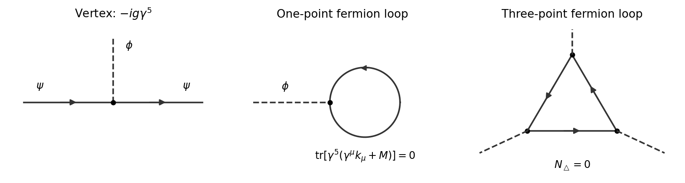

<h1 id="1/c/solution">Solution</h1>

↑ **Parent:** [C](../c.md)

Expanding $e^{iS_{\rm int}}$ gives the [Feynman vertex](../../../../interaction-vertex.md)

$$
\boxed{V_{ab}=-ig(\gamma^5)_{ab}.}
$$

There is one scalar leg and a continuous oriented fermion line; no extra factor $i$ is absorbed into $\gamma^5$. The [Dirac propagator](../../../../dirac-propagator.md) is $S_F(k)=i(\not{k}+M)/(k^2-M^2+i0)$, where $\not{k}=\gamma^\mu k_\mu$. Each closed [fermion loop](../../../../fermion-loop.md) supplies a minus sign.

**[Figure 1](#1/c/image-pseudoscalar-yukawa-vertex-and-the-vanishing-one-loop-bosonic-one-point-and-three-point-diagrams). Pseudoscalar Yukawa vertex and the vanishing one-loop bosonic one-point and three-point diagrams**.

The [tadpole diagram](../../../../tadpole-diagram.md) is proportional to

$$
-\int\frac{d^4k}{(2\pi)^4}\operatorname{tr}\left[(-ig\gamma^5)\frac{i(\not{k}+M)}{k^2-M^2+i0}\right]=0,
$$

because both numerator [traces](../../../../matrix-trace.md) vanish by [a](../a.md). This is zero before the [loop momentum](../../../../loop-momentum.md) integration.

For either orientation of the [triangle Feynman diagram](../../../../triangle-feynman-diagram.md), let $a,b,c$ be its three internal [four-momenta](../../../../four-momentum.md). Its numerator [trace](../../../../matrix-trace.md) is

$$
\begin{aligned}
N&=\operatorname{tr}\left[\gamma^5(\not{a}+M)\gamma^5(\not{b}+M)\gamma^5(\not{c}+M)\right]\\
&=\operatorname{tr}\left[(\not{a}-M)(\not{b}+M)\gamma^5(\not{c}+M)\right]=0.
\end{aligned}
$$

After using [cyclic property of the trace](../../../../cyclic-property-of-the-trace.md), each expanded term is a [trace](../../../../matrix-trace.md) of $\gamma^5$ times at most three ordinary [gamma matrices](../../../../gamma-matrices.md). Such [traces](../../../../matrix-trace.md) vanish in four dimensions. For an odd number of ordinary [gamma matrices](../../../../gamma-matrices.md), conjugation by $\gamma^5$ changes the sign. For two ordinary [gamma matrices](../../../../gamma-matrices.md), the contracted [Clifford algebra](../../../../clifford-algebra.md) identity $\gamma_\rho\gamma^\mu\gamma^\nu\gamma^\rho=4\eta^{\mu\nu}I$ gives

$$
4\operatorname{tr}(\gamma^5\gamma^\mu\gamma^\nu)=-4\eta^{\mu\nu}\operatorname{tr}\gamma^5=0.
$$

The zero-matrix case is [a](../a.md). Hence **both the one-point and three-point one-loop bosonic vertices vanish**, independently of their external [momenta](../../../../momentum-split.md). No cancellation between different loop orientations or delicate shift of a divergent [integral](../../../../integral-split.md) is needed.

## ↑ Ancestors (12)

1. [C](../c.md)
2. [1](../../1.md)
3. [2025](../../../2025-split.md)
4. [Past exam of the quantum field theory course of the University of Oxford](../../../split.md)
5. [Quantum field theory course of the University of Oxford](../../../../quantum-field-theory-course-of-the-university-of-oxford.md)
6. [Year 4 of the mathematical and theoretical physics course of the University of Oxford](../../../../year-4-of-the-mathematical-and-theoretical-physics-course-of-the-university-of-oxford.md)
7. [Mathematical and theoretical physics course of the University of Oxford](../../../../mathematical-and-theoretical-physics-course-of-the-university-of-oxford.md)
8. [Undergraduate course of the University of Oxford](../../../../undergraduate-course-of-the-university-of-oxford.md)
9. [Course of the University of Oxford](../../../../course-of-the-university-of-oxford.md)
10. [University of Oxford](../../../../university-of-oxford-split.md)
11. [List of universities](../../../../list-of-universities.md)
12. [Codex Wiki](../../../../split.md)
