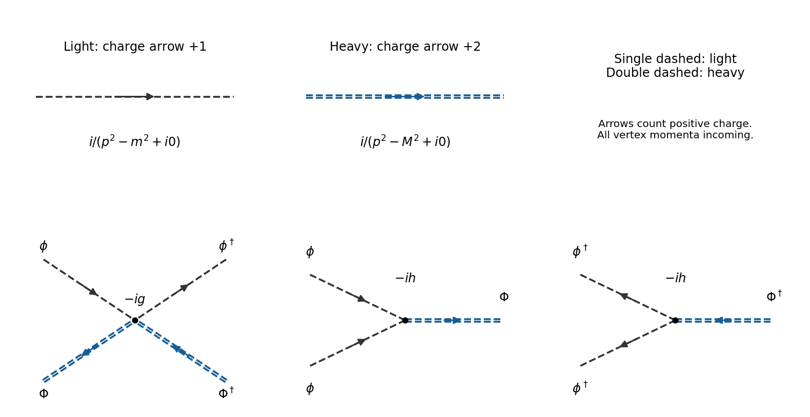

<h1 id="2/b/solution">Solution</h1>

↑ **Parent:** [B](../b.md)

The nonzero free [scalar propagators](../../../../scalar-propagator.md) join a field to its adjoint:

$$
\boxed{\langle T\phi\phi^\dagger\rangle(p)=\frac{i}{p^2-m^2+i0},\qquad \langle T\Phi\Phi^\dagger\rangle(p)=\frac{i}{p^2-M^2+i0}.}
$$

Contractions $\langle T\phi\phi\rangle$, $\langle T\Phi\Phi\rangle$ and mixed-species contractions vanish. With all [momenta](../../../../momentum-split.md) incoming, the [Feynman vertices](../../../../interaction-vertex.md) are

$$
\boxed{V_{\phi\phi^\dagger\Phi\Phi^\dagger}=-ig,\qquad V_{\phi\phi\Phi}=-ih,\qquad V_{\phi^\dagger\phi^\dagger\Phi^\dagger}=-ih.}
$$

The two identical light legs cancel the $1/2!$ in each cubic [interaction vertex](../../../../interaction-vertex.md); there is no remaining factor $1/2$ in its [Feynman rule](../../../../feynman-rule.md). Multiply each [Feynman vertex](../../../../interaction-vertex.md) by $(2\pi)^4\delta^{(4)}(\sum p)$, and integrate an internal unconstrained [four-momentum](../../../../four-momentum.md) with $d^4p/(2\pi)^4$.

**[Figure 2](#2/b/image-charged-scalar-propagators-and-vertices-with-arrows-following-positive-conserved-charge-and-heavy-arrows-carrying-two-units). Charged scalar propagators and vertices, with arrows following positive conserved charge and heavy arrows carrying two units**.

The arrows in the figure follow positive [Noether charge](../../../../noether-charge.md): a light arrow carries one unit and a heavy arrow two. Consequently a heavy [particle](../../../../particle-physics.md) $\Phi$ travels opposite its charge arrow, whereas its [antiparticle](../../../../antiparticle.md) $\bar\Phi$ travels along it. At a $\phi^2\Phi$ [Feynman vertex](../../../../interaction-vertex.md), two unit-charge arrows enter and a two-unit arrow leaves; the conjugate [Feynman vertex](../../../../interaction-vertex.md) reverses every arrow. The quartic [Feynman vertex](../../../../interaction-vertex.md) has one incoming and one outgoing arrow of each weight. These rules prevent attaching a [propagator](../../../../propagator.md) between two unconjugated fields.

## ↑ Ancestors (12)

1. [B](../b.md)
2. [2](../../2.md)
3. [2025](../../../2025-split.md)
4. [Past exam of the quantum field theory course of the University of Oxford](../../../split.md)
5. [Quantum field theory course of the University of Oxford](../../../../quantum-field-theory-course-of-the-university-of-oxford.md)
6. [Year 4 of the mathematical and theoretical physics course of the University of Oxford](../../../../year-4-of-the-mathematical-and-theoretical-physics-course-of-the-university-of-oxford.md)
7. [Mathematical and theoretical physics course of the University of Oxford](../../../../mathematical-and-theoretical-physics-course-of-the-university-of-oxford.md)
8. [Undergraduate course of the University of Oxford](../../../../undergraduate-course-of-the-university-of-oxford.md)
9. [Course of the University of Oxford](../../../../course-of-the-university-of-oxford.md)
10. [University of Oxford](../../../../university-of-oxford-split.md)
11. [List of universities](../../../../list-of-universities.md)
12. [Codex Wiki](../../../../split.md)
