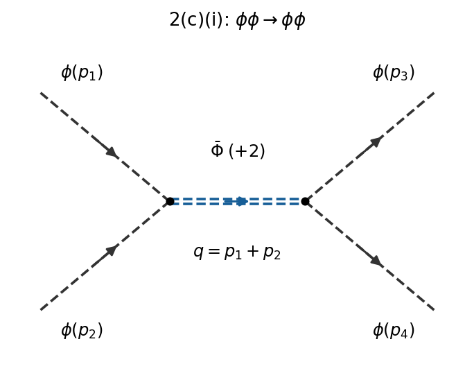

<h1 id="2/c/i/solution">Solution</h1>

↑ **Parent:** [I](../i.md)

Let $p_1,p_2$ be the incoming and $p_3,p_4$ the outgoing [four-momenta](../../../../../four-momentum.md), and set $s=(p_1+p_2)^2$, $t=(p_1-p_3)^2$, $u=(p_1-p_4)^2$, the [Mandelstam variables](../../../../../mandelstam-variables.md). The only connected [tree-level Feynman diagram](../../../../../tree-level-feynman-diagram.md) is the $s$-channel exchange of $\bar\Phi$, with [Noether charge](../../../../../noether-charge.md) $+2$. The two incoming light [particles](../../../../../particle-physics.md) attach to $\phi^2\Phi$, and the two outgoing light [particles](../../../../../particle-physics.md) to its conjugate. There is no four-light contact [Feynman vertex](../../../../../interaction-vertex.md), nor a charge-allowed $t$ or $u$ exchange with these external labels.

**[Figure 3](#2/c/i/image-light-particle-scattering-through-a-heavy-antiparticle-in-the-s-channel). Light-particle scattering through a heavy antiparticle in the s channel**.

Define the [invariant scattering amplitude](../../../../../invariant-scattering-amplitude.md) by $\langle f|S-1|i\rangle=i(2\pi)^4\delta^{(4)}(P_f-P_i)\mathcal M$. Then

$$
i\mathcal M=(-ih)\frac{i}{s-M^2+i0}(-ih),\qquad
\boxed{\mathcal M(\phi\phi\to\phi\phi)=-\frac{h^2}{s-M^2+i0}.}
$$

The [Feynman vertices](../../../../../interaction-vertex.md) already contain the identical-leg combinatorics. No extra factor of two multiplies this [invariant scattering amplitude](../../../../../invariant-scattering-amplitude.md); the distinct [identical final-state symmetry factor](../../../../../identical-particle-factor-in-a-final-state-phase-space-integral.md) enters a [cross section](../../../../../cross-section-physics.md) integral.

## ↑ Ancestors (13)

1. [I](../i.md)
2. [C](../../c.md)
3. [2](../../../2.md)
4. [2025](../../../../2025-split.md)
5. [Past exam of the quantum field theory course of the University of Oxford](../../../../split.md)
6. [Quantum field theory course of the University of Oxford](../../../../../quantum-field-theory-course-of-the-university-of-oxford.md)
7. [Year 4 of the mathematical and theoretical physics course of the University of Oxford](../../../../../year-4-of-the-mathematical-and-theoretical-physics-course-of-the-university-of-oxford.md)
8. [Mathematical and theoretical physics course of the University of Oxford](../../../../../mathematical-and-theoretical-physics-course-of-the-university-of-oxford.md)
9. [Undergraduate course of the University of Oxford](../../../../../undergraduate-course-of-the-university-of-oxford.md)
10. [Course of the University of Oxford](../../../../../course-of-the-university-of-oxford.md)
11. [University of Oxford](../../../../../university-of-oxford-split.md)
12. [List of universities](../../../../../list-of-universities.md)
13. [Codex Wiki](../../../../../split.md)
