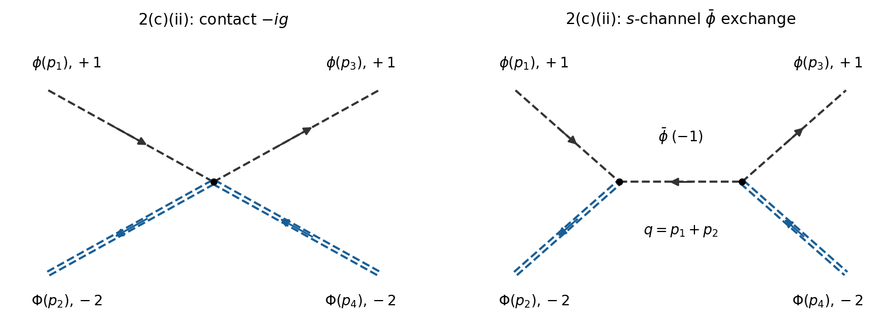

<h1 id="2/c/ii/solution">Solution</h1>

↑ **Parent:** [Ii](../ii.md)

Keep the [particle](../../../../../particle-physics.md) labels specified under [2](../../../2.md). There are two connected [tree-level Feynman diagrams](../../../../../tree-level-feynman-diagram.md): the quartic contact [interaction vertex](../../../../../interaction-vertex.md) and an $s$-channel light [antiparticle](../../../../../antiparticle.md) exchange. The initial [Noether charge](../../../../../noether-charge.md) is $1-2=-1$, exactly the charge of $\bar\phi$. At the first cubic [Feynman vertex](../../../../../interaction-vertex.md), the incoming $\phi$ and $\Phi$ leave the second $\phi$ leg internal; the conjugate [Feynman vertex](../../../../../interaction-vertex.md) supplies both outgoing [particles](../../../../../particle-physics.md).

**[Figure 4](#2/c/ii/image-scattering-of-a-light-particle-and-a-heavy-particle-with-contact-and-s-channel-light-antiparticle-exchange-diagrams). Scattering of a light particle and a heavy particle, with contact and s-channel light-antiparticle exchange diagrams**.

Thus

$$
i\mathcal M=-ig+(-ih)\frac{i}{s-m^2+i0}(-ih),\qquad
\boxed{\mathcal M(\phi\Phi\to\phi\Phi)=-g-\frac{h^2}{s-m^2+i0}.}
$$

Here $s=(p_1+p_2)^2$ for incoming $\phi(p_1),\Phi(p_2)$. Both terms have the same sign in the chosen [S-matrix](../../../../../s-matrix.md) convention.

The distinction from [antiparticles](../../../../../antiparticle.md) matters. If the paper's heavy “$\Phi$ particle” is instead intended to mean the charge-$+2$ state $\bar\Phi$, so that its printed decay into $\phi\phi$ is allowed, the exchange diagram is crossed. For that alternative physical process,

$$
\boxed{\mathcal M(\phi\bar\Phi\to\phi\bar\Phi)=-g-\frac{h^2}{u-m^2+i0},\qquad u=(p_1-p_4)^2.}
$$

This is a consistent alternative naming convention only if it is also applied to the decay in [iii](../iii.md); one cannot use the same heavy [particle](../../../../../particle-physics.md) label for both charge assignments.

## ↑ Ancestors (13)

1. [Ii](../ii.md)
2. [C](../../c.md)
3. [2](../../../2.md)
4. [2025](../../../../2025-split.md)
5. [Past exam of the quantum field theory course of the University of Oxford](../../../../split.md)
6. [Quantum field theory course of the University of Oxford](../../../../../quantum-field-theory-course-of-the-university-of-oxford.md)
7. [Year 4 of the mathematical and theoretical physics course of the University of Oxford](../../../../../year-4-of-the-mathematical-and-theoretical-physics-course-of-the-university-of-oxford.md)
8. [Mathematical and theoretical physics course of the University of Oxford](../../../../../mathematical-and-theoretical-physics-course-of-the-university-of-oxford.md)
9. [Undergraduate course of the University of Oxford](../../../../../undergraduate-course-of-the-university-of-oxford.md)
10. [Course of the University of Oxford](../../../../../course-of-the-university-of-oxford.md)
11. [University of Oxford](../../../../../university-of-oxford-split.md)
12. [List of universities](../../../../../list-of-universities.md)
13. [Codex Wiki](../../../../../split.md)
