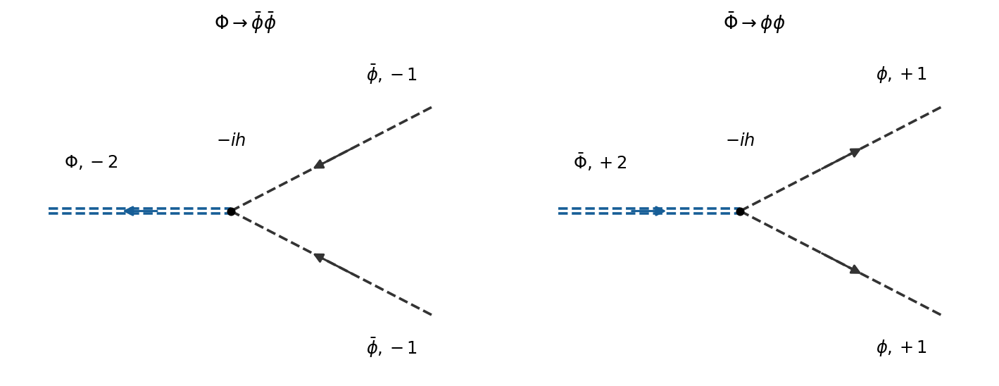

<h1 id="2/c/iii/solution">Solution</h1>

↑ **Parent:** [Iii](../iii.md)

With the conventional [particle](../../../../../particle-physics.md) labels, the allowed cubic [decay channels](../../../../../decay-channel.md) are

$$
\boxed{\Phi\to\bar\phi\bar\phi,\qquad\bar\Phi\to\phi\phi,\qquad\mathcal M=-h\quad\hbox{for either channel}.}
$$

Each has one [tree-level Feynman diagram](../../../../../tree-level-feynman-diagram.md), consisting of one cubic [Feynman vertex](../../../../../interaction-vertex.md). The final identical-leg contractions supply $2!$ and cancel the $1/2!$ in the [Lagrangian density](../../../../../lagrangian-density.md).

**[Figure 5](#2/c/iii/image-the-two-charge-conjugate-heavy-scalar-decays-with-explicit-antiparticle-labels-and-conserved-charge-arrows). The two charge-conjugate heavy-scalar decays, with explicit antiparticle labels and conserved charge arrows**.

Taken literally with these labels, **the printed $\Phi\to\phi\phi$ channel is forbidden**: its initial [Noether charge](../../../../../noether-charge.md) is $-2$ and its final [Noether charge](../../../../../noether-charge.md) is $+2$. Its [decay amplitude](../../../../../decay-amplitude.md) is zero, at every order preserving the [global phase symmetry](../../../../../global-phase-symmetry.md). If the source uses “$\Phi$” to name the heavy [antiparticle](../../../../../antiparticle.md) instead, its intended answer is the nonzero [decay amplitude](../../../../../decay-amplitude.md) $-h$ for $\bar\Phi\to\phi\phi$. The following [decay width](../../../../../decay-width.md) calculation concerns either allowed channel, whose widths are equal by [charge conjugation](../../../../../charge-conjugation.md).

## ↑ Ancestors (13)

1. [Iii](../iii.md)
2. [C](../../c.md)
3. [2](../../../2.md)
4. [2025](../../../../2025-split.md)
5. [Past exam of the quantum field theory course of the University of Oxford](../../../../split.md)
6. [Quantum field theory course of the University of Oxford](../../../../../quantum-field-theory-course-of-the-university-of-oxford.md)
7. [Year 4 of the mathematical and theoretical physics course of the University of Oxford](../../../../../year-4-of-the-mathematical-and-theoretical-physics-course-of-the-university-of-oxford.md)
8. [Mathematical and theoretical physics course of the University of Oxford](../../../../../mathematical-and-theoretical-physics-course-of-the-university-of-oxford.md)
9. [Undergraduate course of the University of Oxford](../../../../../undergraduate-course-of-the-university-of-oxford.md)
10. [Course of the University of Oxford](../../../../../course-of-the-university-of-oxford.md)
11. [University of Oxford](../../../../../university-of-oxford-split.md)
12. [List of universities](../../../../../list-of-universities.md)
13. [Codex Wiki](../../../../../split.md)
