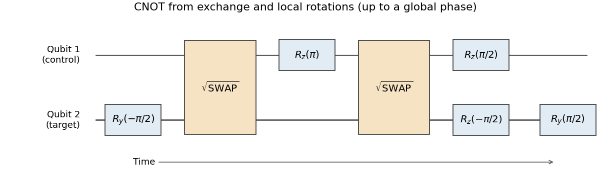

<h1 id="1/solution">Solution</h1>

↑ **Parent:** [1](../1.md)

Use the [computational basis](../../../../computational-basis.md) in the stated order and let the rightmost operation act first. The [controlled phase gate](../../../../controlled-phase-gate.md) is $|0\rangle\langle0|\otimes I+|1\rangle\langle1|\otimes Z$. From the rotation definition,

$$
R_y(\theta)=\begin{pmatrix}\cos(\theta/2)&-\sin(\theta/2)\\\sin(\theta/2)&\cos(\theta/2)\end{pmatrix},\qquad
R_y(\pi/2)ZR_y(-\pi/2)=X.
$$

The control-zero block remains the identity, and the control-one block becomes $X$. Thus

$$
\boxed{R_y^{(2)}(\pi/2)U_{\rm CP}R_y^{(2)}(-\pi/2)=U_{\rm CNOT}.}
$$

This proves the relation for arbitrary [superpositions](../../../../superposition-principle.md), rather than only for computational-basis probabilities.

For the second relation write $S=U_{\rm SW}^{1/2}$. Its central block is $\bigl(\begin{smallmatrix}a&b\\b&a\end{smallmatrix}\bigr)$, with $a=(1+i)/2$, $b=(1-i)/2$. Because $a^2=i/2$, $b^2=-i/2$ and $ab=1/2$, direct multiplication gives

$$
S R_z^{(1)}(\pi) S=\operatorname{diag}(-i,1,-1,i).
$$

Meanwhile $R_z^{(1)}(\pi/2)R_z^{(2)}(-\pi/2)=\operatorname{diag}(1,-i,i,1)$. Multiplying these diagonal matrices and the overall factor $i$ gives

$$
\boxed{iR_z^{(1)}(\pi/2)R_z^{(2)}(-\pi/2)S R_z^{(1)}(\pi)S
=\operatorname{diag}(1,1,1,-1)=U_{\rm CP}.}
$$

The supplied $S$ is indeed a [square root of the SWAP gate](../../../../square-root-of-the-swap-gate.md): $S^2$ exchanges $|01\rangle$ and $|10\rangle$ while fixing the other basis states. It acts as one on the triplet subspace and as $i$ on the singlet subspace.

For an isotropic [exchange interaction](../../../../exchange-interaction.md) with [Hamiltonian](../../../../hamiltonian.md) $H=J(t)\,\boldsymbol\sigma_1\cdot\boldsymbol\sigma_2/4$, define $\varphi=\int J(t)dt/\hbar$. Triplet and singlet energies differ by $J$, so

$$
U(\varphi)=e^{-i\varphi/4}(P_T+e^{i\varphi}P_S).
$$

An exchange pulse with $\varphi=\pi/2$ therefore implements $e^{-i\pi/8}S$. Two such pulses, interspersed with the specified local rotations, implement the [controlled phase gate](../../../../controlled-phase-gate.md); the initial and final target rotations then turn it into a [CNOT gate](../../../../controlled-not-gate.md). Their common overall phase has no effect on an isolated gate's outcome probabilities; a subsequently controlled version must keep track of conditional phases.

**[Figure 1](#1/image-cnot-synthesis-from-two-square-root-of-swap-exchange-pulses-and-local-rotations-with-time-running-left-to-right). CNOT synthesis from two square-root-of-SWAP exchange pulses and local rotations, with time running left to right**.

The construction converts a physically available two-spin interaction into a standard entangling gate, which together with arbitrary one-qubit rotations supplies [universal quantum computation](../../../../universal-quantum-computation.md). Practical operation needs calibrated exchange pulse area and timing, individually controllable rotations, and reproducible phase references. Charge noise can change $J$; magnetic-field gradients add unwanted single-spin evolution, and anisotropic exchange modifies the assumed [Hamiltonian](../../../../hamiltonian.md). Pulses must suppress leakage into unwanted orbital states while finishing before excessive [decoherence](../../../../quantum-decoherence.md). Readout, preparation, cross-talk and the extra operations in this decomposition all affect the achieved [quantum gate fidelity](../../../../quantum-gate-fidelity.md). The algebraic identity alone does not establish a [fault-tolerant quantum computation](../../../../fault-tolerant-quantum-computation.md) implementation.

## ↑ Ancestors (13)

1. [1](../1.md)
2. [Paper 1](../../paper-1-split.md)
3. [2012](../../split.md)
4. [Past exam of the quantum information course of the University of Cambridge](../../../split.md)
5. [Quantum Information course of the University of Cambridge](../../../../quantum-information-course-of-the-university-of-cambridge.md)
6. [Physics course of the year 4 of the natural sciences course of the University of Cambridge](../../../../physics-course-of-the-year-4-of-the-natural-sciences-course-of-the-university-of-cambridge.md)
7. [Year 4 of the natural sciences course of the University of Cambridge](../../../../year-4-of-the-natural-sciences-course-of-the-university-of-cambridge.md)
8. [Year of the natural sciences course of the University of Cambridge](../../../../year-of-the-natural-sciences-course-of-the-university-of-cambridge.md)
9. [Natural sciences course of the University of Cambridge](../../../../natural-sciences-course-of-the-university-of-cambridge.md)
10. [Course of the University of Cambridge](../../../../course-of-the-university-of-cambridge.md)
11. [University of Cambridge](../../../../university-of-cambridge-split.md)
12. [List of universities](../../../../list-of-universities.md)
13. [Codex Wiki](../../../../split.md)
