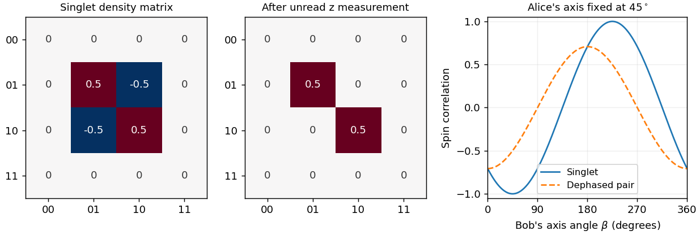

<h1 id="2/solution">Solution</h1>

↑ **Parent:** [2](../2.md)

Include Alice's detector and environment before taking a [partial trace](../../../../partial-trace.md). Ideal measurement produces the global state

$$
|\Psi_1\rangle=\frac1{\sqrt2}\bigl(|01\rangle|d_{0A}E_{0A}\rangle-|10\rangle|d_{1A}E_{1A}\rangle\bigr).
$$

[Orthogonality](../../../../orthogonal-vectors.md) of the two record states removes their cross terms from the reduced state of the particles:

$$
\boxed{\rho_{AB}^{(1)}=\frac12|01\rangle\langle01|+\frac12|10\rangle\langle10|
=\operatorname{diag}(0,1/2,1/2,0).}
$$

This [nonselective quantum measurement](../../../../nonselective-quantum-measurement.md) has changed the initially entangled singlet into a separable, classically anticorrelated reduced state. Its [entropy](../../../../entropy-split.md) is one bit, although the full particles-plus-records state is still pure under the assumed unitary dynamics. The [reduced density matrix](../../../../reduced-density-matrix.md) is an [improper mixture](../../../../improper-mixture.md); tracing the environment does not by itself assert a literal collapse of that global state.

The [Born rule](../../../../born-rule.md) gives Alice outcomes zero and one with equal [probability](../../../../probability.md). Conditional on a recorded result, the [selective quantum measurement](../../../../selective-quantum-measurement.md) assigns $|01\rangle$ or $|10\rangle$ to the particles. The unitary measurement coupling and orthogonal records explain [decoherence](../../../../quantum-decoherence.md) in this basis; they do not supply an additional rule selecting a unique outcome. That is part of the [measurement problem](../../../../measurement-problem.md). In a collapse postulate the individual outcome is stochastic; other interpretations account for outcome experience differently while retaining these operational probabilities.

When Bob makes the same kind of measurement, the global state becomes

$$
|\Psi_2\rangle=\frac1{\sqrt2}\bigl(
|01\rangle|d_{0A}E_{0A}\rangle|d_{1B}E_{1B}\rangle
-|10\rangle|d_{1A}E_{1A}\rangle|d_{0B}E_{0B}\rangle\bigr).
$$

Tracing both laboratories gives **the same reduced matrix**, $\rho_{AB}^{(2)}=\rho_{AB}^{(1)}$. Bob has added a correlated record, not restored the lost reduced coherence. If Alice's outcome is known, Bob's opposite outcome is certain in this ideal common basis. Without that record, his marginal is $I/2$, so his outcome remains equiprobable. Alice cannot choose her random result or use this [correlation](../../../../pearson-correlation-coefficient.md) for faster-than-light signalling, consistently with [quantum no-signalling](../../../../quantum-no-signalling.md).

These common-basis measurements alone do **not** distinguish quantum predictions from a local source sending opposite preassigned bits. To test that explanation, prepare fresh singlets and let the observers independently choose among incompatible measurement axes before recording each result. For singlet [spin](../../../../spin.md) measurements along unit vectors $\mathbf a,\mathbf b$, quantum mechanics predicts $E(\mathbf a,\mathbf b)=-\mathbf a\cdot\mathbf b$. The [CHSH inequality](../../../../chsh-inequality.md) bounds $|S|\leq2$ for Bell-local models with measurement-independent settings. Choosing

$$
\mathbf a=\widehat z,\quad\mathbf a'=\widehat x,\quad
\mathbf b=(\widehat z+\widehat x)/\sqrt2,\quad
\mathbf b'=(\widehat z-\widehat x)/\sqrt2
$$

gives $S=E(\mathbf a,\mathbf b)+E(\mathbf a,\mathbf b')+E(\mathbf a',\mathbf b)-E(\mathbf a',\mathbf b')=-2\sqrt2$. A suitable [Bell test](../../../../bell-test.md) constrains that class of explanations. Independently chosen settings, control of detection bias and separation of the measurement events matter when interpreting an actual experiment.

**[Figure 2](#2/image-singlet-coherence-is-lost-from-the-reduced-density-matrix-after-a-local-unread-measurement-common-axis-anticorrelation-survives). Singlet coherence is lost from the reduced density matrix after a local unread measurement; common-axis anticorrelation survives**.

If Alice first performs the fixed-axis irreversible measurement described above, the resulting [mixed state](../../../../mixed-state.md) has $E(\mathbf a,\mathbf b)=-a_zb_z$ and cannot supply that singlet violation. The incompatible settings must belong to the Bell measurement itself. Moreover, Bell violations do not choose among all interpretations of quantum mechanics: interpretations sharing the Born predictions remain observationally equivalent for this experiment. Objective-collapse modifications could instead require additional [interference](../../../../interference-wave-propagation.md) tests with specified departures from unitary dynamics.

## ↑ Ancestors (13)

1. [2](../2.md)
2. [Paper 1](../../paper-1-split.md)
3. [2012](../../split.md)
4. [Past exam of the quantum information course of the University of Cambridge](../../../split.md)
5. [Quantum Information course of the University of Cambridge](../../../../quantum-information-course-of-the-university-of-cambridge.md)
6. [Physics course of the year 4 of the natural sciences course of the University of Cambridge](../../../../physics-course-of-the-year-4-of-the-natural-sciences-course-of-the-university-of-cambridge.md)
7. [Year 4 of the natural sciences course of the University of Cambridge](../../../../year-4-of-the-natural-sciences-course-of-the-university-of-cambridge.md)
8. [Year of the natural sciences course of the University of Cambridge](../../../../year-of-the-natural-sciences-course-of-the-university-of-cambridge.md)
9. [Natural sciences course of the University of Cambridge](../../../../natural-sciences-course-of-the-university-of-cambridge.md)
10. [Course of the University of Cambridge](../../../../course-of-the-university-of-cambridge.md)
11. [University of Cambridge](../../../../university-of-cambridge-split.md)
12. [List of universities](../../../../list-of-universities.md)
13. [Codex Wiki](../../../../split.md)
