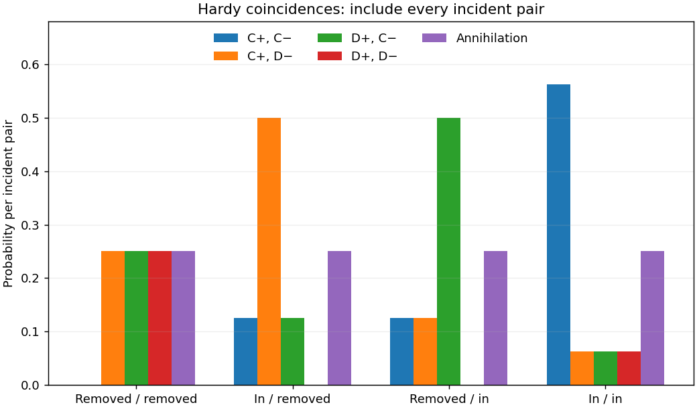

<h1 id="1/d/solution">Solution</h1>

↑ **Parent:** [D](../d.md)

Applying both final splitters gives

$$
\boxed{|\Psi_{II}\rangle=-\frac12|\gamma\rangle+\frac14\left(-3|cc\rangle+i|cd\rangle+i|dc\rangle-|dd\rangle\right).}
$$

The charged-particle coincidence probabilities are $9/16,1/16,1/16,1/16$ in the displayed order, and the annihilation [probability](../../../../../probability.md) remains $1/4$. In particular

$$
\boxed{P_{II}(D^+,D^-)=\frac1{16}.}
$$

Conditioning on surviving pairs would change this number to $(1/16)/(3/4)=1/12$; it would not change the amplitudes of the unconditioned all-trials state above.

**[Figure 1](#1/d/image-hardy-interferometer-unconditional-coincidence-and-annihilation-probabilities). Hardy interferometer: unconditional coincidence and annihilation probabilities**.

## ↑ Ancestors (14)

1. [D](../d.md)
2. [1](../../1.md)
3. [Paper 1](../../../paper-1-split.md)
4. [2013](../../../split.md)
5. [Past exam of the quantum information course of the University of Cambridge](../../../../split.md)
6. [Quantum Information course of the University of Cambridge](../../../../../quantum-information-course-of-the-university-of-cambridge.md)
7. [Physics course of the year 4 of the natural sciences course of the University of Cambridge](../../../../../physics-course-of-the-year-4-of-the-natural-sciences-course-of-the-university-of-cambridge.md)
8. [Year 4 of the natural sciences course of the University of Cambridge](../../../../../year-4-of-the-natural-sciences-course-of-the-university-of-cambridge.md)
9. [Year of the natural sciences course of the University of Cambridge](../../../../../year-of-the-natural-sciences-course-of-the-university-of-cambridge.md)
10. [Natural sciences course of the University of Cambridge](../../../../../natural-sciences-course-of-the-university-of-cambridge.md)
11. [Course of the University of Cambridge](../../../../../course-of-the-university-of-cambridge.md)
12. [University of Cambridge](../../../../../university-of-cambridge-split.md)
13. [List of universities](../../../../../list-of-universities.md)
14. [Codex Wiki](../../../../../split.md)
