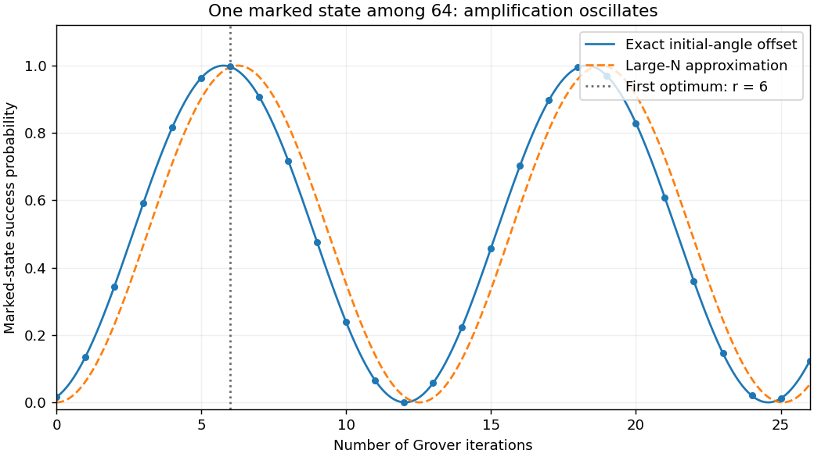

<h1 id="2/solution">Solution</h1>

↑ **Parent:** [2](../2.md)

Set $N=2^n$, $a=N^{-1/2}=\sin t$ and $c=\cos t$, with $N>1$. The ordered vectors $|w\rangle,|s\rangle$ are normalized but [nonorthogonal](../../../../nonorthogonal-vectors.md), since $\langle w|s\rangle=a$. Their coordinate [Gram matrix](../../../../gram-matrix.md) is therefore

$$
S=\begin{pmatrix}1&a\\a&1\end{pmatrix}.
$$

An operator matrix in this basis is obtained from the coefficients in the images of its basis vectors, not by treating those vectors as orthogonal measurement outcomes. Directly applying the two [reflection operators](../../../../reflection-operator.md) gives

$$
\hat U_s|w\rangle=-|w\rangle+2a|s\rangle,\quad\hat U_s|s\rangle=|s\rangle,
$$

$$
\hat U_w|w\rangle=-|w\rangle,\quad\hat U_w|s\rangle=|s\rangle-2a|w\rangle.
$$

Their columns are consequently

$$
\boxed{U_s=\begin{pmatrix}-1&0\\2a&1\end{pmatrix},\qquad
U_w=\begin{pmatrix}-1&-2a\\0&1\end{pmatrix}.}
$$

These are physical unitary operators even though the coordinate matrices are not unitary in the ordinary Euclidean coordinate norm: they preserve $S$, so $U^\dagger SU=S$.

The [Grover iteration in a nonorthogonal basis](../../../../grover-iteration-in-a-nonorthogonal-basis.md) is

$$
G=U_sU_w=\begin{pmatrix}1&2a\\-2a&1-4a^2\end{pmatrix}.
$$

It has determinant one and trace $2-4a^2=2\cos2t$, hence [eigenvalues](../../../../eigenvalue.md) $e^{\pm2it}$. For example, the invertible [matrix](../../../../matrix.md) of [eigenvectors](../../../../eigenvector.md)

$$
M=\begin{pmatrix}1&1\\-a+ic&-a-ic\end{pmatrix}
$$

satisfies

$$
\boxed{G^r=M\begin{pmatrix}e^{2irt}&0\\0&e^{-2irt}\end{pmatrix}M^{-1}.}
$$

This diagonalization is exact for $N>1$; no large-$n$ approximation is needed.

To extract an actual [probability](../../../../probability.md) using the [Born rule](../../../../born-rule.md), introduce the orthonormal unmarked superposition $|b\rangle=(|s\rangle-a|w\rangle)/c$. In the ordered basis $|w\rangle,|b\rangle$, the same iteration is the rotation

$$
G_{\rm orth}=\begin{pmatrix}\cos2t&\sin2t\\-\sin2t&\cos2t\end{pmatrix},\qquad
|s\rangle=\sin t\,|w\rangle+\cos t\,|b\rangle.
$$

After $r$ iterations,

$$
|\psi_f\rangle=\sin((2r+1)t)|w\rangle+\cos((2r+1)t)|b\rangle,
\qquad
\boxed{P_r=\sin^2((2r+1)t).}
$$

Equivalently the original coordinates are $[\sin(2rt)/c,\ \cos((2r+1)t)/c]^T$. The overlap with $|w\rangle$ is the first coordinate **plus $a$ times the second**, recovering the same amplitude. Squaring just the first coordinate would be incorrect in a nonorthogonal basis.

For large $n$, $t\simeq N^{-1/2}$, and dropping the initial angle $t$ gives the requested approximation $P_r\simeq\sin^2(2rt)$. The first near-unit success occurs at the integer closest to $\pi/(4t)-1/2$:

$$
\boxed{r_{\rm opt}=\operatorname{nearest\ integer}\left(\frac\pi{4\arcsin(N^{-1/2})}-\frac12\right)
\sim\frac\pi4\sqrt N.}
$$

One can choose $r_{\rm opt}=\lfloor\pi/(4t)\rfloor$, with either neighbor equivalent in a tie. Further iterations overshoot and reduce success rather than monotonically improving it. The special $N=1$ problem needs no search and the two-vector coordinate construction becomes singular.

**[Figure 2](#2/image-grover-search-success-exact-initial-angle-offset-and-overshooting-the-first-maximum). Grover search success: exact initial-angle offset and overshooting the first maximum**.

For an unstructured search, a reversible [Boolean quantum oracle](../../../../boolean-quantum-oracle.md) implements a phase change on the marked entry, while the diffusion reflection about a uniform state is known. Repeating the pair of reflections amplifies the marked amplitude and measurement yields a candidate that can be checked by another oracle query. The bounded-error query count is $O(\sqrt N)$ for one marked item, compared with classical $\Theta(N)$ queries. It is a quadratic **oracle-query** speedup: state preparation, the cost of implementing the oracle and access to a classical database still matter. The method does not reveal an unknown marked value without the promised query access.[1996 abstract and search construction](../../../../a-fast-quantum-mechanical-algorithm-for-database-search-by-lov-grover.md)

## ↑ Ancestors (13)

1. [2](../2.md)
2. [Paper 1](../../paper-1-split.md)
3. [2013](../../split.md)
4. [Past exam of the quantum information course of the University of Cambridge](../../../split.md)
5. [Quantum Information course of the University of Cambridge](../../../../quantum-information-course-of-the-university-of-cambridge.md)
6. [Physics course of the year 4 of the natural sciences course of the University of Cambridge](../../../../physics-course-of-the-year-4-of-the-natural-sciences-course-of-the-university-of-cambridge.md)
7. [Year 4 of the natural sciences course of the University of Cambridge](../../../../year-4-of-the-natural-sciences-course-of-the-university-of-cambridge.md)
8. [Year of the natural sciences course of the University of Cambridge](../../../../year-of-the-natural-sciences-course-of-the-university-of-cambridge.md)
9. [Natural sciences course of the University of Cambridge](../../../../natural-sciences-course-of-the-university-of-cambridge.md)
10. [Course of the University of Cambridge](../../../../course-of-the-university-of-cambridge.md)
11. [University of Cambridge](../../../../university-of-cambridge-split.md)
12. [List of universities](../../../../list-of-universities.md)
13. [Codex Wiki](../../../../split.md)
