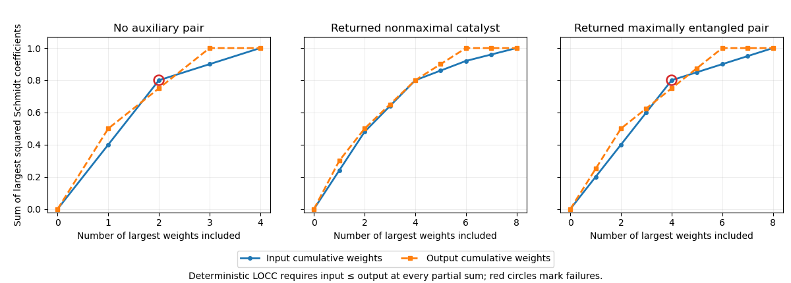

<h1 id="1/solution">Solution</h1>

↑ **Parent:** [1](../1.md)

[Nielsen's pure-state conversion theorem](../../../../nielsen-s-pure-state-conversion-theorem.md) concerns exact deterministic transformations of bipartite [pure states](../../../../pure-state.md) by [local operations and classical communication](../../../../local-operations-and-classical-communication.md). Let $\lambda(\psi)$ be the decreasing vector of squared [Schmidt coefficients](../../../../schmidt-coefficient.md), equivalently the [eigenvalues](../../../../eigenvalue.md) of either party's [reduced density matrix](../../../../reduced-density-matrix.md), padded with zeros when necessary. Then

$$
\boxed{|\psi\rangle\longrightarrow|\chi\rangle\text{ by deterministic LOCC}
\quad\Longleftrightarrow\quad\lambda(\psi)\prec\lambda(\chi).}
$$

The [majorization](../../../../majorization.md) relation means $\sum_{j=1}^k\lambda_j(\psi)\le\sum_{j=1}^k\lambda_j(\chi)$ for every $k$, with equality for the total sum. The direction allows a maximally entangled state to become a [product state](../../../../product-state.md), not the reverse. [Local-unitary invariance of reduced-state spectra](../../../../local-unitary-invariance-of-reduced-state-spectra.md) alone would require equality of all the weights; measurements and communicated outcomes permit this larger class of conversions. A comparison of [entanglement entropies](../../../../entanglement-entropy.md) alone is not a sufficient test in higher dimension.[Necessary and sufficient majorization criterion for deterministic bipartite pure-state conversion](../../../../conditions-for-a-class-of-entanglement-transformations-by-michael-a-nielsen.md)

For the supplied states, the weight vectors and cumulative sums are

$$
\begin{array}{c|rrrr}
\lambda(\psi_1)&0.4&0.4&0.1&0.1\\
\lambda(\psi_2)&0.5&0.25&0.25&0
\end{array}\qquad
\begin{array}{c|rrrr}
\text{input sums}&0.4&0.8&0.9&1\\
\text{output sums}&0.5&0.75&1&1
\end{array}
$$

At $k=2$, $0.8>0.75$, violating the required inequality. **The desired conversion is impossible with certainty using LOCC alone.** The reverse conversion also fails, already at $k=1$, so these states are incomparable under this deterministic ordering.

Taking a tensor product with the catalyst multiplies every original weight by each catalyst weight. Regrouping the two local systems on Alice's side and the two on Bob's side leaves a [Schmidt decomposition](../../../../schmidt-decomposition.md) across the Alice–Bob partition. After sorting, the resulting weight vectors are

$$
\begin{aligned}
x&=(0.24,0.24,0.16,0.16,0.06,0.06,0.04,0.04),\\
y&=(0.30,0.20,0.15,0.15,0.10,0.10,0,0).
\end{aligned}
$$

The actual nonnegative Schmidt amplitudes are $\sqrt{x_j}$ and $\sqrt{y_j}$; the displayed numbers are their squares. The cumulative sums are

$$
\begin{aligned}
X&=(0.24,0.48,0.64,0.80,0.86,0.92,0.96,1),\\
Y&=(0.30,0.50,0.65,0.80,0.90,1,1,1).
\end{aligned}
$$

Every component obeys $X_k\le Y_k$, so $x\prec y$. Hence

$$
\boxed{|\psi_1\rangle\otimes|\phi\rangle
\xrightarrow{\rm LOCC}|\psi_2\rangle\otimes|\phi\rangle.}
$$

The final catalyst is exactly its initial state and is uncorrelated with the desired output. It can therefore be returned and reused. This is [entanglement catalysis](../../../../entanglement-catalysis.md); it is stronger than merely retaining the same catalyst marginal while leaving correlations with the output.[Two-qubit catalyst example and unchanged product-state return](../../../../entanglement-assisted-local-manipulation-of-pure-quantum-states-by-daniel-jonathan-and-martin-b-plenio.md)

For the maximally entangled two-level auxiliary state, the sorted input weights are $(0.2,0.2,0.2,0.2,0.05,0.05,0.05,0.05)$, while the output weights are $(0.25,0.25,0.125,0.125,0.125,0.125,0,0)$. Their first four sums are $0.8$ and $0.75$. **This maximally entangled auxiliary state cannot catalyze the conversion while being returned unchanged.**

Nevertheless, $(0.5,0.5)\prec(0.6,0.4)$, so it can first be converted deterministically into the nonmaximal catalyst. The desired conversion can then proceed, after which Alice and Bob can return **$|\phi\rangle$, rather than the borrowed maximally entangled state**. Turning that returned pair alone back into a maximally entangled pair would increase its [entanglement entropy](../../../../entanglement-entropy.md) and is forbidden by LOCC. No joint restoration procedure can both keep the exact desired $|\psi_2\rangle$ and return the original maximally entangled auxiliary state deterministically: its composition with the preceding steps would contradict the failed four-weight inequality above.

**[Figure 1](#1/image-the-catalyst-repairs-every-failed-majorization-inequality-while-a-maximally-entangled-pair-does-not). The catalyst repairs every failed majorization inequality, while a maximally entangled pair does not**.

## ↑ Ancestors (13)

1. [1](../1.md)
2. [Paper 1](../../paper-1-split.md)
3. [2014](../../split.md)
4. [Past exam of the quantum information course of the University of Cambridge](../../../split.md)
5. [Quantum Information course of the University of Cambridge](../../../../quantum-information-course-of-the-university-of-cambridge.md)
6. [Physics course of the year 4 of the natural sciences course of the University of Cambridge](../../../../physics-course-of-the-year-4-of-the-natural-sciences-course-of-the-university-of-cambridge.md)
7. [Year 4 of the natural sciences course of the University of Cambridge](../../../../year-4-of-the-natural-sciences-course-of-the-university-of-cambridge.md)
8. [Year of the natural sciences course of the University of Cambridge](../../../../year-of-the-natural-sciences-course-of-the-university-of-cambridge.md)
9. [Natural sciences course of the University of Cambridge](../../../../natural-sciences-course-of-the-university-of-cambridge.md)
10. [Course of the University of Cambridge](../../../../course-of-the-university-of-cambridge.md)
11. [University of Cambridge](../../../../university-of-cambridge-split.md)
12. [List of universities](../../../../list-of-universities.md)
13. [Codex Wiki](../../../../split.md)
