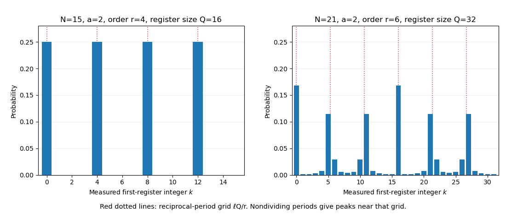

<h1 id="2/solution">Solution</h1>

↑ **Parent:** [2](../2.md)

The input size of an [integer factorization](../../../../integer-factorization.md) problem is its number of bits $n\simeq\log_2N$. Trial division up to $\sqrt N$ is exponential in $n$; advanced classical algorithms do substantially better, but no general polynomial-time classical factoring algorithm is known. The heuristic general-purpose [general number field sieve](../../../../general-number-field-sieve.md) has subexponential rather than polynomial scaling, roughly $\exp(O(n^{1/3}(\log n)^{2/3}))$. This describes known algorithmic performance, not a proof that efficient classical factoring is impossible or that every large integer is difficult.

Choose $a$ with $1<a<N$. A nontrivial [greatest common divisor](../../../../greatest-common-divisor.md) $\gcd(a,N)$ already supplies a factor; otherwise find the [multiplicative order](../../../../multiplicative-order.md) $r$ of $a$ modulo $N$. If $r$ is even and $a^{r/2}\not\equiv-1\pmod N$, then

$$
(a^{r/2}-1)(a^{r/2}+1)\equiv0\pmod N.
$$

Minimality of the order also excludes $a^{r/2}\equiv1\pmod N$, so [factor extraction from an even modular order](../../../../factor-extraction-from-an-even-modular-order.md) gives nontrivial factors through $\gcd(a^{r/2}\pm1,N)$. Unhelpful choices of $a$ or odd orders require another trial. For $N=15$, $a=2$ has successive residues $1,2,4,8$ and order four, giving

$$
\boxed{\gcd(2^2-1,15)=3,\qquad\gcd(2^2+1,15)=5.}
$$

Computing the powers is easy by [repeated squaring](../../../../exponentiation-by-squaring.md); discovering a large order is the step accelerated by [Shor's algorithm](../../../../shor-s-algorithm.md).[Quantum reduction to order finding and classical factor extraction](../../../../polynomial-time-algorithms-for-prime-factorization-and-discrete-logarithms-on-a-quantum-computer-by-peter-w-shor.md)

Put $Q=2^L$ and suppose $Q\ge r$. For each residue class $s=0,\ldots,r-1$, let

$$
n_s=\left\lfloor\frac{Q-1-s}{r}\right\rfloor+1,\qquad
|\phi_s\rangle=\frac1{\sqrt{n_s}}\sum_{j=0}^{n_s-1}|s+jr\rangle.
$$

These are normalized uniform superpositions of the arguments with the same modular-exponentiation value. Their amplitudes repeat at separation $r$ within the finite register window. Exact cyclic periodicity requires $r\mid Q$. The correctly normalized entangled register state is

$$
\boxed{\frac1{\sqrt Q}\sum_{x=0}^{Q-1}|x\rangle|a^x\bmod N\rangle
=\sum_{s=0}^{r-1}\sqrt{\frac{n_s}{Q}}\,|\phi_s\rangle|a^s\bmod N\rangle.}
$$

The equal prefactor $1/\sqrt r$ in the displayed algorithm is exact when $r\mid Q$, for then every $n_s=Q/r$. It is not generally exact for an arbitrary unknown order. A physical implementation uses [quantum modular exponentiation](../../../../quantum-modular-exponentiation.md) as a reversible map; its specified action on second-register input zero is extended to a [unitary operator](../../../../unitary-operator.md) on the whole register space.

For the illustrative $N=15$, $a=2$ and $Q=16$, the four first-register states are

$$
|\phi_s\rangle=\frac12\bigl(|s\rangle+|s+4\rangle+|s+8\rangle+|s+12\rangle\bigr),\qquad s=0,1,2,3.
$$

Applying the positive-sign [quantum Fourier transform](../../../../quantum-fourier-transform-split.md) to the general state gives

$$
\operatorname{QFT}|\phi_s\rangle
=\frac1{\sqrt{Qn_s}}\sum_{k=0}^{Q-1}e^{2\pi iks/Q}
\left[\sum_{j=0}^{n_s-1}e^{2\pi ikrj/Q}\right]|k\rangle.
$$

The bracket is a [finite geometric Fourier amplitude](../../../../finite-geometric-fourier-amplitude.md). If $r\mid Q$, it vanishes unless $k=\ell Q/r$ for $\ell=0,\ldots,r-1$, when it equals $Q/r$. Hence

$$
\operatorname{QFT}|\phi_s\rangle
=\frac1{\sqrt r}\sum_{\ell=0}^{r-1}e^{2\pi i\ell s/r}|\ell Q/r\rangle.
$$

The second-register states are orthogonal, so their different phases do not change the marginal first-register probabilities. Measurement gives

$$
\boxed{k=\ell Q/r\quad\text{with probability }1/r.}
$$

In the $Q=16$ example the possible outcomes are $0,4,8,12$. A nonzero observed ratio $k/Q$ estimates $\ell/r$, not a prime factor directly. Reducing it gives denominator $r/\gcd(\ell,r)$; repeating avoids uninformative outcomes or recovers missing order factors. For example, $k=4$ or $12$ gives denominator four, whereas $k=8$ alone gives only two.

When $r\nmid Q$, the Fourier probabilities have narrow peaks near $k/Q=\ell/r$ instead of support only on an exact reciprocal grid. The general marginal distribution is

$$
\Pr(k)=\frac1{Q^2}\sum_{s=0}^{r-1}
\left|\sum_{j=0}^{n_s-1}e^{2\pi ikrj/Q}\right|^2.
$$

Choosing $Q\ge N^2$ supplies the usual precision for [continued-fraction recovery in quantum order finding](../../../../continued-fraction-recovery-in-quantum-order-finding.md): a nearest grid sample differs from the target rational by at most $1/(2Q)<1/(2r^2)$. Candidate denominators and extracted divisors are checked classically, and repetitions provide useful samples. The small $Q=16$ example works exactly because its order divides the register size; it is not a general precision guarantee for factoring every four-bit integer.

**[Figure 2](#2/image-exact-reciprocal-period-sampling-for-order-four-and-broadened-peaks-when-the-order-does-not-divide-the-register). Exact reciprocal-period sampling for order four and broadened peaks when the order does not divide the register**.

A sufficiently large reliable quantum computer would undermine [RSA](../../../../rsa-cryptosystem.md) by efficient factorization. The related discrete-logarithm algorithm also threatens [Diffie-Hellman key exchange](../../../../diffie-hellman-key-exchange.md) and elliptic-curve public-key schemes. This does not imply that every communication scheme or symmetric cipher is broken by the same algorithm; [post-quantum cryptography](../../../../post-quantum-cryptography.md) studies alternatives based on other problems. The mathematical speedup assumes a scalable quantum computation with enough precision and error control, not merely a small demonstration of factoring fifteen.

## ↑ Ancestors (13)

1. [2](../2.md)
2. [Paper 1](../../paper-1-split.md)
3. [2014](../../split.md)
4. [Past exam of the quantum information course of the University of Cambridge](../../../split.md)
5. [Quantum Information course of the University of Cambridge](../../../../quantum-information-course-of-the-university-of-cambridge.md)
6. [Physics course of the year 4 of the natural sciences course of the University of Cambridge](../../../../physics-course-of-the-year-4-of-the-natural-sciences-course-of-the-university-of-cambridge.md)
7. [Year 4 of the natural sciences course of the University of Cambridge](../../../../year-4-of-the-natural-sciences-course-of-the-university-of-cambridge.md)
8. [Year of the natural sciences course of the University of Cambridge](../../../../year-of-the-natural-sciences-course-of-the-university-of-cambridge.md)
9. [Natural sciences course of the University of Cambridge](../../../../natural-sciences-course-of-the-university-of-cambridge.md)
10. [Course of the University of Cambridge](../../../../course-of-the-university-of-cambridge.md)
11. [University of Cambridge](../../../../university-of-cambridge-split.md)
12. [List of universities](../../../../list-of-universities.md)
13. [Codex Wiki](../../../../split.md)
