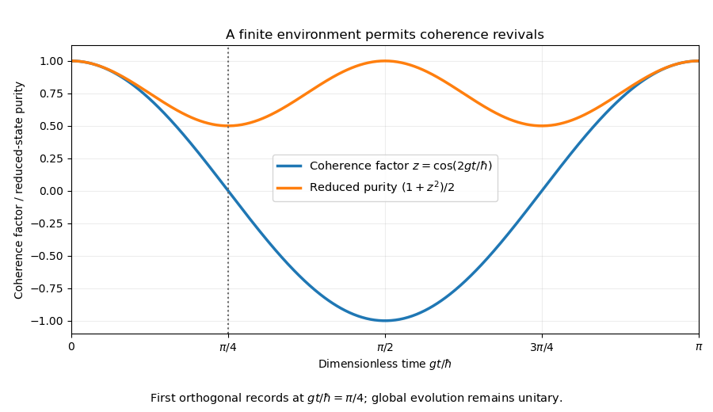

<h1 id="1/d/solution">Solution</h1>

↑ **Parent:** [D](../d.md)

Since $(Z_D\otimes X_E)^2=I$, the solution of the [Time-dependent Schrödinger equation](../../../../../time-dependent-schrodinger-equation.md) is

$$
U(t)=I_S\otimes\left[\cos A\,I_{DE}-i\sin A\,Z_D\otimes X_E\right],
\qquad \boxed{A(t)=gt/\hbar.}
$$

The two detector eigenvalues generate opposite rotations of the environment. Acting on the initial state gives

$$
\boxed{|\Psi(t)\rangle=\frac1{\sqrt2}\left[
|\uparrow d_\uparrow\rangle(\cos A|E_\uparrow\rangle-i\sin A|E_\downarrow\rangle)
+|\downarrow d_\downarrow\rangle(\cos A|E_\uparrow\rangle+i\sin A|E_\downarrow\rangle)\right].}
$$

These are the indicated $|E_-\rangle$ and $|E_+\rangle$. Their [conditional environment overlap](../../../../../conditional-environment-overlap.md) is $\langle E_+|E_-\rangle=\cos2A$. The [partial trace](../../../../../partial-trace.md) therefore multiplies the coherence between $|\uparrow d_\uparrow\rangle$ and $|\downarrow d_\downarrow\rangle$ by $\cos2A$. This is an exactly solvable [single-qubit environment dephasing model](../../../../../single-qubit-environment-dephasing-model.md), with fully reversible global evolution.

**[Figure 1](#1/d/image-single-qubit-environmental-records-suppress-and-later-restore-reduced-coherence). Single-qubit environmental records suppress and later restore reduced coherence**. Original ideal unitary model. Zero off-diagonal coherence at one time does not imply irreversible collapse of the full state.

## ↑ Ancestors (14)

1. [D](../d.md)
2. [1](../../1.md)
3. [Paper 1](../../../paper-1-split.md)
4. [2015](../../../split.md)
5. [Past exam of the quantum information course of the University of Cambridge](../../../../split.md)
6. [Quantum Information course of the University of Cambridge](../../../../../quantum-information-course-of-the-university-of-cambridge.md)
7. [Physics course of the year 4 of the natural sciences course of the University of Cambridge](../../../../../physics-course-of-the-year-4-of-the-natural-sciences-course-of-the-university-of-cambridge.md)
8. [Year 4 of the natural sciences course of the University of Cambridge](../../../../../year-4-of-the-natural-sciences-course-of-the-university-of-cambridge.md)
9. [Year of the natural sciences course of the University of Cambridge](../../../../../year-of-the-natural-sciences-course-of-the-university-of-cambridge.md)
10. [Natural sciences course of the University of Cambridge](../../../../../natural-sciences-course-of-the-university-of-cambridge.md)
11. [Course of the University of Cambridge](../../../../../course-of-the-university-of-cambridge.md)
12. [University of Cambridge](../../../../../university-of-cambridge-split.md)
13. [List of universities](../../../../../list-of-universities.md)
14. [Codex Wiki](../../../../../split.md)
