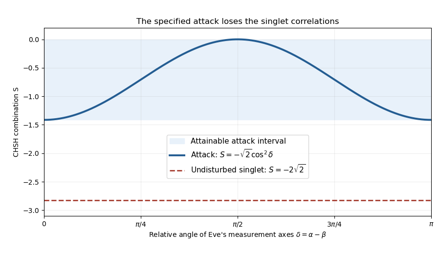

<h1 id="2/e/solution">Solution</h1>

↑ **Parent:** [E](../e.md)

Write $\mathbf n_a=(\cos\alpha,\sin\alpha)$ and $\mathbf n_b=(\cos\beta,\sin\beta)$. Since $\mathbf b_1-\mathbf b_3=\sqrt2\hat{\mathbf x}$ and $\mathbf b_1+\mathbf b_3=\sqrt2\hat{\mathbf y}$, the [CHSH inequality](../../../../../chsh-inequality.md) combination becomes

$$
S=-\sqrt2\cos(\alpha-\beta)
\left(\cos\alpha\cos\beta+\sin\alpha\sin\beta\right).
$$

Therefore

$$
\boxed{S=-\sqrt2\cos^2(\alpha-\beta),\qquad -\sqrt2\leq S\leq0.}
$$

Parallel or antiparallel Eve axes attain the lower endpoint; orthogonal axes attain zero. This bound is specific to the two-sided projective attack and these planar settings. It is stronger than the generic local bound $|S|\le2$ and should not be attributed to every possible eavesdropping strategy.

If Eve varies her axes independently of the users' still-secret random settings, the measured correlations average over her choices. The same linear combination obeys $S=-\sqrt2\,\mathbb E[\cos^2(\alpha-\beta)]$ and remains in the interval by [convexity](../../../../../convex-function.md). Strategies correlated with disclosed measurement settings would violate that independence premise; the protocol must protect it.

**[Figure 2](#2/e/image-the-planar-two-sided-intercept-resend-attack-cannot-reproduce-the-singlet-chsh-value). The planar two-sided intercept-resend attack cannot reproduce the singlet CHSH value**. Original analytic curve as Eve changes the relative angle of her measurement axes. The dashed line is the undisturbed singlet result, outside the attack's attainable interval.

## ↑ Ancestors (14)

1. [E](../e.md)
2. [2](../../2.md)
3. [Paper 1](../../../paper-1-split.md)
4. [2015](../../../split.md)
5. [Past exam of the quantum information course of the University of Cambridge](../../../../split.md)
6. [Quantum Information course of the University of Cambridge](../../../../../quantum-information-course-of-the-university-of-cambridge.md)
7. [Physics course of the year 4 of the natural sciences course of the University of Cambridge](../../../../../physics-course-of-the-year-4-of-the-natural-sciences-course-of-the-university-of-cambridge.md)
8. [Year 4 of the natural sciences course of the University of Cambridge](../../../../../year-4-of-the-natural-sciences-course-of-the-university-of-cambridge.md)
9. [Year of the natural sciences course of the University of Cambridge](../../../../../year-of-the-natural-sciences-course-of-the-university-of-cambridge.md)
10. [Natural sciences course of the University of Cambridge](../../../../../natural-sciences-course-of-the-university-of-cambridge.md)
11. [Course of the University of Cambridge](../../../../../course-of-the-university-of-cambridge.md)
12. [University of Cambridge](../../../../../university-of-cambridge-split.md)
13. [List of universities](../../../../../list-of-universities.md)
14. [Codex Wiki](../../../../../split.md)
