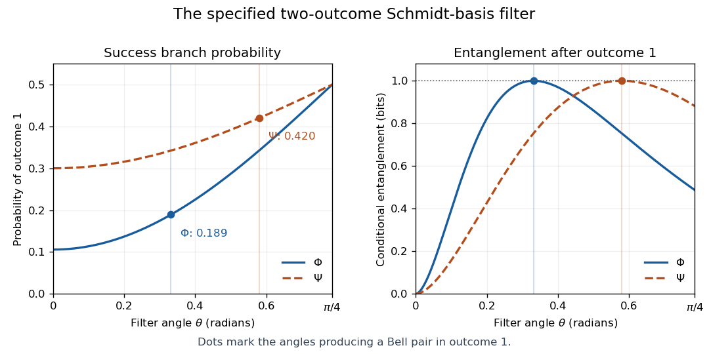

<h1 id="2/solution">Solution</h1>

↑ **Parent:** [2](../2.md)

Use the thin [singular value decomposition](../../../../singular-value-decomposition.md) $a=UdV^\dagger$, with $U^\dagger U=I_N$, $V$ unitary and $d=\operatorname{diag}(d_k)$ nonnegative. Expanding its entries gives

$$
a_{ij}=\sum_kU_{ik}d_kV_{jk}^*,\qquad
|\psi\rangle=\sum_kd_k\left(\sum_iU_{ik}|i_A\rangle\right)\left(\sum_jV_{jk}^*|j_B\rangle\right).
$$

The columns of $U$ and of $V^*$ are orthonormal, establishing the [Schmidt decomposition](../../../../schmidt-decomposition.md). **Bob's basis uses the complex-conjugated columns of $V$.** Omitting that conjugation would not reproduce the coefficient matrix. The squared [Schmidt coefficients](../../../../schmidt-coefficient.md) are the [eigenvalues](../../../../eigenvalue.md) of $a^\dagger a$; equivalently $d^2=V^\dagger a^\dagger aV$ and $d=U^\dagger aV$. The two [reduced density matrices](../../../../reduced-density-matrix.md) are $aa^\dagger$ and $(a^\dagger a)^T$, which have the same nonzero eigenvalues.

The printed coefficient $0.41231$ slightly rounds a normalized state: each squared norm is $0.9999995361$. Normalize before calculating an entropy. For the two states, the resulting [Gram matrices](../../../../gram-matrix.md) are approximately

$$
G_\Phi=\begin{pmatrix}0.6200003&0.2649241-0.2661551i\\0.2649241+0.2661551i&0.3799997\end{pmatrix},\quad
G_\Psi=\begin{pmatrix}0.6200003&-0.0649240+0.1461551i\\-0.0649240-0.1461551i&0.3799997\end{pmatrix}.
$$

For a trace-one two-dimensional [Hermitian matrix](../../../../hermitian-operator.md) with diagonal entry $u$ and off-diagonal entry $c$, its eigenvalues are

$$
\lambda_{0,1}=\frac12\left(1\pm\sqrt{(2u-1)^2+4|c|^2}\right).
$$

Sort them decreasingly and take square roots:

$$
\boxed{\begin{array}{c|c|c|c}
& (d_0,d_1)&(\lambda_0,\lambda_1)&S(\rho_A)\text{ in bits}\\\hline
\Phi&(0.945641,0.325211)&(0.894238,0.105762)&0.487000\\
\Psi&(0.836625,0.547776)&(0.699941,0.300059)&0.881363
\end{array}}
$$

The [Von Neumann entropy](../../../../von-neumann-entropy-split.md) is $S=-\lambda_0\log_2\lambda_0-\lambda_1\log_2\lambda_1$. **$\Psi$ is more entangled:** its Schmidt weights are closer to equal and its reduced-state entropy is larger. Neither state is a product state or maximally entangled on its two-dimensional support.

By [Nielsen's pure-state conversion theorem](../../../../nielsen-s-pure-state-conversion-theorem.md), deterministic [LOCC](../../../../local-operations-and-classical-communication.md) conversion requires the input vector of squared [Schmidt coefficients](../../../../schmidt-coefficient.md) to be majorized by the output vector. Here $0.699941<0.894238$ and both sums are one, so $\lambda(\Psi)\prec\lambda(\Phi)$. Therefore **$\Psi\to\Phi$ is possible deterministically; $\Phi\to\Psi$ is not.** Entanglement can be discarded by local operations but cannot increase deterministically for these pure inputs. Probabilistic concentration is a separate question and is allowed below.[1999 primary theorem: deterministic pure-state conversion and majorization](../../../../conditions-for-a-class-of-entanglement-transformations-by-michael-a-nielsen.md)

There is a dimensional qualification in the proposed measurement. Write $P=|0'_A\rangle\langle0'_A|+|1'_A\rangle\langle1'_A|$. The two supplied [measurement operators](../../../../kraus-operator.md) obey

$$
M_1^\dagger M_1+M_2^\dagger M_2=P.
$$

Thus their effects form a [POVM on the occupied support](../../../../povm-on-the-occupied-support.md), where $P$ is the identity. Alice's full space is three-dimensional, so these two operators alone do not sum to $I_3$. A full-space completion is $M_3=|2'_A\rangle\langle2'_A|$. It has zero probability on either input, so it changes none of the requested outcomes. Strictly, the POVM consists of the effects $E_r=M_r^\dagger M_r$; the specified $M_r$ additionally fix a [quantum instrument](../../../../quantum-instrument.md) and therefore the conditional states.

In the appropriate [Schmidt basis](../../../../schmidt-basis.md) for either input, write $|\psi\rangle=\sqrt{\lambda_0}|00\rangle+\sqrt{\lambda_1}|11\rangle$. The two outcomes have probabilities

$$
\boxed{p_1=\lambda_0\sin^2\theta+\lambda_1\cos^2\theta,\qquad
p_2=\lambda_0\cos^2\theta+\lambda_1\sin^2\theta,}
$$

and normalized conditional states

$$
|\psi_1\rangle=\frac{\sqrt{\lambda_0}\sin\theta|00\rangle+\sqrt{\lambda_1}\cos\theta|11\rangle}{\sqrt{p_1}},\qquad
|\psi_2\rangle=\frac{\sqrt{\lambda_0}\cos\theta|00\rangle+\sqrt{\lambda_1}\sin\theta|11\rangle}{\sqrt{p_2}}.
$$

These formulas give both outcomes for each state by substituting its row of the table. For example,

$$
\begin{array}{c|c|c}
&p_1&p_2\\\hline
\Phi&0.894238\sin^2\theta+0.105762\cos^2\theta&1-p_1\\
\Psi&0.699941\sin^2\theta+0.300059\cos^2\theta&1-p_1
\end{array}
$$

The two inputs have different Schmidt bases; the primed measurement basis is adapted separately to the state, as the question specifies, not one common unexamined laboratory basis.

For the $M_1$ outcome to be a [maximally entangled state](../../../../maximally-entangled-state.md), its two amplitudes must be equal. Hence

$$
\tan\theta=\sqrt{\frac{\lambda_1}{\lambda_0}},\qquad
\sin^2\theta=\lambda_1,\qquad
\boxed{p_1^{\rm Bell}=2\lambda_0\lambda_1.}
$$

The requested numerical results are

$$
\boxed{\begin{array}{c|c|c}
&\theta\text{ in radians}&p_1^{\rm Bell}\\\hline
\Phi&0.331235&0.189153\\
\Psi&0.579704&0.420047
\end{array}}
$$

Thus **$\Psi$ has the larger success probability**, consistent with its greater initial entanglement. The $M_2$ branch cannot be balanced in the allowed angle range for either nonmaximal input: it would require $\tan\theta=\sqrt{\lambda_0/\lambda_1}>1$.

**[Figure 1](#2/image-success-probability-and-conditional-entanglement-for-the-specified-schmidt-basis-filter). Success probability and conditional entanglement for the specified Schmidt-basis filter**. Original calculation with normalized printed coefficients. Each marked angle makes outcome 1 maximally entangled. Curves refer to the specified two-outcome instrument, not the optimal unrestricted concentration protocol.

The success probabilities belong to this particular [binary Schmidt filter](../../../../binary-schmidt-filter.md). They are not the optimum over every possible [quantum instrument](../../../../quantum-instrument.md). The diagonal success operator $\operatorname{diag}(\sqrt{\lambda_1/\lambda_0},1)$ instead gives the standard [single-copy entanglement concentration](../../../../single-copy-entanglement-concentration.md) probability $2\lambda_1$. Postselection can increase entanglement in the retained branch, while the outcome-averaged entanglement cannot increase under [LOCC](../../../../local-operations-and-classical-communication.md).

## ↑ Ancestors (13)

1. [2](../2.md)
2. [Paper 1](../../paper-1-split.md)
3. [2016](../../split.md)
4. [Past exam of the quantum information course of the University of Cambridge](../../../split.md)
5. [Quantum Information course of the University of Cambridge](../../../../quantum-information-course-of-the-university-of-cambridge.md)
6. [Physics course of the year 4 of the natural sciences course of the University of Cambridge](../../../../physics-course-of-the-year-4-of-the-natural-sciences-course-of-the-university-of-cambridge.md)
7. [Year 4 of the natural sciences course of the University of Cambridge](../../../../year-4-of-the-natural-sciences-course-of-the-university-of-cambridge.md)
8. [Year of the natural sciences course of the University of Cambridge](../../../../year-of-the-natural-sciences-course-of-the-university-of-cambridge.md)
9. [Natural sciences course of the University of Cambridge](../../../../natural-sciences-course-of-the-university-of-cambridge.md)
10. [Course of the University of Cambridge](../../../../course-of-the-university-of-cambridge.md)
11. [University of Cambridge](../../../../university-of-cambridge-split.md)
12. [List of universities](../../../../list-of-universities.md)
13. [Codex Wiki](../../../../split.md)
