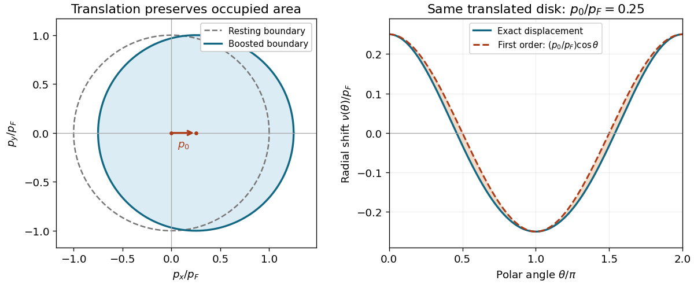

# 2023

↑ **Parent:** [Past exam of the quantum matter course of the University of Oxford](../past-exam-of-the-quantum-matter-course-of-the-university-of-oxford.md)

Source PDF: [https://mmathphys.web.ox.ac.uk/sitefiles/quantum-matter.pdf](https://mmathphys.web.ox.ac.uk/sitefiles/quantum-matter.pdf)

TODO: establish the year coverage of the lecturer's prior-exam solutions collection: [https://www-thphys.physics.ox.ac.uk/people/SteveSimon/QCM2025/quantummatter.html.](https://www-thphys.physics.ox.ac.uk/people/SteveSimon/QCM2025/quantummatter.html.)

**Table of contents**

- [1](#1)
  - [a](#1/a)
    - [Solution](#1/a/solution)
  - [b](#1/b)
    - [Solution](#1/b/solution)
  - [c](#1/c)
    - [Solution](#1/c/solution)
  - [d](#1/d)
    - [Solution](#1/d/solution)
  - [e](#1/e)
    - [Solution](#1/e/solution)
- [2](#2)
  - [a](#2/a)
    - [Solution](#2/a/solution)
  - [b](#2/b)
    - [Solution](#2/b/solution)
  - [c](#2/c)
    - [Solution](#2/c/solution)
  - [d](#2/d)
    - [Solution](#2/d/solution)
  - [e](#2/e)
    - [Solution](#2/e/solution)

## 1

↑ **Parent:** [2023](2023.md)

<h3 id="1/a">a</h3>

↑ **Parent:** [1](#1)

<h4 id="1/a/solution">Solution</h4>

↑ **Parent:** [A](#1/a)

Write $h_0=-\hbar^2\nabla^2/(2m)+V(\mathbf r)$ for the one-particle [Hamiltonian operator](../quantum-system.md#hamiltonian-quantum-mechanics). The [second quantization](../quantum-mechanics.md#second-quantization) of the [kinetic energy](../energy.md#kinetic-energy), external [potential energy](../energy.md#potential-energy) and repulsive [contact interaction](../quantum-mechanics.md#contact-interaction-quantum-mechanics) is

$$
\boxed{\hat H=\int d^3r\,\hat\psi^\dagger(\mathbf r)h_0\hat\psi(\mathbf r)
+\frac{U_0}{2}\int d^3r\,\hat\psi^\dagger(\mathbf r)^2\hat\psi(\mathbf r)^2.}
$$

The factor $1/2$ counts each unordered particle pair once. [Normal ordering](../perturbative-quantum-field-theory.md#normal-ordering) excludes self-interaction: the interaction acts on two distinct [bosons](../tensor-product-of-quantum-systems.md#boson). The fixed [particle number](../physics.md#particle-number) sector has $\hat N=\int d^3r\,\hat\psi^\dagger\hat\psi=N$. In three dimensions, this [contact interaction](../quantum-mechanics.md#contact-interaction-quantum-mechanics) is understood as a regulated low-[energy](../energy.md) interaction with a matched coupling, as in [renormalization of a three-dimensional dilute-gas contact coupling](../quantum-ideal-gas-statistics.md#renormalization-of-a-three-dimensional-dilute-gas-contact-coupling); the finite-mode calculation below uses its projected matrix elements.

<h3 id="1/b">b</h3>

↑ **Parent:** [1](#1)

<h4 id="1/b/solution">Solution</h4>

↑ **Parent:** [B](#1/b)

The [quantized field](../quantum-field-theory.md#quantized-field) expansion in the complete [orthonormal basis](../inner-product.md#orthonormal-basis) of [orbitals](../wave-function.md#single-particle-orbital) is

$$
\boxed{\hat\psi(\mathbf r)=\sum_n\phi_n(\mathbf r)\hat a_n,\qquad
\hat\psi^\dagger(\mathbf r)=\sum_n\phi_n^*(\mathbf r)\hat a_n^\dagger.}
$$

The complex conjugation in the [creation operator](../quantum-harmonic-oscillator.md#creation-operator) expansion is essential for complex [orbitals](../wave-function.md#single-particle-orbital). Indeed, $\hat a_n^\dagger=\int d^3r\,\phi_n(\mathbf r)\hat\psi^\dagger(\mathbf r)$ creates the [wavefunction](../wave-function.md) $\phi_n$. The [resolution of the identity in an orthonormal basis](../inner-product.md#resolution-of-the-identity-in-an-orthonormal-basis) gives

$$
[\hat\psi(\mathbf r),\hat\psi^\dagger(\mathbf r')]
=\sum_n\phi_n(\mathbf r)\phi_n^*(\mathbf r')
=\delta^{(3)}(\mathbf r-\mathbf r'),
$$

recovering the [canonical commutation relation](../quantum-mechanics.md#canonical-commutation-relation) and the spatial [Dirac delta function](../distribution-theory.md#dirac-delta-function).

<h3 id="1/c">c</h3>

↑ **Parent:** [1](#1)

<h4 id="1/c/solution">Solution</h4>

↑ **Parent:** [C](#1/c)

The [two-mode approximation for a Bose gas](../quantum-mechanics.md#two-mode-approximation-for-a-bose-gas) retains the real localized [orbitals](../wave-function.md#single-particle-orbital):

$$
\boxed{\hat\psi^\dagger(\mathbf r)\simeq\varphi_L(\mathbf r)\hat a_L^\dagger+\varphi_R(\mathbf r)\hat a_R^\dagger.}
$$

It is valid when the lowest doublet is well separated from higher [energy levels](../quantum-mechanics.md#energy-level), and the [temperature](../temperature.md) and interaction-induced changes of the [orbitals](../wave-function.md#single-particle-orbital) are small on that separation. More explicitly, if $\Delta$ is the [energy gap](../linear-operator-theory.md#energy-gap) to discarded [orbitals](../wave-function.md#single-particle-orbital), sufficient low-[energy](../energy.md) conditions are $k_BT,t,NU_0I\ll\Delta$, where $I=\int d^3r\,|\varphi_L|^4$. A deep [double-well potential](../energy.md#double-well-potential) suppresses interwell interaction overlaps. Large $N$ alone does not justify the truncation: increasing $N$ at fixed coupling can violate the interaction condition.

Let $\epsilon=(E_0+E_1)/2$ and use the even and odd [eigenfunctions](../linear-operator-theory.md#eigenfunction) to evaluate the projected one-particle [Hamiltonian operator](../quantum-system.md#hamiltonian-quantum-mechanics):

$$
\langle L|h_0|L\rangle=\langle R|h_0|R\rangle=\epsilon,\qquad
\langle L|h_0|R\rangle=\frac{E_0-E_1}{2}=-t.
$$

Thus

$$
\hat H_0=\epsilon(\hat n_L+\hat n_R)-t(\hat a_L^\dagger\hat a_R+\hat a_R^\dagger\hat a_L),\qquad
\boxed{t=\frac{E_1-E_0}{2}>0.}
$$

The same [quantum tunnelling](../quantum-mechanics.md#quantum-tunnelling) matrix element is $t=-\int d^3r\,\varphi_Lh_0\varphi_R$. Reflection symmetry makes $\int|\varphi_L|^4=\int|\varphi_R|^4=I$. Neglecting mixed [contact interaction](../quantum-mechanics.md#contact-interaction-quantum-mechanics) integrals leaves

$$
\hat H_{\rm int}=\frac{U_0I}{2}\sum_{j=L,R}(\hat a_j^\dagger)^2\hat a_j^2
=\frac{U_0I}{2}\sum_{j=L,R}\hat n_j(\hat n_j-1).
$$

The last step is the [normal-ordered boson pair count](../quantum-harmonic-oscillator.md#normal-ordered-boson-pair-count), following from the [canonical commutation relation](../quantum-mechanics.md#canonical-commutation-relation). Consequently the [two-site Bose-Hubbard model](../quantum-mechanics.md#two-site-bose-hubbard-model) has precisely the requested coefficients

$$
\boxed{w=\frac{U_0}{2}\int d^3r\,|\varphi_L(\mathbf r)|^4,\qquad
\mu=w-\frac{E_0+E_1}{2},}
$$

and

$$
\boxed{\hat H=-t(\hat a_L^\dagger\hat a_R+\hat a_R^\dagger\hat a_L)
+w(\hat n_L^2+\hat n_R^2)-\mu(\hat n_L+\hat n_R).}
$$

Here $\mu$ is the coefficient obtained by rewriting the fixed-[particle number](../physics.md#particle-number) [Hamiltonian operator](../quantum-system.md#hamiltonian-quantum-mechanics), rather than an independently prescribed thermodynamic [chemical potential](../chemical-potential.md). Adding a reservoir term $-\mu_{\rm res}\hat N$ would replace it by $\mu+\mu_{\rm res}$.

The negligible-overlap instruction applies to the mixed [contact interaction](../quantum-mechanics.md#contact-interaction-quantum-mechanics) integrals while the small [quantum tunnelling](../quantum-mechanics.md#quantum-tunnelling) matrix element is retained. Exactly disjoint smooth [orbitals](../wave-function.md#single-particle-orbital) for a local $h_0$ would also give $t=0$; setting every overlap-related matrix element identically to zero would discard the physical splitting one is trying to describe.

<h3 id="1/d">d</h3>

↑ **Parent:** [1](#1)

<h4 id="1/d/solution">Solution</h4>

↑ **Parent:** [D](#1/d)

The normalized [Hartree product state](../quantum-mechanics.md#hartree-product-state) and its equivalent [second quantization](../quantum-mechanics.md#second-quantization) form are

$$
\boxed{\Psi_{\theta,\chi}(\mathbf r_1,\ldots,\mathbf r_N)
=\prod_{j=1}^N\varphi_{(\theta,\chi)}(\mathbf r_j),\qquad
|\theta,\chi;N\rangle=\frac{(\cos\theta\,\hat a_L^\dagger+e^{i\chi}\sin\theta\,\hat a_R^\dagger)^N}{\sqrt{N!}}|0\rangle.}
$$

The product is already symmetric under exchanging [bosons](../tensor-product-of-quantum-systems.md#boson); no additional $1/\sqrt{N!}$ belongs in the coordinate [wavefunction](../wave-function.md). The factor in the [second quantization](../quantum-mechanics.md#second-quantization) expression instead normalizes repeated [creation operators](../quantum-harmonic-oscillator.md#creation-operator) acting on the [vacuum state](../quantum-field-theory.md#vacuum-state). This is a [fixed-number two-mode condensate](../quantum-ideal-gas-statistics.md#fixed-number-two-mode-condensate), with every [boson](../tensor-product-of-quantum-systems.md#boson) in the same normalized [orbital](../wave-function.md#single-particle-orbital).

Set $c=\cos\theta$ and $s=\sin\theta$. Its [binomial distribution](../discrete-probability-distribution.md#binomial-distribution) of occupations gives

$$
\langle\hat n_L\rangle=Nc^2,\quad\langle\hat n_R\rangle=Ns^2,\quad
\langle\hat a_L^\dagger\hat a_R\rangle=Ncs\,e^{i\chi},\qquad
\langle\hat n_L^2+\hat n_R^2\rangle=N+N(N-1)(c^4+s^4).
$$

The [expectation value](../quantum-system.md#expectation-value) of the [Hamiltonian operator](../quantum-system.md#hamiltonian-quantum-mechanics) is therefore

$$
\boxed{E(\theta,\chi)=-tN\sin(2\theta)\cos\chi
+w\left[N+N(N-1)\left(1-\frac12\sin^2(2\theta)\right)\right]-\mu N.}
$$

Keeping $N(N-1)$ rather than replacing it by $N^2$ retains the exact pair count of the trial [quantum state](../quantum-system.md#quantum-state). Equivalently, with $\epsilon=w-\mu$, its interaction contribution is $wN(N-1)(c^4+s^4)$ and its one-particle contribution is $\epsilon N-tN\sin(2\theta)\cos\chi$.

Choose the nonredundant parameter range $0\leq\theta\leq\pi/2$, with $\chi$ modulo $2\pi$. For $t>0$, minimizing over the relative [phase](../wave.md#phase-waves) gives $\chi=0$. Putting $x=\sin(2\theta)\in[0,1]$, the remaining nonconstant [energy](../energy.md) is $-tNx-\tfrac12wN(N-1)x^2$, which decreases with $x$ for the repulsive coupling $w>0$. Hence

$$
\boxed{\theta=\frac\pi4,\qquad\chi=0\pmod{2\pi},\qquad
E_{\min}=-tN+\frac w2N(N+1)-\mu N.}
$$

The optimal [orbital](../wave-function.md#single-particle-orbital) is the symmetric $\phi_0=(\varphi_L+\varphi_R)/\sqrt2$. Both the [quantum tunnelling](../quantum-mechanics.md#quantum-tunnelling) term and the repulsive interaction favor this balanced occupation within the [Hartree product state](../quantum-mechanics.md#hartree-product-state) family. This result uses a [variational method](../quantum-theory.md#variational-method): for strong repulsion relative to [quantum tunnelling](../quantum-mechanics.md#quantum-tunnelling), the true many-body [ground state](../quantum-mechanics.md#ground-state) can have smaller occupation fluctuations than this [fixed-number two-mode condensate](../quantum-ideal-gas-statistics.md#fixed-number-two-mode-condensate).

<h3 id="1/e">e</h3>

↑ **Parent:** [1](#1)

<h4 id="1/e/solution">Solution</h4>

↑ **Parent:** [E](#1/e)

**The printed identity has the wrong sign for the specified relative phase.** Differentiating the [energy](../energy.md) found above and evaluating the [operator commutator](../vector-space.md#operator-commutator) give

$$
\frac{\partial E}{\partial\chi}=tN\sin(2\theta)\sin\chi,\qquad
[\hat H,\hat n_L]=t(\hat a_L^\dagger\hat a_R-\hat a_R^\dagger\hat a_L),\qquad
i\langle[\hat H,\hat n_L]\rangle=-tN\sin(2\theta)\sin\chi.
$$

Thus the [phase derivative of a two-mode condensate energy](../quantum-ideal-gas-statistics.md#phase-derivative-of-a-two-mode-condensate-energy) is

$$
\boxed{\frac{\partial E}{\partial\chi}=-i\langle[\hat H,\hat n_L]\rangle
=i\langle[\hat H,\hat n_R]\rangle.}
$$

A concrete counterexample to the printed sign is $N=100$, $\theta=\pi/4$, $\chi=\pi/2$ and $t>0$: its left side is $100t$, whereas its printed right side is $-100t$, independently of $w$ and $\mu$.

There is also a direct derivation without inserting the [Hamiltonian operator](../quantum-system.md#hamiltonian-quantum-mechanics). Since $|\theta,\chi;N\rangle=e^{i\chi\hat n_R}|\theta,0;N\rangle$, differentiating this [unitary operator](../vector-space.md#unitary-operator) gives $\partial_\chi E=i\langle[\hat H,\hat n_R]\rangle$. Conservation of the total [particle number](../physics.md#particle-number), $[\hat H,\hat n_L+\hat n_R]=0$, then supplies the minus sign for the left well.

By the [Heisenberg equation of motion](../quantum-system.md#heisenberg-equation-of-motion), $\hbar\,d\langle\hat n_L\rangle/dt=i\langle[\hat H,\hat n_L]\rangle$. Define the [bosonic Josephson junction](../statistical-physics.md#bosonic-josephson-junction) [particle current](../physics.md#particle-current) from left to right as $J_{L\to R}=-d\langle\hat n_L\rangle/dt$. The corrected identity means

$$
\boxed{J_{L\to R}=\frac1\hbar\frac{\partial E}{\partial\chi}
=\frac{tN}{\hbar}\sin(2\theta)\sin\chi.}
$$

The [energy](../energy.md) slope with respect to the relative [phase](../wave.md#phase-waves) drives particle transfer; an extremum with respect to that [phase](../wave.md#phase-waves) has zero instantaneous [particle current](../physics.md#particle-current). The printed sign would work with $e^{-i\chi}$ in the right-well [orbital](../wave-function.md#single-particle-orbital), or with $[\hat n_L,\hat H]$ in place of $[\hat H,\hat n_L]$.

## 2

↑ **Parent:** [2023](2023.md)

<h3 id="2/a">a</h3>

↑ **Parent:** [2](#2)

<h4 id="2/a/solution">Solution</h4>

↑ **Parent:** [A](#2/a)

For a uniform continuum gas with pair interactions depending on relative positions, a [Galilean boost](../special-relativity.md#galilean-transformation) changes every particle [momentum](../momentum.md) by $p_0\hat{\mathbf x}$ and leaves the interaction [energy](../energy.md) unchanged. Write $\hat P_x=\sum_j\hat p_{j,x}$. The transformed many-body [Hamiltonian operator](../quantum-system.md#hamiltonian-quantum-mechanics) is

$$
\hat H'=\sum_{j=1}^N\frac{(\hat{\mathbf p}_j+p_0\hat{\mathbf x})^2}{2m}+\hat U
=\hat H+\frac{p_0}{m}\hat P_x+\frac{Np_0^2}{2m}.
$$

The resting [ground state](../quantum-mechanics.md#ground-state) has $\langle\hat P_x\rangle=0$, so the [Galilean boost energy of an interacting gas](../special-relativity.md#galilean-boost-energy-of-an-interacting-gas) is

$$
\boxed{\Delta E=\frac{Np_0^2}{2m}.}
$$

The [mass](../classical-mechanics.md#mass) here is the bare particle [mass](../classical-mechanics.md#mass), because this is an exact transformation of the microscopic [kinetic energy](../energy.md#kinetic-energy). Substituting the [Fermi-liquid effective mass](../fermi-liquid.md#fermi-liquid-effective-mass) $m^*$ would omit the change in interaction [energy](../energy.md) encoded by the [Landau quasiparticle energy functional](../fermi-liquid.md#landau-quasiparticle-energy-functional). This conclusion requires the [Principle of Galilean relativity](../special-relativity.md#principle-of-galilean-relativity); a gas in a lattice or a fixed external [potential energy](../energy.md#potential-energy) landscape need not obey it.

<h3 id="2/b">b</h3>

↑ **Parent:** [2](#2)

<h4 id="2/b/solution">Solution</h4>

↑ **Parent:** [B](#2/b)

Let $A$ be the real-space area and use $\sum_{\mathbf p}\to C\int d^2p$, with $C=A/(2\pi\hbar)^2$. There is one state per [momentum](../momentum.md) cell, since the [fermions](../tensor-product-of-quantum-systems.md#fermion) are spinless. An annulus between $p$ and $p+dp$ contains $C\,2\pi p\,dp$ states. Near the [Fermi surface](../fermi-liquid.md#fermi-surface), the [quasiparticle](../quantum-mechanics.md#quasiparticle) [dispersion relation](../dispersion-relation.md) has $d\epsilon/dp=v_F^*=p_F/m^*$, so the total [density of states](../quantum-ideal-gas-statistics.md#density-of-states) is

$$
\boxed{D^*(\mu)=C\frac{2\pi p_F}{v_F^*}=\frac{Am^*}{2\pi\hbar^2}.}
$$

The [density of states](../quantum-ideal-gas-statistics.md#density-of-states) per unit area and the occupied-state count are, respectively,

$$
\boxed{g^*(\mu)=\frac{D^*(\mu)}A=\frac{m^*}{2\pi\hbar^2},\qquad
N=C\pi p_F^2=\frac{Ap_F^2}{4\pi\hbar^2}.}
$$

In particular, $D^*(\mu)=2Nm^*/p_F^2$. No factor of two for [spin degeneracy](../statistical-physics.md#spin-degeneracy) is present. This counts [Landau quasiparticle](../fermi-liquid.md#landau-quasiparticle) levels, so it is not multiplied by the [quasiparticle residue](../fermi-liquid.md#quasiparticle-residue) of the microscopic particle [Green's function](../green-s-function.md).

<h3 id="2/c">c</h3>

↑ **Parent:** [2](#2)

<h4 id="2/c/solution">Solution</h4>

↑ **Parent:** [C](#2/c)

The shifted [Fermi circle](../fermi-liquid.md#fermi-circle) satisfies $|\mathbf p-p_0\hat{\mathbf x}|=p_F$. Its radial boundary at polar angle $\theta$ is the positive solution of $p^2-2pp_0\cos\theta+p_0^2=p_F^2$. Thus, for $p_0<p_F$,

$$
p_F+\nu(\theta)=p_0\cos\theta+\sqrt{p_F^2-p_0^2\sin^2\theta},
$$

and its leading [Taylor expansion](../calculus.md#taylor-expansion) is

$$
\boxed{\nu(\theta)=p_0\cos\theta+O(p_0^2/p_F).}
$$

Forward-pointing [momenta](../momentum.md) gain occupied states and backward-pointing [momenta](../momentum.md) lose them. With the paper's explicitly reversed [Heaviside step function](../integral-transform.md#heaviside-step-function) convention, $\Theta'(x)=-\delta(x)$; consequently

$$
\delta n(\mathbf p)=\nu(\theta_{\mathbf p})\delta(p-p_F)+O(p_0^2),
$$

with a positive leading sign.

For the later quadratic [energy](../energy.md) calculation it is useful to distinguish the first-order shape from exact [particle number](../physics.md#particle-number) conservation. The [particle-conserving displacement of a Fermi circle](../fermi-liquid.md#particle-conserving-displacement-of-a-fermi-circle) has

$$
\nu(\theta)=p_0\cos\theta-\frac{p_0^2}{2p_F}\sin^2\theta+O(p_0^4/p_F^3),\qquad
\delta N=C\int_0^{2\pi}\left[p_F\nu+\frac{\nu^2}{2}\right]d\theta=0.
$$

The second-order inward correction cancels the apparent area increase one would obtain by treating $\nu=p_0\cos\theta$ as exact.

**[Figure 1](#2/c/image-translation-of-a-fermi-circle-and-its-radial-displacement). Translation of a Fermi circle and its radial displacement**. Original geometric construction with $p_0/p_F=0.25$. The [Fermi sea](../quantum-ideal-gas-statistics.md#fermi-sea) keeps its area under translation; the first-order radial approximation differs from the exact boundary at second order.

<h3 id="2/d">d</h3>

↑ **Parent:** [2](#2)

<h4 id="2/d/solution">Solution</h4>

↑ **Parent:** [D](#2/d)

Within a stable normal [Fermi liquid](../fermi-liquid.md), the low-[energy](../energy.md) states are described by long-lived [Landau quasiparticles](../fermi-liquid.md#landau-quasiparticle) and [holes](../quantum-mechanics.md#electron-hole) in a thin shell about the [Fermi surface](../fermi-liquid.md#fermi-surface); the [Pauli exclusion principle](../tensor-product-of-quantum-systems.md#pauli-exclusion-principle) suppresses their decay. Expanding the [energy](../energy.md) about the equilibrium occupations gives the one-[quasiparticle](../quantum-mechanics.md#quasiparticle) [dispersion relation](../dispersion-relation.md) at first order and the interaction between occupation changes at second order, namely the [Landau quasiparticle energy functional](../fermi-liquid.md#landau-quasiparticle-energy-functional). For a smooth interaction, radial deviations in that interaction may be neglected at leading order, leaving its angular dependence; higher occupation terms contribute higher powers of the small shell thickness. Collective occupation deformations are included in the same description. The sufficiency claim is conditional on the normal [Fermi liquid](../fermi-liquid.md) regime, and on supplementing this static [energy functional](../calculus-of-variations.md#energy-functional) with dynamics when required: it is not a description of arbitrary low-[energy](../energy.md) phases such as a [superconductor](../superconductivity.md#superconductor) or [non-Fermi liquid](../statistical-physics.md#non-fermi-liquid).

<h3 id="2/e">e</h3>

↑ **Parent:** [2](#2)

<h4 id="2/e/solution">Solution</h4>

↑ **Parent:** [E](#2/e)

Use the total [density of states](../quantum-ideal-gas-statistics.md#density-of-states) $D^*=Am^*/(2\pi\hbar^2)$ and $C=A/(2\pi\hbar)^2$ from part (b). In the paper's double-sum convention, $f(\phi)$ has units of [energy](../energy.md) and scales as $A^{-1}$. Define its first angular moment by

$$
\overline f_1=\int_0^{2\pi}\frac{d\phi}{2\pi}\,f(\phi)\cos\phi.
$$

This convention matters: the [Landau quasiparticle energy functional](../fermi-liquid.md#landau-quasiparticle-energy-functional) written with an explicit $1/A$ instead uses the intensive kernel $\widetilde f=Af$.

At zero [temperature](../temperature.md), the displayed functional is the change in $E-\mu N$; a true [Galilean boost](../special-relativity.md#galilean-transformation) preserves $N$, so $\Delta\mathcal F=\Delta E$. For a radial displacement $\nu(\theta)$, the first term in the [Landau quasiparticle energy functional](../fermi-liquid.md#landau-quasiparticle-energy-functional) becomes

$$
\begin{aligned}
\Delta\mathcal F_{\rm qp}
&=C\int_0^{2\pi}d\theta\int_{p_F}^{p_F+\nu(\theta)}p\,dp\,\frac{p_F}{m^*}(p-p_F)\\
&=\frac{Cp_F^2}{2m^*}\int_0^{2\pi}\nu(\theta)^2\,d\theta+o(p_0^2).
\end{aligned}
$$

The oriented radial [integral](../integral.md) also works for negative $\nu$: removing occupied levels below the [chemical potential](../chemical-potential.md) costs positive [energy](../energy.md). Substituting $\nu=p_0\cos\theta+O(p_0^2/p_F)$ and using $N=C\pi p_F^2$ gives

$$
\boxed{\Delta\mathcal F_{\rm qp}=\frac{Np_0^2}{2m^*}+o(p_0^2).}
$$

The exact second-order correction to the boundary is unnecessary here because the unperturbed excitation [energy](../energy.md) vanishes on the [Fermi surface](../fermi-liquid.md#fermi-surface); it changes this term only beyond quadratic order. It must nevertheless be understood when identifying $\Delta\mathcal F$ with a fixed-[particle number](../physics.md#particle-number) [energy](../energy.md) change.

For the quadratic interaction term, the first-order occupation change alone suffices. The radial [Dirac delta function](../distribution-theory.md#dirac-delta-function) integrals give

$$
\Delta\mathcal F_{\rm int}=\frac{C^2p_F^2p_0^2}{2}
\int_0^{2\pi}d\theta\int_0^{2\pi}d\theta'\,
f(\theta-\theta')\cos\theta\cos\theta'+o(p_0^2).
$$

Put $\phi=\theta-\theta'$. The remaining angular [integral](../integral.md) uses

$$
\int_0^{2\pi}\cos(\theta'+\phi)\cos\theta'\,d\theta'=\pi\cos\phi,
$$

so only the first cosine component of the interaction survives. Since $D^*=2\pi Cm^*$,

$$
\begin{aligned}
\Delta\mathcal F_{\rm int}
&=\frac{C^2p_F^2p_0^2\pi}{2}\int_0^{2\pi}f(\phi)\cos\phi\,d\phi+o(p_0^2)\\
&=\frac{Np_0^2}{2m^*}\,D^*\overline f_1+o(p_0^2).
\end{aligned}
$$

Adding both contributions and matching the bare-[mass](../classical-mechanics.md#mass) result of part (a) yields the [two-dimensional Landau effective-mass relation](../fermi-liquid.md#two-dimensional-landau-effective-mass-relation):

$$
\boxed{\Delta E=\frac{Np_0^2}{2m^*}\left(1+D^*\overline f_1\right)+o(p_0^2),\qquad
\frac{m^*}{m}=1+D^*\int_0^{2\pi}\frac{d\phi}{2\pi}\,f(\phi)\cos\phi.}
$$

Equivalently, using the [density of states](../quantum-ideal-gas-statistics.md#density-of-states) per unit area $g^*=D^*/A$,

$$
\boxed{\frac{m^*}{m}=1+g^*\int_0^{2\pi}\frac{d\phi}{2\pi}\,\widetilde f(\phi)\cos\phi.}
$$

If dimensionless [Landau parameters](../fermi-liquid.md#landau-parameter) are defined through the [Fourier series](../fourier-series.md) $D^*f(\phi)=F_0+\sum_{\ell\geq1}F_\ell\cos(\ell\phi)$, then $D^*\overline f_1=F_1/2$ and

$$
\boxed{\frac{m^*}{m}=1+\frac{F_1}{2}.}
$$

Defining the cosine expansion with an extra factor of two would instead absorb that factor into $F_1$; the angular-[integral](../integral.md) formula above fixes the convention unambiguously. The physical content is that interaction changes accompanying a moving [Fermi sea](../quantum-ideal-gas-statistics.md#fermi-sea) compensate the renormalized [quasiparticle](../quantum-mechanics.md#quasiparticle) [velocity](../classical-mechanics.md#velocity), so the total boost [energy](../energy.md) is governed by the bare [mass](../classical-mechanics.md#mass). For an interaction independent of angle, $\overline f_1=0$ and this consistency condition requires $m^*=m$.

## ↑ Ancestors (9)

1. [Past exam of the quantum matter course of the University of Oxford](../past-exam-of-the-quantum-matter-course-of-the-university-of-oxford.md)
2. [Quantum matter course of the University of Oxford](../university-of-oxford.md#quantum-matter-course-of-the-university-of-oxford)
3. [Year 4 of the mathematical and theoretical physics course of the University of Oxford](../university-of-oxford.md#year-4-of-the-mathematical-and-theoretical-physics-course-of-the-university-of-oxford)
4. [Mathematical and theoretical physics course of the University of Oxford](../university-of-oxford.md#mathematical-and-theoretical-physics-course-of-the-university-of-oxford)
5. [Undergraduate course of the University of Oxford](../university-of-oxford.md#undergraduate-course-of-the-university-of-oxford)
6. [Course of the University of Oxford](../university-of-oxford.md#course-of-the-university-of-oxford)
7. [University of Oxford](../university-of-oxford.md)
8. [List of universities](../README.md#list-of-universities)
9. [Codex Wiki](../README.md)
