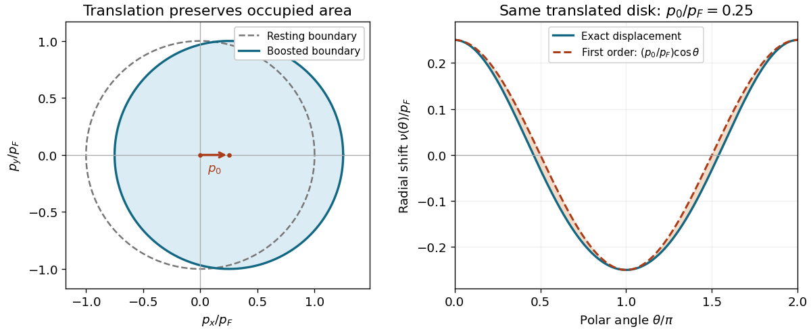

<h1 id="2/c/solution">Solution</h1>

↑ **Parent:** [C](../c.md)

The shifted [Fermi circle](../../../../fermi-circle.md) satisfies $|\mathbf p-p_0\hat{\mathbf x}|=p_F$. Its radial boundary at polar angle $\theta$ is the positive solution of $p^2-2pp_0\cos\theta+p_0^2=p_F^2$. Thus, for $p_0<p_F$,

$$
p_F+\nu(\theta)=p_0\cos\theta+\sqrt{p_F^2-p_0^2\sin^2\theta},
$$

and its leading [Taylor expansion](../../../../taylor-expansion.md) is

$$
\boxed{\nu(\theta)=p_0\cos\theta+O(p_0^2/p_F).}
$$

Forward-pointing [momenta](../../../../momentum-split.md) gain occupied states and backward-pointing [momenta](../../../../momentum-split.md) lose them. With the paper's explicitly reversed [Heaviside step function](../../../../heaviside-step-function.md) convention, $\Theta'(x)=-\delta(x)$; consequently

$$
\delta n(\mathbf p)=\nu(\theta_{\mathbf p})\delta(p-p_F)+O(p_0^2),
$$

with a positive leading sign.

For the later quadratic [energy](../../../../energy-split.md) calculation it is useful to distinguish the first-order shape from exact [particle number](../../../../particle-number.md) conservation. The [particle-conserving displacement of a Fermi circle](../../../../particle-conserving-displacement-of-a-fermi-circle.md) has

$$
\nu(\theta)=p_0\cos\theta-\frac{p_0^2}{2p_F}\sin^2\theta+O(p_0^4/p_F^3),\qquad
\delta N=C\int_0^{2\pi}\left[p_F\nu+\frac{\nu^2}{2}\right]d\theta=0.
$$

The second-order inward correction cancels the apparent area increase one would obtain by treating $\nu=p_0\cos\theta$ as exact.

**[Figure 1](#2/c/image-translation-of-a-fermi-circle-and-its-radial-displacement). Translation of a Fermi circle and its radial displacement**. Original geometric construction with $p_0/p_F=0.25$. The [Fermi sea](../../../../fermi-sea.md) keeps its area under translation; the first-order radial approximation differs from the exact boundary at second order.

## ↑ Ancestors (12)

1. [C](../c.md)
2. [2](../../2.md)
3. [2023](../../../2023-split.md)
4. [Past exam of the quantum matter course of the University of Oxford](../../../split.md)
5. [Quantum matter course of the University of Oxford](../../../../quantum-matter-course-of-the-university-of-oxford.md)
6. [Year 4 of the mathematical and theoretical physics course of the University of Oxford](../../../../year-4-of-the-mathematical-and-theoretical-physics-course-of-the-university-of-oxford.md)
7. [Mathematical and theoretical physics course of the University of Oxford](../../../../mathematical-and-theoretical-physics-course-of-the-university-of-oxford.md)
8. [Undergraduate course of the University of Oxford](../../../../undergraduate-course-of-the-university-of-oxford.md)
9. [Course of the University of Oxford](../../../../course-of-the-university-of-oxford.md)
10. [University of Oxford](../../../../university-of-oxford-split.md)
11. [List of universities](../../../../list-of-universities.md)
12. [Codex Wiki](../../../../split.md)
