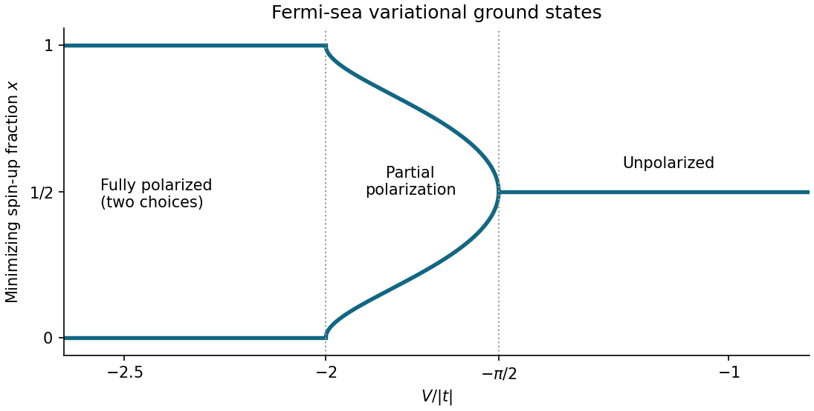
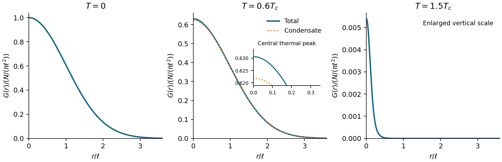
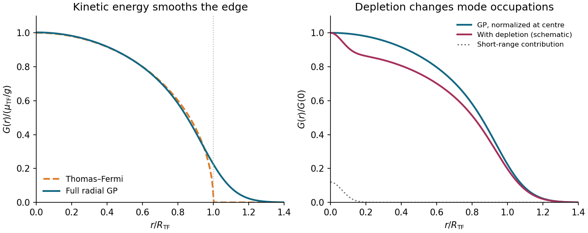

# 2025

↑ **Parent:** [Past exam of the quantum matter course of the University of Oxford](../past-exam-of-the-quantum-matter-course-of-the-university-of-oxford.md)

Source PDF: [https://mmathphys.physics.ox.ac.uk/sites/g/files/vzsiac2991/files/mmathphys/documents/media/a1853381.pdf](https://mmathphys.physics.ox.ac.uk/sites/g/files/vzsiac2991/files/mmathphys/documents/media/a1853381.pdf)

TODO: establish the year coverage of the lecturer’s prior-exam collection: [https://www-thphys.physics.ox.ac.uk/people/SteveSimon/QCM2025/quantummatter.html.](https://www-thphys.physics.ox.ac.uk/people/SteveSimon/QCM2025/quantummatter.html.)

**Table of contents**

- [1](#1)
  - [a](#1/a)
    - [Solution](#1/a/solution)
  - [b](#1/b)
    - [Solution](#1/b/solution)
  - [c](#1/c)
    - [Solution](#1/c/solution)
  - [d](#1/d)
    - [Solution](#1/d/solution)
  - [e](#1/e)
    - [Solution](#1/e/solution)
- [2](#2)
  - [a](#2/a)
    - [Solution](#2/a/solution)
  - [b](#2/b)
    - [Solution](#2/b/solution)
  - [c](#2/c)
    - [Solution](#2/c/solution)
  - [d](#2/d)
    - [Solution](#2/d/solution)
  - [e](#2/e)
    - [Solution](#2/e/solution)

## 1

↑ **Parent:** [2025](2025.md)

<h3 id="1/a">a</h3>

↑ **Parent:** [1](#1)

<h4 id="1/a/solution">Solution</h4>

↑ **Parent:** [A](#1/a)

The [Hartree-Fock method](../chemistry.md#hartree-fock-method) approximates the [ground state](../quantum-mechanics.md#ground-state) [wavefunction](../wave-function.md) by a single [Slater determinant](../tensor-product-of-quantum-systems.md#slater-determinant), minimizing the [expectation value](../quantum-system.md#expectation-value) of the [Hamiltonian](../hamiltonian-mechanics.md#hamiltonian) over its occupied [orbitals](../wave-function.md#single-particle-orbital). It retains [fermionic exchange symmetry](../tensor-product-of-quantum-systems.md#fermi-dirac-statistics) exactly within that determinant but omits [electron correlation](../physics.md#electron-correlation) beyond a single [Slater determinant](../tensor-product-of-quantum-systems.md#slater-determinant).

<h3 id="1/b">b</h3>

↑ **Parent:** [1](#1)

<h4 id="1/b/solution">Solution</h4>

↑ **Parent:** [B](#1/b)

The [periodic boundary condition](../differential-equation.md#periodic-boundary-conditions) requires $e^{ikM}=1$, so there are exactly $M$ independent [wavevectors](../elasticity-physics.md#wavevector) in a [Brillouin zone](../bloch-s-theorem.md#brillouin-zone):

$$
\boxed{k=\frac{2\pi l}{M},\qquad l=0,\ldots,M-1\quad(\bmod\ 2\pi).}
$$

The inverse [discrete Fourier transform](../discrete-fourier-transform.md), with the sign convention of the paper, is

$$
c^\dagger_{\sigma,j}=\frac1{\sqrt M}\sum_k e^{-ikj}\widetilde c^\dagger_{\sigma,k},\qquad
c_{\sigma,j}=\frac1{\sqrt M}\sum_k e^{ikj}\widetilde c_{\sigma,k}.
$$

[Fourier orthogonality](../fourier-series.md#fourier-orthogonality) gives the [tight binding](../bloch-s-theorem.md#tight-binding) [dispersion relation](../dispersion-relation.md) $\epsilon_k=-2t\cos k$. For the interaction, first use the [canonical anticommutation relations](../supersymmetric-quantum-mechanics.md#canonical-anticommutation-relations) at distinct sites to write $n_{\sigma,j}n_{\sigma,j+1}=c^\dagger_{\sigma,j}c^\dagger_{\sigma,j+1}c_{\sigma,j+1}c_{\sigma,j}$. Summing its [discrete Fourier transform](../discrete-fourier-transform.md) over $j$ enforces [crystal momentum conservation](../bloch-s-theorem.md#crystal-momentum-conservation), giving

$$
\boxed{H=\sum_{\sigma,k}(-2t\cos k)\widetilde c^\dagger_{\sigma,k}\widetilde c_{\sigma,k}
+\frac VM\sum_{\sigma,k,p,q}e^{iq}\widetilde c^\dagger_{\sigma,k+q}\widetilde c^\dagger_{\sigma,p-q}\widetilde c_{\sigma,p}\widetilde c_{\sigma,k}.}
$$

Every [wavevector](../elasticity-physics.md#wavevector) is reduced modulo $2\pi$. The phase $e^{iq}$ comes from the displacement of the second site by one lattice spacing. Equivalently replace $e^{iq}$ by $\cos q$: exchanging the two incoming and the two outgoing [fermions](../tensor-product-of-quantum-systems.md#fermion) changes $q$ to $-q$ with two cancelling [fermionic signs](../perturbative-quantum-field-theory.md#fermionic-sign). Thus the usual interaction vertex is $2V\cos q$ accompanied by the factor $1/(2M)$.

<h3 id="1/c">c</h3>

↑ **Parent:** [1](#1)

<h4 id="1/c/solution">Solution</h4>

↑ **Parent:** [C](#1/c)

For each [spin](../angular-momentum-operator.md#spin) let $\mathcal F_\sigma$ contain the $N_\sigma$ lowest [tight binding](../bloch-s-theorem.md#tight-binding) [energy levels](../quantum-mechanics.md#energy-level), and set $n_\sigma=N_\sigma/M$ and $C_\sigma=M^{-1}\sum_{k\in\mathcal F_\sigma}e^{ik}$. The normalized trial [Slater determinant](../tensor-product-of-quantum-systems.md#slater-determinant) is

$$
|\mathcal F\rangle=\prod_{\sigma}\prod_{k\in\mathcal F_\sigma}\widetilde c^\dagger_{\sigma,k}|0\rangle.
$$

Its nearest-neighbour [one-body density matrix](../density-matrix.md#one-body-density-matrix) is $\langle c^\dagger_{\sigma,j}c_{\sigma,j+1}\rangle=C_\sigma$. By [Wick's theorem](../perturbative-quantum-field-theory.md#wick-s-theorem), [fermionic exchange symmetry](../tensor-product-of-quantum-systems.md#fermi-dirac-statistics) subtracts the squared off-diagonal [one-body density matrix](../density-matrix.md#one-body-density-matrix) from the direct contribution

$$
\langle n_{\sigma,j}n_{\sigma,j+1}\rangle=n_\sigma^2-|C_\sigma|^2,
\qquad
\boxed{\langle H\rangle=M\sum_\sigma\left[-2t\operatorname{Re}C_\sigma+V(n_\sigma^2-|C_\sigma|^2)\right].}
$$

This formula also specifies the finite-$M$ answer exactly, including partially filled terminal [energy levels](../quantum-mechanics.md#energy-level) through the chosen occupied set. For $N_\sigma$ consecutive allowed [wavevectors](../elasticity-physics.md#wavevector), $|C_\sigma|=|\sin(\pi N_\sigma/M)|/[M\sin(\pi/M)]$; its phase locates the centre of that occupied interval.

Write $\tau=|t|$. In the large-$M$ limit the [Fermi sea](../quantum-ideal-gas-statistics.md#fermi-sea) is centred at $k_0=0$ for $t>0$ and $k_0=\pi$ for $t<0$, with [Fermi wavevector](../quantum-ideal-gas-statistics.md#fermi-wavevector) $k_{F,\sigma}=\pi n_\sigma$ measured from $k_0$. Consequently

$$
C_\sigma\longrightarrow e^{ik_0}\frac{\sin(\pi n_\sigma)}\pi,\qquad
\boxed{\frac{\langle H\rangle}{M}=\sum_{\sigma=\uparrow,\downarrow}\left[-\frac{2\tau}{\pi}\sin(\pi n_\sigma)+V\left(n_\sigma^2-\frac{\sin^2(\pi n_\sigma)}{\pi^2}\right)\right].}
$$

The subtraction due to [fermionic exchange symmetry](../tensor-product-of-quantum-systems.md#fermi-dirac-statistics) is essential: replacing $\langle n_jn_{j+1}\rangle$ by $n^2$ would discard the suppression of neighbouring equal-[spin](../angular-momentum-operator.md#spin) occupation. A completely filled [spin](../angular-momentum-operator.md#spin) band has zero [kinetic energy](../energy.md#kinetic-energy) and interaction [energy](../energy.md) $MV$, as the formula also shows.

<h3 id="1/d">d</h3>

↑ **Parent:** [1](#1)

<h4 id="1/d/solution">Solution</h4>

↑ **Parent:** [D](#1/d)

At $N=M$, the two [spin](../angular-momentum-operator.md#spin) occupations per site are $x$ and $1-x$. With $\tau=|t|>0$, the trial [energy](../energy.md) per site is

$$
\boxed{e(x)=\frac{\langle H\rangle}{M}=-\frac{4\tau}{\pi}\sin(\pi x)+V\left[x^2+(1-x)^2-\frac{2\sin^2(\pi x)}{\pi^2}\right],\quad 0\leq x\leq1.}
$$

Its [derivative](../calculus.md#derivative) is $e'(x)=-4\tau\cos(\pi x)+V[4x-2-(2/\pi)\sin(2\pi x)]$. Since $x=0$ is a boundary point, its [local minimum](../analysis.md#local-minimum) test is one-sided: $e'(0)=-4\tau-2V$. At $V=-2\tau$, where this [derivative](../calculus.md#derivative) vanishes, its [Taylor series](../calculus.md#taylor-series) begins $e(x)-e(0)=(2\pi^2\tau/3)x^3+O(x^4)>0$ for small positive $x$. Hence

$$
\boxed{x=0\text{ is a strict one-sided local minimum exactly when }V/\tau\leq-2.}
$$

The same applies to $x=1$ by [spin](../angular-momentum-operator.md#spin) interchange.

The [symmetry](../physics.md#symmetry-physics) $e(x)=e(1-x)$ makes $x=1/2$ a stationary point for every $V$. Here $e''(1/2)=4\pi\tau+8V$, so the [second-derivative test](../multivariable-calculus.md#second-derivative-test) settles all cases except equality. Writing $y=x-1/2$, at $V=-\pi\tau/2$ the [Taylor series](../calculus.md#taylor-series) is $e(1/2+y)-e(1/2)=(\pi^3\tau/6)y^4+O(y^6)$. Thus

$$
\boxed{x=\tfrac12\text{ is a strict local minimum exactly when }V/\tau\geq-\pi/2;\quad V/\tau<-\pi/2\text{ makes it a local maximum}.}
$$

**The minimizing branches interpolate continuously.** To find all of them, put $u=\pi(1/2-x)$ on $0<x<1/2$. An interior stationary point obeys

$$
\frac V\tau=-\frac{\pi\sin u}{u+\sin u\cos u},\qquad 0<u<\frac\pi2.
$$

The right side decreases strictly from $-\pi/2$ to $-2$, since

$$
\frac{d}{du}\frac{\sin u}{u+\sin u\cos u}
=\frac{\cos u\,(u-\sin u\cos u)}{(u+\sin u\cos u)^2}>0.
$$

The positivity follows from $u-\sin u\cos u=\int_0^u2\sin^2v\,dv$. There is therefore exactly one such stationary point on each side of $1/2$ when $-2<V/\tau<-\pi/2$. The signs of $e'$ show that both are [global minima](../analysis.md#global-minimum), whereas $1/2$ is then a [local maximum](../analysis.md#local-maximum). The complete answer is

$$
\boxed{x_{\min}=\begin{cases}
0\text{ or }1,&V/\tau\leq-2,\\
\tfrac12\mp u/\pi,&-2<V/\tau<-\pi/2,\quad V/\tau=-\pi\sin u/(u+\sin u\cos u),\\
\tfrac12,&V/\tau\geq-\pi/2.
\end{cases}}
$$

The pair merges through a [supercritical pitchfork bifurcation](../bifurcation-theory.md#supercritical-pitchfork-bifurcation) at $V/\tau=-\pi/2$. Comparing only $e(0)$ and $e(1/2)$ would miss the intervening [ground states](../quantum-mechanics.md#ground-state) with partial [spin polarization](../angular-momentum-operator.md#spin-polarization).

**[Figure 1](#1/d/image-minimizing-spin-fractions-in-the-restricted-fermi-sea-approximation). Minimizing spin fractions in the restricted Fermi-sea approximation**. Both symmetry-related global minima are plotted. The intermediate branches join the fully polarized endpoints continuously at $V/|t|=-2$ and merge at $V/|t|=-\pi/2$.

<h3 id="1/e">e</h3>

↑ **Parent:** [1](#1)

<h4 id="1/e/solution">Solution</h4>

↑ **Parent:** [E](#1/e)

For $V\gg|t|$, the leading objective is to avoid adjacent electrons of the same [spin](../angular-momentum-operator.md#spin). The unpolarized [Fermi sea](../quantum-ideal-gas-statistics.md#fermi-sea), although optimal within the preceding restricted family, has interaction [energy](../energy.md) per site $V(1/2-2/\pi^2)>0$. Its cost grows linearly with $V$, while states with no forbidden neighbouring pairs have zero interaction [energy](../energy.md).

There are two independent [spinless fermion t-V chains](../bloch-s-theorem.md#spinless-fermion-t-v-chain), one for each [spin](../angular-momentum-operator.md#spin). On an even ring, avoiding all neighbouring pairs allows at most $M/2$ particles in each chain. Since the total is $M$, both bounds must be saturated, and each chain must alternate occupied and empty sites. Their two independent choices give **four limiting occupation patterns**:

$$
\boxed{\begin{gathered}
\uparrow,\downarrow,\uparrow,\downarrow,\ldots;\qquad
\downarrow,\uparrow,\downarrow,\uparrow,\ldots;\\
\uparrow\downarrow,0,\uparrow\downarrow,0,\ldots;\qquad
0,\uparrow\downarrow,0,\uparrow\downarrow,\ldots.
\end{gathered}}
$$

The first two are [Néel states](../statistical-physics.md#neel-state) with one electron per site; the last two are [charge density waves](../physics.md#charge-density-wave) alternating doubly occupied and empty sites. Opposite-[spin](../angular-momentum-operator.md#spin) double occupation costs nothing in this particular [Hamiltonian](../hamiltonian-mechanics.md#hamiltonian). Each species has alternating occupation in all four patterns.

These are the exact zero-interaction [ground states](../quantum-mechanics.md#ground-state) at $t=0$, and the limiting ordered configurations as $V/|t|\to\infty$. At large finite $V/|t|$, [virtual hopping](../bloch-s-theorem.md#virtual-hopping) admixes configurations with forbidden pairs, producing an [energy](../energy.md) correction of order $-M|t|^2/V$. A finite ring can have [superpositions](../vector-space.md#superposition-principle) of the ordered configurations, with possible [quantum tunnelling](../quantum-mechanics.md#quantum-tunnelling) splittings; four exactly degenerate product [ground states](../quantum-mechanics.md#ground-state) are not implied at finite hopping. The four ordered choices describe the strong-coupling [thermodynamic limit](../statistical-physics.md#thermodynamic-limit), with [spontaneous symmetry breaking](../quantum-field-theory.md#spontaneous-symmetry-breaking) understood.

## 2

↑ **Parent:** [2025](2025.md)

<h3 id="2/a">a</h3>

↑ **Parent:** [2](#2)

<h4 id="2/a/solution">Solution</h4>

↑ **Parent:** [A](#2/a)

Measure single-particle [energy](../energy.md) from the [quantum harmonic oscillator](../quantum-harmonic-oscillator.md) [ground state](../quantum-mechanics.md#ground-state) [energy](../energy.md) $\hbar\omega$, and write $\widetilde\mu=\mu_{\mathrm{physical}}-\hbar\omega\leq0$. The [Bose-Einstein distribution](../quantum-ideal-gas-statistics.md#bose-einstein-distribution) and the supplied [density of states](../quantum-ideal-gas-statistics.md#density-of-states) give

$$
N_{\mathrm{ex}}(T,\widetilde\mu)=\int_0^\infty\frac{E\,dE}{(\hbar\omega)^2[e^{(E-\widetilde\mu)/(k_BT)}-1]}.
$$

This excited-state population increases with the [chemical potential](../chemical-potential.md) and has the finite saturation value

$$
N_{\mathrm{ex}}^{\max}(T)=\left(\frac{k_BT}{\hbar\omega}\right)^2\int_0^\infty\frac{u\,du}{e^u-1}
=\frac{\pi^2}{6}\left(\frac{k_BT}{\hbar\omega}\right)^2.
$$

Any additional particles must occupy the [ground state](../quantum-mechanics.md#ground-state): this is [two-dimensional harmonic-trap Bose condensation](../quantum-ideal-gas-statistics.md#two-dimensional-harmonic-trap-bose-condensation). The [critical temperature](../quantum-ideal-gas-statistics.md#critical-temperature) and the [condensate fraction](../quantum-ideal-gas-statistics.md#condensate-fraction) are therefore

$$
\boxed{N\omega^2=\frac{\pi^2}{6}\left(\frac{k_BT_c}{\hbar}\right)^2,\qquad
k_BT_c=\frac{\hbar\omega\sqrt{6N}}\pi,\qquad
N_0(T)=\begin{cases}N[1-(T/T_c)^2],&T\leq T_c,\\0,&T>T_c.\end{cases}}
$$

Here $N$ is the total [particle number](../physics.md#particle-number), the integral of the inhomogeneous [number density](../statistical-physics.md#number-density) over the trap; there is no fixed uniform area in which $N$ itself is a [number density](../statistical-physics.md#number-density). Equivalently $N\kappa=\pi^2m(k_BT_c)^2/(6\hbar^2)$ relates the trap population to the [critical temperature](../quantum-ideal-gas-statistics.md#critical-temperature). Harmonic confinement changes the low-[energy](../energy.md) [density of states](../quantum-ideal-gas-statistics.md#density-of-states) and permits this saturation in two spatial dimensions.

These formulas are leading large-$N$ results with $k_BT_c\gg\hbar\omega$. A sharp transition belongs to the trapped-gas [thermodynamic limit](../statistical-physics.md#thermodynamic-limit) $N\to\infty$, $\omega\to0$ at fixed $N\omega^2$; a finite trap has [finite-size rounding](../statistical-physics.md#finite-size-rounding). In particular, finite $N_0$ requires $\widetilde\mu=-k_BT\log(1+1/N_0)<0$, approaching zero in the condensation limit.

<h3 id="2/b">b</h3>

↑ **Parent:** [2](#2)

<h4 id="2/b/solution">Solution</h4>

↑ **Parent:** [B](#2/b)

Write $G(r)=\langle\psi^\dagger(0)\psi(\mathbf r)\rangle$, $r=|\mathbf r|$, and $\ell^2=\hbar/(m\omega)$. At zero [temperature](../temperature.md) all $N$ particles occupy $\phi_0(\mathbf r)=(\ell\sqrt\pi)^{-1}e^{-r^2/(2\ell^2)}$. Expanding the [bosonic annihilation operator](../quantum-harmonic-oscillator.md#bosonic-annihilation-operator) in single-particle [orbitals](../wave-function.md#single-particle-orbital) gives

$$
\boxed{G(r)=N\phi_0^*(0)\phi_0(\mathbf r)=\frac{N}{\pi\ell^2}\exp\!\left(-\frac{r^2}{2\ell^2}\right)\quad(T=0).}
$$

This [one-body density matrix](../density-matrix.md#one-body-density-matrix) is a [Gaussian function](../calculus.md#gaussian-function) of width $\ell$; it contains one [wavefunction](../wave-function.md) evaluated at $r$, so its exponent is half that of the spatial [number density](../statistical-physics.md#number-density) $N|\phi_0(r)|^2$. In particular,

$$
\boxed{G(0)=\langle\psi^\dagger(0)\psi(0)\rangle=n(0),}
$$

the total [number density](../statistical-physics.md#number-density) at the trap centre, including condensed and noncondensed particles.

At positive [temperature](../temperature.md), with occupations $\overline n_a$ of the trap [energy eigenstates](../energy-eigenvalue.md#energy-eigenstate), the exact ideal-gas decomposition is

$$
G(r)=\frac{N_0}{\pi\ell^2}e^{-r^2/(2\ell^2)}+\sum_{a\ne0}\overline n_a\phi_a^*(0)\phi_a(\mathbf r).
$$

For $\hbar\omega\ll k_BT<k_BT_c$, the sketch has a broad [Bose-Einstein condensate](../quantum-ideal-gas-statistics.md#bose-einstein-condensate) component on scale $\ell$ and a narrower thermal peak near the origin. On approaching $T_c$ the broad component loses its weight $N_0$, while the thermal part remains. Above $T_c$ there is no macroscopic broad [Bose-Einstein condensate](../quantum-ideal-gas-statistics.md#bose-einstein-condensate) component; close to $T_c$, low [energy levels](../quantum-mechanics.md#energy-level) can still give a shoulder, so a single narrow [Gaussian function](../calculus.md#gaussian-function) is only a high-[temperature](../temperature.md) description. At $k_BT\lesssim\hbar\omega$ individual excited [energy levels](../quantum-mechanics.md#energy-level) matter and the two-scale description need not apply.

For $T\gg T_c$ the [Maxwell-Boltzmann distribution](../quantum-ideal-gas-statistics.md#maxwell-boltzmann-distribution) applies. The leading off-diagonal [one-body density matrix](../density-matrix.md#one-body-density-matrix) is

$$
G(r)\simeq\frac{N\kappa}{2\pi k_BT}\exp\!\left(-\frac{mk_BT}{2\hbar^2}r^2\right),\qquad
\boxed{\sigma_r=\frac{\hbar}{\sqrt{mk_BT}}=\frac{\lambda_T}{\sqrt{2\pi}},\quad
\lambda_T=\sqrt{\frac{2\pi\hbar^2}{mk_BT}}.}
$$

Here $\sigma_r$ is the [Gaussian function](../calculus.md#gaussian-function) width defined by $e^{-r^2/(2\sigma_r^2)}$, and $\lambda_T$ is the [thermal de Broglie wavelength](../canonical-ensemble.md#thermal-de-broglie-wavelength). The thermal cloud itself extends over the much larger spatial scale $\sqrt{k_BT/\kappa}$; this is a [correlation](../variance.md#pearson-correlation-coefficient) width, not the cloud radius.

**[Figure 2](#2/b/image-ideal-trapped-gas-one-body-correlations-across-condensation). Ideal trapped-gas one-body correlations across condensation**. Curves for $N=10^4$ use the discrete oscillator spectrum and its thermal kernel, with the chemical potential chosen to fix $N$. Each vertical axis shows $G(r)/(N/(\pi\ell^2))$; the last panel enlarges the vertical scale. The dotted curve below $T_c$ is the condensate contribution. The value of $T_c$ used in the labels is the leading large-$N$ expression.

<h3 id="2/c">c</h3>

↑ **Parent:** [2](#2)

<h4 id="2/c/solution">Solution</h4>

↑ **Parent:** [C](#2/c)

For a normalized [orbital](../wave-function.md#single-particle-orbital) $\int d^2r\,|\phi|^2=1$, the symmetric [Hartree product state](../quantum-mechanics.md#hartree-product-state) and its equivalent [Fock space](../quantum-field-theory.md#fock-space) form are

$$
\boxed{\Phi(\mathbf r_1,\ldots,\mathbf r_N)=\prod_{j=1}^N\phi(\mathbf r_j),\qquad
|N:\phi\rangle=\frac{(a_\phi^\dagger)^N}{\sqrt{N!}}|0\rangle,\quad
a_\phi^\dagger=\int d^2r\,\phi(\mathbf r)\psi^\dagger(\mathbf r).}
$$

There are exactly $N(N-1)/2$ interacting pairs, so the [expectation value](../quantum-system.md#expectation-value) of the grand [Hamiltonian](../hamiltonian-mechanics.md#hamiltonian) is the [functional](../calculus-of-variations.md#functional)

$$
\boxed{\mathcal E_\mu[\phi]=N\int d^2r\left[\frac{\hbar^2}{2m}|\nabla\phi|^2+\frac\kappa2r^2|\phi|^2\right]
+\frac{gN(N-1)}2\int d^2r\,|\phi|^4-\mu N.}
$$

At fixed $N$ the term $-\mu N$ is constant. Enforce [wavefunction normalization](../wave-function.md#wavefunction-normalization) separately by varying $\mathcal E_\mu-N\eta(\int|\phi|^2-1)$ with respect to $\phi^*$. The resulting stationary [Gross–Pitaevskii equation](../quantum-ideal-gas-statistics.md#gross-pitaevskii-equation) for the normalized [orbital](../wave-function.md#single-particle-orbital) is

$$
\boxed{\left[-\frac{\hbar^2}{2m}\nabla^2+\frac\kappa2r^2+g(N-1)|\phi|^2\right]\phi=\eta\phi.}
$$

The [Lagrange multiplier](../mathematical-optimization.md#lagrange-multiplier) $\eta$ enforces the norm; fixed-$N$ variation cannot identify it with the independently inserted [chemical potential](../chemical-potential.md) merely by differentiating the constant $-\mu N$.

For the standard large-$N$ convention put $\Psi=\sqrt N\phi$, so $n=|\Psi|^2$ and $\int n=N$, and replace $N-1$ by $N$. Varying the resulting grand [energy](../energy.md) [functional](../calculus-of-variations.md#functional)

$$
\int d^2r\left[\frac{\hbar^2}{2m}|\nabla\Psi|^2+\left(\frac\kappa2r^2-\mu\right)|\Psi|^2+\frac g2|\Psi|^4\right]
$$

with unrestricted $\Psi$ gives

$$
\boxed{\left[-\frac{\hbar^2}{2m}\nabla^2+\frac\kappa2r^2+g|\Psi|^2\right]\Psi=\mu\Psi.}
$$

Equivalently, at fixed $N$ this same $\mu$ is chosen as the normalization [Lagrange multiplier](../mathematical-optimization.md#lagrange-multiplier). This is the [chemical potential](../chemical-potential.md) convention used below. The [contact interaction](../quantum-mechanics.md#contact-interaction-quantum-mechanics) coupling $g$ has dimensions of [energy](../energy.md) times area in two dimensions.

<h3 id="2/d">d</h3>

↑ **Parent:** [2](#2)

<h4 id="2/d/solution">Solution</h4>

↑ **Parent:** [D](#2/d)

In the large-$N$ [Gross–Pitaevskii equation](../quantum-ideal-gas-statistics.md#gross-pitaevskii-equation), dropping the [kinetic energy](../energy.md#kinetic-energy) gives $[\kappa r^2/2+gn(r)-\mu]\Psi(r)=0$. The physical nonnegative [Thomas–Fermi approximation for a condensate](../quantum-ideal-gas-statistics.md#thomas-fermi-approximation-for-a-condensate) is therefore

$$
\boxed{n(r)=\frac1g\left(\mu-\frac\kappa2r^2\right)_+,\qquad R=\sqrt{\frac{2\mu}\kappa},}
$$

where $(z)_+=\max(z,0)$ and $R$ is the cloud radius. Its [particle number](../physics.md#particle-number) is

$$
N=2\pi\int_0^Rr\,n(r)\,dr=\frac{2\pi}{g}\left(\frac{\mu R^2}2-\frac{\kappa R^4}8\right)
=\frac{\pi\mu^2}{g\kappa}.
$$

Thus the [two-dimensional Thomas–Fermi condensate](../quantum-ideal-gas-statistics.md#two-dimensional-thomas-fermi-condensate) obeys

$$
\boxed{\mu=\sqrt{\frac{Ng\kappa}\pi},\qquad R=\left(\frac{4Ng}{\pi\kappa}\right)^{1/4},\qquad n(0)=\frac\mu g.}
$$

Here $N=\int n\,d^2r$ is a total [particle number](../physics.md#particle-number). Keeping the exact pair count in the fixed-$N$ [Hartree product state](../quantum-mechanics.md#hartree-product-state) would replace $g$ by $g(1-1/N)$ in these formulas expressed in terms of $n=N|\phi|^2$.

The approximation is **best at the centre, $r=0$, and worst near the edge, $r=R$**. For example its omitted [quantum pressure of a condensate](../quantum-ideal-gas-statistics.md#quantum-pressure-of-a-condensate), evaluated on the interior profile, is

$$
Q(r)=-\frac{\hbar^2}{2m}\frac{\nabla^2\sqrt{n}}{\sqrt n}
=\frac{\hbar^2}{2mR^2}\frac{2-r^2/R^2}{(1-r^2/R^2)^2}.
$$

It is smallest at the centre and diverges at the artificial sharp edge. The central [healing length](../quantum-ideal-gas-statistics.md#healing-length) $\xi_0=\hbar/\sqrt{2m\mu}$ is much smaller than $R$ when $\mu\gg\hbar\omega$, since $R/\xi_0=2\mu/(\hbar\omega)$. This is the bulk validity condition; the full [Gross–Pitaevskii equation](../quantum-ideal-gas-statistics.md#gross-pitaevskii-equation) smooths the edge and gives a decaying tail outside $R$.

<h3 id="2/e">e</h3>

↑ **Parent:** [2](#2)

<h4 id="2/e/solution">Solution</h4>

↑ **Parent:** [E](#2/e)

The [Hartree product state](../quantum-mechanics.md#hartree-product-state) underlying the [Gross–Pitaevskii equation](../quantum-ideal-gas-statistics.md#gross-pitaevskii-equation) has the factorized [one-body coherence of a Hartree condensate](../density-matrix.md#one-body-coherence-of-a-hartree-condensate). Choosing its nodeless [ground state](../quantum-mechanics.md#ground-state) [orbital](../wave-function.md#single-particle-orbital) real gives

$$
\boxed{G_{\mathrm{GP}}(r)=N\phi^*(0)\phi(r)=\sqrt{n(0)n(r)}.}
$$

In particular, the [Thomas–Fermi approximation for a condensate](../quantum-ideal-gas-statistics.md#thomas-fermi-approximation-for-a-condensate) from part (d) predicts

$$
\boxed{G_{\mathrm{TF}}(r)=\begin{cases}\displaystyle\frac\mu g\sqrt{1-r^2/R^2},&0\leq r<R,\\0,&r\geq R.\end{cases}}
$$

The curve starts at $\mu/g$, decreases with zero slope at the origin, and reaches zero with an infinite slope at $R$. Restoring the [kinetic energy](../energy.md#kinetic-energy) in the full [Gross–Pitaevskii equation](../quantum-ideal-gas-statistics.md#gross-pitaevskii-equation) rounds that edge and produces a nonzero tail. This corrects the [Thomas–Fermi approximation for a condensate](../quantum-ideal-gas-statistics.md#thomas-fermi-approximation-for-a-condensate), but the resulting [one-body density matrix](../density-matrix.md#one-body-density-matrix) still factorizes.

**The additional missing physics is quantum depletion.** Interactions scatter pairs of [bosons](../tensor-product-of-quantum-systems.md#boson) into [orbitals](../wave-function.md#single-particle-orbital) outside the [Bose-Einstein condensate](../quantum-ideal-gas-statistics.md#bose-einstein-condensate) even at zero [temperature](../temperature.md). In terms of the true [Bose-Einstein condensate](../quantum-ideal-gas-statistics.md#bose-einstein-condensate) [orbital](../wave-function.md#single-particle-orbital) $\varphi_0$ the exact [one-body density matrix](../density-matrix.md#one-body-density-matrix) decomposes as

$$
G(r)=N_0\varphi_0^*(0)\varphi_0(r)+\rho_{\mathrm{ex}}(0,\mathbf r),\qquad N_0<N,
\qquad
G(0)=N_0|\varphi_0(0)|^2+n_{\mathrm{ex}}(0).
$$

The single-[orbital](../wave-function.md#single-particle-orbital) [Hartree product state](../quantum-mechanics.md#hartree-product-state) sets $N_0=N$ and omits $\rho_{\mathrm{ex}}$ altogether. In a [weakly interacting Bose gas](../quantum-ideal-gas-statistics.md#weakly-interacting-bose-gas), [Bogoliubov theory](../quantum-ideal-gas-statistics.md#bogoliubov-theory) adds a comparatively short-range noncondensed contribution near the origin, together with reduced weight in the broad [Bose-Einstein condensate](../quantum-ideal-gas-statistics.md#bose-einstein-condensate) component. The central value remains the total [number density](../statistical-physics.md#number-density), not just the [condensate density](../quantum-ideal-gas-statistics.md#condensate-density). Its numerical shift relative to the original [Gross–Pitaevskii equation](../quantum-ideal-gas-statistics.md#gross-pitaevskii-equation) solution also depends on the interaction-induced redistribution of [number density](../statistical-physics.md#number-density); it is not fixed by the [condensate fraction](../quantum-ideal-gas-statistics.md#condensate-fraction) alone.

**[Figure 3](#2/e/image-edge-smoothing-and-quantum-depletion-give-different-corrections-to-the-correlation). Edge smoothing and quantum depletion give different corrections to the correlation**. Left: a numerical radial Gross–Pitaevskii solution at $gN/(\hbar\omega\ell^2)=100\pi$ is compared with the Thomas–Fermi curve, each at the same $N$. Right: an illustrative depletion correction reduces the broad component and adds a narrow contribution, with the central density held fixed for comparison. Its weight and width are schematic, not a calculation of the exact interacting gas. Solving the full Gross–Pitaevskii equation accounts for the left correction only.

## ↑ Ancestors (9)

1. [Past exam of the quantum matter course of the University of Oxford](../past-exam-of-the-quantum-matter-course-of-the-university-of-oxford.md)
2. [Quantum matter course of the University of Oxford](../university-of-oxford.md#quantum-matter-course-of-the-university-of-oxford)
3. [Year 4 of the mathematical and theoretical physics course of the University of Oxford](../university-of-oxford.md#year-4-of-the-mathematical-and-theoretical-physics-course-of-the-university-of-oxford)
4. [Mathematical and theoretical physics course of the University of Oxford](../university-of-oxford.md#mathematical-and-theoretical-physics-course-of-the-university-of-oxford)
5. [Undergraduate course of the University of Oxford](../university-of-oxford.md#undergraduate-course-of-the-university-of-oxford)
6. [Course of the University of Oxford](../university-of-oxford.md#course-of-the-university-of-oxford)
7. [University of Oxford](../university-of-oxford.md)
8. [List of universities](../README.md#list-of-universities)
9. [Codex Wiki](../README.md)
