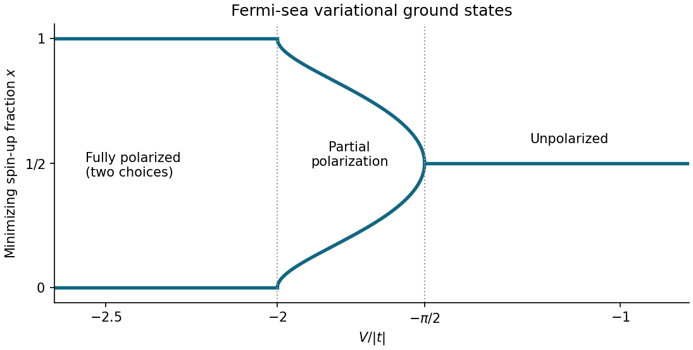

<h1 id="1/d/solution">Solution</h1>

↑ **Parent:** [D](../d.md)

At $N=M$, the two [spin](../../../../spin.md) occupations per site are $x$ and $1-x$. With $\tau=|t|>0$, the trial [energy](../../../../energy-split.md) per site is

$$
\boxed{e(x)=\frac{\langle H\rangle}{M}=-\frac{4\tau}{\pi}\sin(\pi x)+V\left[x^2+(1-x)^2-\frac{2\sin^2(\pi x)}{\pi^2}\right],\quad 0\leq x\leq1.}
$$

Its [derivative](../../../../derivative.md) is $e'(x)=-4\tau\cos(\pi x)+V[4x-2-(2/\pi)\sin(2\pi x)]$. Since $x=0$ is a boundary point, its [local minimum](../../../../local-minimum.md) test is one-sided: $e'(0)=-4\tau-2V$. At $V=-2\tau$, where this [derivative](../../../../derivative.md) vanishes, its [Taylor series](../../../../taylor-series.md) begins $e(x)-e(0)=(2\pi^2\tau/3)x^3+O(x^4)>0$ for small positive $x$. Hence

$$
\boxed{x=0\text{ is a strict one-sided local minimum exactly when }V/\tau\leq-2.}
$$

The same applies to $x=1$ by [spin](../../../../spin.md) interchange.

The [symmetry](../../../../symmetry-physics.md) $e(x)=e(1-x)$ makes $x=1/2$ a stationary point for every $V$. Here $e''(1/2)=4\pi\tau+8V$, so the [second-derivative test](../../../../second-derivative-test.md) settles all cases except equality. Writing $y=x-1/2$, at $V=-\pi\tau/2$ the [Taylor series](../../../../taylor-series.md) is $e(1/2+y)-e(1/2)=(\pi^3\tau/6)y^4+O(y^6)$. Thus

$$
\boxed{x=\tfrac12\text{ is a strict local minimum exactly when }V/\tau\geq-\pi/2;\quad V/\tau<-\pi/2\text{ makes it a local maximum}.}
$$

**The minimizing branches interpolate continuously.** To find all of them, put $u=\pi(1/2-x)$ on $0<x<1/2$. An interior stationary point obeys

$$
\frac V\tau=-\frac{\pi\sin u}{u+\sin u\cos u},\qquad 0<u<\frac\pi2.
$$

The right side decreases strictly from $-\pi/2$ to $-2$, since

$$
\frac{d}{du}\frac{\sin u}{u+\sin u\cos u}
=\frac{\cos u\,(u-\sin u\cos u)}{(u+\sin u\cos u)^2}>0.
$$

The positivity follows from $u-\sin u\cos u=\int_0^u2\sin^2v\,dv$. There is therefore exactly one such stationary point on each side of $1/2$ when $-2<V/\tau<-\pi/2$. The signs of $e'$ show that both are [global minima](../../../../global-minimum.md), whereas $1/2$ is then a [local maximum](../../../../local-maximum.md). The complete answer is

$$
\boxed{x_{\min}=\begin{cases}
0\text{ or }1,&V/\tau\leq-2,\\
\tfrac12\mp u/\pi,&-2<V/\tau<-\pi/2,\quad V/\tau=-\pi\sin u/(u+\sin u\cos u),\\
\tfrac12,&V/\tau\geq-\pi/2.
\end{cases}}
$$

The pair merges through a [supercritical pitchfork bifurcation](../../../../supercritical-pitchfork-bifurcation.md) at $V/\tau=-\pi/2$. Comparing only $e(0)$ and $e(1/2)$ would miss the intervening [ground states](../../../../ground-state.md) with partial [spin polarization](../../../../spin-polarization.md).

**[Figure 1](#1/d/image-minimizing-spin-fractions-in-the-restricted-fermi-sea-approximation). Minimizing spin fractions in the restricted Fermi-sea approximation**. Both symmetry-related global minima are plotted. The intermediate branches join the fully polarized endpoints continuously at $V/|t|=-2$ and merge at $V/|t|=-\pi/2$.

## ↑ Ancestors (12)

1. [D](../d.md)
2. [1](../../1.md)
3. [2025](../../../2025-split.md)
4. [Past exam of the quantum matter course of the University of Oxford](../../../split.md)
5. [Quantum matter course of the University of Oxford](../../../../quantum-matter-course-of-the-university-of-oxford.md)
6. [Year 4 of the mathematical and theoretical physics course of the University of Oxford](../../../../year-4-of-the-mathematical-and-theoretical-physics-course-of-the-university-of-oxford.md)
7. [Mathematical and theoretical physics course of the University of Oxford](../../../../mathematical-and-theoretical-physics-course-of-the-university-of-oxford.md)
8. [Undergraduate course of the University of Oxford](../../../../undergraduate-course-of-the-university-of-oxford.md)
9. [Course of the University of Oxford](../../../../course-of-the-university-of-oxford.md)
10. [University of Oxford](../../../../university-of-oxford-split.md)
11. [List of universities](../../../../list-of-universities.md)
12. [Codex Wiki](../../../../split.md)
