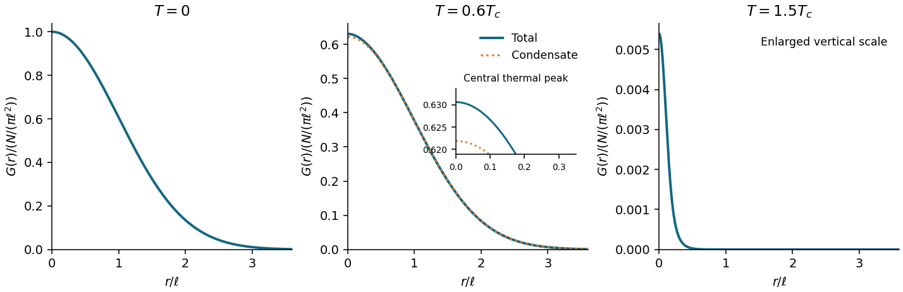

<h1 id="2/b/solution">Solution</h1>

↑ **Parent:** [B](../b.md)

Write $G(r)=\langle\psi^\dagger(0)\psi(\mathbf r)\rangle$, $r=|\mathbf r|$, and $\ell^2=\hbar/(m\omega)$. At zero [temperature](../../../../temperature-split.md) all $N$ particles occupy $\phi_0(\mathbf r)=(\ell\sqrt\pi)^{-1}e^{-r^2/(2\ell^2)}$. Expanding the [bosonic annihilation operator](../../../../bosonic-annihilation-operator.md) in single-particle [orbitals](../../../../single-particle-orbital.md) gives

$$
\boxed{G(r)=N\phi_0^*(0)\phi_0(\mathbf r)=\frac{N}{\pi\ell^2}\exp\!\left(-\frac{r^2}{2\ell^2}\right)\quad(T=0).}
$$

This [one-body density matrix](../../../../one-body-density-matrix.md) is a [Gaussian function](../../../../gaussian-function.md) of width $\ell$; it contains one [wavefunction](../../../../wave-function-split.md) evaluated at $r$, so its exponent is half that of the spatial [number density](../../../../number-density.md) $N|\phi_0(r)|^2$. In particular,

$$
\boxed{G(0)=\langle\psi^\dagger(0)\psi(0)\rangle=n(0),}
$$

the total [number density](../../../../number-density.md) at the trap centre, including condensed and noncondensed particles.

At positive [temperature](../../../../temperature-split.md), with occupations $\overline n_a$ of the trap [energy eigenstates](../../../../energy-eigenstate.md), the exact ideal-gas decomposition is

$$
G(r)=\frac{N_0}{\pi\ell^2}e^{-r^2/(2\ell^2)}+\sum_{a\ne0}\overline n_a\phi_a^*(0)\phi_a(\mathbf r).
$$

For $\hbar\omega\ll k_BT<k_BT_c$, the sketch has a broad [Bose-Einstein condensate](../../../../bose-einstein-condensate.md) component on scale $\ell$ and a narrower thermal peak near the origin. On approaching $T_c$ the broad component loses its weight $N_0$, while the thermal part remains. Above $T_c$ there is no macroscopic broad [Bose-Einstein condensate](../../../../bose-einstein-condensate.md) component; close to $T_c$, low [energy levels](../../../../energy-level.md) can still give a shoulder, so a single narrow [Gaussian function](../../../../gaussian-function.md) is only a high-[temperature](../../../../temperature-split.md) description. At $k_BT\lesssim\hbar\omega$ individual excited [energy levels](../../../../energy-level.md) matter and the two-scale description need not apply.

For $T\gg T_c$ the [Maxwell-Boltzmann distribution](../../../../maxwell-boltzmann-distribution.md) applies. The leading off-diagonal [one-body density matrix](../../../../one-body-density-matrix.md) is

$$
G(r)\simeq\frac{N\kappa}{2\pi k_BT}\exp\!\left(-\frac{mk_BT}{2\hbar^2}r^2\right),\qquad
\boxed{\sigma_r=\frac{\hbar}{\sqrt{mk_BT}}=\frac{\lambda_T}{\sqrt{2\pi}},\quad
\lambda_T=\sqrt{\frac{2\pi\hbar^2}{mk_BT}}.}
$$

Here $\sigma_r$ is the [Gaussian function](../../../../gaussian-function.md) width defined by $e^{-r^2/(2\sigma_r^2)}$, and $\lambda_T$ is the [thermal de Broglie wavelength](../../../../thermal-de-broglie-wavelength.md). The thermal cloud itself extends over the much larger spatial scale $\sqrt{k_BT/\kappa}$; this is a [correlation](../../../../pearson-correlation-coefficient.md) width, not the cloud radius.

**[Figure 2](#2/b/image-ideal-trapped-gas-one-body-correlations-across-condensation). Ideal trapped-gas one-body correlations across condensation**. Curves for $N=10^4$ use the discrete oscillator spectrum and its thermal kernel, with the chemical potential chosen to fix $N$. Each vertical axis shows $G(r)/(N/(\pi\ell^2))$; the last panel enlarges the vertical scale. The dotted curve below $T_c$ is the condensate contribution. The value of $T_c$ used in the labels is the leading large-$N$ expression.

## ↑ Ancestors (12)

1. [B](../b.md)
2. [2](../../2.md)
3. [2025](../../../2025-split.md)
4. [Past exam of the quantum matter course of the University of Oxford](../../../split.md)
5. [Quantum matter course of the University of Oxford](../../../../quantum-matter-course-of-the-university-of-oxford.md)
6. [Year 4 of the mathematical and theoretical physics course of the University of Oxford](../../../../year-4-of-the-mathematical-and-theoretical-physics-course-of-the-university-of-oxford.md)
7. [Mathematical and theoretical physics course of the University of Oxford](../../../../mathematical-and-theoretical-physics-course-of-the-university-of-oxford.md)
8. [Undergraduate course of the University of Oxford](../../../../undergraduate-course-of-the-university-of-oxford.md)
9. [Course of the University of Oxford](../../../../course-of-the-university-of-oxford.md)
10. [University of Oxford](../../../../university-of-oxford-split.md)
11. [List of universities](../../../../list-of-universities.md)
12. [Codex Wiki](../../../../split.md)
