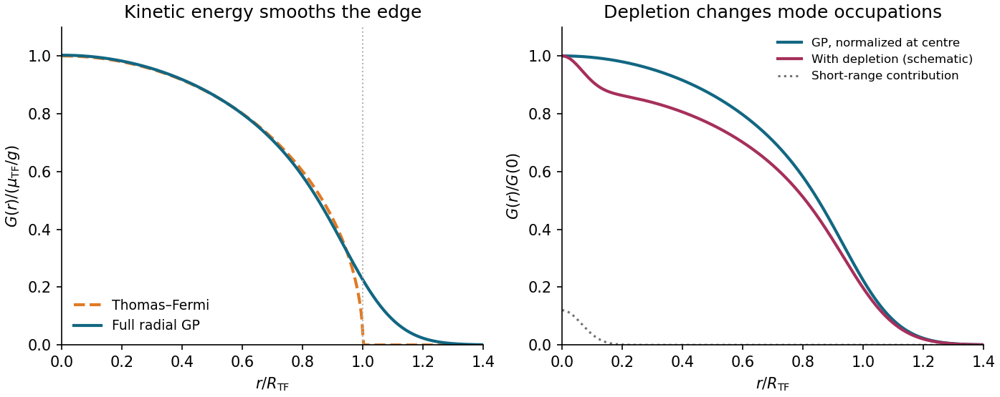

<h1 id="2/e/solution">Solution</h1>

↑ **Parent:** [E](../e.md)

The [Hartree product state](../../../../hartree-product-state.md) underlying the [Gross–Pitaevskii equation](../../../../gross-pitaevskii-equation.md) has the factorized [one-body coherence of a Hartree condensate](../../../../one-body-coherence-of-a-hartree-condensate.md). Choosing its nodeless [ground state](../../../../ground-state.md) [orbital](../../../../single-particle-orbital.md) real gives

$$
\boxed{G_{\mathrm{GP}}(r)=N\phi^*(0)\phi(r)=\sqrt{n(0)n(r)}.}
$$

In particular, the [Thomas–Fermi approximation for a condensate](../../../../thomas-fermi-approximation-for-a-condensate.md) from part (d) predicts

$$
\boxed{G_{\mathrm{TF}}(r)=\begin{cases}\displaystyle\frac\mu g\sqrt{1-r^2/R^2},&0\leq r<R,\\0,&r\geq R.\end{cases}}
$$

The curve starts at $\mu/g$, decreases with zero slope at the origin, and reaches zero with an infinite slope at $R$. Restoring the [kinetic energy](../../../../kinetic-energy.md) in the full [Gross–Pitaevskii equation](../../../../gross-pitaevskii-equation.md) rounds that edge and produces a nonzero tail. This corrects the [Thomas–Fermi approximation for a condensate](../../../../thomas-fermi-approximation-for-a-condensate.md), but the resulting [one-body density matrix](../../../../one-body-density-matrix.md) still factorizes.

**The additional missing physics is quantum depletion.** Interactions scatter pairs of [bosons](../../../../boson.md) into [orbitals](../../../../single-particle-orbital.md) outside the [Bose-Einstein condensate](../../../../bose-einstein-condensate.md) even at zero [temperature](../../../../temperature-split.md). In terms of the true [Bose-Einstein condensate](../../../../bose-einstein-condensate.md) [orbital](../../../../single-particle-orbital.md) $\varphi_0$ the exact [one-body density matrix](../../../../one-body-density-matrix.md) decomposes as

$$
G(r)=N_0\varphi_0^*(0)\varphi_0(r)+\rho_{\mathrm{ex}}(0,\mathbf r),\qquad N_0<N,
\qquad
G(0)=N_0|\varphi_0(0)|^2+n_{\mathrm{ex}}(0).
$$

The single-[orbital](../../../../single-particle-orbital.md) [Hartree product state](../../../../hartree-product-state.md) sets $N_0=N$ and omits $\rho_{\mathrm{ex}}$ altogether. In a [weakly interacting Bose gas](../../../../weakly-interacting-bose-gas.md), [Bogoliubov theory](../../../../bogoliubov-theory.md) adds a comparatively short-range noncondensed contribution near the origin, together with reduced weight in the broad [Bose-Einstein condensate](../../../../bose-einstein-condensate.md) component. The central value remains the total [number density](../../../../number-density.md), not just the [condensate density](../../../../condensate-density.md). Its numerical shift relative to the original [Gross–Pitaevskii equation](../../../../gross-pitaevskii-equation.md) solution also depends on the interaction-induced redistribution of [number density](../../../../number-density.md); it is not fixed by the [condensate fraction](../../../../condensate-fraction.md) alone.

**[Figure 3](#2/e/image-edge-smoothing-and-quantum-depletion-give-different-corrections-to-the-correlation). Edge smoothing and quantum depletion give different corrections to the correlation**. Left: a numerical radial Gross–Pitaevskii solution at $gN/(\hbar\omega\ell^2)=100\pi$ is compared with the Thomas–Fermi curve, each at the same $N$. Right: an illustrative depletion correction reduces the broad component and adds a narrow contribution, with the central density held fixed for comparison. Its weight and width are schematic, not a calculation of the exact interacting gas. Solving the full Gross–Pitaevskii equation accounts for the left correction only.

## ↑ Ancestors (12)

1. [E](../e.md)
2. [2](../../2.md)
3. [2025](../../../2025-split.md)
4. [Past exam of the quantum matter course of the University of Oxford](../../../split.md)
5. [Quantum matter course of the University of Oxford](../../../../quantum-matter-course-of-the-university-of-oxford.md)
6. [Year 4 of the mathematical and theoretical physics course of the University of Oxford](../../../../year-4-of-the-mathematical-and-theoretical-physics-course-of-the-university-of-oxford.md)
7. [Mathematical and theoretical physics course of the University of Oxford](../../../../mathematical-and-theoretical-physics-course-of-the-university-of-oxford.md)
8. [Undergraduate course of the University of Oxford](../../../../undergraduate-course-of-the-university-of-oxford.md)
9. [Course of the University of Oxford](../../../../course-of-the-university-of-oxford.md)
10. [University of Oxford](../../../../university-of-oxford-split.md)
11. [List of universities](../../../../list-of-universities.md)
12. [Codex Wiki](../../../../split.md)
