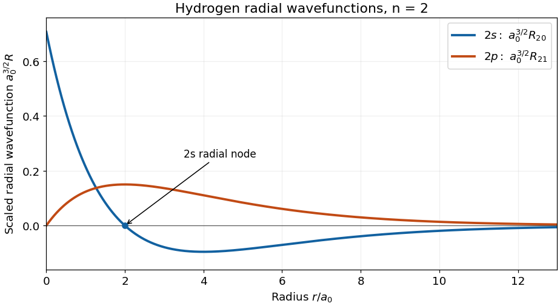
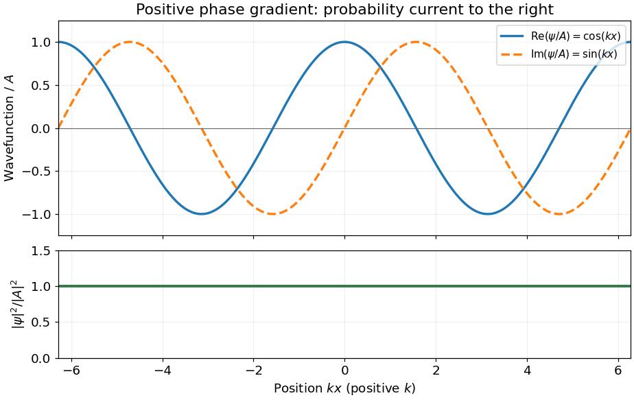
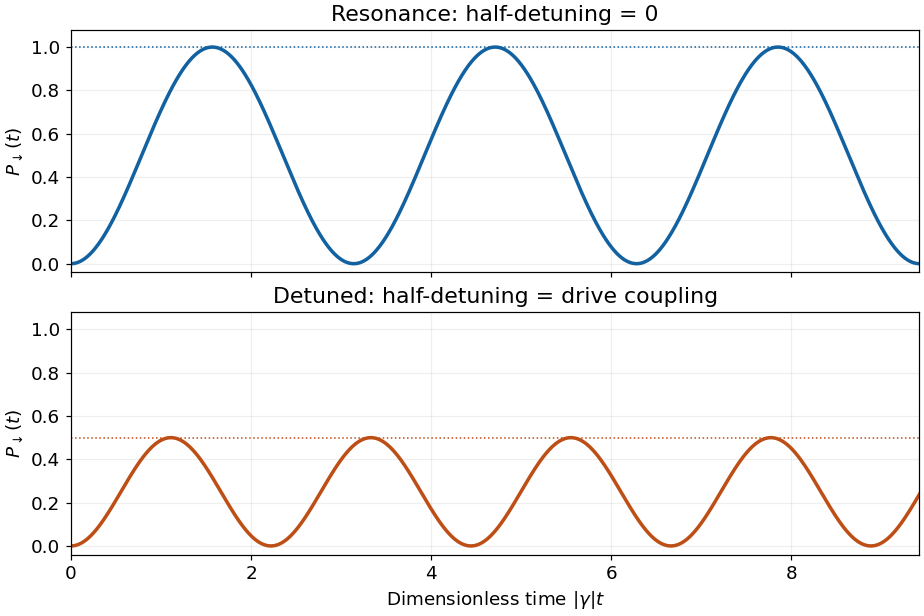

# 2016

↑ **Parent:** [Past exam of the quantum physics course of the University of Oxford](../past-exam-of-the-quantum-physics-course-of-the-university-of-oxford.md)

Source paper: [https://www.whatdotheyknow.com/request/physics_past_exam_papers_2015_16/response/973997/attach/3/Cowell%20Attachment.zip?cookie_passthrough=1](https://www.whatdotheyknow.com/request/physics_past_exam_papers_2015_16/response/973997/attach/3/Cowell%20Attachment.zip?cookie_passthrough=1) (member: Finals papers/A10431W1\_A3\_2016.pdf). The dated cover identifies the ordinary Part A sitting of 17 June 2016. All optional questions are included below. Lettered scopes separate successive marked blocks where the source leaves them unlettered.

**Table of contents**

- [1](#1)
  - [Solution](#1/solution)
- [2](#2)
  - [Solution](#2/solution)
- [3](#3)
  - [Solution](#3/solution)
- [4](#4)
  - [Solution](#4/solution)
- [5](#5)
  - [Solution](#5/solution)
- [6](#6)
  - [a](#6/a)
    - [Solution](#6/a/solution)
  - [b](#6/b)
    - [Solution](#6/b/solution)
- [7](#7)
  - [a](#7/a)
    - [Solution](#7/a/solution)
  - [b](#7/b)
    - [Solution](#7/b/solution)
  - [c](#7/c)
    - [Solution](#7/c/solution)
  - [d](#7/d)
    - [Solution](#7/d/solution)
- [8](#8)
  - [a](#8/a)
    - [Solution](#8/a/solution)
  - [b](#8/b)
    - [Solution](#8/b/solution)
  - [c](#8/c)
    - [Solution](#8/c/solution)
  - [d](#8/d)
    - [Solution](#8/d/solution)
- [9](#9)
  - [a](#9/a)
    - [Solution](#9/a/solution)
  - [b](#9/b)
    - [Solution](#9/b/solution)
  - [c](#9/c)
    - [Solution](#9/c/solution)
  - [d](#9/d)
    - [Solution](#9/d/solution)
- [10](#10)
  - [a](#10/a)
    - [Solution](#10/a/solution)
  - [b](#10/b)
    - [Solution](#10/b/solution)
  - [c](#10/c)
    - [Solution](#10/c/solution)
  - [d](#10/d)
    - [Solution](#10/d/solution)
  - [e](#10/e)
    - [a](#10/e/a)
      - [Solution](#10/e/a/solution)
    - [b](#10/e/b)
      - [Solution](#10/e/b/solution)

## 1

↑ **Parent:** [2016](2016.md)

<h3 id="1/solution">Solution</h3>

↑ **Parent:** [1](#1)

Insert [hydrogen](../chemical-substance.md#hydrogen) [energy eigenstates](../energy-eigenvalue.md#energy-eigenstate) on either side of the [commutator](../lie-algebra.md#commutator). Because $L_z$ is [Hermitian](../hilbert-space.md#hermitian-operator) and has [eigenvalue](../linear-operator-theory.md#eigenvalue) $\hbar m$,

$$
0=\langle nlm|[L_z,z]|nl'm'\rangle=\hbar(m-m')\langle nlm|z|nl'm'\rangle.
$$

Thus

$$
\boxed{\langle nlm|z|nl'm'\rangle\ne0\ \Longrightarrow\ m=m'.}
$$

This is a **necessary [electric-dipole selection rule](../quantum-mechanics.md#electric-dipole-selection-rule)**, not a sufficient condition for a nonzero [matrix element](../vector-space.md#matrix-element). For example, $\langle200|z|200\rangle=0$ by [parity](../quantum-mechanics.md#parity) even though $m=m'=0$. The angular factor $z=r\cos\theta$ additionally requires $l'=l\pm1$: multiplication of a [spherical harmonic](../analysis.md#spherical-harmonic) by $\cos\theta$ gives only harmonics with the same $m$ and adjacent $l$. The [commutator](../lie-algebra.md#commutator) alone establishes only the [magnetic quantum number](../quantum-mechanics.md#magnetic-quantum-number) restriction; radial [integrals](../integral.md) and the remaining [electric-dipole selection rules for hydrogen](../mathematical-physics.md#electric-dipole-selection-rules-for-hydrogen) must still be considered.

## 2

↑ **Parent:** [2016](2016.md)

<h3 id="2/solution">Solution</h3>

↑ **Parent:** [2](#2)

[Separation of variables](../partial-differential-equation.md#separation-of-variables) in the central [Coulomb potential](../electrostatics.md#coulomb-potential-energy) gives $\psi_{nlm}=R_{nl}(r)Y_l^m(\theta,\phi)$. The [radial wavefunction](../wave-function.md#radial-wavefunction) depends on **$n$ and $l$**, independently of $m$. For the [hydrogen radial wavefunction in the first excited shell](../mathematical-physics.md#hydrogen-radial-wavefunction-in-the-first-excited-shell), put $\rho=r/a_0$. The [Bohr radius](../mathematical-physics.md#bohr-radius) is $a_0=4\pi\epsilon_0\hbar^2/(\mu e^2)$, where $\mu$ is the [electron](../physics.md#electron)–[proton](../physics.md#proton) [reduced mass](../classical-mechanics.md#reduced-mass). Choose the real [phases](../wave.md#phase-waves)

$$
R_{20}=\frac{(2-\rho)e^{-\rho/2}}{2\sqrt2\,a_0^{3/2}},\qquad R_{21}=\frac{\rho e^{-\rho/2}}{\sqrt{24}\,a_0^{3/2}}.
$$

Near the origin, $R_{20}\to1/(\sqrt2a_0^{3/2})$, whereas $R_{21}\sim r/(\sqrt{24}a_0^{5/2})$. More generally, regular [hydrogen](../chemical-substance.md#hydrogen) [radial wavefunctions](../wave-function.md#radial-wavefunction) behave as $r^l$. At large $r$, both displayed functions have a [polynomial](../polynomial.md) factor proportional to $r$ multiplying $e^{-r/(2a_0)}$; $R_{20}$ approaches zero from below and $R_{21}$ from above with these [phase](../wave.md#phase-waves) choices.

The $2s$ [radial wavefunction](../wave-function.md#radial-wavefunction) crosses zero once, at $r=2a_0$, and has its negative minimum at $4a_0$. The $2p$ [radial wavefunction](../wave-function.md#radial-wavefunction) has no [radial node](../chemistry.md#radial-node) at positive $r$, and reaches its maximum at $2a_0$. The count is $n-l-1$; neither the origin nor the limit at infinity is counted as a [radial node](../chemistry.md#radial-node). These are sketches of $R$, rather than of $rR$ or the [radial probability density](../wave-function.md#radial-probability-density) $r^2|R|^2$.

**[Figure 1](#2/image-hydrogen-radial-wavefunctions-in-the-first-excited-shell). Hydrogen radial wavefunctions in the first excited shell**. The horizontal coordinate is measured in Bohr radii; the vertical coordinate is the radial wavefunction multiplied by the Bohr radius to the power three halves.

## 3

↑ **Parent:** [2016](2016.md)

<h3 id="3/solution">Solution</h3>

↑ **Parent:** [3](#3)

For the [Schrödinger equation](../mathematical-physics.md#schrodinger-equation) with a real [scalar potential](../classical-field-theory.md#scalar-potential) and no [vector potential](../multivariable-calculus.md#vector-potential), the [probability current](../wave-function.md#probability-current) is

$$
\mathbf j=\frac{\hbar}{2mi}(\Psi^*\nabla\Psi-\Psi\nabla\Psi^*)=\frac{\hbar}{m}\operatorname{Im}(\Psi^*\nabla\Psi).
$$

Together with the [probability density](../wave-function.md#probability-density) $\rho=|\Psi|^2$, it satisfies the [continuity equation](../mathematical-physics.md#continuity-equation) $\partial_t\rho+\nabla\cdot\mathbf j=0$. Substituting $\partial_x\Psi=ik\Psi$ gives

$$
\boxed{j=\frac{\hbar k}{m}|A|^2,\qquad \rho(x)=|A|^2,\qquad dP=|A|^2\,dx.}
$$

A complex [wavefunction](../wave-function.md) requires both its real and [imaginary parts](../complex-analysis.md#imaginary-part) in the sketch. Choosing the irrelevant constant [phase](../wave.md#phase-waves) so that $A$ is real, they are $A\cos kx$ and $A\sin kx$, while the [probability density](../wave-function.md#probability-density) is horizontal. It is the **[spatial phase gradient of a Schrodinger wavefunction](../wave-function.md#spatial-phase-gradient-of-a-schrodinger-wavefunction)** $\partial_x\arg\Psi=k$ that determines the sign of the [probability current](../wave-function.md#probability-current). In particular, $e^{ikx}$ and $e^{-ikx}$ have the same [real part](../complex-analysis.md#real-part) but opposite [probability currents](../wave-function.md#probability-current), so the slope of the [real part](../complex-analysis.md#real-part) cannot determine the direction.

A nonzero [plane wave](../wave-function.md#plane-wave) on the whole real line is not square integrable. The displayed density is understood with box [normalization](../mathematics.md#normalization), generalized [normalization](../mathematics.md#normalization), or as a local description of a broad [wave packet](../dispersion-relation.md#wave-packet); it does not define a normalized [probability distribution](../probability-distribution.md) on the whole line.

**[Figure 2](#3/image-complex-plane-wave-and-its-constant-probability-density). Complex plane wave and its constant probability density**. The plotted example has positive wavevector. Reversing the wavevector reverses the imaginary part and the probability current while preserving the real part and the probability density.

## 4

↑ **Parent:** [2016](2016.md)

<h3 id="4/solution">Solution</h3>

↑ **Parent:** [4](#4)

Use the [orthonormal](../inner-product.md#orthonormal-set) [energy eigenstates](../energy-eigenvalue.md#energy-eigenstate) of the [infinite square well](../quantum-mechanics.md#infinite-square-well),

$$
\phi_n(x)=\sqrt{\frac2a}\sin\frac{n\pi x}{a},\qquad E_n=n^2E_1,\qquad E_1=\frac{\pi^2\hbar^2}{2ma^2}.
$$

The identity $\sin u\cos u=\tfrac12\sin2u$ resolves the initial [wavefunction](../wave-function.md) into $\Psi(0)=(2\phi_1+\phi_2)/\sqrt5$. Each [energy eigenstate](../energy-eigenvalue.md#energy-eigenstate) acquires its own [dynamical phase](../quantum-system.md#dynamical-phase), so

$$
\boxed{\Psi(x,t_0)=\frac{2\phi_1(x)e^{-iE_1t_0/\hbar}+\phi_2(x)e^{-4iE_1t_0/\hbar}}{\sqrt5}}
$$

inside the well, and the [wavefunction](../wave-function.md) vanishes outside. The [energy](../energy.md) probabilities are $4/5$ and $1/5$ at every time. Consequently

$$
\boxed{\langle H\rangle_0=\langle H\rangle_{t_0}=\frac85E_1=\frac{4\pi^2\hbar^2}{5ma^2}.}
$$

For the left half, each diagonal [integral](../integral.md) $\int_0^{a/2}|\phi_n|^2dx$ is $1/2$, while

$$
\int_0^{a/2}\phi_1\phi_2\,dx=\frac4{3\pi}.
$$

The [interference](../physical-optics.md#interference-wave-propagation) term therefore yields

$$
\boxed{P_{\mathrm{left}}(t_0)=\frac12+\frac{16}{15\pi}\cos\frac{3E_1t_0}{\hbar}.}
$$

This [probability](../probability-theory.md#probability) lies between approximately $0.1605$ and $0.8395$, with [period](../mathematics.md#period-of-a-function) $2\pi\hbar/(3E_1)$. A conserved [energy](../energy.md) distribution is compatible with time-dependent position probabilities because the relative [quantum phase](../quantum-system.md#quantum-phase) keeps evolving.

## 5

↑ **Parent:** [2016](2016.md)

<h3 id="5/solution">Solution</h3>

↑ **Parent:** [5](#5)

Identify the nonrelativistic [mass](../classical-mechanics.md#mass) with the [rest mass](../special-relativity.md#invariant-mass), $m=m_0$. Expanding the [relativistic kinetic energy](../energy.md#relativistic-kinetic-energy) in $p^2/(m^2c^2)$ gives

$$
T=\frac{p^2}{2m}-\frac{p^4}{8m^3c^2}+O(c^{-4}),\qquad H'=-\frac{p^4}{8m^3c^2}.
$$

First-order [perturbation theory](../asymptotic-expansion.md#perturbation-theory) requires $\Delta E_0=\langle0|H'|0\rangle$. Put $\alpha=\sqrt{m\hbar\omega/2}$, so $p=i\alpha(a^\dagger-a)$. The annihilation relations are $a|0\rangle=0$ and $\langle0|a^\dagger=0$. In particular, $a^\dagger|0\rangle$ does **not** vanish. A short calculation retaining the operator ordering gives

$$
p^2|0\rangle=\alpha^2\bigl(|0\rangle-\sqrt2|2\rangle\bigr),\qquad
\langle0|p^4|0\rangle=\|p^2|0\rangle\|^2=3\alpha^4.
$$

Equivalently, of the ordered words in $(a^\dagger-a)^4$, only $aa^\dagger aa^\dagger$ and $aa a^\dagger a^\dagger$ have nonzero ground-state expectation values, respectively $1$ and $2$. Words with a [creation operator](../quantum-harmonic-oscillator.md#creation-operator) on the far left or an [annihilation operator](../quantum-harmonic-oscillator.md#annihilation-operator) on the far right vanish; the remaining unbalanced words also vanish. Thus

$$
\boxed{\Delta E_0=-\frac{3\hbar^2\omega^2}{32mc^2},\qquad E_0=\frac12\hbar\omega-\frac{3\hbar^2\omega^2}{32mc^2}+O(c^{-4}).}
$$

The correction is negative because the [relativistic kinetic energy](../energy.md#relativistic-kinetic-energy) is smaller than $p^2/(2m)$ at fixed nonzero [momentum](../momentum.md). This [relativistic oscillator ground-state kinetic correction](../quantum-harmonic-oscillator.md#relativistic-oscillator-ground-state-kinetic-correction) requires $\hbar\omega\ll mc^2$.

## 6

↑ **Parent:** [2016](2016.md)

<h3 id="6/a">a</h3>

↑ **Parent:** [6](#6)

<h4 id="6/a/solution">Solution</h4>

↑ **Parent:** [A](#6/a)

For two [spin one-half](../angular-momentum-operator.md#spin-one-half) particles, $s_1^2=s_2^2=3\hbar^2/4$. Squaring $\mathbf S=\mathbf s_1+\mathbf s_2$ gives

$$
\boxed{f=a+\frac b2\left(S^2-\frac32\hbar^2\right).}
$$

Take $a,b$ real so that $f$ is [Hermitian](../hilbert-space.md#hermitian-operator). Since $[S^2,S_z]=0$, the displayed [polynomial](../polynomial.md) implies $[f,S^2]=[f,S_z]=0$. There is a common [orthonormal](../inner-product.md#orthonormal-set) [eigenbasis](../linear-operator-theory.md#eigenbasis), so all three observables can be simultaneously certain **in a common [eigenstate](../energy-eigenvalue.md#eigenstate)**. Commutation does not mean that every [quantum superposition](../quantum-system.md#quantum-superposition) has definite values of all three.

<h3 id="6/b">b</h3>

↑ **Parent:** [6](#6)

<h4 id="6/b/solution">Solution</h4>

↑ **Parent:** [B](#6/b)

Suppress the fixed individual [quantum numbers](../quantum-system.md#quantum-number) $s_1=s_2=1/2$. In the coupled [basis](../vector-space.md#basis), ordered on both rows and columns as $|1,1\rangle,|1,0\rangle,|1,-1\rangle,|0,0\rangle$, the total-spin [eigenvalues](../linear-operator-theory.md#eigenvalue) give

$$
\boxed{[f]_{\mathrm{coupled}}=\operatorname{diag}\left(a+\frac{b\hbar^2}4,a+\frac{b\hbar^2}4,a+\frac{b\hbar^2}4,a-\frac{3b\hbar^2}4\right).}
$$

Here the first three entries form the [triplet state](../angular-momentum-operator.md#spin-one-half-triplet-state) sector and the last is the [singlet state](../angular-momentum-operator.md#singlet-state). For the product [basis](../vector-space.md#basis), use

$$
\mathbf s_1\cdot\mathbf s_2=s_{1z}s_{2z}+\frac12(s_{1+}s_{2-}+s_{1-}s_{2+}).
$$

The first term has diagonal entries $\hbar^2(1,-1,-1,1)/4$. Each nonzero exchange term flips $|\uparrow\downarrow\rangle$ to $|\downarrow\uparrow\rangle$ or back, with coefficient $\hbar^2/2$. With rows and columns ordered as $|\uparrow\uparrow\rangle,|\uparrow\downarrow\rangle,|\downarrow\uparrow\rangle,|\downarrow\downarrow\rangle$,

$$
\boxed{[f]_{\mathrm{product}}=aI+\frac{b\hbar^2}4\begin{pmatrix}1&0&0&0\\0&-1&2&0\\0&2&-1&0\\0&0&0&1\end{pmatrix}.}
$$

The [change of basis](../linear-algebra.md#change-of-basis) is made explicit by $|1,0\rangle=(|\uparrow\downarrow\rangle+|\downarrow\uparrow\rangle)/\sqrt2$ and $|0,0\rangle=(|\uparrow\downarrow\rangle-|\downarrow\uparrow\rangle)/\sqrt2$, with $|1,\pm1\rangle=|\uparrow\uparrow\rangle,|\downarrow\downarrow\rangle$. The resulting [eigenvalues](../linear-operator-theory.md#eigenvalue) reproduce the diagonal coupled [matrix](../vector-space.md#matrix).

## 7

↑ **Parent:** [2016](2016.md)

<h3 id="7/a">a</h3>

↑ **Parent:** [7](#7)

<h4 id="7/a/solution">Solution</h4>

↑ **Parent:** [A](#7/a)

The [spin](../angular-momentum-operator.md#spin) [Hilbert space](../hilbert-space.md) is a [tensor product](../multilinear-algebra.md#tensor-product) of two two-dimensional spaces and therefore has [dimension](../vector-space.md#dimension-vector-space) four. [Angular momentum addition](../momentum.md#angular-momentum-addition) decomposes it as

$$
\boxed{S=1:\ M_S=1,0,-1;\qquad S=0:\ M_S=0.}
$$

These are three [orthogonal](../inner-product.md#orthogonal-vectors) [triplet states](../angular-momentum-operator.md#spin-one-half-triplet-state) and one [singlet state](../angular-momentum-operator.md#singlet-state). For identical [electrons](../physics.md#electron) the **complete** [wavefunction](../wave-function.md) must also satisfy [fermionic exchange symmetry](../tensor-product-of-quantum-systems.md#fermi-dirac-statistics): a symmetric triplet [spin](../angular-momentum-operator.md#spin) factor accompanies an antisymmetric spatial factor, whereas the antisymmetric singlet [spin](../angular-momentum-operator.md#spin) factor accompanies a symmetric spatial factor. If both [electrons](../physics.md#electron) occupy the same [spatial orbital](../tensor-product-of-quantum-systems.md#spatial-orbital), only the singlet [spin](../angular-momentum-operator.md#spin) factor is allowed. The four-dimensional [spin](../angular-momentum-operator.md#spin) space does not assert four allowed [spin](../angular-momentum-operator.md#spin) states for that particular spatial occupation.

<h3 id="7/b">b</h3>

↑ **Parent:** [7](#7)

<h4 id="7/b/solution">Solution</h4>

↑ **Parent:** [B](#7/b)

Expanding the total [angular momentum](../momentum.md#angular-momentum) and replacing transverse components by [ladder operators](../semisimple-lie-algebra.md#ladder-operator) gives

$$
\boxed{S_z=s_{1z}+s_{2z},\qquad S^2=s_1^2+s_2^2+2s_{1z}s_{2z}+s_{1+}s_{2-}+s_{1-}s_{2+}.}
$$

The [particle exchange operator](../tensor-product-of-quantum-systems.md#particle-exchange-operator) obeys $P_{12}^2=I$ and $P_{12}s_{1\alpha}P_{12}=s_{2\alpha}$, with the reverse relation for index $2$. These statements also apply to the [ladder operators](../semisimple-lie-algebra.md#ladder-operator). Exchanging the indices preserves $s_1^2+s_2^2$ and $s_{1z}+s_{2z}$; it interchanges the last two terms in $S^2$. Operators on different tensor factors commute. Hence

$$
P_{12}S^2P_{12}=S^2,\qquad P_{12}S_zP_{12}=S_z,
\qquad\boxed{[P_{12},S^2]=[P_{12},S_z]=0.}
$$

The full particle exchange includes the [spin](../angular-momentum-operator.md#spin) coordinates as well as the spatial coordinates.

<h3 id="7/c">c</h3>

↑ **Parent:** [7](#7)

<h4 id="7/c/solution">Solution</h4>

↑ **Parent:** [C](#7/c)

Write $\Psi=(|\downarrow\uparrow\rangle+|\uparrow\downarrow\rangle)/\sqrt2$. Each term has cancelling $z$ components, so $S_z\Psi=0$. In the formula for $S^2$, the first three terms contribute $(3/2-1/2)\hbar^2\Psi=\hbar^2\Psi$. The two ladder products exchange the two terms and contribute another $\hbar^2\Psi$. Therefore

$$
\boxed{S^2\Psi=2\hbar^2\Psi,\quad S=1,\quad M_S=0,\quad P_{12}\Psi=+\Psi.}
$$

This [spin](../angular-momentum-operator.md#spin) state is symmetric; the accompanying spatial state must be antisymmetric for two [electrons](../physics.md#electron). A labelled product $|\downarrow_1\uparrow_2\rangle$ alone is not an [eigenstate](../energy-eigenvalue.md#eigenstate) of [spin](../angular-momentum-operator.md#spin) exchange: its exchanged [vector](../vector-space.md#vector) is [orthogonal](../inner-product.md#orthogonal-vectors) to it. Thus it cannot supply a definite exchange symmetry when multiplied by a fixed symmetric spatial factor.

This does **not** prohibit opposite [spins](../angular-momentum-operator.md#spin) in different [spatial orbitals](../tensor-product-of-quantum-systems.md#spatial-orbital). For example, with [orthonormal](../inner-product.md#orthonormal-set) orbitals $\phi_a,\phi_b$, the [Slater determinant](../tensor-product-of-quantum-systems.md#slater-determinant)

$$
\frac1{\sqrt2}\left[\phi_a(\mathbf r_1)\phi_b(\mathbf r_2)|\downarrow_1\uparrow_2\rangle-\phi_b(\mathbf r_1)\phi_a(\mathbf r_2)|\uparrow_1\downarrow_2\rangle\right]
$$

is a valid antisymmetric two-electron state. What fails is treating persistent particle labels as physically distinguishable identities without the required antisymmetrization.

<h3 id="7/d">d</h3>

↑ **Parent:** [7](#7)

<h4 id="7/d/solution">Solution</h4>

↑ **Parent:** [D](#7/d)

For a [conditional spin measurement of identical fermions](../tensor-product-of-quantum-systems.md#conditional-spin-measurement-of-identical-fermions) addressing the $z$ component in one spatial mode, the [Born rule](../wave-function.md#born-rule) gives

$$
\boxed{P(\uparrow)=\frac12.}
$$

Conditioned on this result, the mode [spin](../angular-momentum-operator.md#spin) state is $|\uparrow_a\downarrow_b\rangle$; the other outcome produces $|\downarrow_a\uparrow_b\rangle$. The [spin](../angular-momentum-operator.md#spin) product is not a spin-exchange [eigenstate](../energy-eigenvalue.md#eigenstate). The [measurement](../physics.md#measurement) has selected an addressed mode and recorded an outcome, so this conditional [spin](../angular-momentum-operator.md#spin) description distinguishes the measured subsystem.

The full [electron](../physics.md#electron) [wavefunction](../wave-function.md) still obeys [fermionic exchange symmetry](../tensor-product-of-quantum-systems.md#fermi-dirac-statistics). For example, the conditional spin-up outcome in spatial mode $a$ is represented in particle coordinates by

$$
\frac1{\sqrt2}\left[\phi_a(\mathbf r_1)\phi_b(\mathbf r_2)|\uparrow_1\downarrow_2\rangle-\phi_b(\mathbf r_1)\phi_a(\mathbf r_2)|\downarrow_1\uparrow_2\rangle\right].
$$

It is antisymmetric under full particle exchange. Thus the loss of a definite symmetry of the **conditional [spin](../angular-momentum-operator.md#spin) product** does not mean that [measurement](../physics.md#measurement) turns identical [electrons](../physics.md#electron) into distinguishable particles. If the outcome is discarded, the mode [spin](../angular-momentum-operator.md#spin) state is instead the equal [mixture](../mixture.md) of the two opposite-spin products. The [measurement](../physics.md#measurement) must specify which spatial mode is addressed for the conditional statement to be operationally meaningful.

## 8

↑ **Parent:** [2016](2016.md)

<h3 id="8/a">a</h3>

↑ **Parent:** [8](#8)

<h4 id="8/a/solution">Solution</h4>

↑ **Parent:** [A](#8/a)

Hermiticity of the Cartesian [angular momentum](../momentum.md#angular-momentum) components gives

$$
\boxed{L_+^\dagger=L_-,\qquad L_-^\dagger=L_+.}
$$

The [angular momentum commutation relations](../angular-momentum-operator.md#angular-momentum-commutation-relations) $[L_i,L_j]=i\hbar\epsilon_{ijk}L_k$ imply

$$
\boxed{[L^2,L_\pm]=0,\qquad [L_z,L_\pm]=\pm\hbar L_\pm.}
$$

For example, $[L_z,L_x+iL_y]=i\hbar L_y+\hbar L_x=\hbar L_+$. The two terms in $[L_x^2+L_y^2+L_z^2,L_i]$ cancel in pairs, giving the first [commutator](../lie-algebra.md#commutator). Also $[L_+,L_-]=2\hbar L_z$.

<h3 id="8/b">b</h3>

↑ **Parent:** [8](#8)

<h4 id="8/b/solution">Solution</h4>

↑ **Parent:** [B](#8/b)

The [spherical harmonics](../analysis.md#spherical-harmonic) satisfy

$$
L^2Y_l^m=\hbar^2l(l+1)Y_l^m,\qquad L_zY_l^m=\hbar mY_l^m,
\quad l=0,1,\ldots,\quad -l\le m\le l.
$$

Commuting $L^2$ or $L_z$ past $L_\pm$ therefore gives

$$
\boxed{L^2(L_\pm Y_l^m)=\hbar^2l(l+1)(L_\pm Y_l^m),\qquad L_z(L_\pm Y_l^m)=\hbar(m\pm1)(L_\pm Y_l^m).}
$$

For a nonzero result these are the [eigenvalue equations](../linear-operator-theory.md#eigenvalue-equation) with unchanged $l$ and shifted [magnetic quantum number](../quantum-mechanics.md#magnetic-quantum-number). Taking the squared [norm](../normed-vector-space.md#norm), using $L_\mp L_\pm=L^2-L_z^2\mp\hbar L_z$, fixes the conventional coefficient:

$$
L_\pm Y_l^m=\hbar\sqrt{l(l+1)-m(m\pm1)}\,Y_l^{m\pm1}.
$$

At the appropriate endpoint the coefficient is zero. The zero [vector](../vector-space.md#vector) is not itself an [eigenstate](../energy-eigenvalue.md#eigenstate).

<h3 id="8/c">c</h3>

↑ **Parent:** [8](#8)

<h4 id="8/c/solution">Solution</h4>

↑ **Parent:** [C](#8/c)

There is no allowed [spherical harmonic](../analysis.md#spherical-harmonic) with $m=l+1$, so $L_+Y_l^l=0$. The equation $-i\hbar\partial_\phi Y=\hbar lY$ first gives $Y=f(\theta)e^{il\phi}$. Combining the differential expressions for $L_x,L_y$ yields

$$
L_+=\hbar e^{i\phi}(\partial_\theta+i\cot\theta\,\partial_\phi).
$$

Its annihilation of the highest-weight state becomes

$$
f'(\theta)-l\cot\theta\,f(\theta)=0.
$$

Integrating $f'/f=l\cot\theta$ gives $f=C\sin^l\theta$, with the constant solution included for $l=0$. Hence

$$
\boxed{Y_l^l(\theta,\phi)=C\sin^l\theta\,e^{il\phi}.}
$$

The [phase](../wave.md#phase-waves) $e^{il\phi}$ is single valued for [integral](../integral.md) orbital [quantum number](../quantum-system.md#quantum-number) $l$; [normalization](../mathematics.md#normalization) fixes only $|C|$, leaving a conventional constant [phase](../wave.md#phase-waves).

<h3 id="8/d">d</h3>

↑ **Parent:** [8](#8)

<h4 id="8/d/solution">Solution</h4>

↑ **Parent:** [D](#8/d)

Direct [integration](../integral.md) over [solid angle](../euclidean-geometry.md#solid-angle) gives

$$
1=2\pi|C|^2\int_0^\pi\sin^{2l+1}\theta\,d\theta
=4\pi|C|^2\frac{(2^l l!)^2}{(2l+1)!}.
$$

Thus $|C|=\sqrt{(2l+1)!/(4\pi)}/(2^l l!)$. Choosing the usual alternating sign convention,

$$
\boxed{Y_l^l=(-1)^l\frac{\sqrt{(2l+1)!}}{2^l l!\sqrt{4\pi}}\sin^l\theta\,e^{il\phi}.}
$$

Apply $L_-$ successively and divide by its ladder coefficient at each step. Explicitly,

$$
\boxed{Y_l^m=\sqrt{\frac{(l+m)!}{(2l)!(l-m)!}}\,\hbar^{-(l-m)}(L_-)^{l-m}Y_l^l.}
$$

The [normalization](../mathematics.md#normalization) follows because the product of the squared ladder coefficients is $\hbar^{2(l-m)}(2l)!(l-m)!/(l+m)!$. This constructs every [magnetic sublevel](../quantum-mechanics.md#magnetic-sublevel), including negative $m$.

## 9

↑ **Parent:** [2016](2016.md)

<h3 id="9/a">a</h3>

↑ **Parent:** [9](#9)

<h4 id="9/a/solution">Solution</h4>

↑ **Parent:** [A](#9/a)

Separate the [center-of-mass motion](../classical-mechanics.md#center-of-mass-motion) from the [relative motion](../classical-mechanics.md#relative-motion). Two equal [quark](../standard-model.md#quark) masses give [reduced mass](../classical-mechanics.md#reduced-mass) $\mu=m_q/2$. Replacing the [hydrogen](../chemical-substance.md#hydrogen) Coulomb strength by $a>0$ gives the Coulomb binding energies and length scale

$$
\boxed{E_n^{(0)}=-\frac{m_q a^2}{4\hbar^2n^2},\qquad a_q=\frac{\hbar^2}{\mu a}=\frac{2\hbar^2}{m_q a}.}
$$

The factor of two in the [reduced mass](../classical-mechanics.md#reduced-mass) matters: using $m_q$ directly would double the [binding energy](../energy.md#binding-energy). These are relative binding energies measured from the free [quark](../standard-model.md#quark)–[antiquark](../standard-model.md#antiquark) threshold; the rest [energy](../energy.md) $2m_qc^2$ is excluded.

<h3 id="9/b">b</h3>

↑ **Parent:** [9](#9)

<h4 id="9/b/solution">Solution</h4>

↑ **Parent:** [B](#9/b)

Ignoring [spin](../angular-momentum-operator.md#spin) and working in the fixed [quarkonium](../physics.md#quarkonium) internal sector, the orbital degeneracy is $\sum_{l=0}^{n-1}(2l+1)=n^2$. Hence

$$
\boxed{g_1=1\quad(1s),\qquad g_2=4\quad(2s\text{ and three }2p\text{ states}).}
$$

No extra [spin](../angular-momentum-operator.md#spin) or colour multiplicity is being counted. The degeneracy between different $l$ at fixed $n$ is special to the [Coulomb potential](../electrostatics.md#coulomb-potential-energy).

<h3 id="9/c">c</h3>

↑ **Parent:** [9](#9)

<h4 id="9/c/solution">Solution</h4>

↑ **Parent:** [C](#9/c)

The [linear confinement correction to Coulomb bound states](../quantum-mechanics.md#linear-confinement-correction-to-coulomb-bound-states) uses $H'=br$, and its [first-order energy correction](../quantum-mechanics.md#first-order-energy-correction) in a normalized Coulomb [eigenstate](../energy-eigenvalue.md#eigenstate) is $b\langle r\rangle$. Replace $a_0$ by $a_q$ in the [hydrogen](../chemical-substance.md#hydrogen) [wavefunctions](../wave-function.md). The normalized [spherical harmonics](../analysis.md#spherical-harmonic) remove the angular [integral](../integral.md), leaving

$$
\langle r\rangle_{nl}=\int_0^\infty r^3|R_{nl}(r)|^2\,dr.
$$

For $1s$, the [integral](../integral.md) of $r^3e^{-2r/a_q}$ yields

$$
\langle r\rangle_{1s}=\frac4{a_q^3}\frac{3!}{(2/a_q)^4}=\frac32a_q.
$$

For $2s$, put $u=r/a_q$ and square the full radial [polynomial](../polynomial.md), including its cross term:

$$
\langle r\rangle_{2s}=\frac{a_q}{2}\int_0^\infty u^3\left(1-u+\frac{u^2}4\right)e^{-u}du
=\frac{a_q}{2}\left(3!-4!+\frac{5!}4\right)=6a_q.
$$

For $2p$, the same calculation gives

$$
\langle r\rangle_{2p}=\frac{a_q}{24}\int_0^\infty u^5e^{-u}du=5a_q.
$$

Consequently the first two Coulomb levels become, to first order,

$$
\boxed{\begin{aligned}
E_{1s}&=-\frac{m_qa^2}{4\hbar^2}+\frac32ba_q+O(b^2),\\
E_{2s}&=-\frac{m_qa^2}{16\hbar^2}+6ba_q+O(b^2),\\
E_{2p,m}&=-\frac{m_qa^2}{16\hbar^2}+5ba_q+O(b^2),\qquad m=-1,0,1.
\end{aligned}}
$$

Thus the second level splits into a singlet orbital level and a triply degenerate orbital level, with $E_{2s}-E_{2p}=ba_q+O(b^2)$. For the confining sign $b>0$, $2p$ lies lower than $2s$: its smaller mean radius gives the smaller positive correction. The expansion assumes these corrections and the induced couplings to other principal shells are small compared with the relevant Coulomb [energy](../energy.md) gaps; $ba_q^2/a\ll1$ is the governing small parameter for fixed low $n$.

<h3 id="9/d">d</h3>

↑ **Parent:** [9](#9)

<h4 id="9/d/solution">Solution</h4>

↑ **Parent:** [D](#9/d)

The unperturbed $n=2$ level **is degenerate**. The useful point is that a central perturbation is already diagonal within its usual orbital [eigenbasis](../linear-operator-theory.md#eigenbasis):

$$
\langle nlm|br|nl'm'\rangle
=b\left(\int_0^\infty r^3R_{nl}^*R_{nl'}\,dr\right)\delta_{ll'}\delta_{mm'}.
$$

Angular [orthogonality](../inner-product.md#orthogonal-vectors) removes the possible mixing of $2s$ and $2p$, and also the mixing of different [magnetic sublevels](../quantum-mechanics.md#magnetic-sublevel). Therefore the [matrix](../vector-space.md#matrix) required by [degenerate perturbation theory](../quantum-mechanics.md#degenerate-perturbation-theory) needs no further diagonalization: its diagonal entries are precisely the expectation values above. It would be incorrect to justify the calculation by claiming that the unperturbed spectrum was nondegenerate.

For $b=0$ the [energy](../energy.md) needs only $n$. For a nonzero central confinement term the [energy](../energy.md) generally needs **$n,l$**, but remains independent of $m$. The [magnetic quantum number](../quantum-mechanics.md#magnetic-quantum-number) is still needed to specify an individual orbital [eigenstate](../energy-eigenvalue.md#eigenstate), rather than just its [energy](../energy.md).

## 10

↑ **Parent:** [2016](2016.md)

<h3 id="10/a">a</h3>

↑ **Parent:** [10](#10)

<h4 id="10/a/solution">Solution</h4>

↑ **Parent:** [A](#10/a)

With $\mathbf B=B_0\hat{\mathbf z}$ and $S_z=(\hbar/2)\sigma_z$,

$$
H_0=\mu_BB_0\begin{pmatrix}1&0\\0&-1\end{pmatrix}.
$$

Thus

$$
\boxed{E_+=\mu_BB_0,\quad |+\rangle=\begin{pmatrix}1\\0\end{pmatrix};\qquad E_-=-\mu_BB_0,\quad |-\rangle=\begin{pmatrix}0\\1\end{pmatrix}.}
$$

For $B_0>0$, [spin](../angular-momentum-operator.md#spin) down is the lower [energy eigenstate](../energy-eigenvalue.md#energy-eigenstate). The negative [electron magnetic moment](../electromagnetism.md#electron-magnetic-moment) is already accounted for in the positive coefficient multiplying $\mathbf S\cdot\mathbf B$ in the given [Hamiltonian](../hamiltonian-mechanics.md#hamiltonian).

<h3 id="10/b">b</h3>

↑ **Parent:** [10](#10)

<h4 id="10/b/solution">Solution</h4>

↑ **Parent:** [B](#10/b)

In the ordered [basis](../vector-space.md#basis) $|+\rangle,|-\rangle$, the transverse [magnetic field](../magnetic-field.md) produces

$$
V(t)=\mu_BB_1(\sigma_x\cos\omega t+\sigma_y\sin\omega t)
=\boxed{\hbar\gamma\begin{pmatrix}0&e^{-i\omega t}\\e^{i\omega t}&0\end{pmatrix}},\qquad\gamma=\frac{\mu_BB_1}{\hbar}.
$$

The off-diagonal complex exponentials follow directly from $\cos\omega t\mp i\sin\omega t$. This [matrix](../vector-space.md#matrix) is [Hermitian](../hilbert-space.md#hermitian-operator) at every time.

<h3 id="10/c">c</h3>

↑ **Parent:** [10](#10)

<h4 id="10/c/solution">Solution</h4>

↑ **Parent:** [C](#10/c)

Insert the expansion with amplitudes $c_1,c_2$ and the two unperturbed [dynamical phases](../quantum-system.md#dynamical-phase) into $i\hbar\dot\Psi=(H_0+V)\Psi$. Differentiation of the explicit [phases](../wave.md#phase-waves) cancels $H_0$, leaving

$$
i\dot c_1=\gamma e^{-i(\omega-\omega_0)t}c_2,\qquad
i\dot c_2=\gamma e^{i(\omega-\omega_0)t}c_1,
\qquad\omega_0=\frac{2\mu_BB_0}{\hbar}.
$$

Equivalently, with $\Omega=(\omega-\omega_0)/2$,

$$
\boxed{\dot c_1=-i\gamma e^{-2i\Omega t}c_2,\qquad\dot c_2=-i\gamma e^{2i\Omega t}c_1.}
$$

These interaction-picture equations conserve $|c_1|^2+|c_2|^2$. They are exact for the [circularly rotating magnetic drive](../quantum-system.md#circularly-rotating-magnetic-drive); a [rotating-wave approximation](../quantum-mechanics.md#rotating-wave-approximation) has not been used.

<h3 id="10/d">d</h3>

↑ **Parent:** [10](#10)

<h4 id="10/d/solution">Solution</h4>

↑ **Parent:** [D](#10/d)

Differentiate $\dot c_2=-i\gamma e^{2i\Omega t}c_1$ and substitute the equation for $\dot c_1$. The result is

$$
\boxed{\ddot c_2-2i\Omega\dot c_2+\gamma^2c_2=0.}
$$

Putting $c_2=e^{i\Omega t}u$ removes the first [derivative](../calculus.md#derivative) and gives $\ddot u+\kappa^2u=0$, where $\kappa=\sqrt{\Omega^2+\gamma^2}$. For $\kappa>0$ the general solution is

$$
c_2=e^{i\Omega t}(A\cos\kappa t+B\sin\kappa t).
$$

The initial [spinor](../algebra-over-a-field.md#spinor) fixes $c_1(0)=1,c_2(0)=0$, and the **first-order coupled equation** fixes the second initial datum $\dot c_2(0)=-i\gamma$. Thus $A=0$, $B=-i\gamma/\kappa$, and

$$
\boxed{c_2(t)=-i\frac\gamma\kappa e^{i\Omega t}\sin\kappa t,\qquad c_1(t)=e^{-i\Omega t}\left(\cos\kappa t+i\frac\Omega\kappa\sin\kappa t\right).}
$$

Their squared magnitudes sum to one. If both $\Omega$ and $\gamma$ vanish, the initial amplitudes simply remain $(1,0)$; the formulas have that continuous limit.

**Source convention correction.** For positive $\gamma$, the printed expression for $c_2$ lacks the factor $-i$ required by the stated [basis](../vector-space.md#basis) and initial [vector](../vector-space.md#vector). A concrete test is its [derivative](../calculus.md#derivative) at $t=0$: the printed expression gives $+\gamma$, whereas the [Schrödinger equation](../mathematical-physics.md#schrodinger-equation) gives $-i\gamma$. Multiplying only $c_2$ by a [phase](../wave.md#phase-waves) changes the relative [quantum phase](../quantum-system.md#quantum-phase). One may change the overall [phase](../wave.md#phase-waves) of the entire [spinor](../algebra-over-a-field.md#spinor), but must then transform $c_1$ and its initial amplitude as well. The printed modulus nevertheless gives the correct [transition probability](../markov-chain.md#transition-probability).

<h3 id="10/e">e</h3>

↑ **Parent:** [10](#10)

<h4 id="10/e/a">a</h4>

↑ **Parent:** [E](#10/e)

<h5 id="10/e/a/solution">Solution</h5>

↑ **Parent:** [A](#10/e/a)

On Rabi resonance, $\omega=\omega_0$ and $\Omega=0$, so

$$
\boxed{P_-(t)=|c_2(t)|^2=\sin^2(\gamma t).}
$$

For nonzero drive the [probability](../probability-theory.md#probability) starts at zero, reaches unity at $t=\pi/(2|\gamma|)$, and repeats with [period](../mathematics.md#period-of-a-function) $\pi/|\gamma|$. The population oscillation therefore has [angular frequency](../lagrangian-mechanics.md#angular-frequency) $2|\gamma|$. This is complete resonant Rabi transfer; a drive of zero strength gives no transition.

**[Figure 3](#10/e/a/image-resonant-and-detuned-spin-transition-probabilities). Resonant and detuned spin transition probabilities**. The dimensionless time is the drive coupling times time. The detuned example uses half-detuning equal to the drive coupling, making the maximum transition probability one half.

<h4 id="10/e/b">b</h4>

↑ **Parent:** [E](#10/e)

<h5 id="10/e/b/solution">Solution</h5>

↑ **Parent:** [B](#10/e/b)

For nonzero [Rabi detuning](../quantum-system.md#rabi-detuning),

$$
\boxed{P_-(t)=\frac{\gamma^2}{\gamma^2+\Omega^2}\sin^2\left(\sqrt{\gamma^2+\Omega^2}\,t\right).}
$$

The sketch starts at zero and oscillates between zero and $\gamma^2/(\gamma^2+\Omega^2)<1$, with [period](../mathematics.md#period-of-a-function) $\pi/\sqrt{\gamma^2+\Omega^2}$ when the coupling is nonzero. Relative to resonance, the oscillations have a smaller maximum and a shorter [period](../mathematics.md#period-of-a-function) at fixed coupling. The sign of the [Rabi detuning](../quantum-system.md#rabi-detuning) changes the amplitudes' [phases](../wave.md#phase-waves) but leaves this [transition probability](../markov-chain.md#transition-probability) unchanged. For $|\Omega|\gg|\gamma|$, its maximum is approximately $\gamma^2/\Omega^2$, so population transfer is strongly suppressed. The plotted detuned example has $|\Omega|=|\gamma|$, giving maximum $1/2$.

## ↑ Ancestors (9)

1. [Past exam of the quantum physics course of the University of Oxford](../past-exam-of-the-quantum-physics-course-of-the-university-of-oxford.md)
2. [Quantum physics course of the University of Oxford](../university-of-oxford.md#quantum-physics-course-of-the-university-of-oxford)
3. [Year 2 of the physics course of the University of Oxford](../university-of-oxford.md#year-2-of-the-physics-course-of-the-university-of-oxford)
4. [Physics course of the University of Oxford](../university-of-oxford.md#physics-course-of-the-university-of-oxford)
5. [Undergraduate course of the University of Oxford](../university-of-oxford.md#undergraduate-course-of-the-university-of-oxford)
6. [Course of the University of Oxford](../university-of-oxford.md#course-of-the-university-of-oxford)
7. [University of Oxford](../university-of-oxford.md)
8. [List of universities](../README.md#list-of-universities)
9. [Codex Wiki](../README.md)
