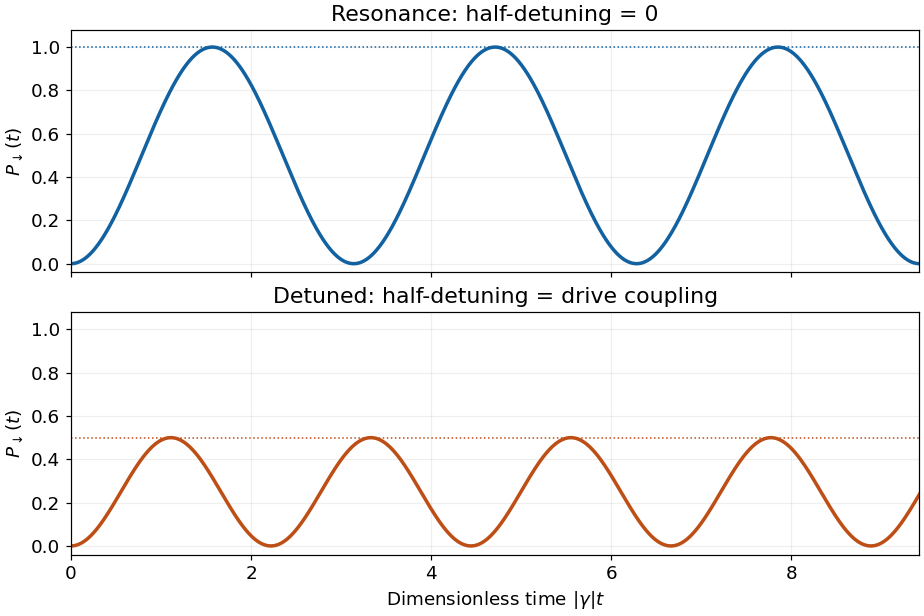

<h1 id="10/e/a/solution">Solution</h1>

↑ **Parent:** [A](../a.md)

On Rabi resonance, $\omega=\omega_0$ and $\Omega=0$, so

$$
\boxed{P_-(t)=|c_2(t)|^2=\sin^2(\gamma t).}
$$

For nonzero drive the [probability](../../../../../probability.md) starts at zero, reaches unity at $t=\pi/(2|\gamma|)$, and repeats with [period](../../../../../period-of-a-function.md) $\pi/|\gamma|$. The population oscillation therefore has [angular frequency](../../../../../angular-frequency.md) $2|\gamma|$. This is complete resonant Rabi transfer; a drive of zero strength gives no transition.

**[Figure 3](#10/e/a/image-resonant-and-detuned-spin-transition-probabilities). Resonant and detuned spin transition probabilities**. The dimensionless time is the drive coupling times time. The detuned example uses half-detuning equal to the drive coupling, making the maximum transition probability one half.

## ↑ Ancestors (13)

1. [A](../a.md)
2. [E](../../e.md)
3. [10](../../../10.md)
4. [2016](../../../../2016-split.md)
5. [Past exam of the quantum physics course of the University of Oxford](../../../../split.md)
6. [Quantum physics course of the University of Oxford](../../../../../quantum-physics-course-of-the-university-of-oxford.md)
7. [Year 2 of the physics course of the University of Oxford](../../../../../year-2-of-the-physics-course-of-the-university-of-oxford.md)
8. [Physics course of the University of Oxford](../../../../../physics-course-of-the-university-of-oxford.md)
9. [Undergraduate course of the University of Oxford](../../../../../undergraduate-course-of-the-university-of-oxford.md)
10. [Course of the University of Oxford](../../../../../course-of-the-university-of-oxford.md)
11. [University of Oxford](../../../../../university-of-oxford-split.md)
12. [List of universities](../../../../../list-of-universities.md)
13. [Codex Wiki](../../../../../split.md)
