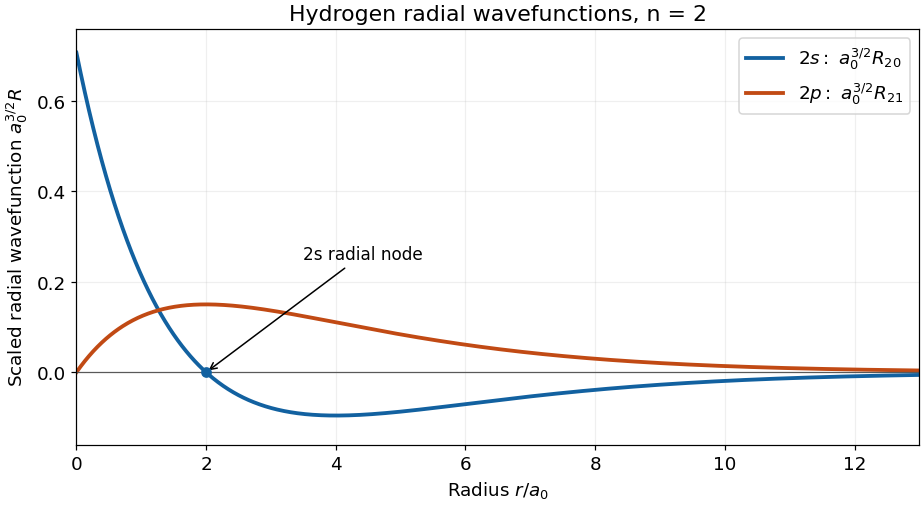

<h1 id="2/solution">Solution</h1>

↑ **Parent:** [2](../2.md)

[Separation of variables](../../../separation-of-variables.md) in the central [Coulomb potential](../../../coulomb-potential-energy.md) gives $\psi_{nlm}=R_{nl}(r)Y_l^m(\theta,\phi)$. The [radial wavefunction](../../../radial-wavefunction.md) depends on **$n$ and $l$**, independently of $m$. For the [hydrogen radial wavefunction in the first excited shell](../../../hydrogen-radial-wavefunction-in-the-first-excited-shell.md), put $\rho=r/a_0$. The [Bohr radius](../../../bohr-radius.md) is $a_0=4\pi\epsilon_0\hbar^2/(\mu e^2)$, where $\mu$ is the [electron](../../../electron.md)–[proton](../../../proton.md) [reduced mass](../../../reduced-mass.md). Choose the real [phases](../../../phase-waves.md)

$$
R_{20}=\frac{(2-\rho)e^{-\rho/2}}{2\sqrt2\,a_0^{3/2}},\qquad R_{21}=\frac{\rho e^{-\rho/2}}{\sqrt{24}\,a_0^{3/2}}.
$$

Near the origin, $R_{20}\to1/(\sqrt2a_0^{3/2})$, whereas $R_{21}\sim r/(\sqrt{24}a_0^{5/2})$. More generally, regular [hydrogen](../../../hydrogen.md) [radial wavefunctions](../../../radial-wavefunction.md) behave as $r^l$. At large $r$, both displayed functions have a [polynomial](../../../polynomial-split.md) factor proportional to $r$ multiplying $e^{-r/(2a_0)}$; $R_{20}$ approaches zero from below and $R_{21}$ from above with these [phase](../../../phase-waves.md) choices.

The $2s$ [radial wavefunction](../../../radial-wavefunction.md) crosses zero once, at $r=2a_0$, and has its negative minimum at $4a_0$. The $2p$ [radial wavefunction](../../../radial-wavefunction.md) has no [radial node](../../../radial-node.md) at positive $r$, and reaches its maximum at $2a_0$. The count is $n-l-1$; neither the origin nor the limit at infinity is counted as a [radial node](../../../radial-node.md). These are sketches of $R$, rather than of $rR$ or the [radial probability density](../../../radial-probability-density.md) $r^2|R|^2$.

**[Figure 1](#2/image-hydrogen-radial-wavefunctions-in-the-first-excited-shell). Hydrogen radial wavefunctions in the first excited shell**. The horizontal coordinate is measured in Bohr radii; the vertical coordinate is the radial wavefunction multiplied by the Bohr radius to the power three halves.

## ↑ Ancestors (11)

1. [2](../2.md)
2. [2016](../../2016-split.md)
3. [Past exam of the quantum physics course of the University of Oxford](../../split.md)
4. [Quantum physics course of the University of Oxford](../../../quantum-physics-course-of-the-university-of-oxford.md)
5. [Year 2 of the physics course of the University of Oxford](../../../year-2-of-the-physics-course-of-the-university-of-oxford.md)
6. [Physics course of the University of Oxford](../../../physics-course-of-the-university-of-oxford.md)
7. [Undergraduate course of the University of Oxford](../../../undergraduate-course-of-the-university-of-oxford.md)
8. [Course of the University of Oxford](../../../course-of-the-university-of-oxford.md)
9. [University of Oxford](../../../university-of-oxford-split.md)
10. [List of universities](../../../list-of-universities.md)
11. [Codex Wiki](../../../split.md)
