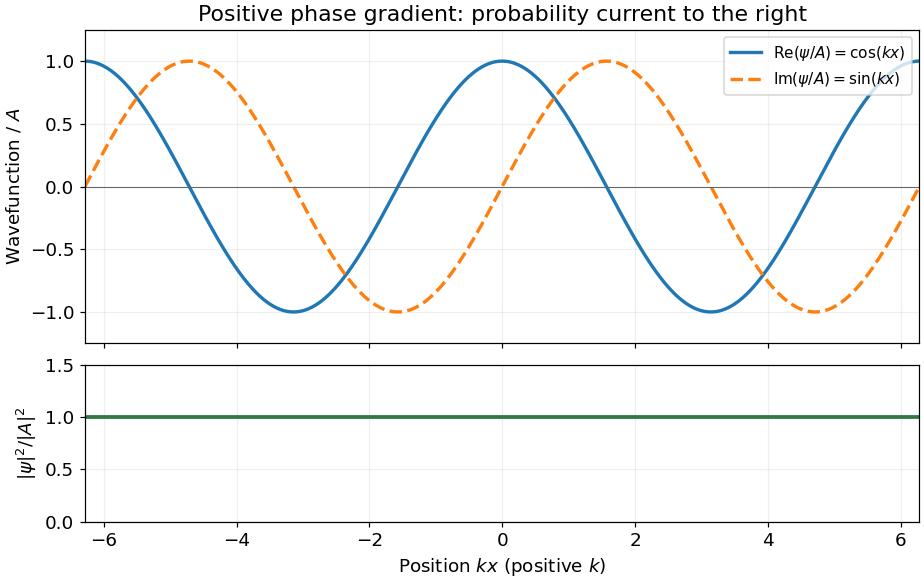

<h1 id="3/solution">Solution</h1>

↑ **Parent:** [3](../3.md)

For the [Schrödinger equation](../../../schrodinger-equation.md) with a real [scalar potential](../../../scalar-potential.md) and no [vector potential](../../../vector-potential.md), the [probability current](../../../probability-current.md) is

$$
\mathbf j=\frac{\hbar}{2mi}(\Psi^*\nabla\Psi-\Psi\nabla\Psi^*)=\frac{\hbar}{m}\operatorname{Im}(\Psi^*\nabla\Psi).
$$

Together with the [probability density](../../../probability-density.md) $\rho=|\Psi|^2$, it satisfies the [continuity equation](../../../continuity-equation.md) $\partial_t\rho+\nabla\cdot\mathbf j=0$. Substituting $\partial_x\Psi=ik\Psi$ gives

$$
\boxed{j=\frac{\hbar k}{m}|A|^2,\qquad \rho(x)=|A|^2,\qquad dP=|A|^2\,dx.}
$$

A complex [wavefunction](../../../wave-function-split.md) requires both its real and [imaginary parts](../../../imaginary-part.md) in the sketch. Choosing the irrelevant constant [phase](../../../phase-waves.md) so that $A$ is real, they are $A\cos kx$ and $A\sin kx$, while the [probability density](../../../probability-density.md) is horizontal. It is the **[spatial phase gradient of a Schrodinger wavefunction](../../../spatial-phase-gradient-of-a-schrodinger-wavefunction.md)** $\partial_x\arg\Psi=k$ that determines the sign of the [probability current](../../../probability-current.md). In particular, $e^{ikx}$ and $e^{-ikx}$ have the same [real part](../../../real-part.md) but opposite [probability currents](../../../probability-current.md), so the slope of the [real part](../../../real-part.md) cannot determine the direction.

A nonzero [plane wave](../../../plane-wave.md) on the whole real line is not square integrable. The displayed density is understood with box [normalization](../../../normalization.md), generalized [normalization](../../../normalization.md), or as a local description of a broad [wave packet](../../../wave-packet.md); it does not define a normalized [probability distribution](../../../probability-distribution-split.md) on the whole line.

**[Figure 2](#3/image-complex-plane-wave-and-its-constant-probability-density). Complex plane wave and its constant probability density**. The plotted example has positive wavevector. Reversing the wavevector reverses the imaginary part and the probability current while preserving the real part and the probability density.

## ↑ Ancestors (11)

1. [3](../3.md)
2. [2016](../../2016-split.md)
3. [Past exam of the quantum physics course of the University of Oxford](../../split.md)
4. [Quantum physics course of the University of Oxford](../../../quantum-physics-course-of-the-university-of-oxford.md)
5. [Year 2 of the physics course of the University of Oxford](../../../year-2-of-the-physics-course-of-the-university-of-oxford.md)
6. [Physics course of the University of Oxford](../../../physics-course-of-the-university-of-oxford.md)
7. [Undergraduate course of the University of Oxford](../../../undergraduate-course-of-the-university-of-oxford.md)
8. [Course of the University of Oxford](../../../course-of-the-university-of-oxford.md)
9. [University of Oxford](../../../university-of-oxford-split.md)
10. [List of universities](../../../list-of-universities.md)
11. [Codex Wiki](../../../split.md)
