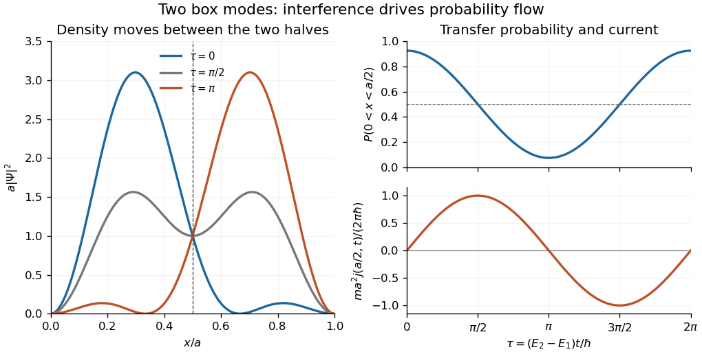

# 2014

↑ **Parent:** [Past exam of the quantum theory course of the University of Oxford](../past-exam-of-the-quantum-theory-course-of-the-university-of-oxford.md)

**Table of contents**

- [1](#1)
  - [a](#1/a)
    - [Solution](#1/a/solution)
  - [b](#1/b)
    - [Solution](#1/b/solution)
  - [c](#1/c)
    - [Solution](#1/c/solution)
  - [d](#1/d)
    - [Solution](#1/d/solution)
- [2](#2)
  - [a](#2/a)
    - [Solution](#2/a/solution)
  - [b](#2/b)
    - [Solution](#2/b/solution)
  - [c](#2/c)
    - [Solution](#2/c/solution)
  - [d](#2/d)
    - [Solution](#2/d/solution)
- [3](#3)
  - [a](#3/a)
    - [i](#3/a/i)
      - [Solution](#3/a/i/solution)
    - [ii](#3/a/ii)
      - [Solution](#3/a/ii/solution)
    - [iii](#3/a/iii)
      - [Solution](#3/a/iii/solution)
  - [b](#3/b)
    - [Solution](#3/b/solution)
  - [c](#3/c)
    - [Solution](#3/c/solution)

## 1

↑ **Parent:** [2014](2014.md)

<h3 id="1/a">a</h3>

↑ **Parent:** [1](#1)

<h4 id="1/a/solution">Solution</h4>

↑ **Parent:** [A](#1/a)

The [Time-dependent Schrödinger equation](../mathematical-physics.md#time-dependent-schrodinger-equation), with the [Hamiltonian](../hamiltonian-mechanics.md#hamiltonian) for a particle of [mass](../classical-mechanics.md#mass) $m$ in a real [potential energy](../energy.md#potential-energy) $V$, is

$$
i\hbar\frac{\partial\Psi}{\partial t}=H\Psi,\qquad H=-\frac{\hbar^2}{2m}\frac{\partial^2}{\partial x^2}+V(x).
$$

A [stationary state](../quantum-system.md#stationary-state) is an [energy eigenstate](../energy-eigenvalue.md#energy-eigenstate): its [wavefunction](../wave-function.md) evolves by a single [global phase](../quantum-system.md#global-phase),

$$
\Psi(x,t)=\psi(x)e^{-iEt/\hbar},\qquad \boxed{-\frac{\hbar^2}{2m}\psi''+V\psi=E\psi.}
$$

Its [probability density](../wave-function.md#probability-density) is independent of time. For a normalized [wavefunction](../wave-function.md), the [probability density](../wave-function.md#probability-density) and [probability current](../wave-function.md#probability-current) are

$$
\boxed{\rho=\Psi^*\Psi,\qquad j=\frac{\hbar}{2mi}(\Psi^*\partial_x\Psi-\Psi\partial_x\Psi^*)=\frac{\hbar}{m}\operatorname{Im}(\Psi^*\partial_x\Psi).}
$$

Subtracting the [complex conjugate](../complex-analysis.md#complex-conjugate) of the [Time-dependent Schrödinger equation](../mathematical-physics.md#time-dependent-schrodinger-equation), multiplied by $\Psi$, from the original equation multiplied by $\Psi^*$ cancels the real [potential energy](../energy.md#potential-energy) terms and gives the [continuity equation](../mathematical-physics.md#continuity-equation) $\partial_t\rho+\partial_xj=0$. Thus $j$ measures signed probability flow in the positive $x$ direction.

<h3 id="1/b">b</h3>

↑ **Parent:** [1](#1)

<h4 id="1/b/solution">Solution</h4>

↑ **Parent:** [B](#1/b)

Inside the [infinite square well](../quantum-mechanics.md#infinite-square-well), the [time-independent Schrödinger equation](../mathematical-physics.md#time-independent-schrodinger-equation) and [Dirichlet boundary conditions](../differential-equation.md#dirichlet-boundary-condition) are

$$
-\frac{\hbar^2}{2m}\psi''=E\psi\quad(0<x<a),\qquad \psi(0)=\psi(a)=0,
$$

and the [wavefunction](../wave-function.md) vanishes outside the interval. For a nonzero state, [integration by parts](../calculus.md#integration-by-parts) gives

$$
E\int_0^a|\psi|^2\,dx=\frac{\hbar^2}{2m}\int_0^a|\psi'|^2\,dx>0.
$$

The strict inequality follows because a function with zero derivative and zero endpoint values is zero. Put $k=\sqrt{2mE}/\hbar$. The general solution is $A\sin kx+B\cos kx$; the first [boundary condition](../differential-equation.md#boundary-condition) gives $B=0$, and the second gives $ka=n\pi$, $n=1,2,\ldots$. Since $\int_0^a\sin^2(n\pi x/a)\,dx=a/2$, the normalized [energy eigenstates](../energy-eigenvalue.md#energy-eigenstate) and [eigenvalues](../linear-operator-theory.md#eigenvalue) are

$$
\boxed{\psi_n(x)=\sqrt{\frac2a}\sin\frac{n\pi x}{a},\qquad E_n=\frac{n^2\pi^2\hbar^2}{2ma^2},\quad n\geq1.}
$$

The normalization fixes the magnitude of the coefficient; its arbitrary [global phase](../quantum-system.md#global-phase) has been chosen real and positive.

<h3 id="1/c">c</h3>

↑ **Parent:** [1](#1)

<h4 id="1/c/solution">Solution</h4>

↑ **Parent:** [C](#1/c)

The initial [quantum state](../quantum-system.md#quantum-state) is the [equal superposition of the first two box states](../quantum-mechanics.md#equal-superposition-of-the-first-two-box-states), $(\psi_1+\psi_2)/\sqrt2$. The [orthonormality](../inner-product.md#orthonormal-set) of the two [energy eigenstates](../energy-eigenvalue.md#energy-eigenstate) makes its squared [norm](../normed-vector-space.md#norm) equal to one. Their separate [stationary state](../quantum-system.md#stationary-state) phases give

$$
\boxed{\Psi(x,t)=\frac1{\sqrt a}\left[\sin\frac{\pi x}{a}e^{-iE_1t/\hbar}+\sin\frac{2\pi x}{a}e^{-iE_2t/\hbar}\right].}
$$

Write $\Omega=(E_2-E_1)/\hbar=3\pi^2\hbar/(2ma^2)$. The [probability density](../wave-function.md#probability-density) is

$$
\rho(x,t)=\frac1a\left[\sin^2\frac{\pi x}a+\sin^2\frac{2\pi x}a+2\sin\frac{\pi x}a\sin\frac{2\pi x}a\cos\Omega t\right].
$$

Each squared sine integrates to $a/4$ on the left half. For the [quantum interference](../quantum-system.md#quantum-interference) term, the product-to-sum identity gives

$$
\int_0^{a/2}\sin\frac{\pi x}a\sin\frac{2\pi x}a\,dx=\frac12\int_0^{a/2}\left(\cos\frac{\pi x}a-\cos\frac{3\pi x}a\right)dx=\frac{2a}{3\pi}.
$$

Hence the [Born rule](../wave-function.md#born-rule) gives

$$
\boxed{P_{\mathrm L}(t)=\int_0^{a/2}\rho(x,t)\,dx=\frac12+\frac4{3\pi}\cos\Omega t.}
$$

The [quantum interference](../quantum-system.md#quantum-interference) moves probability between the halves even though each component separately is a [stationary state](../quantum-system.md#stationary-state).

<h3 id="1/d">d</h3>

↑ **Parent:** [1](#1)

<h4 id="1/d/solution">Solution</h4>

↑ **Parent:** [D](#1/d)

At the midpoint the second sine vanishes, whereas the derivative of the first sine vanishes. Thus the [wavefunction](../wave-function.md) and its spatial derivative simplify to

$$
\Psi(a/2,t)=\frac{e^{-iE_1t/\hbar}}{\sqrt a},\qquad \partial_x\Psi(a/2,t)=-\frac{2\pi}{a^{3/2}}e^{-iE_2t/\hbar}.
$$

Substitution in the [probability current](../wave-function.md#probability-current) gives

$$
\boxed{j(a/2,t)=\frac{2\pi\hbar}{ma^2}\sin\Omega t.}
$$

The [continuity equation](../mathematical-physics.md#continuity-equation), integrated over the left half, gives $P_{\mathrm L}'(t)=j(0,t)-j(a/2,t)$. The [Dirichlet boundary condition](../differential-equation.md#dirichlet-boundary-condition) makes $j(0,t)=0$, and the preceding [probability](../probability-theory.md#probability) formula gives

$$
P_{\mathrm L}'(t)=-\frac{4\Omega}{3\pi}\sin\Omega t=-\frac{2\pi\hbar}{ma^2}\sin\Omega t=-j(a/2,t).
$$

**Positive midpoint current removes probability from the left half.** This is precisely the [midpoint current of a two-mode box state](../quantum-mechanics.md#midpoint-current-of-a-two-mode-box-state).

**[Figure 1](#1/d/image-interference-between-the-first-two-box-modes-transfers-probability-between-the-two-halves-midpoint-current-is-minus-the-derivative-of-left-half-probability). Interference between the first two box modes transfers probability between the two halves; midpoint current is minus the derivative of left-half probability**.

## 2

↑ **Parent:** [2014](2014.md)

<h3 id="2/a">a</h3>

↑ **Parent:** [2](#2)

<h4 id="2/a/solution">Solution</h4>

↑ **Parent:** [A](#2/a)

The dimensionless coordinate for the [quantum harmonic oscillator](../quantum-harmonic-oscillator.md) gives $d/dx=\sqrt{m\omega/\hbar}\,d/d\xi$. The [time-independent Schrödinger equation](../mathematical-physics.md#time-independent-schrodinger-equation) therefore becomes

$$
-\psi_{\xi\xi}+\xi^2\psi=\frac{2E}{\hbar\omega}\psi.
$$

For $\psi=e^{-\xi^2/2}f$, direct [differentiation](../calculus.md#differentiation) yields

$$
\psi_{\xi\xi}=e^{-\xi^2/2}\left[f''-2\xi f'+(\xi^2-1)f\right].
$$

Cancelling the nonzero exponential reduces the equation to the [Hermite differential equation](../analysis.md#hermite-differential-equation)

$$
f''-2\xi f'+(\epsilon-1)f=0,\qquad \boxed{\epsilon=\frac{2E}{\hbar\omega}.}
$$

<h3 id="2/b">b</h3>

↑ **Parent:** [2](#2)

<h4 id="2/b/solution">Solution</h4>

↑ **Parent:** [B](#2/b)

Substitute the [power series](../sequence-and-series.md#power-series) and collect each power of $\xi$:

$$
\sum_{k\geq0}\left[(k+2)(k+1)a_{k+2}+(\epsilon-1-2k)a_k\right]\xi^k=0.
$$

Matching the [power series](../sequence-and-series.md#power-series) coefficients gives the [recurrence relation](../sequence-and-series.md#recurrence-relation)

$$
\boxed{a_{k+2}=\frac{2k+1-\epsilon}{(k+2)(k+1)}a_k,\qquad k=0,1,2,\ldots.}
$$

The [even](../calculus.md#even-function) and [odd](../calculus.md#odd-function) coefficients form separate sequences, determined by $a_0$ and $a_1$, respectively. For example, $a_2=(1-\epsilon)a_0/2$ and $a_3=(3-\epsilon)a_1/6$. These are the two independent [power series solutions of the Hermite differential equation](../analysis.md#power-series-solutions-of-the-hermite-differential-equation).

<h3 id="2/c">c</h3>

↑ **Parent:** [2](#2)

<h4 id="2/c/solution">Solution</h4>

↑ **Parent:** [C](#2/c)

The issue is the [square-integrable](../measure-theory.md#square-integrable-function) condition on the whole real line, not just decay at one end. Because the [quantum harmonic oscillator](../quantum-harmonic-oscillator.md) potential is [even](../calculus.md#even-function), the even and odd parts of a square-integrable [wavefunction](../wave-function.md) are themselves square integrable and satisfy the same equation. It is therefore enough to examine each parity sequence separately.

For a nonterminating sequence, put $b_j=a_{2j+p}$, where $p=0$ or $1$. Its [recurrence relation](../sequence-and-series.md#recurrence-relation) gives

$$
\frac{b_{j+1}}{b_j}=\frac{4j+2p+1-\epsilon}{(2j+p+2)(2j+p+1)}\sim\frac1j.
$$

Since $\epsilon$ is real for an [energy eigenvalue](../energy-eigenvalue.md), the ratio is eventually positive. After multiplying by one constant phase, the tail coefficients are all positive. Choose $0<\delta<1/2$. For sufficiently large $j$, the ratio is at least $(1-\delta)/(j+1)$, so for some $K>0$ the tail coefficients obey $b_j\geq K(1-\delta)^j/j!$. Consequently, for $\xi>0$, the magnitude of $f$ eventually exceeds a positive multiple of $\xi^p e^{(1-\delta)\xi^2}$ after subtraction of a fixed [polynomial](../polynomial.md). Multiplication by $e^{-\xi^2/2}$ leaves exponential growth like $e^{(1/2-\delta)\xi^2}$, incompatible with the [square-integrable](../measure-theory.md#square-integrable-function) condition. Thus each nonzero parity series must terminate. The parity argument also excludes cancellation between the two nonterminating sequences at both infinities. This proves [Normalization forces Hermite-series termination](../analysis.md#normalization-forces-hermite-series-termination).

If the terminating [polynomial](../polynomial.md) has degree $n$, its top nonzero coefficient requires $2n+1-\epsilon=0$. Conversely, when $\epsilon=2n+1$, choosing the seed of parity $n$ nonzero makes the [recurrence relation](../sequence-and-series.md#recurrence-relation) terminate exactly at degree $n$. The opposite seed must be zero, since that sequence does not terminate. Therefore

$$
\boxed{E_n=\left(n+\frac12\right)\hbar\omega,\qquad n=0,1,2,\ldots.}
$$

The resulting [polynomials](../polynomial.md) are proportional to the physicists' [Hermite polynomials](../orthogonal-polynomial.md#hermite-polynomial), and $\psi_n\propto H_n(\xi)e^{-\xi^2/2}$ is normalizable because any [polynomial](../polynomial.md) times this [Gaussian function](../calculus.md#gaussian-function) is square integrable. The two parity seeds describe the full solution space of the second-order [differential equation](../differential-equation.md); the preceding argument therefore exhausts the normalizable [stationary states](../quantum-system.md#stationary-state). Each [eigenspace](../linear-operator-theory.md#eigenspace) has dimension one. General time-dependent [quantum states](../quantum-system.md#quantum-state) can of course be [superpositions](../vector-space.md#superposition-principle) of these [energy eigenstates](../energy-eigenvalue.md#energy-eigenstate).

<h3 id="2/d">d</h3>

↑ **Parent:** [2](#2)

<h4 id="2/d/solution">Solution</h4>

↑ **Parent:** [D](#2/d)

For a normalized [wavefunction](../wave-function.md), the [expectation value](../quantum-system.md#expectation-value) of a function of [position](../classical-mechanics.md#position) is

$$
\mathbb E_\psi(g(x))=\int_{-\infty}^{\infty}g(x)|\psi(x)|^2\,dx,
$$

provided the integral exists. For an unnormalized state, divide this expression by $\int|\psi|^2dx$. Put $b=m\omega/\hbar>0$. The [ground state](../quantum-mechanics.md#ground-state) has [probability density](../wave-function.md#probability-density) $\sqrt{b/\pi}\,e^{-bx^2}$, which is [even](../calculus.md#even-function). Thus

$$
\mathbb E_{\psi_0}(|x|)=2\sqrt{\frac b\pi}\int_0^\infty xe^{-bx^2}\,dx=2\sqrt{\frac b\pi}\left[-\frac{e^{-bx^2}}{2b}\right]_0^\infty=\boxed{\sqrt{\frac{\hbar}{\pi m\omega}}}.
$$

The zero mean [position](../classical-mechanics.md#position) $\mathbb E_{\psi_0}(x)=0$ expresses symmetry, whereas this positive [expectation value](../quantum-system.md#expectation-value) measures the mean distance from the centre.

## 3

↑ **Parent:** [2014](2014.md)

<h3 id="3/a">a</h3>

↑ **Parent:** [3](#3)

<h4 id="3/a/i">i</h4>

↑ **Parent:** [A](#3/a)

<h5 id="3/a/i/solution">Solution</h5>

↑ **Parent:** [I](#3/a/i)

The [commutator](../lie-algebra.md#commutator) of two [linear operators](../vector-space.md#linear-operator) is $\boxed{[A,B]=AB-BA}$. Write $T^\dagger$ for the [adjoint operator](../hilbert-space.md#adjoint-operator), using the [inner product](../inner-product.md) convention linear in its second argument. Since $A^\dagger=A$ and $B^\dagger=B$,

$$
[A,B]^\dagger=B^\dagger A^\dagger-A^\dagger B^\dagger=BA-AB=-[A,B].
$$

Thus the [commutator](../lie-algebra.md#commutator) is anti-self-adjoint. With $C=-i[A,B]$, conjugation of the scalar gives

$$
\boxed{C^\dagger=i[A,B]^\dagger=-i[A,B]=C.}
$$

All products are understood on the stated common [operator domain](../vector-space.md#operator-domain); for physical unbounded [linear operators](../vector-space.md#linear-operator), the state must lie in the relevant product domains and have the finite moments used below.

<h4 id="3/a/ii">ii</h4>

↑ **Parent:** [A](#3/a)

<h5 id="3/a/ii/solution">Solution</h5>

↑ **Parent:** [Ii](#3/a/ii)

A normalized [quantum state](../quantum-system.md#quantum-state) satisfies $\langle\psi,\psi\rangle=1$. Its [expectation value](../quantum-system.md#expectation-value) is $\boxed{\mathbb E_\psi(A)=\langle\psi,A\psi\rangle}$. The conjugate symmetry of the [inner product](../inner-product.md) and [self-adjointness](../linear-operator-theory.md#self-adjoint-operator) give

$$
\overline{\langle\psi,A\psi\rangle}=\langle A\psi,\psi\rangle=\langle\psi,A\psi\rangle,
$$

so the [expectation value](../quantum-system.md#expectation-value) is real. If $A\phi=\lambda\phi$ with $\phi\ne0$, normalize $\phi$ by dividing by its [norm](../normed-vector-space.md#norm). Then

$$
\lambda=\langle\phi/\|\phi\|,A\phi/\|\phi\|\rangle\in\mathbb R.
$$

**Every eigenvalue of a self-adjoint operator is real.**

<h4 id="3/a/iii">iii</h4>

↑ **Parent:** [A](#3/a)

<h5 id="3/a/iii/solution">Solution</h5>

↑ **Parent:** [Iii](#3/a/iii)

Let $a=\mathbb E_\psi(A)$, which is real. The dispersion, or [quantum uncertainty](../quantum-system.md#quantum-uncertainty), is the nonnegative [standard deviation](../variance.md#standard-deviation)

$$
\boxed{\Delta_\psi(A)=\sqrt{\mathbb E_\psi(A^2)-\mathbb E_\psi(A)^2}=\|(A-aI)\psi\|.}
$$

Indeed, [self-adjointness](../linear-operator-theory.md#self-adjoint-operator) and normalization give

$$
\|(A-aI)\psi\|^2=\langle\psi,(A-aI)^2\psi\rangle=\mathbb E_\psi(A^2)-2a\mathbb E_\psi(A)+a^2=\mathbb E_\psi(A^2)-a^2.
$$

A squared [norm](../normed-vector-space.md#norm) is nonnegative, so the [square root](../algebra.md#square-root) is defined. It vanishes precisely when $(A-aI)\psi=0$, namely when $\psi$ is an [eigenvector](../linear-operator-theory.md#eigenvector) of $A$. Conversely, an [eigenvector](../linear-operator-theory.md#eigenvector) with [eigenvalue](../linear-operator-theory.md#eigenvalue) $\lambda$ has $a=\lambda$ and hence zero dispersion. Thus **zero dispersion is equivalent to being an eigenstate**.

<h3 id="3/b">b</h3>

↑ **Parent:** [3](#3)

<h4 id="3/b/solution">Solution</h4>

↑ **Parent:** [B](#3/b)

Set $u=A\psi$, $v=B\psi$ and $z=\langle u,v\rangle$. The [self-adjointness](../linear-operator-theory.md#self-adjoint-operator) of $A,B$ implies

$$
z=\langle\psi,AB\psi\rangle,\qquad \overline z=\langle\psi,BA\psi\rangle,\qquad \mathbb E_\psi(C)=-i(z-\overline z)=2\operatorname{Im}z.
$$

The [Cauchy-Schwarz inequality](../probability-and-statistics.md#cauchy-schwarz-inequality) followed by $|z|^2\geq(\operatorname{Im}z)^2$ gives

$$
\mathbb E_\psi(A^2)\mathbb E_\psi(B^2)=\|u\|^2\|v\|^2\geq|z|^2\geq(\operatorname{Im}z)^2=\boxed{\frac14\bigl(\mathbb E_\psi(C)\bigr)^2}.
$$

Both inequalities must be equalities. The exact conditions are **$A\psi$ and $B\psi$ are linearly dependent, and $\operatorname{Re}\langle A\psi,B\psi\rangle=0$**. Equivalently, equality holds if either vector is zero; when both are nonzero it holds precisely when

$$
\boxed{B\psi=i\lambda A\psi\quad\text{for some real }\lambda\ne0.}
$$

The zero-vector cases matter: they saturate the inequality but cannot all be expressed by solving for $B\psi$ as a multiple of $A\psi$. The real-part condition can also be written $\mathbb E_\psi(AB+BA)=0$, using the [anticommutator](../vector-space.md#anticommutator). This is the [uncentered second-moment commutator inequality](../quantum-theory.md#uncentered-second-moment-commutator-inequality).

<h3 id="3/c">c</h3>

↑ **Parent:** [3](#3)

<h4 id="3/c/solution">Solution</h4>

↑ **Parent:** [C](#3/c)

Centre the [position operator](../quantum-mechanics.md#position-operator) and [momentum operator](../quantum-mechanics.md#momentum-operator) by their real [expectation values](../quantum-system.md#expectation-value):

$$
A=X-x_0I,\quad B=P-p_0I,\qquad x_0=\mathbb E_\psi(X),\quad p_0=\mathbb E_\psi(P).
$$

Scalar multiples of the [identity operator](../vector-space.md#identity-operator) commute with every [linear operator](../vector-space.md#linear-operator), so the [canonical commutation relation](../quantum-mechanics.md#canonical-commutation-relation) gives

$$
[A,B]=[X,P]=i\hbar I,\qquad C=\hbar I,\qquad \mathbb E_\psi(C)=\hbar.
$$

The second moments of the centred [linear operators](../vector-space.md#linear-operator) are the [variances](../variance.md), $\mathbb E_\psi(A^2)=\Delta_\psi(X)^2$ and $\mathbb E_\psi(B^2)=\Delta_\psi(P)^2$. Applying the preceding inequality and taking nonnegative square roots proves the [Heisenberg uncertainty relation](../quantum-theory.md#heisenberg-uncertainty-relation):

$$
\Delta_\psi(X)^2\Delta_\psi(P)^2\geq\frac{\hbar^2}4,\qquad \boxed{\Delta_\psi(X)\Delta_\psi(P)\geq\frac\hbar2.}
$$

**Subtracting the means is essential**: the uncentred second moments alone do not equal the [variances](../variance.md). The [equality case of the Heisenberg uncertainty relation](../quantum-theory.md#equality-case-of-the-heisenberg-uncertainty-relation) requires the centred vectors to be imaginary multiples, as in the preceding equality conditions.

## ↑ Ancestors (9)

1. [Past exam of the quantum theory course of the University of Oxford](../past-exam-of-the-quantum-theory-course-of-the-university-of-oxford.md)
2. [Quantum theory course of the University of Oxford](../university-of-oxford.md#quantum-theory-course-of-the-university-of-oxford)
3. [Year 2 of the mathematics course of the University of Oxford](../university-of-oxford.md#year-2-of-the-mathematics-course-of-the-university-of-oxford)
4. [Mathematics course of the University of Oxford](../university-of-oxford.md#mathematics-course-of-the-university-of-oxford)
5. [Undergraduate course of the University of Oxford](../university-of-oxford.md#undergraduate-course-of-the-university-of-oxford)
6. [Course of the University of Oxford](../university-of-oxford.md#course-of-the-university-of-oxford)
7. [University of Oxford](../university-of-oxford.md)
8. [List of universities](../README.md#list-of-universities)
9. [Codex Wiki](../README.md)
